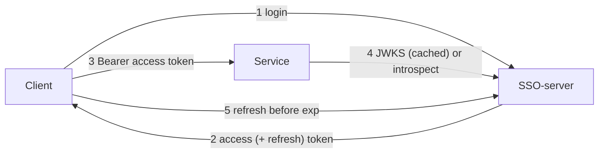

# SSO-server API Reference Manual

For developers of **clients** (browser SPAs, native apps, scripts, MCP clients, server-side "BFF" apps) and
**services** (back-ends that accept SSO tokens). As-built reference: branch `feat/app-permissions`; every
implemented fact here comes from `ssoproject/urls.py`, `sso/*.py` and `application/*.py` and matches
[ARCHITECTURE.md](ARCHITECTURE.md) §8–9. Items marked **Planned v1.2a/b** or **v1.4** are designs from
[DESIGN-v1.2-requirements.md](DESIGN-v1.2-requirements.md) and do **not** exist yet.

## Contents

- [1. Basics](#1-basics)
- [2. Client developers](#2-client-developers)
- [3. Service developers](#3-service-developers)
- [4. Endpoint reference](#4-endpoint-reference)
- [5. Token claims](#5-token-claims)
- [6. Error codes](#6-error-codes)
- [7. Planned v1.2 features](#7-planned-v12-features)
- [8. Planned admin REST API (v1.3a, proposal)](#8-planned-admin-rest-api-v13a-proposal)

## 1. Basics

- Base URL = the SSO issuer, e.g. `https://sso.example.com`. No trailing slashes on paths.
- JSON only: send `Content-Type: application/json` (else 415), accept JSON (else 406).
- Errors are always `{"error": "<code>", "detail": "<text>"}`.
- Tokens: RS256 JWTs with `kid` header. Access token 15 min (`expires_in: 900` by default), refresh token 7 days,
  rotated on every refresh (the old one is blacklisted).
- Rate limits (defaults): login 10/min per IP and 5/min per username; refresh + logout 60/min per IP. 429 carries
  `Retry-After`.



## 2. Client developers

### 2.1 Choose a mode

| Client | Mode | Refresh token lives in |
|---|---|---|
| Browser SPA on an origin in `SSO_CORS_ALLOWED_ORIGINS` | `"client": "browser"` (default) | HttpOnly cookie `sso_refresh`, path `/api/v1/auth/` |
| Native app, CLI, script, MCP client | `"client": "native"` | response body; store it securely (OS keychain) |
| Server-side web app (BFF, e.g. llm-wiki-svc) | native + ServiceClient Basic + `client_ip` | your server-side session store |

Keep the access token in memory only. Never put tokens in `localStorage` or URLs.

### 2.2 Login

curl (native):

```bash
curl -sS https://sso.example.com/api/v1/auth/login \
  -H 'Content-Type: application/json' \
  -d '{"username":"thomas","password":"correct horse","client":"native"}'
```

Response 200:

```json
{
  "access_token": "eyJ...", "token_type": "Bearer", "expires_in": 900,
  "user": {"id": 42, "username": "thomas", "email": "thomas@example.com", "first_name": "Thomas",
           "last_name": "Choi", "is_staff": false, "groups": ["trader"], "perms": ["application.app1"]},
  "refresh_token": "eyJ..."
}
```

`username` may also be an email address (case-insensitive, must match exactly one user).

JavaScript (browser SPA, cookie mode):

```js
const SSO = "https://sso.example.com";
let accessToken = null, expiresAt = 0;

async function login(username, password) {
  const r = await fetch(`${SSO}/api/v1/auth/login`, {
    method: "POST", credentials: "include",
    headers: { "Content-Type": "application/json" },
    body: JSON.stringify({ username, password }),          // client defaults to "browser"
  });
  const body = await r.json();
  if (!r.ok) throw Object.assign(new Error(body.detail), { code: body.error, status: r.status,
                                   retryAfter: r.headers.get("Retry-After") });
  accessToken = body.access_token;
  expiresAt = Date.now() + body.expires_in * 1000;
  return body.user;
}
```

Python (native):

```python
import requests
SSO = "https://sso.example.com"

def login(username: str, password: str) -> dict:
    r = requests.post(f"{SSO}/api/v1/auth/login", timeout=10,
                      json={"username": username, "password": password, "client": "native"})
    if r.status_code != 200:
        raise RuntimeError(f"{r.status_code} {r.json().get('error')}")
    return r.json()          # access_token, refresh_token, expires_in, user
```

BFF login on behalf of a browser (your app is a registered ServiceClient):

```bash
curl -sS https://sso.example.com/api/v1/auth/login -u 'llm-wiki:<client_secret>' \
  -H 'Content-Type: application/json' \
  -d '{"username":"thomas","password":"...","client":"native","client_ip":"203.0.113.7"}'
```

With Basic auth the `client_ip` is used for the per-IP throttle and the login log. A Basic header that is not an
active ServiceClient gives 401 `invalid_client`; a non-IP `client_ip` gives 400. Without Basic, `client_ip` is
ignored. Send Basic + `client_ip` on `/refresh` and `/logout` as well.

### 2.3 Refresh

Refresh shortly before `expires_in` runs out (e.g. 60 s before) or after a 401 from a service.

```bash
curl -sS https://sso.example.com/api/v1/auth/refresh -H 'Content-Type: application/json' \
  -d '{"refresh_token":"eyJ..."}'
```

Returns the same shape as login with a **new** refresh token: always replace the stored one. Re-using the old one
gives 401 `token_invalid`.

Browser (cookie mode, body `{}`; the browser sends the cookie and `Origin`):

```js
async function refresh() {
  const r = await fetch(`${SSO}/api/v1/auth/refresh`, {
    method: "POST", credentials: "include",
    headers: { "Content-Type": "application/json" }, body: "{}",
  });
  if (r.status === 401 || r.status === 403) { accessToken = null; return false; }  // log in again
  if (!r.ok) throw new Error(`refresh failed ${r.status}`);                          // 429/5xx: retry later
  const b = await r.json();
  accessToken = b.access_token; expiresAt = Date.now() + b.expires_in * 1000;
  return true;
}
```

Call `refresh()` on page load to restore a session silently. Two tabs refreshing at once: one wins, the other gets
401 (the SSO does not coordinate tabs). Serialise refreshes, e.g. with `navigator.locks.request("sso-refresh", …)`
or a `BroadcastChannel`.

Python:

```python
def refresh(rt: str) -> dict:
    r = requests.post(f"{SSO}/api/v1/auth/refresh", json={"refresh_token": rt}, timeout=10)
    if r.status_code in (401, 403):
        raise PermissionError("login required")
    r.raise_for_status()
    return r.json()          # store r["refresh_token"] immediately
```

### 2.4 Calling a service

```bash
curl -H "Authorization: Bearer $ACCESS" https://reporting.example.com/api/data
```

On 401 from a service: refresh once and retry once. On 403: the user lacks the app permission; do not retry.

### 2.5 Current user

`GET /api/v1/auth/me` with `Authorization: Bearer <access>` returns the `user` object, re-read from the database
(current groups and perms).

### 2.6 Logout

```bash
# this device
curl -sS -o /dev/null -w '%{http_code}\n' https://sso.example.com/api/v1/auth/logout \
  -H 'Content-Type: application/json' -d '{"refresh_token":"eyJ..."}'        # 204
# everywhere
curl -sS -X POST https://sso.example.com/api/v1/auth/logout-all -H "Authorization: Bearer $ACCESS"   # 204
```

Browser: `fetch(SSO + "/api/v1/auth/logout", {method:"POST", credentials:"include", headers:{"Content-Type":
"application/json"}, body:"{}"})`; the cookie is cleared. Then drop the in-memory access token. Logout does not
invalidate access tokens already issued (they live until `exp`, ≤ 15 min) except for services that introspect;
`logout-all` makes them fail at `/me`, `/refresh` and introspect.

### 2.7 Error handling and retry

| Status | `error` | Client action |
|---|---|---|
| 400 | `invalid_request` | fix the request, do not retry |
| 401 | `invalid_credentials` | show "wrong username or password" |
| 401 | `token_invalid` | refresh once; if refresh also fails, log in again |
| 401 | `invalid_client` | BFF misconfiguration (client id/secret) |
| 403 | `account_inactive` | account suspended; log out, show message |
| 403 | `origin_not_allowed` | SPA origin not in `SSO_CORS_ALLOWED_ORIGINS` (configuration) |
| 429 | `rate_limited` | wait `Retry-After` seconds; never retry login in a loop |
| 5xx / timeout | `server_error` or none | retry idempotent calls with exponential backoff + jitter (1, 2, 4 … max 60 s); keep the user's current access token until it expires |

Do not retry `/refresh` blindly after a timeout: the SSO may have rotated the token. Retry once with the same token;
if that gives 401, log in again.

```python
import random, time
def with_backoff(call, tries=5):
    for i in range(tries):
        try:
            r = call()
        except requests.ConnectionError:
            r = None
        if r is not None and r.status_code == 429:
            time.sleep(int(r.headers.get("Retry-After", "1"))); continue
        if r is not None and r.status_code < 500:
            return r
        time.sleep(min(60, 2 ** i) + random.random())
    raise RuntimeError("SSO unavailable")
```

## 3. Service developers

> **v1.2b — Python library (implemented, `clients/python/`, version 0.1.0).** Python services should use the
> `sso-client` package (`import sso_client`),
> which derives the client IP from the socket peer and trusted proxies, and wraps introspection, caching and
> permission checks (`@require_permission`). See [SSO-CLIENT-LIBRARY-DESIGN.md](SSO-CLIENT-LIBRARY-DESIGN.md) and
> [client-IP rules](DESIGN-v1.2-requirements.md#45-how-the-client-ip-is-determined). The raw HTTP API below
> stays the contract for non-Python services. Library decisions: package `sso-client` (import `sso_client`;
> `nm-sso-client` kept as an alternative name), source in `clients/python/` of this repo, installed with `pip`
> from git; fail-closed 503 when the SSO is unreachable; caches only `active:true` answers for 30 s; uses httpx.
> Install: `pip install "sso-client[fastapi] @ git+https://github.com/Neural-Matrix-LLC/SSO-server.git@<tag or branch>#subdirectory=clients/python"`;
> usage in [clients/python/README.md](../clients/python/README.md).

### 3.1 Register your service

Ask an SSO admin to run (or do it in the admin UI at `/<SSO_ADMIN_PATH>`):

```bash
python manage.py register_service reporting --name "Reporting" --app app2 \
    --app-name "Can use app2 (reporting)"      # creates application.app2 if missing; prints client_secret once
```

(v1.2a. Equivalent two-step form: `create_app_permission app2 "…"` then `create_service_client reporting
--name "Reporting" --app app2`. In the admin: *Application permissions → Add*, then *Service clients → Add* with
"App codename" `app2`.) Then grant `application.app2` to users or groups in the admin (actions *Grant app
access…* on the user or group list). Codenames match `^[a-z][a-z0-9_]{1,62}$`.
You receive: issuer, JWKS URL (`<issuer>/.well-known/jwks.json`), audience (`myfin-services` unless configured
otherwise; one token is valid for all services), `client_id` / `client_secret`, and your permission name.
`--notify-url` stores your future webhook endpoint (HTTPS); nothing is sent before v1.4.

### 3.2 Verify tokens locally (JWKS)

Checklist:

1. `Authorization: Bearer <token>` present, else 401.
2. Unverified header: `alg == "RS256"` and `kid` present.
3. Key by `kid` from a cached JWKS (cache 1 h; refetch on unknown `kid` at most once per 60 s; keep old keys if the
   fetch fails).
4. Verify signature, `iss`, `aud`, `exp` with 30 s leeway; require `exp, iat, sub, iss, aud`.
5. `token_type == "access"` (refresh tokens are also signed and carry `aud`).
6. Authorise: `"application.<app>" in perms`, else **403** (not 401).

Python (PyJWT ≥ 2.8, `pip install "pyjwt[crypto]"`):

```python
import jwt
from jwt import PyJWKClient

ISSUER = "https://sso.example.com"
AUDIENCE = "myfin-services"
REQUIRED = "application.app2"
jwks = PyJWKClient(f"{ISSUER}/.well-known/jwks.json", cache_keys=True, lifespan=3600)

class Unauthorized(Exception): pass
class Forbidden(Exception): pass

def verify(auth_header: str | None) -> dict:
    if not auth_header or not auth_header.startswith("Bearer "):
        raise Unauthorized("missing bearer")
    token = auth_header[7:]
    try:
        hdr = jwt.get_unverified_header(token)
        if hdr.get("alg") != "RS256" or not hdr.get("kid"):
            raise Unauthorized("bad header")
        key = jwks.get_signing_key(hdr["kid"]).key       # refetches on unknown kid
        claims = jwt.decode(token, key, algorithms=["RS256"], audience=AUDIENCE, issuer=ISSUER,
                            leeway=30, options={"require": ["exp", "iat", "sub", "iss", "aud"]})
    except jwt.PyJWTError as e:
        raise Unauthorized(str(e))
    if claims.get("token_type") != "access":
        raise Unauthorized("not an access token")
    if REQUIRED not in claims.get("perms", []):
        raise Forbidden("missing " + REQUIRED)
    return claims
```

A fuller reference with refetch rate limiting is `examples/verifier/sso_verifier.py` in this repo.

Node.js (`npm i jose`):

```js
import { createRemoteJWKSet, jwtVerify } from "jose";
const ISSUER = "https://sso.example.com";
const JWKS = createRemoteJWKSet(new URL(`${ISSUER}/.well-known/jwks.json`),
                                { cacheMaxAge: 3600_000, cooldownDuration: 60_000 });

export async function verify(authHeader, required = "application.app2") {
  if (!authHeader?.startsWith("Bearer ")) return { status: 401 };
  try {
    const { payload } = await jwtVerify(authHeader.slice(7), JWKS, {
      issuer: ISSUER, audience: "myfin-services", algorithms: ["RS256"], clockTolerance: 30,
      requiredClaims: ["exp", "iat", "sub"],
    });
    if (payload.token_type !== "access") return { status: 401 };
    if (!(payload.perms ?? []).includes(required)) return { status: 403 };
    return { status: 200, claims: payload };
  } catch { return { status: 401 }; }
}
```

401 responses should carry `WWW-Authenticate: Bearer realm="<your app>", error="invalid_token"`.

### 3.3 Introspection (revocation-aware)

Local verification cannot see logout-all, suspension, password change or a permission removal before `exp`
(≤ 15 min). For sensitive operations call introspect:

```bash
curl -sS https://sso.example.com/api/v1/auth/introspect -u 'reporting:<client_secret>' \
  -H 'Content-Type: application/json' \
  -d '{"token":"eyJ...", "ip":"203.0.113.7", "require":"application.app2"}'
```

| Field | Type | Required | Notes |
|---|---|---|---|
| `token` | string ≤ 8192 | yes | the user's access token |
| `ip` | string | in `WARNING`/`ENFORCE` | end-user IP **as your service observed it** (socket peer + your trusted proxies, §4.5 of the design); normalised by the SSO (port, brackets, zone id stripped, `::ffff:a.b.c.d` → `a.b.c.d`). Missing or unparseable = mismatch for a bound token |
| `require` | string or list of strings | no | permission(s) to test; the response adds `allowed` (true only if **all** are held) |

```json
{"active": true, "sub": "42", "username": "thomas", "email": "thomas@example.com", "is_staff": false,
 "groups": ["trader"], "perms": ["application.app1", "application.app2"], "sid": "Yp3…",
 "ip_binding": "ENFORCE", "ip_match": true, "allowed": true,
 "token_type": "access", "iat": 1791800000, "exp": 1791800900, "iss": "https://sso.example.com",
 "aud": "myfin-services", "client_id": "reporting"}
```

- `{"active": false}` for invalid, expired, refresh, revoked tokens or inactive/missing users. Treat as 401.
- `perms`, `groups`, `email`, `is_staff` are **current** database values; `client_id` is **your** client id.
- 401 `invalid_client` = your credentials are wrong or the client is inactive.
- Responses are `Cache-Control: no-store`; you may cache an `active:true` answer briefly (≤ 30 s, never past
  `exp`, keyed by token hash **and** ip) yourself. Never cache `active:false`.
- **v1.2b IP binding** (`SSO_IP_BINDING_MODE`): `ip_binding` is the server mode; `ip_match` is `true`, `false`
  (only in `WARNING`: allowed, logged as `ip_mismatch`) or `null` (`NOIP`, or a token issued without `cip`).
  In `ENFORCE` a mismatch (or a missing `ip`) answers `{"active": false}` **and revokes the session**: the
  user's refresh fails too and they must log in again. Always send the original client IP, never your own.
- `sid` is the session id (opaque). `allowed` appears only when `require` was sent.
- Throttle: scope `introspect`, per ServiceClient (default `6000/min`, `SSO_THROTTLE_INTROSPECT`); 429
  `rate_limited` with `Retry-After`.

```python
def introspect(token: str, client_ip: str) -> dict:
    r = requests.post(f"{ISSUER}/api/v1/auth/introspect", auth=(CLIENT_ID, CLIENT_SECRET),
                      json={"token": token, "ip": client_ip}, timeout=5)
    r.raise_for_status()
    return r.json()
```

### 3.4 Key rotation and caching

- JWKS answers `Cache-Control: public, max-age=3600` and lists the signing key first plus older published keys.
- During rotation the SSO publishes the new and old public keys; an unknown `kid` means "refetch once" (rate
  limited), not "reject forever".
- If the JWKS fetch fails, keep using cached keys; only tokens with unknown `kid` fail (401).

### 3.5 Handling SSO errors in a service

| Situation | Service answer to its own caller |
|---|---|
| Token invalid / expired / `active:false` | 401 + `WWW-Authenticate: Bearer` |
| Permission missing | 403 |
| Introspect returns 429 | honour `Retry-After`; fall back to local JWKS result for non-sensitive calls |
| SSO down / timeout (JWKS or introspect) | cached JWKS keeps working; for introspect-required operations answer 503, do **not** accept unverified tokens |

## 4. Endpoint reference

| Method | Path | Auth | Throttle |
|---|---|---|---|
| POST | `/api/v1/auth/login` | none, optional ServiceClient Basic | `login`, `login_user` |
| POST | `/api/v1/auth/refresh` | refresh token (body, or cookie + allowed `Origin`), optional Basic | `refresh` |
| POST | `/api/v1/auth/logout` | same as refresh | `refresh` |
| POST | `/api/v1/auth/logout-all` | Bearer access token | none |
| GET | `/api/v1/auth/me` | Bearer access token | none |
| POST | `/api/v1/auth/introspect` | ServiceClient Basic (required) | `introspect` (per client, v1.2b) |
| GET | `/.well-known/jwks.json` | none | none |
| GET | `/.well-known/openid-configuration` | none | none |
| GET | `/healthz` | none | none |

### login — `POST /api/v1/auth/login`

| Field | Type | Required | Notes |
|---|---|---|---|
| `username` | string ≤ 254 | yes | or email |
| `password` | string ≤ 4096 | yes | |
| `client` | `browser` \| `native` | no | default `browser` |
| `client_ip` | IPv4/IPv6 | no | only with valid ServiceClient Basic |

200 token response (browser mode: no `refresh_token` in body, `Set-Cookie: sso_refresh=…; HttpOnly; Secure;
SameSite=Lax; Path=/api/v1/auth/; Max-Age=604800`). Errors: 400 `invalid_request`, 401 `invalid_credentials`,
401 `invalid_client`, 403 `account_inactive`, 415, 429 `rate_limited`. Responses: `Cache-Control: no-store`.

### refresh — `POST /api/v1/auth/refresh`

Native: `{"refresh_token": "<jwt>"}` (≤ 8192). Cookie: `{}` + cookie + allowed `Origin`. 200 like login, new
refresh token, same session id `sid` (v1.2a). Errors: 400, 401 `token_invalid` (missing, expired,
blacklisted/reused, wrong type, revoked, session revoked, lost race), 401 `invalid_client`, 403
`account_inactive` (user suspended; also for a refresh token that the suspension blacklisted), 403
`origin_not_allowed`, 429.

**IP binding (v1.2b).** In `WARNING`/`ENFORCE` the refresh token's `cip` is compared with the caller's client
IP (a ServiceClient BFF passes the browser's IP as `client_ip`, as on login and logout). `ENFORCE` + other IP:
401 `token_invalid` and the session is revoked; `WARNING`: allowed and logged. The new pair keeps the session's
original binding; a token issued under `NOIP` gets bound to the refreshing IP.

**Reuse (v1.2a).** Presenting a refresh token that was already used gets 401 `token_invalid`. If it was used
more than `SSO_REFRESH_REUSE_GRACE_SECONDS` (default 10) ago, the SSO treats it as stolen and **revokes the
whole session** (every token with that `sid`): the legitimate holder's newer refresh token and its access
tokens stop working too and the user must log in again. Within the grace window (two tabs refreshing at once,
a retry after a lost response) only the late request fails; the session survives. Clients should still
serialise refreshes (one in flight per session) and never retry a refresh with the old token after a
successful one.

### logout — `POST /api/v1/auth/logout`

Input as refresh. 204 (token blacklisted, cookie cleared; also cookie mode without a cookie). 401 `token_invalid`
for an invalid/already-used token (cookie still cleared), 400, 401 `invalid_client`, 403 `origin_not_allowed`, 429.

### logout-all — `POST /api/v1/auth/logout-all`

Bearer. 204: blacklists all outstanding refresh tokens, sets the revocation time, clears the cookie. 401
`token_invalid`, 403 `account_inactive`.

### me — `GET /api/v1/auth/me`

Bearer. 200 `user` object from the database. 401 / 403 as logout-all; 401 also for a token of a revoked
session (v1.2a) or of a suspended user.

### introspect — `POST /api/v1/auth/introspect`

See §3.3. 400 `invalid_request` (no `token`, bad `require`), 401 `invalid_client` (`WWW-Authenticate: Basic
realm="sso-introspect"`), 429 `rate_limited`.

### jwks — `GET /.well-known/jwks.json`

`{"keys":[{"kty":"RSA","kid":"…","use":"sig","alg":"RS256","n":"…","e":"AQAB"}, …]}`, `max-age=3600`, CORS.

### discovery — `GET /.well-known/openid-configuration`

`{"issuer", "jwks_uri", "token_endpoint": "<issuer>/api/v1/auth/login", "id_token_signing_alg_values_supported":
["RS256"]}`. Not a full OIDC provider (no ID tokens, no `authorization_endpoint` until phase 5).

### healthz — `GET /healthz`

200 `{"status":"ok"}` or 503 `{"error":"unhealthy","detail":"database"}`.

## 5. Token claims

| Claim | Access | Refresh |
|---|---|---|
| `token_type` | `access` | `refresh` |
| `sub` | user id (string) | same |
| `iat`, `exp`, `jti` | yes (exp +15 min) | yes (exp +7 days) |
| `iss` | issuer | same |
| `aud` | `SSO_AUDIENCE` (default `myfin-services`) | same |
| `username`, `email`, `is_staff` | yes | no |
| `groups` | sorted group names | no |
| `perms` | sorted `application.*` (explicit user + group grants; superusers only if `SSO_SUPERUSER_ALL_APPS=true`) | no |
| `cip` | v1.2b, only in `WARNING`/`ENFORCE`: base64url(HMAC-SHA256(`SSO_IP_BINDING_KEY`, client IP)); opaque, services cannot check it locally | same (refresh keeps the session's binding, no rebind) |
| `sid` | session id (v1.2a): one per login, unchanged by refresh | same |

Claims are a snapshot at issue time; changes reach new tokens at the next refresh. Tokens issued before v1.2a
have no `sid`; refreshing one starts a new session. Treat `sid` as opaque.

## 6. Error codes

| HTTP | `error` | Meaning |
|---|---|---|
| 400 | `invalid_request` | malformed body/fields, bad `client_ip`, disallowed Host |
| 401 | `invalid_credentials` | wrong username/password |
| 401 | `token_invalid` | token missing, bad, expired, wrong type, blacklisted, revoked (user or session) |
| 401 | `invalid_client` | ServiceClient Basic auth failed |
| 403 | `account_inactive` | user suspended (`is_active=false`) |
| 403 | `origin_not_allowed` | cookie mode without an allowed `Origin` |
| 403 | `forbidden` | generic |
| 404 | `not_found` | unknown URL |
| 405 | `method_not_allowed` | wrong method |
| 406 | `not_acceptable` | `Accept` excludes JSON |
| 415 | `unsupported_media_type` | body is not JSON |
| 429 | `rate_limited` | throttled, see `Retry-After` |
| 500 | `server_error` | unhandled error |
| 503 | `unhealthy` | `/healthz` only |

## 7. Planned v1.2 features

Rows marked **Planned** do not exist yet; do not code against them until they are released. Agreed design (decisions of
2026-10-13): [DESIGN-v1.2-requirements.md](DESIGN-v1.2-requirements.md). Later ideas: [TODOS.md](../TODOS.md).

| Feature | Sketch |
|---|---|
| **Done in v1.2a** Suspend revokes immediately | `is_active=false` revokes all of the user's tokens (revocation marker + refresh blacklist); introspect `active:false`, refresh 403 `account_inactive`, `/me` 401. Unsuspending does not revive old tokens |
| **Done in v1.2a** `register_service`, admin actions, `sid`, refresh-reuse session revocation | see §3.1, §4 refresh, §5 |
| **Done in v1.2b** Client-IP binding | server setting `SSO_IP_BINDING_MODE=NOIP\|WARNING\|ENFORCE` (default `NOIP`). Access and refresh tokens carry `cip` = base64url(HMAC-SHA256(server secret, exact client IP)) and a session id `sid`. Services cannot check `cip` locally; they send the observed IP to introspect. `ENFORCE` + other IP: `active:false`, session revoked, client must log in again. `WARNING`: allowed and logged |
| **Done in v1.2b** Introspect / permission query | request `{"token", "ip", "require"?}`; response adds `ip_binding`, `ip_match` (`true`/`false`/`null`), `allowed`; `perms` are current DB values. One token (single `aud`) works for all services. Services may cache `active:true` ≤ 30 s keyed by (token hash, ip) |
| **Planned v1.4** Signed webhooks to services | `ServiceClient.notify_url`; `X-SSO-Event-Id`, `X-SSO-Timestamp`, `X-SSO-Signature: v1=HMAC-SHA256(notify_secret, ts + "." + body)`; at-least-once, retries with backoff for 24 h; events `token.revoked`, `user.suspended`, `user.reactivated`, `user.deleted`, `permission.changed`, `keys.rotated`. Clients get no push: they learn of expiry/revocation by rejection (401) |

Not planned: per-service audience, DPoP, SSE/WebSocket client push (see TODOS.md). Sign-up and password
change/reset are future items in TODOS.md.

## 8. Planned admin REST API (v1.3a, proposal)

**Planned, proposal pending review.** Nothing below exists yet. Full design: [ECOSYSTEM-INTEGRATION.md](ECOSYSTEM-INTEGRATION.md) §7.
Callers: the FUND Admin UI (browser, Bearer SSO access token, CORS from the FUND origin). Django admin stays as the
break-glass tool.

- Base path `/api/v1/admin/`. Auth: `Authorization: Bearer <access token>`; the user must be active and hold
  `application.sso_admin` (checked in the DB on every call; IP binding applies). Errors use the §6 format; new codes
  `admin_forbidden` (403), `self_action_forbidden` (409), `last_admin` (409), `conflict` (409).
- Every change writes one `sso_adminauditlog` row (actor, actor IP, action, target, before/after) in the same transaction.

| Method + path | Action |
|---|---|
| `GET /users` · `POST /users` | list (`q`, `active`, `group`, `page`), create |
| `GET` / `PATCH` / `DELETE /users/{id}` | read, edit profile, delete |
| `POST /users/{id}/suspend` · `/unsuspend` · `/logout-all` · `/set-password` | lifecycle; suspend revokes all tokens (v1.2a) |
| `GET /users/{id}/permissions` · `POST` / `DELETE /users/{id}/permissions/{codename}` | app access |
| `PUT /users/{id}/groups` | group membership |
| `GET` / `POST /groups` · `GET` / `PATCH` / `DELETE /groups/{id}` · `POST` / `DELETE /groups/{id}/permissions/{codename}` | groups |
| `GET` / `POST /permissions` · `PATCH` / `DELETE /permissions/{codename}` | `application.*` permissions |
| `GET` / `POST /services` · `GET` / `PATCH` / `DELETE /services/{client_id}` · `POST /services/{client_id}/rotate-secret` | ServiceClients (secret returned once) |
| `GET /apps` · `PUT /apps/{app_codename}/permissions?dry_run=` | applications; idempotent bulk upsert of an app's `config.py` permissions; returns `created`/`updated`/`unchanged`/`missing`; never deletes |
| `POST /reauth` | step-up: `{password}` → `reauth_token` (5 min); destructive endpoints need `X-SSO-Reauth`, else `401 reauth_required` |
| `GET /devices?owner=` · `DELETE /devices/{client_id}` | FUND Local Gateway device credentials |
| `GET /audit` | audit log (`actor`, `target`, `action`, `since`) |

Also planned in v1.3a (not under `/admin`):

| Method + path | Auth | Action |
|---|---|---|
| `POST /api/v1/auth/service-token` | Basic ServiceClient, `grant_type=client_credentials` | 5-min RS256 service token: `sub="svc:<client_id>"`, `typ="service"`, `perms`, no `cip` (IP binding not applied) |
| `POST /api/v1/devices` | relay service token on behalf of the user | create a device ServiceClient (`kind=device`, owner, Ed25519 public key) after pairing; device tokens via `service-token` with `private_key_jwt`, `typ=device`, no IP binding |
| `GET /api/v1/service/users/inactive?since=` | service token | user ids suspended or deleted since a cursor, for the suspend sweep |

On behalf of a user, a service sends `Authorization: Bearer <service token>`, `X-SSO-User-Token` and `X-SSO-Client-IP`
(the browser IP); the user token is checked against that IP.
