# SSO server: technical design and architecture

> **See also:** [FUND ecosystem integration design](ECOSYSTEM-INTEGRATION.md), [v1.2 requirements design](DESIGN-v1.2-requirements.md) and the [API Reference Manual for client and service developers](API-REFERENCE-MANUAL.md). Future items: [TODOS.md](../TODOS.md).

| | |
|---|---|
| Status | Describes the code on branch `feat/app-permissions` at `0a1a462` (SSO server) and `feat/sso-login` (llm-wiki-svc consumer) |
| Audience | Developers building or integrating with the SSO server, reviewers, operators |
| Supersedes | Nothing. `docs/SSO-server.md` (v1.0 spec), `docs/DESIGN-ADDENDUM-v1.1.md` and `docs/sso-integration-design.md` stay the design history. Where they disagree with this file, the **code** wins and this file describes the code (see §12 for the differences found) |

Labels used in this document:

- **Implemented**: behaviour the code does today, with the file that does it.
- **Recommendation**: what a client or operator should do. The server does not enforce it.
- **Not implemented**: planned or reserved, nothing in the code yet.

## Contents

0. System context: FUND-Financial-Research ecosystem
1. Purpose and scope
2. Glossary
3. Architecture (system context, components, software layers)
4. Component responsibilities
5. Data model and dataflow
6. Workflows (sequence diagrams)
7. Event and failure handling (state and event diagrams)
8. API reference
9. Token and claims reference
10. Configuration reference
11. Security model, deployment view, consumer integration
12. Open items, not implemented, and doc/code discrepancies

---

## 0. System context: FUND-Financial-Research ecosystem

> **Design proposal (2026-10-13), not implemented.** Integration details, phasing and open questions:
> [ECOSYSTEM-INTEGRATION.md](ECOSYSTEM-INTEGRATION.md). Labels: **[Repo]** read from that repo, **[Assumption]** to be
> confirmed, **[Proposal]** design choice.

FUND-Financial-Research is the core product: a React SPA plus a group of Python agent services for financial
research [Repo]. The SSO server replaces FUND's own login (`fund-auth`, HS256 JWT) and becomes the one
authentication server for FUND, llm-wiki-svc and Smart_Gateway_MCP; myFinance is phasing out. The day-to-day
admin page moves into the FUND frontend on top of a new SSO admin REST API; Django admin stays as break-glass.
FUND users are already in `dcWebUsers` (`fund-auth` shares it), each application declares its permissions in its
`config.py` for import, and FUND switches provider with `AUTH_PROVIDER` in its root `.env` (decisions 2026-10-14).

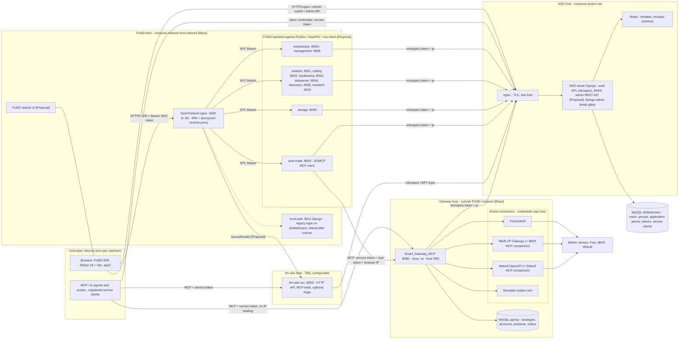

**Trust boundaries**

| Boundary | What crosses it | Control |
|---|---|---|
| Internet → FUND nginx / SSO nginx | people: user login and user tokens | TLS; RS256 user tokens (15 min); **IP binding applies** (v1.2b); only nginx-forwarded IPs trusted |
| AI agents / MCP / scripts / services → SSO, SGMCP, llm-wiki | service tokens (client credentials) | registered ServiceClient per process, granted permissions, **no IP binding**; on behalf of a user also the user token + browser IP (decision 2026-10-14) |
| FUND nginx → FUND agents | user requests + `X-Forwarded-For` | agents trust XFF only from the nginx address (`TRUSTED_PROXY_IPS`); every agent checks the token via `sso-client` [Proposal]. Today most agent endpoints are unauthenticated [Repo] |
| Services → SSO | introspect, BFF login, admin calls | ServiceClient Basic credentials; `client_ip` accepted only from an authenticated ServiceClient |
| FUND → SGMCP | strategy/trading MCP calls | today one static `SGMCP_AUTH_TOKEN` [Repo]; target: auto-trade service token + user token, trading permissions; suspend stops and deletes the owner's strategies |
| SGMCP → brokers | orders, account data | broker credentials and sessions live only on the gateway host (or the user's FUND Local Gateway, `Local_login.md`) [Repo] |
| Admin | user / permission / service changes | FUND `/admin` → SSO admin REST API with `application.sso_admin`; Django admin = break-glass, superusers only |

**Which component holds what**

| Component | Holds | Never holds |
|---|---|---|
| SSO server + `dcWebUsers` | users, password hashes, groups, `application.*` permissions, refresh tokens, revocations, ServiceClients, RSA private key, admin audit log [Proposal] | broker credentials, research data |
| FUND SPA | access token in memory; refresh token only as HttpOnly cookie on the SSO origin [Proposal] (today: HS256 JWT in `localStorage` [Repo]) | passwords after login, service secrets |
| FUND agents | ServiceClient id/secret, research data (`./data`), `STORAGE_AGENT_SECRET` | user passwords, private keys |
| auto-trade | ServiceClient for SGMCP + the user's token per request | broker credentials |
| Smart_Gateway_MCP | broker sessions/credentials, `sgmcp` ledgers, strategy `owner_sub` [Proposal] | user passwords |
| llm-wiki-svc | knowledge base, its ServiceClient, BFF session (optional) | user passwords |
| Redis (SSO) | throttle counters, revoked-session cache (v1.2b) | durable data |

---

## 1. Purpose and scope

The SSO server is one login service for Thomas's applications. It reuses the **existing Django user table of
myFinance** (MySQL database `dcWebUsers`), so every myFinance account can sign in with its current password, and it
issues **RS256 JWTs** that any back end can verify on its own with the public keys from JWKS.

In scope (implemented):

- Password login by username or email, for browsers (refresh token in an HttpOnly cookie) and for native or
  server-side callers (refresh token in the JSON body).
- Refresh with rotation and blacklist, logout, logout of every session, `/me`.
- Token introspection for registered back-end services (`ServiceClient`, HTTP Basic).
- Per-application access permissions `application.<codename>` (for example `application.app1` = llm-wiki-svc)
  carried in the access token's `perms` claim.
- JWKS and a minimal OpenID discovery document, `/healthz`, the Django admin at a configurable path.
- Throttling with a shared cache (Redis), structured security logs, Docker deployment behind nginx.

Out of scope today (see §12): hosted login page, authorization code + PKCE, account endpoints (sign-up,
password reset), OIDC ID tokens. (Refresh-token reuse now revokes the session, v1.2a, §7.4.)

## 2. Glossary

| Term | Meaning |
|---|---|
| Access token | Short-lived JWT (default 15 min, `SSO_ACCESS_TTL_MIN`), `token_type: "access"`. Sent as `Authorization: Bearer`. Carries profile claims and `perms` |
| Refresh token | Longer-lived JWT (default 7 days, `SSO_REFRESH_TTL_DAYS`), `token_type: "refresh"`. Only exchanged at the SSO server. One use: rotated on every refresh |
| Rotation | Every successful `/refresh` blacklists the presented refresh token and issues a brand-new pair |
| Blacklist | simplejwt's `token_blacklist` app: table `token_blacklist_outstandingtoken` (every refresh token issued) and `token_blacklist_blacklistedtoken` (the ones no longer usable) |
| Revocation epoch | `sso_usertokenrevocation.revoked_at` per user. Tokens whose `iat` is earlier are rejected at `/refresh`, `/me`, `/logout-all` and `/introspect`. Set by `logout-all` and by a password change made through this Django project |
| kid | Key id in the JWT header: first 16 hex characters of SHA-256 over the public key's DER SubjectPublicKeyInfo (`sso/keys.py` `compute_kid`) |
| JWKS | JSON Web Key Set at `/.well-known/jwks.json`: every published public key |
| Browser mode | Login with `"client": "browser"` (the default). Refresh token goes into the `sso_refresh` cookie, never into the body |
| Native mode | Login with `"client": "native"`. Refresh token is in the body. Used by scripts, mobile apps and server-side apps |
| BFF | "Back end for front end": a server-rendered app (llm-wiki-svc) that logs in on the user's behalf and keeps the tokens server-side |
| ServiceClient | A registered back-end service (`sso_serviceclient`): `client_id` + hashed secret. Used for `/introspect` and for delegating the end-user IP (`client_ip`) on login, refresh and logout |
| `application.<codename>` | A Django permission on the content type `application.applicationaccess`. One per application. Granted with the stock admin |
| dcWebUsers | The MySQL database shared with myFinance. Holds `auth_user` and the other stock Django tables plus the SSO's own tables |
| Leeway | 30 s of clock-skew tolerance on `exp`/`iat` (simplejwt `LEEWAY`, and the verifiers) |

## 3. Architecture

### 3.1 System context

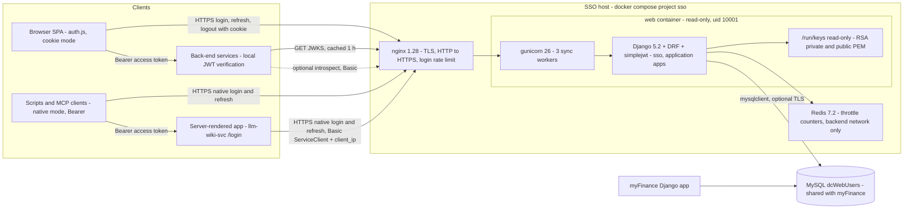

Notes:

- The SSO server never calls a client. All traffic is inbound.
- Back-end services need **no SSO database access and no private key**. They need the JWKS URL, the issuer and the
  audience (`examples/verifier/sso_verifier.py`, `llmwiki/auth/sso.py`).
- `myFinance` and the SSO server both write `auth_user`. Password changes made in myFinance do **not** revoke SSO
  tokens (`sso/signals.py` only sees saves made through the SSO process).

### 3.2 Software layers

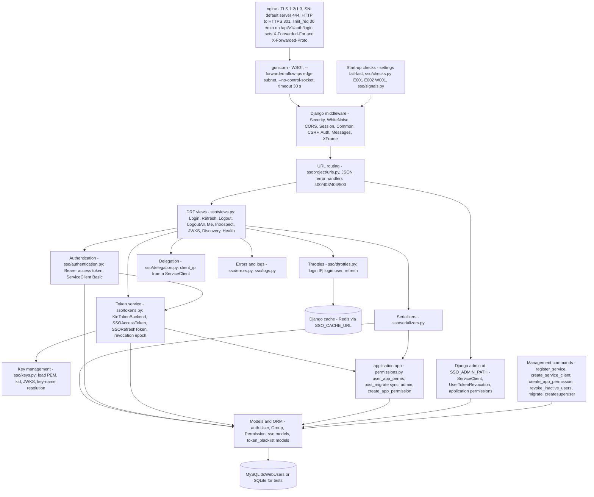

Planned layers (not implemented): v1.2b adds the introspect/permission query and the `sso-client` library on the
**service** side (each FUND agent, llm-wiki-svc and SGMCP runs it as middleware between its web framework and its
handlers). v1.3a adds `sso/admin_api` (DRF views under `/api/v1/admin/`, permission `application.sso_admin`, writes
`sso_adminauditlog`) next to the Django admin. See [ECOSYSTEM-INTEGRATION.md](ECOSYSTEM-INTEGRATION.md) §7.

## 4. Component responsibilities

| Component | File(s) | Responsibility |
|---|---|---|
| nginx | `docker/nginx.conf` | TLS termination, redirect HTTP to HTTPS (except ACME), reject unknown host names (444), optional `limit_req` (30 r/min, burst 10) on `/api/v1/auth/login`, optional admin IP allow-list (`/etc/nginx/sso-admin.d/*.conf`), overwrite `X-Forwarded-For` with the peer address, set `X-Forwarded-Proto` |
| gunicorn | `Dockerfile` CMD | WSGI server, `GUNICORN_WORKERS` (3) sync workers, trusts forwarded headers only from `SSO_FORWARDED_ALLOW_IPS` |
| Settings | `ssoproject/settings.py` | All config from env / `.env`. Fails fast in non-debug mode: empty `SSO_SECRET_KEY`, empty `SSO_ISSUER`, missing key files, missing or per-process cache, running as root |
| Views | `sso/views.py` | The REST API (§8) |
| Token service | `sso/tokens.py` | Signs with the current key and puts its `kid` in the header. Verifies by `kid` among all published keys, RS256 only, enforces `iss`, `aud`, `exp` (30 s leeway). Adds profile claims and `perms` to access tokens. Revocation epoch |
| Keys | `sso/keys.py` | Loads PEM files, computes `kid`, renders JWKS, resolves file names in `SSO_JWT_KEYS_MOUNT` > `SSO_KEYS_DIR` > `/run/keys`, clear errors for missing or unreadable files |
| Authentication | `sso/authentication.py` | `SSOAccessTokenAuthentication` (Bearer, plus revocation epoch) and `ServiceClientBasicAuthentication` (constant-cost failure via a dummy hash) |
| Delegation | `sso/delegation.py` | A ServiceClient sending `Authorization: Basic` may pass the browser's `client_ip`. Bad credentials 401 `invalid_client`, bad IP 400 |
| Throttles | `sso/throttles.py` | `login` per IP, `login_user` per lowercased username, `refresh` per IP. Counters in the shared Django cache |
| Errors | `sso/errors.py` | Uniform `{"error", "detail"}` body for every DRF and Django error |
| Logs | `sso/logs.py` | One JSON line per login attempt and per token event on logger `sso.auth`. Never tokens or passwords |
| Signals | `sso/signals.py` | A real password change saved through this project sets the revocation epoch |
| Checks | `sso/checks.py`, `sso/runtime.py` | `sso.E001` per-process cache, `sso.E002` root, `sso.W001` deprecated key variables |
| Models | `sso/models.py` | `ServiceClient`, `UserTokenRevocation`, `AuthorizationCode` (phase 5, unused) |
| Application permissions | `application/*` | Anchor model `ApplicationAccess` (table `sso_application_access`, no rows) whose content type carries `application.*` permissions. Registry `ApplicationPermissionRecord`. `user_app_perms()` builds the `perms` claim. Post-migrate sync recreates `app1` and reports lost permissions. `create_app_permission` command. Read-only admin list |
| Admin | `sso/admin.py`, `application/admin.py` | Stock Django admin plus ServiceClient (secret shown once), UserTokenRevocation, application permissions |
| Redis | `docker-compose.yml` | Throttle counters only (no persistence, 64 MB LRU, `backend` network is internal) |
| MySQL | external | `dcWebUsers`. No DB container in production compose. Migrations are operator-run |

## 5. Data model and dataflow

### 5.1 Tables

The SSO server owns only the `sso`, `application` and `token_blacklist` migrations. The stock Django tables are
shared with myFinance and are never altered (`sso/models.py` docstring, addendum B.11).

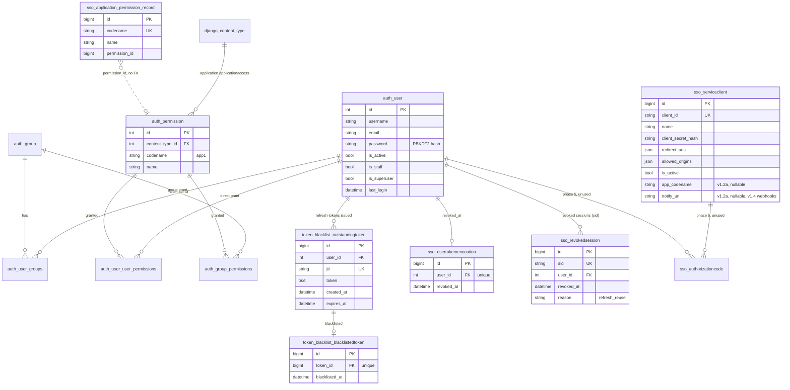

`sso_application_access` exists only to anchor the content type and never has rows. `ApplicationPermission` is a
proxy model over `auth_permission` for the admin (no table).

> Warning (implemented safeguard, not a prevention): `remove_stale_contenttypes` run in **myFinance** would delete
> the `application.applicationaccess` content type and cascade-delete every `application.*` grant. After the next
> `migrate`, `application/permissions.py` `sync_permissions` recreates `app1`, drops the registry rows of
> command-created permissions, and logs an ERROR listing what was lost. Grants must be re-assigned by hand.

### 5.2 Where each piece of data lives

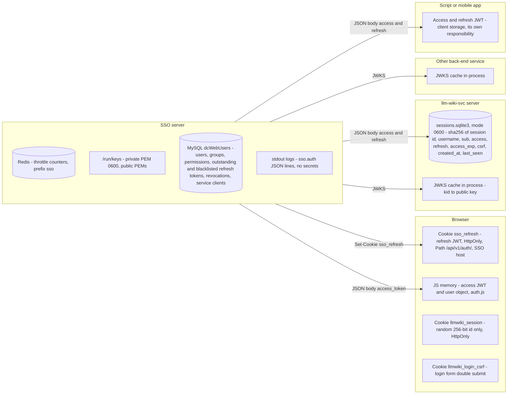

What is stored where, precisely:

| Data | Location | Written by | Notes |
|---|---|---|---|
| User, password hash, `is_active`, `is_staff`, groups | `auth_user`, `auth_group`, `auth_user_groups` | myFinance and SSO admin | Stock User model, no `AUTH_USER_MODEL` |
| `application.*` permission rows | `auth_permission` on content type `application.applicationaccess` | `migrate` (app1), `create_app_permission` | Grants in `auth_user_user_permissions` / `auth_group_permissions` |
| Every issued refresh token | `token_blacklist_outstandingtoken` | `issue_token_pair` via `SSORefreshToken.for_session` | Includes the raw token text, with its `sid` (the session family is found by decoding these). Access tokens are **not** stored anywhere |
| Used / logged-out refresh tokens | `token_blacklist_blacklistedtoken` | `/refresh`, `/logout`, `/logout-all` | `flushexpiredtokens` is not run automatically (Dockerfile R6) |
| Revocation epoch | `sso_usertokenrevocation` | `/logout-all`, password change signal, suspend / unsuspend (`is_active` change), inactive user seen on use, `revoke_inactive_users`, admin | One row per user, `update_or_create` |
| Revoked sessions | `sso_revokedsession` | `/refresh` on refresh-token reuse (v1.2a) | One row per revoked `sid`; checked by `/refresh`, `/me`, `/introspect` |
| Service clients | `sso_serviceclient` | admin, `register_service`, `create_service_client` | Secret stored as a Django password hash; `app_codename` links `application.<codename>` |
| Throttle counters | Redis | DRF throttles | Lost on Redis restart (by design) |
| Signing key | `/run/keys/<SSO_JWT_PRIVATE_KEY>` | `scripts/gen_keys.sh` | Read once at process start |

### 5.3 Claims in the tokens

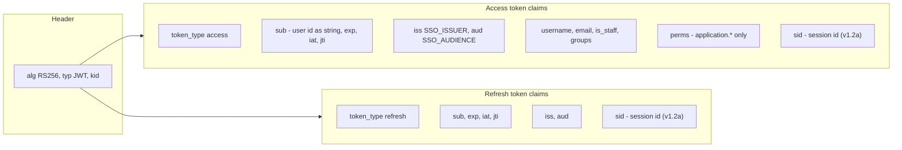

Details are in §9.

## 6. Workflows

### 6.1 Browser-mode login (SPA, HttpOnly cookie)

Implemented by `sso/views.py` `LoginView` and `examples/frontend/auth.js`.

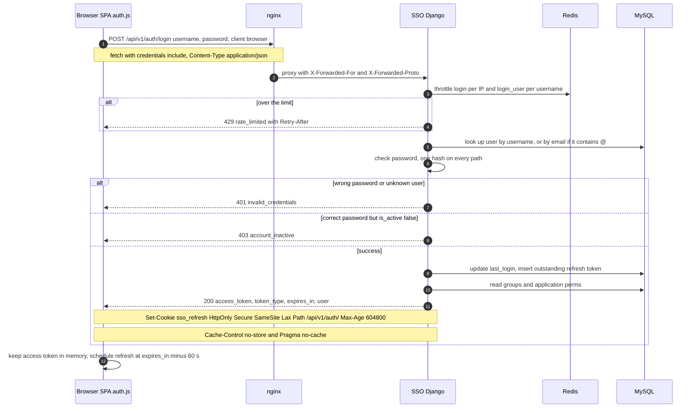

Cross-origin notes: `CORS_ALLOW_CREDENTIALS = True`, allowed origins = `SSO_CORS_ALLOWED_ORIGINS`, CORS headers only
on `/api/` and `/.well-known/`. Login itself does **not** check `Origin` (no cookie is consumed). For the cookie
to be sent back cross-site, the SPA and the SSO must be same-site, or `SSO_COOKIE_SAMESITE=None` is needed
(recommendation, see `docs/SSO-server.md` §7).

### 6.2 Native login (scripts, mobile, MCP clients)

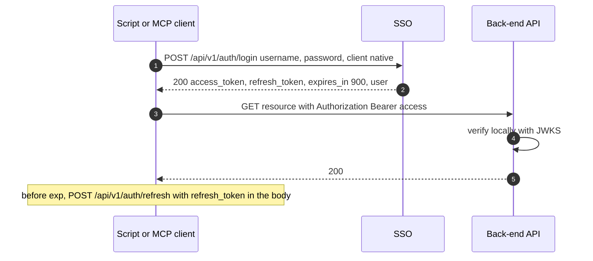

No `Origin` check and no cookie in native mode. The caller must store the refresh token safely.

### 6.3 Server-side (BFF) login, as llm-wiki-svc does it

Implemented by `llmwiki/api/login.py`, `llmwiki/auth/service.py`, `llmwiki/auth/client.py`,
`llmwiki/auth/session.py`, and on the SSO side by `sso/delegation.py`.

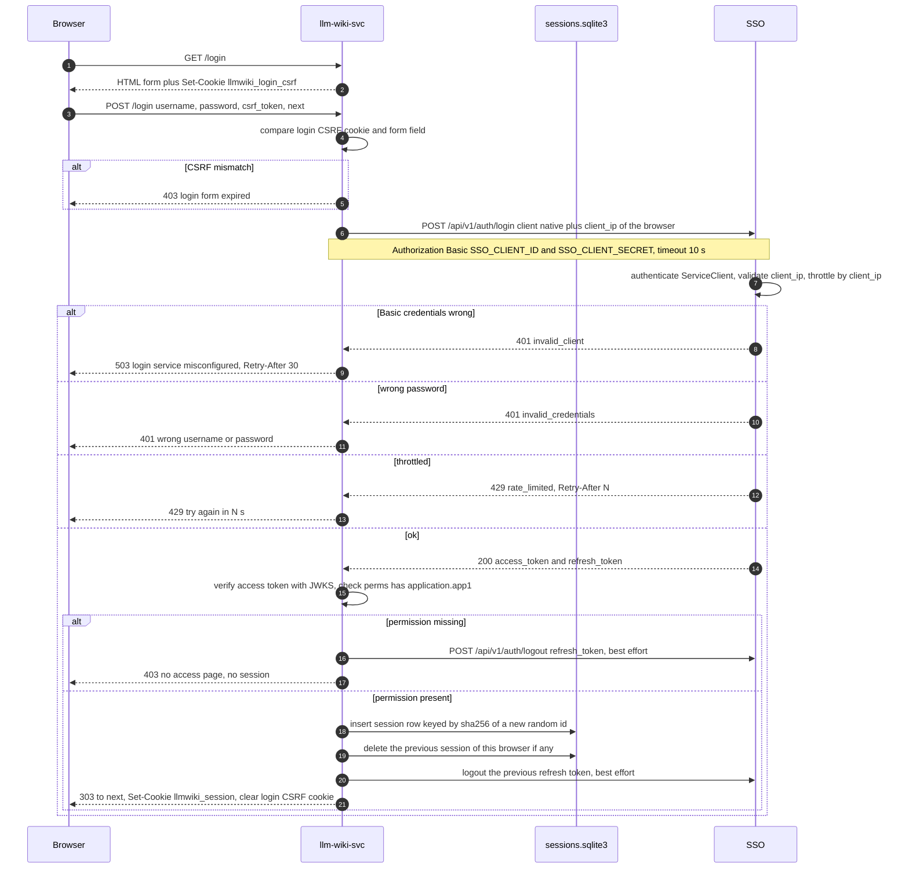

The browser never sees an SSO token in this mode. `client_ip` comes from the TCP peer, or from
`CLIENT_IP_HEADER` only when the peer is in `TRUSTED_PROXY_IPS` (`llmwiki/api/session.py` `client_ip_of`).

### 6.4 Silent session restore on page load (SPA)

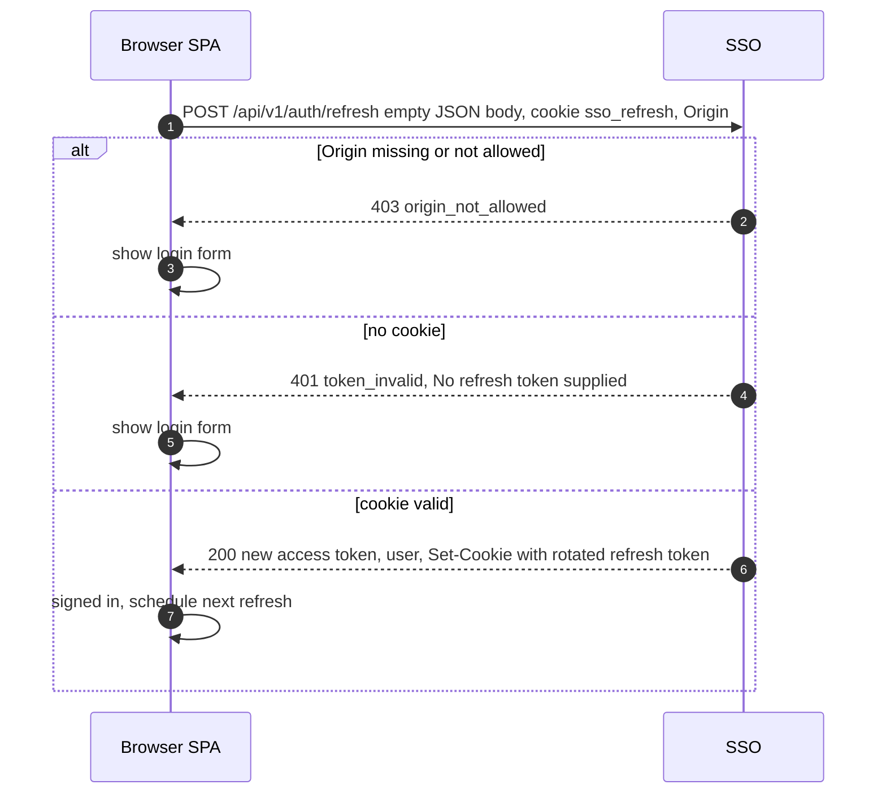

`auth.js` `restoreSession()` turns any failure into `null` = "show the login form".

### 6.5 Refresh with rotation and blacklist

Implemented by `RefreshView` + `load_refresh` + simplejwt `BlacklistMixin`.

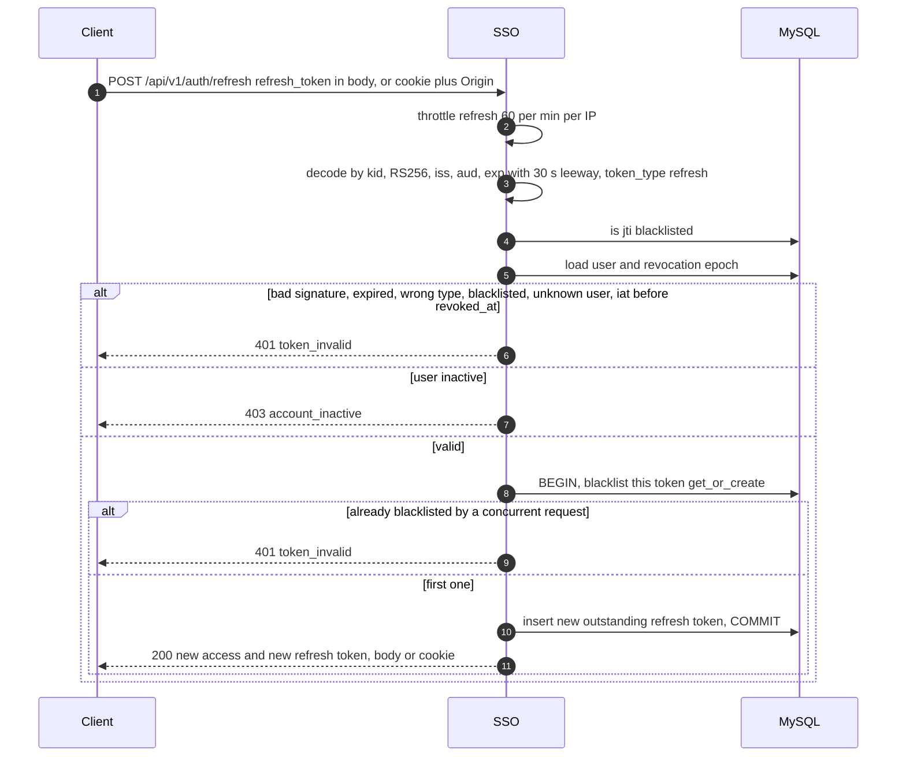

The new pair is created with `RefreshToken.for_user`, so each refresh token gets a **fresh 7-day expiry**.
There is no absolute session cap on the SSO side: an active user can stay signed in indefinitely as long as they
refresh within 7 days. `perms`, `groups`, `email`, `is_staff` are re-read from the DB on every refresh.

### 6.6 Logout

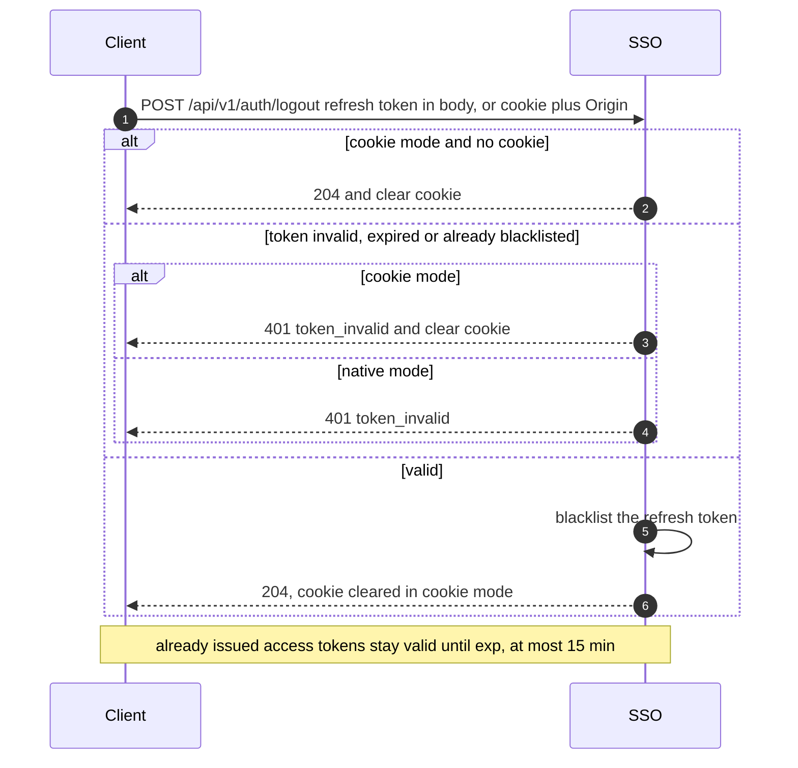

### 6.7 Logout everywhere and revocation

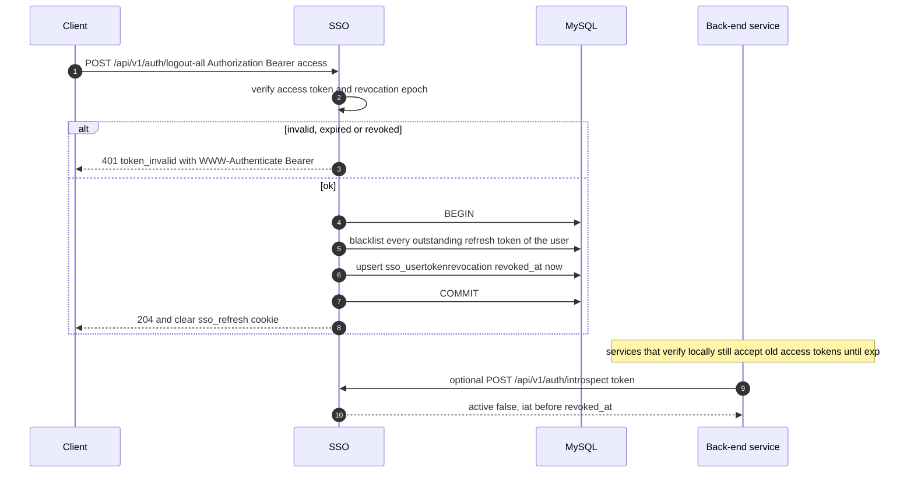

A password change made through this project (admin, `changepassword`, shell `set_password` + `save`) also
upserts `revoked_at` (`sso/signals.py`). A transparent hash upgrade at login does not. A change made in
myFinance does not (different process).

Tokens issued in the same second as a revocation would look revoked, so `issue_token_pair` waits up to 1 s past
`revoked_at` before signing (`sso/tokens.py` `_wait_past_revocation`).

### 6.8 GET /me

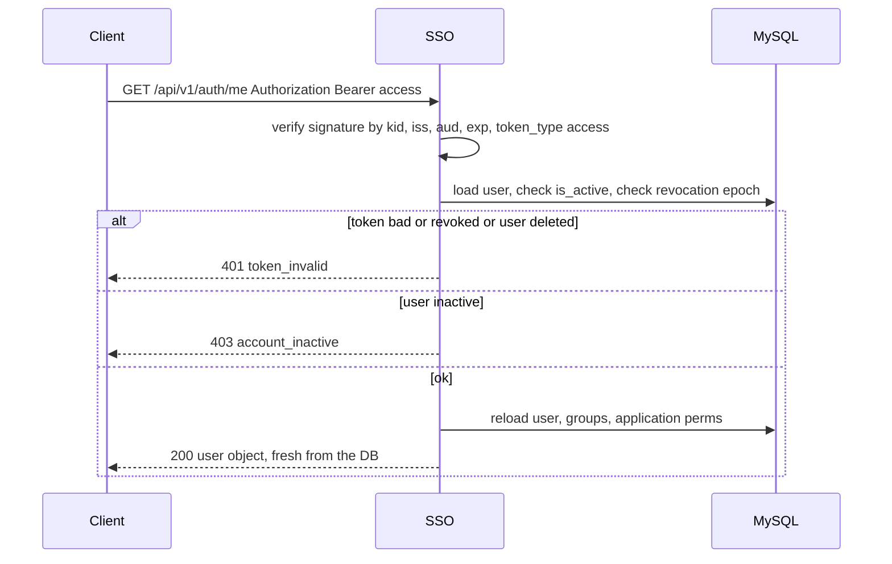

### 6.9 Back-end service: local JWT verification with JWKS

Implemented identically by `examples/verifier/sso_verifier.py` and `llmwiki/auth/sso.py`.

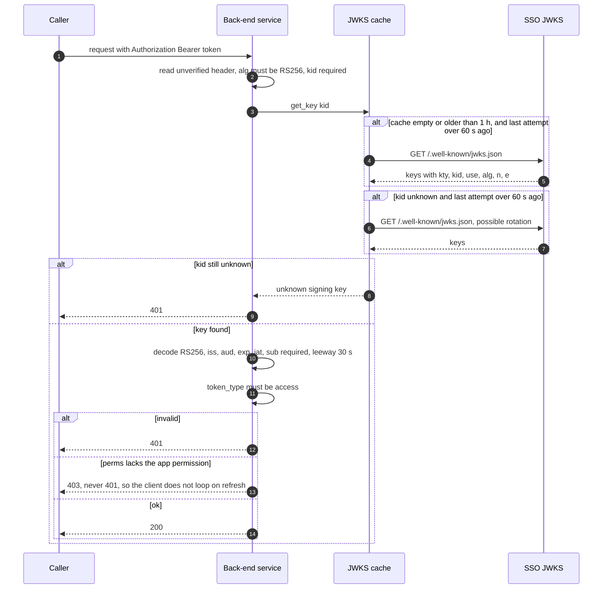

PyJWT 2.15 (`requirements.lock`) already rejects `iat` more than the leeway in the future; llm-wiki-svc repeats that check explicitly.

### 6.10 Introspection by a registered ServiceClient

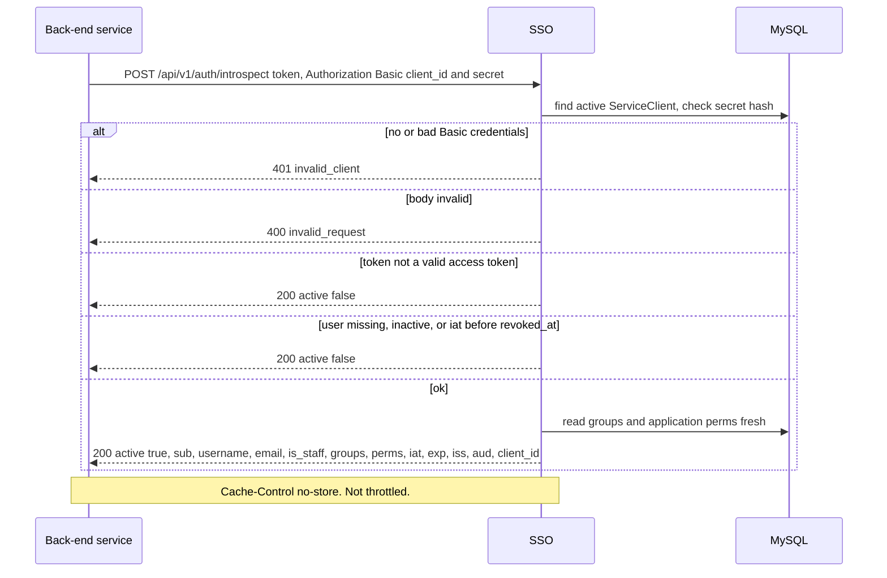

### 6.11 Granting `application.app1` and how it reaches the token

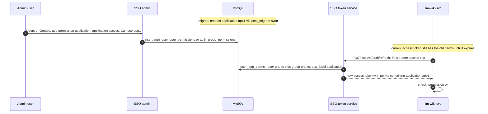

Rules in `application/permissions.py` `user_app_perms`:

- Only permissions whose content type `app_label` is `application`, prefixed `application.`, sorted.
- Direct user grants plus grants through groups.
- Inactive users: empty list.
- Superusers: **only their explicit grants**, unless `SSO_SUPERUSER_ALL_APPS=true` (then all `application.*`).
- New applications: `python manage.py create_app_permission app2 "Can use app2 (reports)"`. Codename regex
  `^[a-z][a-z0-9_]{1,62}$`.

`/me` and `/introspect` show a change at once, because they read the DB. The token's `perms` claim changes at the
next refresh (at most one access TTL later).

## 7. Event and failure handling

Network events are where most integration bugs come from. Every diagram below states who does what. Behaviour is
**implemented** unless marked otherwise.

### 7.1 Token lifecycle

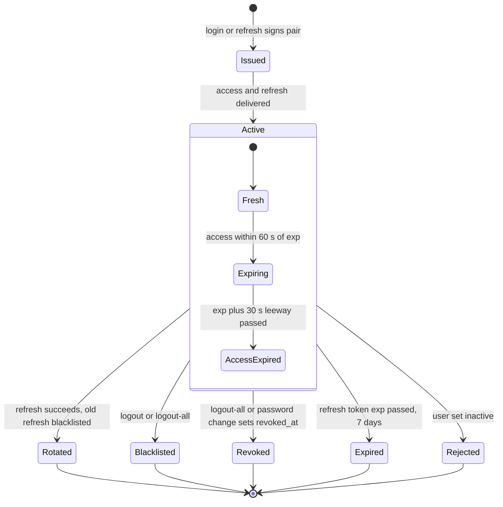

| State | Access token at a local verifier | Access token at `/me`, `/introspect` | Refresh token at `/refresh` |
|---|---|---|---|
| Active | accepted | accepted | accepted, rotates |
| Rotated | accepted until `exp` | accepted until `exp` | 401 `token_invalid` (blacklisted) |
| Blacklisted (logout) | accepted until `exp` | accepted until `exp` | 401 `token_invalid` |
| Revoked (`revoked_at`) | **accepted until `exp`** (verifiers do not know `revoked_at`) | 401 / `active:false` | 401 `token_invalid` |
| User inactive | accepted until `exp` | 403 `account_inactive` / `active:false` | 403 `account_inactive` |
| Expired | 401 | 401 / `active:false` | 401 `token_invalid` |

### 7.2 Browser session states

SPA with `auth.js`:

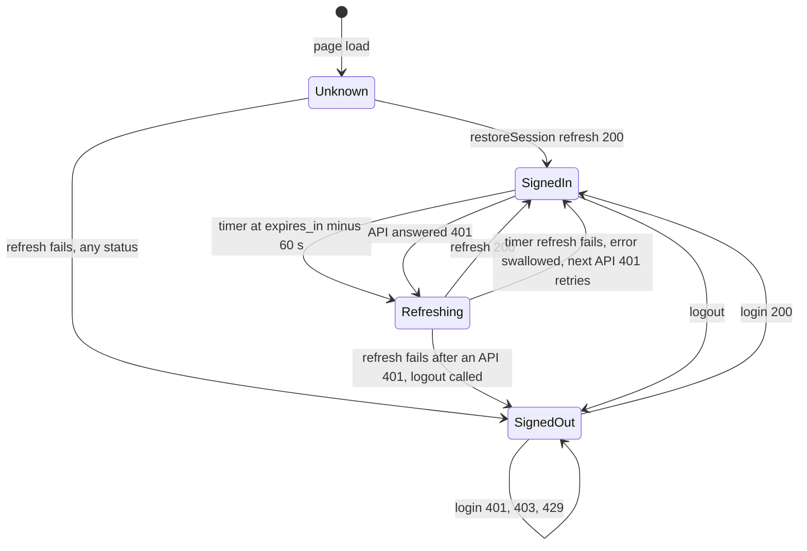

llm-wiki-svc server-side session (`llmwiki/api/session.py` `SessionAuthMiddleware._resolve`):

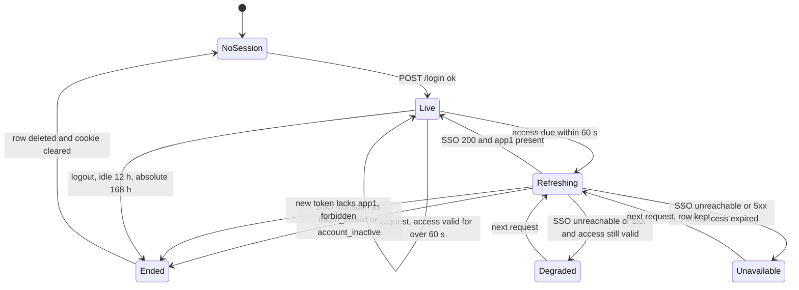

`Unavailable` answers 503 (API: `Login service unavailable`). The session row is kept so the user is not logged
out by an SSO outage (design v1.1 Q-05).

### 7.3 Concurrent refresh race

#### At the SSO server (two tabs, same cookie)

```mermaid
sequenceDiagram
  participant T1 as Tab 1
  participant T2 as Tab 2
  participant S as SSO
  participant D as MySQL
  par both tabs refresh with the same refresh token R1
    T1->>S: POST /refresh cookie R1
  and
    T2->>S: POST /refresh cookie R1
  end
  S->>D: T1 checks R1 not blacklisted, ok
  S->>D: T2 checks R1 not blacklisted, ok
  S->>D: T1 blacklist R1 get_or_create, created
  S-->>T1: 200 access A2, Set-Cookie R2
  S->>D: T2 blacklist R1 get_or_create, already exists
  S-->>T2: 401 token_invalid
  Note over T2: the cookie jar now holds R2 from tab 1, so a retry of refresh succeeds
  T2->>S: POST /refresh cookie R2, recommendation - retry once on 401
  S-->>T2: 200 access A3, Set-Cookie R3
```

Exactly one request wins per refresh token: the unique `blacklistedtoken.token_id` plus `get_or_create` inside
`transaction.atomic()` (`RefreshView`). The loser gets 401. `auth.js` does **not** coordinate tabs: the shipped
`apiFetch` calls `logout()` when the retried refresh fails. A cross-tab lock (BroadcastChannel / Web Locks) or a
second refresh attempt is a **recommendation**, not implemented in `auth.js`.

#### At llm-wiki-svc (parallel requests of one browser session)

```mermaid
sequenceDiagram
  participant R1 as Request 1
  participant R2 as Request 2
  participant L as asyncio lock per session
  participant DB as SQLite BEGIN IMMEDIATE
  participant S as SSO
  par same llmwiki_session cookie
    R1->>L: acquire
  and
    R2->>L: wait
  end
  R1->>DB: BEGIN IMMEDIATE, re-read row, refresh token still R1 and due
  R1->>S: POST /refresh R1
  S-->>R1: 200 A2, R2tok
  R1->>DB: UPDATE access A2, refresh R2tok, COMMIT
  R1->>L: release
  R2->>L: acquire
  R2->>DB: BEGIN IMMEDIATE, re-read row, access no longer due
  R2->>DB: COMMIT, reuse A2, no SSO call
  R2->>L: release
```

The asyncio lock serialises within one process. `BEGIN IMMEDIATE` and the "refresh token changed or no longer due"
re-check serialise across uvicorn workers sharing the SQLite file (`SessionStore.refresh_locked`).

### 7.4 Refresh-token reuse

```mermaid
sequenceDiagram
  participant U as Legitimate client
  participant X as Attacker with a stolen R1
  participant S as SSO
  U->>S: refresh R1
  S-->>U: 200 R2, R1 blacklisted
  X->>S: refresh R1 (more than SSO_REFRESH_REUSE_GRACE_SECONDS after its first use)
  S->>S: R1 is ours, valid, already blacklisted: reuse of session sid
  S->>S: sso_revokedsession sid, blacklist R2 and every other refresh token of sid
  S-->>X: 401 token_invalid
  U->>S: refresh R2
  S-->>U: 401 token_invalid, log in again
  Note over S: access tokens of sid fail at /me and /introspect at once
```

Implemented in v1.2a (OAuth 2.0 BCP family revocation, family = `sid`). Whoever uses R1 second ends the whole
session, so it also helps when the attacker used R1 **first**. Grace: a reuse within
`SSO_REFRESH_REUSE_GRACE_SECONDS` (default 10) of the first use, or a request that loses the blacklist insert
to a concurrent one, only gets 401 (two tabs, retries); the session is kept (§7.3). Local verifiers still see a
revoked session's access tokens as valid until `exp`. Details: DESIGN-v1.2 §10.

### 7.5 SSO unreachable, 5xx or timeout

```mermaid
sequenceDiagram
  participant B as Browser
  participant W as llm-wiki-svc
  participant S as SSO
  participant API as Other service
  rect rgb(240,240,255)
  Note over B,S: during login
  B->>W: POST /login
  W->>S: POST /api/v1/auth/login, timeout 10 s
  alt connect error, timeout, or HTTP 5xx, or non-JSON
    W-->>B: 503 login service unavailable, Retry-After 30
  else 401 invalid_client
    W-->>B: 503 login service misconfigured, Retry-After 30
  end
  end
  rect rgb(240,255,240)
  Note over B,S: during a session refresh
  B->>W: GET /dashboard, access due
  W->>S: POST /api/v1/auth/refresh
  alt SSO down and access token still valid
    W-->>B: 200, served with the current access token, warning logged
  else SSO down and access token expired
    W-->>B: 503, session row kept
  else SSO answered 4xx
    W-->>B: 401 or login redirect, session deleted, cookie cleared
  end
  end
  rect rgb(255,245,235)
  Note over API,S: during a JWKS fetch
  API->>S: GET /.well-known/jwks.json
  alt fetch fails and keys are cached
    API->>API: keep old keys, retry after 60 s at most
  else fetch fails and no keys cached
    API-->>B: 401, cannot fetch the SSO JWKS
  end
  end
```

SPA (`auth.js`): a network failure on `/refresh` rejects the promise. On the timer path it is swallowed. After an API
401 it calls `logout()` and throws `login_required`. There is no back-off or offline handling (recommendation).

The SSO server itself answers 503 only from `/healthz`. If MySQL is down during `/login` or `/refresh`, the
`DatabaseError` becomes a 500 `server_error` through `sso/errors.py`, or nginx answers 502/504 if gunicorn is down or
slower than 30 s (`proxy_read_timeout 30s`, gunicorn `--timeout 30`).

### 7.6 Clock skew and leeway

```mermaid
sequenceDiagram
  participant S as SSO clock
  participant V as Verifier clock
  Note over S: issues token with iat T and exp T plus 900
  alt verifier clock behind by 20 s
    V->>V: iat looks 20 s in the future, within 30 s leeway, accepted
  else verifier clock behind by 45 s
    V->>V: iat more than 30 s in the future, rejected - PyJWT 2.15 ImmatureSignatureError, 401
  else verifier clock ahead by 20 s
    V->>V: expiry seen 20 s early, leeway 30 s, accepted until 10 s after the real exp
  end
```

Both the SSO (`SIMPLE_JWT["LEEWAY"] = 30`) and the verifiers use 30 s. Recommendation: NTP on every host.

### 7.7 Unknown kid and JWKS refetch limit

```mermaid
stateDiagram-v2
  [*] --> Empty
  Empty --> Cached: first fetch ok
  Empty --> Failed: first fetch fails, AuthError
  Failed --> Cached: next attempt after 60 s ok
  Cached --> Cached: known kid, no fetch
  Cached --> Refetching: unknown kid and last attempt over 60 s ago
  Cached --> Refetching: cache older than 1 h and last attempt over 60 s ago
  Cached --> RejectUnknown: unknown kid within 60 s of last attempt
  RejectUnknown --> Cached: 401 to the caller, no fetch
  Refetching --> Cached: ok, keys replaced
  Refetching --> Cached: fetch failed, old keys kept
```

A flood of tokens with invented `kid`s causes at most one JWKS request per minute per process.

### 7.8 Key rotation timeline

The SSO accepts every key listed in `SSO_JWT_PUBLIC_KEYS` (by `kid`) and always publishes the signing key's own
public key first (`sso/keys.py` `build_keyset`). Keys are read at process start, so each step needs a restart
(`docker compose up -d --force-recreate web`). Runbook: `devops/DEPLOYMENT-PLAN.md` §11, README §4.

Dates in the chart are illustrative only.

```mermaid
gantt
  title Key rotation, old key K1 to new key K2
  dateFormat  YYYY-MM-DD HH:mm
  axisFormat  %d %H:%M
  section Published in JWKS
  K1 published                :done, k1pub, 2026-11-01 00:00, 2026-11-09 00:30
  K2 published                :active, k2pub, 2026-11-01 00:00, 2026-11-12 00:00
  section Signing key
  K1 signs                    :done, k1s, 2026-11-01 00:00, 2026-11-02 00:00
  K2 signs                    :active, k2s, 2026-11-02 00:00, 2026-11-12 00:00
  section Steps
  Step 1 append K2 public, restart     :milestone, m1, 2026-11-01 00:00, 0m
  Step 2 wait 24 h, over JWKS cache 1 h :w1, 2026-11-01 00:00, 2026-11-02 00:00
  Step 3 switch SSO_JWT_PRIVATE_KEY to K2 :milestone, m2, 2026-11-02 00:00, 0m
  Step 4 keep K1 for 15 min plus 7 days :w2, 2026-11-02 00:00, 2026-11-09 00:30
  Step 5 remove K1 public, restart      :milestone, m3, 2026-11-09 00:30, 0m
```

```mermaid
sequenceDiagram
  participant Op as Operator
  participant S as SSO
  participant V as Verifier
  Op->>S: step 1, SSO_JWT_PUBLIC_KEYS K1 and K2, restart
  V->>S: JWKS within 1 h, learns K2
  Op->>S: step 3, SSO_JWT_PRIVATE_KEY K2, restart
  S-->>V: new tokens carry kid K2, verifier knows it
  Note over V: a verifier that missed step 1 sees an unknown kid, refetches at most once per minute
  Note over S: refresh tokens signed with K1 still refresh until removed
  Op->>S: step 5, drop K1 after 15 min plus refresh TTL, restart
```

Emergency rotation (compromised key): new key only, every user logs in again (`DEPLOYMENT-PLAN.md` §11.3).

### 7.9 Rate limiting (429 and Retry-After)

```mermaid
sequenceDiagram
  participant C as Client
  participant N as nginx
  participant S as SSO
  participant R as Redis
  C->>N: POST /api/v1/auth/login
  alt over 30 per min per IP plus burst 10 at nginx
    N-->>C: 429 from nginx, nginx body, no Retry-After
  else passed
    N->>S: proxy
    S->>R: incr login, key client IP or delegated client_ip, 10 per min
    S->>R: incr login_user, key lowercased username, 5 per min
    alt either limit exceeded
      S-->>C: 429 rate_limited, detail Try again in N s, Retry-After N
      Note over S: sso.auth log result rate_limited
    else ok
      S-->>C: normal login answer
    end
  end
```

`/refresh` and `/logout` share scope `refresh` (60/min per IP). `/me`, `/logout-all`, `/introspect`, JWKS,
discovery and `/healthz` are not throttled by DRF. Recommendation for clients: honour `Retry-After`, never retry
login automatically. llm-wiki-svc passes `Retry-After` through to the browser.

### 7.10 Account disabled mid-session

```mermaid
sequenceDiagram
  participant A as Admin
  participant S as SSO
  participant C as Client
  participant API as Service
  A->>S: set is_active false (admin action, form, save())
  S->>S: v1.2a: revoked_at = now, all refresh tokens blacklisted (same transaction)
  C->>API: Bearer access, still before exp
  API-->>C: 200, local verification does not see is_active
  C->>S: GET /me
  S-->>C: 401 (inactive user / revoked token)
  C->>S: POST /refresh
  S-->>C: 403 account_inactive
  Note over C: llm-wiki deletes the session, cookie cleared
  opt service needs it at once
    API->>S: introspect
    S-->>API: active false
  end
```

Worst case exposure at local verifiers: one access TTL (15 min, plus 30 s leeway). Unsuspending revokes again,
so tokens from before the reactivation stay dead; `QuerySet.update()` / myFinance writes send no signal and are
caught on the next refresh or introspect of a live token, or by `manage.py revoke_inactive_users`
(DESIGN-v1.2 §10).

### 7.11 Permission revoked mid-session

```mermaid
sequenceDiagram
  participant A as Admin
  participant S as SSO
  participant W as llm-wiki-svc
  participant B as Browser
  A->>S: remove application.app1 from the user or group
  B->>W: request, access token still has app1
  W-->>B: 200
  Note over W: until 60 s before access exp
  B->>W: request, access due
  W->>S: refresh
  S-->>W: 200, perms without app1
  W->>S: logout the new refresh token, best effort
  W->>W: delete session row
  W-->>B: 403, cookie cleared
```

Effect delay: at most one access TTL minus the 60 s refresh margin at llm-wiki-svc. For Bearer callers (MCP,
scripts) the old token works until `exp`, then the next token lacks the permission and they get 403.

### 7.12 CORS and Origin check failure

```mermaid
sequenceDiagram
  participant B as Browser on origin O
  participant S as SSO
  B->>S: OPTIONS /api/v1/auth/refresh preflight
  alt O not in SSO_CORS_ALLOWED_ORIGINS
    S-->>B: 200 without Access-Control-Allow-Origin
    B->>B: browser blocks the call, fetch rejects with TypeError
  else allowed
    S-->>B: 200 with Allow-Origin O and Allow-Credentials true
    B->>S: POST /api/v1/auth/refresh with cookie and Origin O
    S->>S: check_origin - Origin header in CORS_ALLOWED_ORIGINS
    S-->>B: 200
  end
  Note over S: a cookie request whose Origin is missing or unknown always gets 403 origin_not_allowed, even if CORS lets it through
```

The `Origin` check is the CSRF defence for cookie mode (`sso/views.py` `check_origin`, addendum B.9). Native
requests (token in the body) skip it.

### 7.13 Database down and health

```mermaid
sequenceDiagram
  participant H as Docker healthcheck
  participant W as web
  participant D as MySQL
  participant N as nginx
  H->>W: GET /healthz, Host and X-Forwarded-Proto https
  W->>D: SELECT 1
  alt DatabaseError
    W-->>H: 503 error unhealthy, detail database
    Note over H: after 3 failures, 30 s apart, container marked unhealthy
  else ok
    W-->>H: 200 status ok
  end
  Note over N: nginx depends_on web healthy only at start, it keeps proxying later
```

`/healthz` is exempt from the HTTPS redirect (`SECURE_REDIRECT_EXEMPT`). A Redis outage does not affect `/healthz`.
With Redis down, the throttled endpoints (`login`, `refresh`, `logout`) are expected to fail with 500, because Django's `RedisCache` raises and `sso/errors.py` turns unhandled errors into `server_error` (derived from the code, not tested here).

## 8. API reference

Routes from `ssoproject/urls.py` (nothing else is routed). Base URL = `SSO_ISSUER` (for example
`https://sso.example.com`). No trailing slashes.

| Method | Path | Auth | Throttle scope | View |
|---|---|---|---|---|
| POST | `/api/v1/auth/login` | none (optional ServiceClient Basic) | `login` + `login_user` | `LoginView` |
| POST | `/api/v1/auth/refresh` | refresh token (body, or cookie + `Origin`), optional Basic | `refresh` | `RefreshView` |
| POST | `/api/v1/auth/logout` | refresh token (body, or cookie + `Origin`), optional Basic | `refresh` | `LogoutView` |
| POST | `/api/v1/auth/logout-all` | Bearer access token | none | `LogoutAllView` |
| GET | `/api/v1/auth/me` | Bearer access token | none | `MeView` |
| POST | `/api/v1/auth/introspect` | ServiceClient Basic (required) | none | `IntrospectView` |
| GET | `/.well-known/jwks.json` | none | none | `JWKSView` |
| GET | `/.well-known/openid-configuration` | none | none | `DiscoveryView` |
| GET | `/healthz` | none | none | `HealthView` |
| any | `/<SSO_ADMIN_PATH>` (default `/sso-admin/`) | Django admin session (staff) | none | Django admin |

### 8.0 Common rules

- **Request format**: JSON only (`DEFAULT_PARSER_CLASSES = JSONParser`). Another `Content-Type` gives
  415 `unsupported_media_type`. Malformed JSON gives 400 `invalid_request` "Malformed JSON body.". A body that is
  JSON but not an object gives 400.
- **Response format**: JSON only. An `Accept` that excludes JSON gives 406 `not_acceptable`.
- **Errors**: always `{"error": "<code>", "detail": "<message>"}` (`sso/errors.py`), never tokens or stack traces.
- **Wrong method**: 405 `method_not_allowed` (for example `GET /api/v1/auth/login`).
- **HTTPS**: with `SSO_SSL_REDIRECT` (default on when not debug) Django redirects plain HTTP to HTTPS (301) except
  `/healthz`. nginx sets `X-Forwarded-Proto`.
- **Host**: must be in `SSO_ALLOWED_HOSTS`, else 400 `invalid_request` (Django `DisallowedHost` through `handler400`).
- **CORS**: `django-cors-headers` on `^/(api/|\.well-known/).*$`, origins `SSO_CORS_ALLOWED_ORIGINS`,
  `Access-Control-Allow-Credentials: true`. Default allowed request headers include `authorization` and
  `content-type`.
- **CSRF**: DRF `APIView` is CSRF-exempt. Cookie-mode `/refresh` and `/logout` instead require `Origin` in
  `SSO_CORS_ALLOWED_ORIGINS` (403 `origin_not_allowed`).
- **Token responses** (`login`, `refresh`) carry `Cache-Control: no-store` and `Pragma: no-cache`.
- **Mode detection** on `/refresh` and `/logout`: a non-empty `refresh_token` field in the body means native mode.
  Otherwise cookie mode (Origin check, cookie `sso_refresh`).
- **ServiceClient Basic on login/refresh/logout** (`sso/delegation.py`): with `Authorization: Basic`, the
  credentials must be an active ServiceClient (else 401 `invalid_client`). `client_ip` in the body, if present,
  must be an IP address (else 400) and then replaces the caller's IP for the `login`/`refresh` throttles and the
  login log. Without a Basic header, `client_ip` is ignored. 401 answers on these three endpoints carry
  `WWW-Authenticate: Basic realm="sso-service-client"`.
- **Client IP**: `REST_FRAMEWORK["NUM_PROXIES"] = SSO_NUM_PROXIES` (compose: 1, nginx overwrites
  `X-Forwarded-For`).

### 8.1 POST /api/v1/auth/login

Request headers: `Content-Type: application/json`. Optional `Authorization: Basic base64(client_id:secret)`.

Request body:

| Field | Type | Required | Rules |
|---|---|---|---|
| `username` | string | yes | max 254, trimmed. Contains `@` → looked up by `email__iexact`; zero or several matches, or empty email, never match |
| `password` | string | yes | max 4096, not trimmed |
| `client` | `"browser"` or `"native"` | no | default `"browser"` |
| `client_ip` | string | no | only with valid Basic auth; IPv4 or IPv6 |

```json
{ "username": "thomas", "password": "correct horse", "client": "native" }
```

Response 200 (native):

```json
{
  "access_token": "eyJhbGciOiJSUzI1NiIsImtpZCI6IjNmMmE5YjFjMGQ0ZTVmNjciLCJ0eXAiOiJKV1QifQ...",
  "token_type": "Bearer",
  "expires_in": 900,
  "user": {
    "id": 42, "username": "thomas", "email": "thomas@example.com",
    "first_name": "Thomas", "last_name": "Choi", "is_staff": false,
    "groups": ["trader"], "perms": ["application.app1"]
  },
  "refresh_token": "eyJhbGciOiJSUzI1NiIsImtpZCI6IjNmMmE5YjFjMGQ0ZTVmNjciLCJ0eXAiOiJKV1QifQ..."
}
```

Browser mode: same body **without** `refresh_token`, plus

```
Set-Cookie: sso_refresh=<jwt>; HttpOnly; Secure; SameSite=Lax; Path=/api/v1/auth/; Max-Age=604800[; Domain=<SSO_COOKIE_DOMAIN>]
```

| Status | `error` | When |
|---|---|---|
| 200 | — | success, `last_login` updated |
| 400 | `invalid_request` | missing/invalid fields ("Missing or malformed fields: password."), bad `client`, bad `client_ip` with Basic |
| 401 | `invalid_credentials` | wrong password, unknown user, ambiguous email, unparsable stored hash |
| 401 | `invalid_client` | `Authorization: Basic` present but not an active ServiceClient |
| 403 | `account_inactive` | right password, `is_active = false` |
| 415 | `unsupported_media_type` | not JSON |
| 429 | `rate_limited` | over `login` (10/min per IP) or `login_user` (5/min per username); `Retry-After` header |

Every attempt writes one `sso.auth` log line: `event`, `result` (`success`, `invalid_credentials`,
`account_inactive`, `invalid_request`, `rate_limited`), `username`, `ip`, `client`, `user_id`.

### 8.2 POST /api/v1/auth/refresh

Native: body `{"refresh_token": "<jwt>"}` (max 8192). Cookie: body `{}` with cookie `sso_refresh` and an allowed
`Origin` header. Optional Basic + `client_ip` as for login.

Response 200: same shape as login. Native returns the new `refresh_token` in the body, cookie mode sets a new
cookie. The presented refresh token is blacklisted. The new pair keeps the session id `sid` (v1.2a).

| Status | `error` | When |
|---|---|---|
| 400 | `invalid_request` | body not an object, `refresh_token` blank or too long, bad `client_ip` |
| 401 | `token_invalid` | no token ("No refresh token supplied."), bad signature or unknown `kid`, wrong `iss`/`aud`, expired, `token_type` not `refresh` (an access token here fails), blacklisted, user deleted, `iat` before `revoked_at`, `sid` revoked, lost a concurrent-refresh race. Reuse of an already-used token more than `SSO_REFRESH_REUSE_GRACE_SECONDS` after its first use also revokes its session (§7.4) |
| 401 | `invalid_client` | bad Basic credentials |
| 403 | `account_inactive` | user disabled (also when the suspension already blacklisted this token) |
| 403 | `origin_not_allowed` | cookie mode, `Origin` missing or not allowed |
| 429 | `rate_limited` | over `refresh` (60/min per IP), `Retry-After` |

### 8.3 POST /api/v1/auth/logout

Same input as refresh.

| Status | Body | When |
|---|---|---|
| 204 | empty | token blacklisted (cookie cleared in cookie mode); or cookie mode without any cookie (cookie cleared) |
| 400 | `invalid_request` | body problems |
| 401 | `token_invalid` | invalid, expired or already-blacklisted token. Cookie mode also clears the cookie |
| 401 | `invalid_client` | bad Basic credentials |
| 403 | `origin_not_allowed` | cookie mode, bad `Origin` |
| 429 | `rate_limited` | scope `refresh` |

Logout does not check `is_active` or `revoked_at`. Access tokens are not affected.

### 8.4 POST /api/v1/auth/logout-all

Headers: `Authorization: Bearer <access token>`. Body: none needed.

Blacklists every outstanding refresh token of the user, sets `revoked_at = now` (all earlier tokens fail at
`/refresh`, `/me`, `/logout-all`, `/introspect`), clears the `sso_refresh` cookie.

| Status | `error` | When |
|---|---|---|
| 204 | — | done |
| 401 | `token_invalid` | missing/invalid/expired/revoked access token, refresh token used instead. `WWW-Authenticate: Bearer realm="sso", error="invalid_token"` |
| 403 | `account_inactive` | user disabled |

### 8.5 GET /api/v1/auth/me

Headers: `Authorization: Bearer <access token>`. Response 200: the `user` object of §8.1, re-read from the DB
(groups and `perms` are current, not the token's). Errors as `/logout-all`. No explicit `Cache-Control`.

### 8.6 POST /api/v1/auth/introspect

Headers: `Authorization: Basic base64(client_id:client_secret)` of an active ServiceClient (required).
Body: `{"token": "<access jwt>"}` (max 8192).

Response 200 active:

```json
{
  "active": true, "sub": "42", "username": "thomas", "email": "thomas@example.com",
  "is_staff": false, "groups": ["trader"], "perms": ["application.app1"],
  "token_type": "access", "iat": 1791800000, "exp": 1791800900,
  "iss": "https://sso.example.com", "aud": "myfin-services", "client_id": "llm-wiki"
}
```

Response 200 inactive: `{"active": false}` when the token is invalid, expired, a refresh token, the user is missing
or inactive, or `iat < revoked_at`. Both carry `Cache-Control: no-store`.

| Status | `error` | When |
|---|---|---|
| 400 | `invalid_request` | missing `token`, body not an object |
| 401 | `invalid_client` | no Basic header, wrong secret, unknown or inactive client. `WWW-Authenticate: Basic realm="sso-introspect"` |

Note: `perms`, `groups`, `email`, `is_staff` here come from the DB **now**, not from the token.

### 8.7 GET /.well-known/jwks.json

```json
{ "keys": [
  { "kty": "RSA", "kid": "3f2a9b1c0d4e5f67", "use": "sig", "alg": "RS256", "n": "u1Sx...", "e": "AQAB" },
  { "kty": "RSA", "kid": "9c8d7e6f5a4b3c2d", "use": "sig", "alg": "RS256", "n": "x9Qp...", "e": "AQAB" }
] }
```

Signing key first, then the other `SSO_JWT_PUBLIC_KEYS`, duplicates dropped. `Cache-Control: public, max-age=3600`.
CORS-enabled.

### 8.8 GET /.well-known/openid-configuration

```json
{
  "issuer": "https://sso.example.com",
  "jwks_uri": "https://sso.example.com/.well-known/jwks.json",
  "token_endpoint": "https://sso.example.com/api/v1/auth/login",
  "id_token_signing_alg_values_supported": ["RS256"]
}
```

`Cache-Control: public, max-age=3600`. No `authorization_endpoint` until phase 5 (addendum B.2). This is not a
full OIDC provider: there are no ID tokens.

### 8.9 GET /healthz

200 `{"status": "ok"}` with `Cache-Control: no-store` after `SELECT 1` on the DB. 503
`{"error": "unhealthy", "detail": "database"}` on `DatabaseError`. Exempt from the HTTPS redirect. The container
healthcheck (`docker/healthcheck.py`) sends the right `Host` and `X-Forwarded-Proto: https`.

### 8.10 Admin

Django admin at `/<SSO_ADMIN_PATH>` (default `sso-admin/`; README advises a non-default value). Staff session login,
Django CSRF applies. nginx can restrict it by IP via `SSO_ADMIN_ALLOW_DIR` snippets. Registered: stock Users and
Groups with v1.2a actions (Users: *Suspend*, *Unsuspend*, *Grant / Revoke app access…*; Groups: *Grant / Revoke
app access…*), `ServiceClient` (secret generated and shown once on create or "regenerate secret"; `app_codename`,
`notify_url`, users-with-access count), `UserTokenRevocation`, `RevokedSession` (read-only),
`ApplicationPermission` (add / rename via `ensure_permission`, delete with an affected-users confirmation; `app1`
not deletable), `ApplicationPermissionRecord` (read-only). Actions write `LogEntry` and `sso.admin` JSON lines.

### 8.11 Error codes

| HTTP | `error` | Meaning | Raised by |
|---|---|---|---|
| 400 | `invalid_request` | missing/malformed fields, malformed JSON, bad `client_ip`, disallowed Host | serializers, `InvalidRequest`, `handler400` |
| 401 | `invalid_credentials` | username/password wrong (same answer for unknown users) | `LoginView` |
| 401 | `token_invalid` | token missing, bad, expired, wrong type, blacklisted, revoked | refresh/logout/Bearer auth |
| 401 | `invalid_client` | ServiceClient Basic authentication failed | `ServiceClientBasicAuthentication`, `delegation.py` |
| 403 | `account_inactive` | user is not active | login, refresh, Bearer auth (`user_inactive`) |
| 403 | `origin_not_allowed` | cookie mode without an allowed `Origin` | `check_origin` |
| 403 | `forbidden` | generic permission denied (Django-level 403) | `handler403` |
| 404 | `not_found` | unknown URL | `handler404` |
| 405 | `method_not_allowed` | wrong HTTP method | DRF |
| 406 | `not_acceptable` | `Accept` excludes JSON | DRF |
| 415 | `unsupported_media_type` | body is not JSON | DRF |
| 429 | `rate_limited` | throttle exceeded, `Retry-After` header | DRF throttles |
| 500 | `server_error` | unhandled exception (traceback logged server-side only) | `error_handler`, `handler500` |
| 503 | `unhealthy` | `/healthz` only, DB check failed (`detail: "database"`) | `HealthView` |

`service_unavailable` (503) exists in `GENERIC` but no view raises it.

## 9. Token and claims reference

Header (both tokens): `{"alg": "RS256", "typ": "JWT", "kid": "<16 hex>"}`.

| Claim | Access | Refresh | Source |
|---|---|---|---|
| `token_type` | `"access"` | `"refresh"` | simplejwt `TOKEN_TYPE_CLAIM` |
| `sub` | user id as string | same | `USER_ID_CLAIM = "sub"`, `USER_ID_FIELD = "id"` |
| `iat` | issue time, epoch s | same | simplejwt |
| `exp` | `iat` + 15 min | `iat` + 7 days | `SSO_ACCESS_TTL_MIN`, `SSO_REFRESH_TTL_DAYS` |
| `jti` | random id | random id (row in `outstandingtoken`) | simplejwt |
| `iss` | `SSO_ISSUER` | same | `KidTokenBackend.encode` |
| `aud` | `SSO_AUDIENCE` (default `myfin-services`) | same | `KidTokenBackend.encode` |
| `username` | yes | no | `issue_token_pair` |
| `email` | yes, `""` if none | no | `issue_token_pair` |
| `is_staff` | yes | no | `issue_token_pair` |
| `groups` | sorted group names | no | `user_groups` |
| `perms` | sorted `application.*` | no | `user_app_perms` |

Example decoded access token payload:

```json
{
  "token_type": "access", "exp": 1791800900, "iat": 1791800000, "jti": "5f0c3a7e1b2d4c6e8a9b0c1d2e3f4a5b",
  "sub": "42", "iss": "https://sso.example.com", "aud": "myfin-services",
  "username": "thomas", "email": "thomas@example.com", "is_staff": false,
  "groups": ["trader"], "perms": ["application.app1"]
}
```

Verification on the SSO (`sso/tokens.py`): `alg` must be RS256, `kid` must be one of the published keys, then
signature, `iss`, `aud`, `exp` (30 s leeway), `token_type`, plus blacklist (refresh) and revocation epoch.

## 10. Configuration reference

From `ssoproject/settings.py` (env or `.env`; `SSO_ENV_FILE` chooses the file, default `<repo>/.env`, empty = none).
"Fatal" = refuses to start when `SSO_DEBUG=False`.

| Variable | Default | Meaning |
|---|---|---|
| `SSO_DEBUG` | `false` | Debug mode. Also relaxes the fail-fast checks (ephemeral key, LocMem cache, dev secret) |
| `SSO_SECRET_KEY` | empty, fatal | Django `SECRET_KEY` |
| `SSO_ISSUER` | empty, fatal (debug: `http://localhost:8000`) | Public base URL, `iss` claim; trailing `/` stripped |
| `SSO_AUDIENCE` | `myfin-services` | `aud` claim |
| `SSO_SUPERUSER_ALL_APPS` | `false` | `true` = active superusers get every `application.*` in `perms` |
| `SSO_ALLOWED_HOSTS` | debug: `localhost,127.0.0.1`, else empty | Django `ALLOWED_HOSTS` |
| `SSO_CSRF_TRUSTED_ORIGINS` | empty | For the admin behind TLS proxies |
| `SSO_JWT_PRIVATE_KEY` | unset, fatal | Signing key **file name** in the keys mount (a value with `/` is a path) |
| `SSO_JWT_PUBLIC_KEYS` | unset | Comma list of public key file names to publish/accept (signing key's own public key is always added) |
| `SSO_JWT_KEYS_MOUNT` | unset | Directory for key names, highest precedence. Compose pins `/run/keys` |
| `SSO_KEYS_DIR` | unset (compose: `./keys`) | Host folder mounted at `/run/keys`; outside compose also a name directory (second precedence) |
| `SSO_JWT_PRIVATE_KEY_PATH`, `SSO_JWT_PUBLIC_KEY_PATHS`, `SSO_JWT_PUBLIC_KEY_PATH` | unset | Deprecated full-path forms, warning `sso.W001` on stderr; old + new together is fatal even in debug |
| `SSO_DB_ENGINE` | `mysql` | `mysql` or `sqlite` |
| `SSO_SQLITE_PATH` | `<repo>/db.sqlite3` | SQLite file |
| `SSO_DBNAME` | `dcWebUsers` | MySQL database |
| `SSO_DBHOST` | `127.0.0.1` | Resolved inside the container: use `host.docker.internal` for a MySQL on the Docker host |
| `SSO_DBPORT` | `3306` | |
| `SSO_DBUSER` / `SSO_DBPWD` | empty | Runtime account (`sso_app`); migrations use `sso_migrator` passed with `-e` |
| `SSO_DB_CONN_MAX_AGE` | `60` | Persistent connection seconds |
| `SSO_DB_SSL_CA` | empty | CA file for DB TLS; implies `VERIFY_CA` |
| `SSO_DB_SSL_MODE` | empty | `DISABLED`, `PREFERRED`, `REQUIRED`, `VERIFY_CA`, `VERIFY_IDENTITY` |
| `SSO_TEST_DBNAME` | `test_dcWebUsers` | Test DB name |
| `SSO_CACHE_URL` | empty, fatal (debug: LocMem); compose `redis://redis:6379/0` | Shared throttle cache; LocMem/dummy fatal. Key prefix `sso` |
| `SSO_NUM_PROXIES` | `0` (compose `1`) | Trusted proxy hops for `X-Forwarded-For`. v1.2b: replaced by `SSO_TRUSTED_PROXIES` (CIDR list), this stays as a deprecated fallback |
| `SSO_REFRESH_REUSE_GRACE_SECONDS` | `10` | v1.2a: reuse of a refresh token this soon after its first use is a concurrent refresh (401, session kept); later reuse revokes the session. `0` = no grace |
| `SSO_THROTTLE_LOGIN` | `10/min` | per client IP |
| `SSO_THROTTLE_LOGIN_USER` | `5/min` | per lowercased username/email |
| `SSO_THROTTLE_REFRESH` | `60/min` | per client IP, `/refresh` and `/logout` |
| `SSO_ACCESS_TTL_MIN` | `15` | Access token minutes (`expires_in`) |
| `SSO_REFRESH_TTL_DAYS` | `7` | Refresh token days, cookie `Max-Age` |
| `SSO_CODE_TTL_SEC` | `60` | Phase 5, unused |
| `SSO_CORS_ALLOWED_ORIGINS` | empty | CORS origins, also the cookie-mode `Origin` allow-list |
| `SSO_COOKIE_DOMAIN` | empty (host-only) | `sso_refresh` cookie domain |
| `SSO_COOKIE_SECURE` | `true` | `Secure` on `sso_refresh` |
| `SSO_COOKIE_SAMESITE` | `Lax` | SameSite of `sso_refresh` |
| `SSO_SECURE_COOKIES` | `true` | Django session and CSRF cookies `Secure` (admin) |
| `SSO_SSL_REDIRECT` | `not SSO_DEBUG` | HTTP to HTTPS redirect, `/healthz` exempt |
| `SSO_HSTS_SECONDS` | debug 0, else 31536000 | HSTS |
| `SSO_HSTS_INCLUDE_SUBDOMAINS` | `true` | |
| `SSO_HSTS_PRELOAD` | `false` | |
| `SSO_ADMIN_PATH` | `sso-admin/` | Admin URL prefix |
| `SSO_LOG_LEVEL` | `INFO` | Root log level |

Fixed (not configurable): cookie name `sso_refresh`, cookie path `/api/v1/auth/`, algorithm RS256, leeway 30 s,
rotation and blacklist on.

Compose / runtime only: `GUNICORN_WORKERS` (3), `SSO_FORWARDED_ALLOW_IPS` (edge subnet), `SSO_UID`/`SSO_GID`
(10001), `SSO_HOSTNAME` (required), `SSO_HTTP_PORT`/`SSO_HTTPS_PORT` (80/443), `SSO_CERTS_DIR`,
`SSO_TLS_CERT_FILE`/`SSO_TLS_KEY_FILE`, `SSO_ACME_WEBROOT`, `SSO_MYSQL_CA_DIR`, `SSO_ADMIN_ALLOW_DIR`,
`SSO_EDGE_SUBNET` (172.31.250.0/24), `DOCKER_USER`, `IMAGE_TAG`.

## 11. Security model, deployment and integration

### 11.1 Security model summary

| Threat | Control | Where |
|---|---|---|
| Token forgery | RS256 only, private key only on the SSO, `alg` and `kid` checked before decode | `sso/tokens.py`, verifiers |
| Token theft (XSS) in SPAs | Refresh token in HttpOnly cookie scoped to `/api/v1/auth/`, access token in memory, 15 min TTL | `views.set_refresh_cookie`, `auth.js` |
| Token theft in BFF | Tokens only server-side, SQLite 0600, session id hashed, rotation on login, idle and absolute limits | `llmwiki/auth/session.py` |
| CSRF on cookie endpoints | `Origin` allow-list, SameSite Lax | `check_origin` |
| CSRF on llm-wiki forms | login double-submit cookie, per-session token on writes | `llmwiki/api/login.py`, `routes.py` |
| Replay of a used refresh token | blacklist on rotation, atomic | `RefreshView` |
| Password guessing | 10/min per IP, 5/min per username, nginx 30/min | `sso/throttles.py`, `nginx.conf` |
| Throttle bypass via headers | `NUM_PROXIES` default 0, nginx overwrites XFF, `client_ip` only from authenticated ServiceClients | `settings.py`, `delegation.py` |
| User enumeration | same 401 for unknown user, one hash on every path, dummy hash for unknown ServiceClients | `serializers.check_credentials`, `authentication._dummy_check` |
| Session after compromise | `logout-all`, password change and suspend set `revoked_at`; refresh-token reuse revokes the session (`sid`) | `views.LogoutAllView`, `signals.py`, `revocation.py`, `views.handle_refresh_reuse` |
| Container compromise | non-root uid 10001 (fatal as root), read-only root fs, `cap_drop ALL`, `no-new-privileges`, keys mounted read-only, Redis on an internal network | `Dockerfile`, `docker-compose.yml` |
| Secret leakage in logs | JSON log lines without tokens/passwords; key errors never print key contents | `sso/logs.py`, `sso/keys.py` |

Known limits: local verifiers cannot see logout, revocation or deactivation before `exp`; reuse within the grace
window is not treated as theft; password changes and suspensions written by myFinance do not revoke tokens until
a token is used or `revoke_inactive_users` runs.

**Operations (DevOps): schedule `python manage.py revoke_inactive_users` to run hourly** (cron, systemd timer or a
scheduled one-off container on the same image and settings as the SSO). It bounds the window for suspensions
written outside `save()` (myFinance, `QuerySet.update()`) to about one hour even when no token is used. It is
idempotent; `--dry-run` lists what it would revoke.

### 11.2 Deployment view

```mermaid
flowchart TB
  subgraph Host["Docker host"]
    subgraph Edge["network edge, 172.31.250.0/24"]
      NG["nginx - ports 80 and 443 published"]
      WEB["web - gunicorn, no published port, uid 10001, read_only, tmpfs /tmp"]
    end
    subgraph Back["network backend, internal"]
      RE["redis 7.2.5 - no persistence, 64 MB LRU"]
    end
    V1["SSO_KEYS_DIR to /run/keys ro"]
    V2["SSO_MYSQL_CA_DIR to /run/mysql-ca ro"]
    V3["docker/nginx.conf template, SSO_CERTS_DIR, SSO_ACME_WEBROOT, SSO_ADMIN_ALLOW_DIR, all ro"]
    ENV[".env via env_file"]
  end
  DB[("MySQL dcWebUsers - remote or host.docker.internal")]
  NG -- "http web:8000" --> WEB
  WEB --- RE
  WEB -.- V1 & V2 & ENV
  NG -.- V3
  WEB -- "3306" --> DB
```

- `web` is on both networks; `redis` only on `backend` (internal); `nginx` only on `edge`.
- Start order: `redis` healthy → `web` healthy (`/healthz`) → `nginx`.
- `web` sets `extra_hosts: host.docker.internal:host-gateway`.
- No automatic `migrate`, `createsuperuser` or `flushexpiredtokens` at start (Dockerfile R5/R6). Migrations:
  `docker compose run --rm -e SSO_DBUSER=sso_migrator -e SSO_DBPWD web python manage.py migrate --plan` then
  `migrate`. The plan should list only `application`, `sso` and `token_blacklist`.
- Overlays: `docker-compose.dev.yml` (MySQL container `db`, demo page and verifier), `docker-compose.test.yml`.
- Logs: json-file driver, 10 MB × 5.

### 11.3 Consumer integration reference

Back-end verification checklist (as `examples/verifier/sso_verifier.py` and `llmwiki/auth/sso.py` do):

1. Read `Authorization: Bearer <token>`. Missing → 401.
2. Read the header without verifying. `alg` must be `RS256`, `kid` must be present.
3. Get the key by `kid` from a JWKS cache: 1 h lifespan; unknown `kid` refetch at most once per 60 s; keep old
   keys if a fetch fails.
4. `jwt.decode(..., algorithms=["RS256"], audience=SSO_AUDIENCE, issuer=SSO_ISSUER, leeway=30,
   options={"require": ["exp", "iat", "sub", "iss", "aud"]})`.
5. `token_type == "access"` (refresh tokens also carry `aud`).
6. Authorize with `perms` (your `application.<codename>`), then `groups` / `is_staff`. Missing → **403**, never 401.
7. Optional: `/api/v1/auth/introspect` for revocation-aware checks on sensitive operations.

llm-wiki-svc settings (`src/llmwiki/config.py`):

| Setting | Default | Meaning |
|---|---|---|
| `AUTH_MODE` | `static` | `static` = only `INGEST_API_TOKEN`; `sso` = SSO tokens + browser session; `both` = either (JWT-shaped bearers go to SSO first, then static compare) |
| `SSO_BASE_URL` | empty | SSO base URL for server-to-server calls (required in sso/both) |
| `SSO_ISSUER` | empty | Must equal the SSO's `iss` (required) |
| `SSO_JWKS_URL` | `{SSO_BASE_URL}/.well-known/jwks.json` | |
| `SSO_AUDIENCE` | `myfin-services` | |
| `SSO_REQUIRED_PERMISSION` | `application.app1` | Checked on every request |
| `SSO_CLIENT_ID` / `SSO_CLIENT_SECRET` | empty | This app's ServiceClient (required) |
| `SESSION_DB_PATH` | `{LOCAL_STORAGE_PATH}/sessions.sqlite3` | Session store, must be 0600 |
| `SESSION_MAX_AGE_HOURS` | `168` | Absolute session lifetime (refresh never extends it) |
| `SESSION_IDLE_HOURS` | `12` | Idle timeout |
| `CLIENT_IP_HEADER` / `TRUSTED_PROXY_IPS` | empty | Which header carries the browser IP, honoured only from these proxies |
| `SESSION_COOKIE_SECURE` | `true` | `Secure` on `llmwiki_session` |
| `SSO_PROTECT_READS` | `false` | Also require auth on read routes |

llm-wiki-svc refreshes server-side when the access token expires within 60 s (`REFRESH_MARGIN_S`), with a 10 s
HTTP timeout (`SSO_TIMEOUT_S`). `/mcp` requires a Bearer in sso/both: 401 with `WWW-Authenticate: Bearer` or 403
`permission_denied`.

## 12. Open items, not implemented, and discrepancies

### 12.1 Not implemented

| Item | Status |
|---|---|
| Hosted login page, `GET /sso/authorize`, `POST /api/v1/auth/token`, auth code + PKCE, `sso/logout` (phase 5) | Not routed. `AuthorizationCode` model, `ServiceClient.redirect_uris` and `SSO_CODE_TTL_SEC` exist unused |
| Account endpoints `api/v1/account/*` (sign-up, activation, password reset) | Not routed |
| OIDC ID tokens, userinfo, `authorization_endpoint` in discovery | Not implemented |
| Refresh-token family revocation on reuse | **Implemented v1.2a** (§7.4); `sso_revokedsession` rows are not pruned yet |
| Absolute SSO-side session cap | Not implemented; each refresh issues a new 7-day token |
| Revocation for local verifiers before `exp` | By design only via `/introspect` |
| Revocation on password change in myFinance | Not implemented (other process) |
| `ServiceClient.allowed_origins` | Informational; CORS uses `SSO_CORS_ALLOWED_ORIGINS` |
| Automatic `flushexpiredtokens` | Not run by the image; operator cron (deployment plan) |
| Cross-tab refresh coordination in `auth.js` | Not implemented (recommendation §7.3) |
| Hot key reload | Keys read at start; rotation needs a restart |

### 12.2 Discrepancies found between existing docs and the code

Found while writing this document. None of them changes behaviour; they are documentation fixes unless noted.

| # | Document | What it says | What the code does |
|---|---|---|---|
| D1 | `docs/SSO-server.md` §6.7 | Discovery `token_endpoint` is `/api/v1/auth/token` and lists `authorization_endpoint` `/sso/authorize` | `token_endpoint` = `/api/v1/auth/login`, no `authorization_endpoint` (`DiscoveryView`; addendum B.2 already corrected the spec, but §6.7 was not updated) |
| D2 | `docs/SSO-server.md` §6.0 | Error table has 5 codes | Code also returns `invalid_client`, `origin_not_allowed`, `forbidden`, `not_found`, `method_not_allowed`, `not_acceptable`, `unsupported_media_type`, `server_error`, and `/healthz` uses `unhealthy` |
| D3 | `docs/SSO-server.md` §6.4 | `logout-all` blacklists outstanding refresh tokens | Also sets `UserTokenRevocation.revoked_at` and clears the cookie |
| D4 | `docs/SSO-server.md` §6.6 | Introspect returns `active, sub, username, groups, perms, exp` | Also `email, is_staff, token_type, iat, iss, aud, client_id`, with `Cache-Control: no-store` |
| D5 | `docs/SSO-server.md` §6.7 / `sso/errors.py` docstring | `/healthz` failure implied as `503 service_unavailable` in the error list | `/healthz` answers `503 {"error":"unhealthy","detail":"database"}`; `service_unavailable` is never raised |
| D6 | `docs/SSO-server.md` §6.8, §10 | Hosted login / PKCE is "phase 2" | Code, `urls.py` and the addendum call it phase 5 (spec §10 table lists it as row 5 too, the §6.8 heading still says phase 2) |
| D7 | `README.md` §6a "Grant" bullet (line ~424) | "superusers have every `application.*` permission" | Default `SSO_SUPERUSER_ALL_APPS=false`: superusers get only explicit grants (`user_app_perms`). README's own env table (line ~247) and §6a later text say the correct thing |
| D8 | `docs/DESIGN-ADDENDUM-v1.1.md` B.11 | The only migrations SSO owns are `sso` and `token_blacklist` | Also `application` (0001_initial); the compose header and README already say so |
| D9 | `docs/sso-integration-design.md` v1.1 item 4 | "Without valid Basic auth the `client_ip` field is ignored" | Since v1.2 (C-19): a Basic header that fails is 401 `invalid_client`; only a request with **no** Basic header ignores `client_ip` (`sso/delegation.py`). The doc's later v1.2 section has it right, item 4 was not amended |
| D10 | `docs/SSO-server.md` §6.3 | Logout "clears the cookie", 204 | 204 only for a valid token or no cookie; an invalid/blacklisted token gives 401 `token_invalid` (cookie still cleared in cookie mode) |
| D11 | llm-wiki-svc `auth/client.py` vs design v1.1 item 4 | Server-side calls pass the browser IP | `logout()` sends Basic but **no** `client_ip`, so all llm-wiki logouts count against the llm-wiki server's own IP in the SSO `refresh` throttle (60/min shared with refresh). Low impact; worth passing `client_ip` there too |
| D12 (fixed v1.2a) | `sso/admin.py` docstring | "read-only revocation markers" | `UserTokenRevocationAdmin` has no read-only override; rows can be added and edited in the admin (useful as a manual revoke, but the docstring is wrong) |
