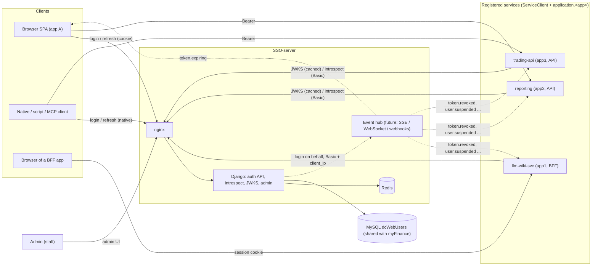
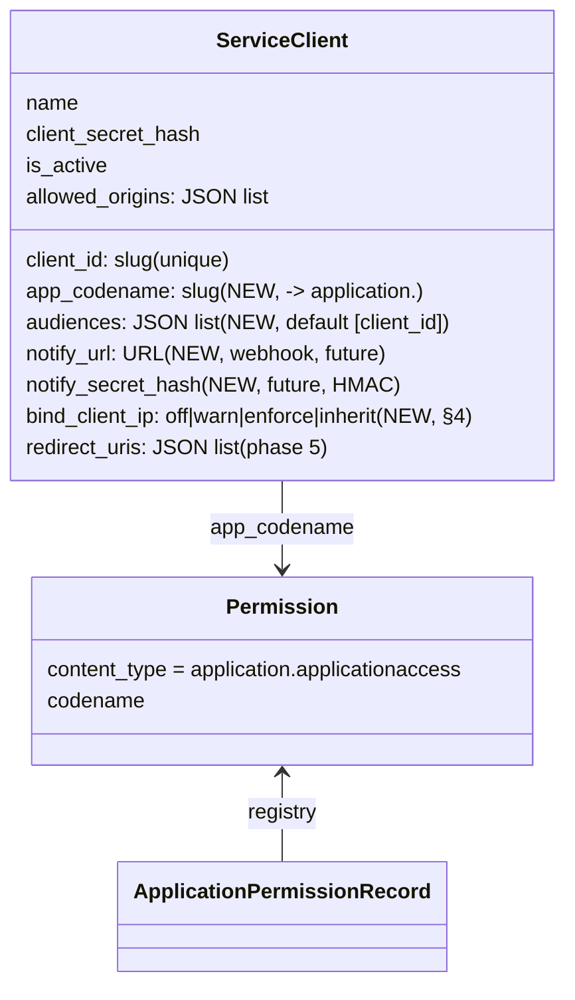
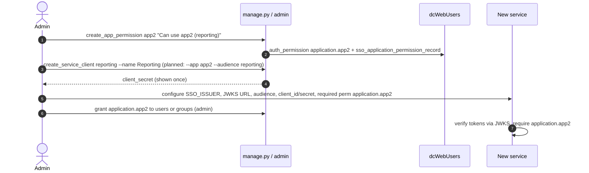
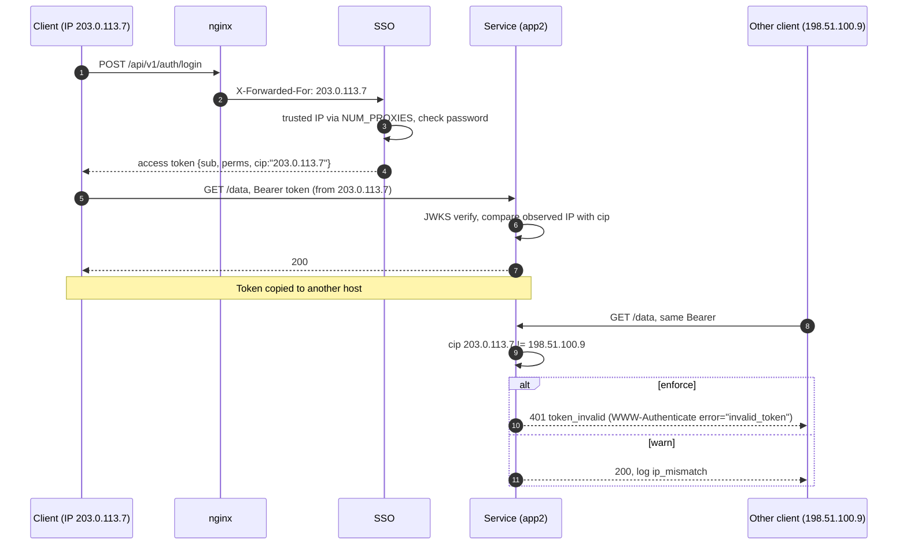
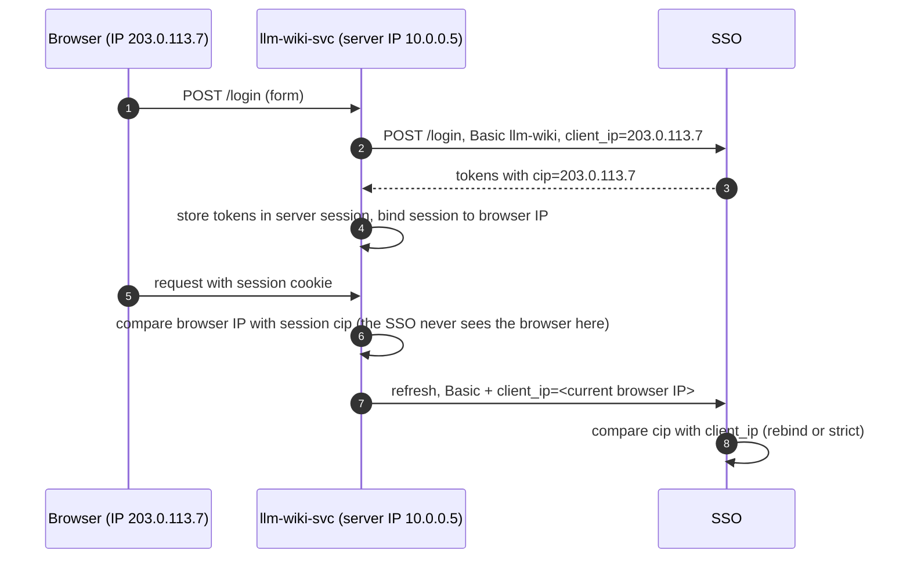
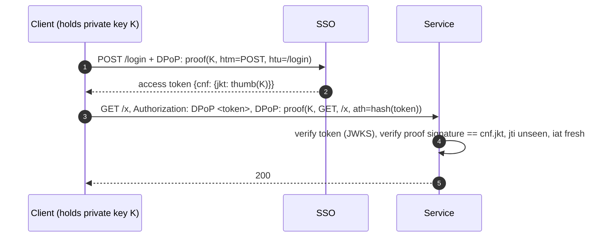
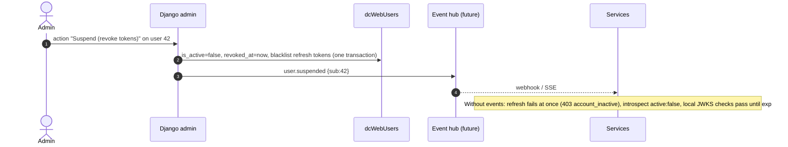
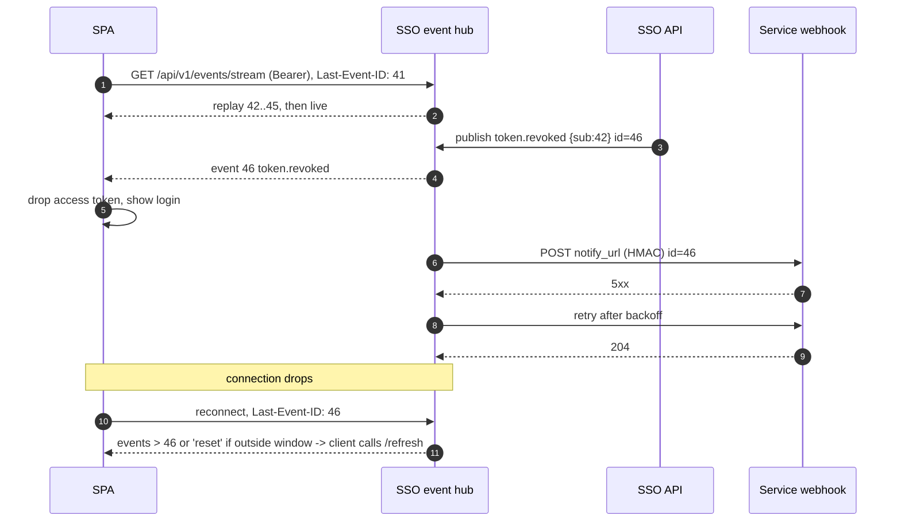
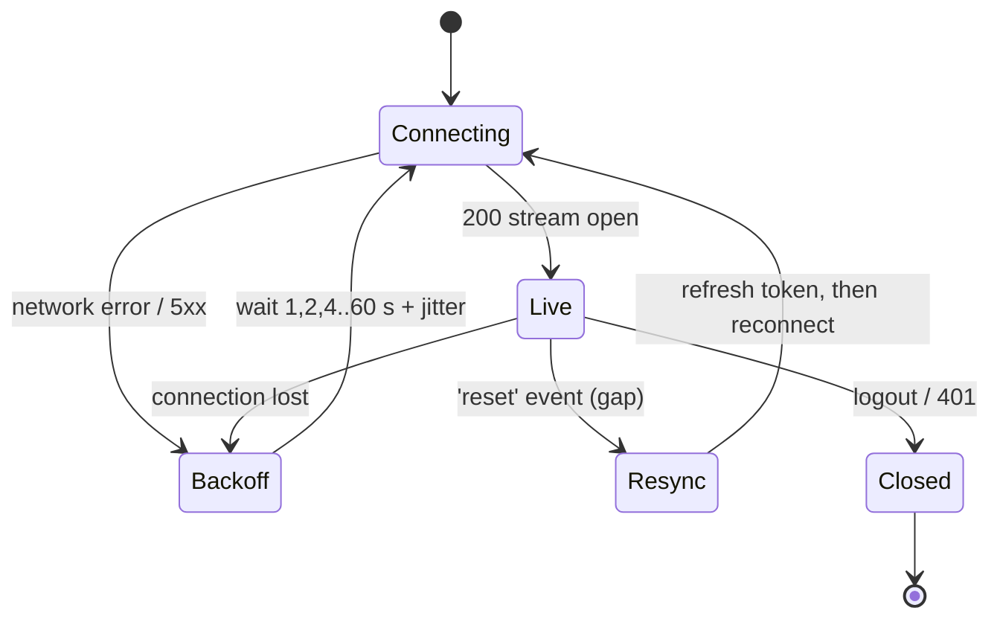
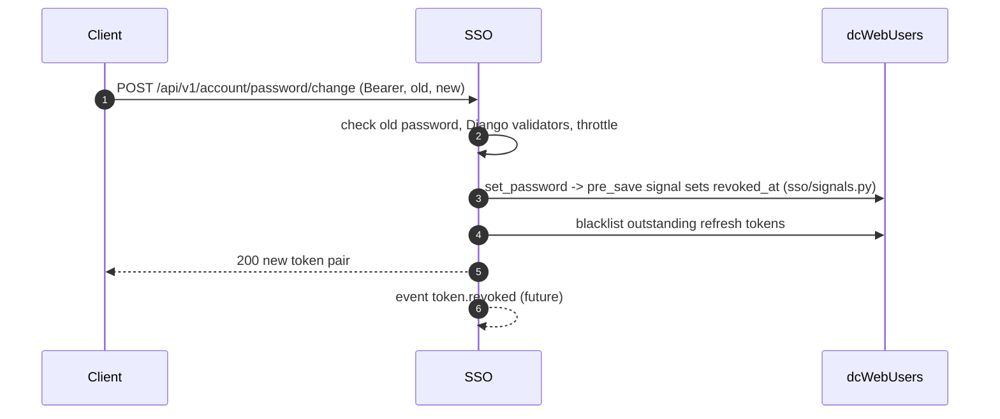

# SSO-server design v1.2: company-wide auth server requirements

Status: **proposal for review** by Thomas (owner). Documentation only, nothing here is implemented unless the
traceability table says "implemented". Baseline: branch `feat/app-permissions` @ `ea115b6`, see
[ARCHITECTURE.md](ARCHITECTURE.md) for the as-built system and [API-REFERENCE-MANUAL.md](API-REFERENCE-MANUAL.md)
for the developer manual.

## Contents

1. [Requirements traceability](#1-requirements-traceability)
2. [Target architecture: many registered services](#2-target-architecture-many-registered-services)
3. [Service registry](#3-service-registry)
4. [Client-IP token binding](#4-client-ip-token-binding)
5. [Admin page](#5-admin-page)
6. [Event notifications (future phase)](#6-event-notifications-future-phase)
7. [Online sign-up and password change (phase 5)](#7-online-sign-up-and-password-change-phase-5)
8. [Phasing plan](#8-phasing-plan)
9. [Decisions needed from Thomas](#9-decisions-needed-from-thomas)

## 1. Requirements traceability

Status legend: **implemented** (in code today), **gap** (partly there, needs work), **new** (new design in this
document), **future** (agreed later phase).

| # | Requirement | Status | Evidence in the repo / design section |
|---|---|---|---|
| 1a | REST API | implemented | JSON-only DRF views, `ssoproject/urls.py`, `sso/views.py`; reference in ARCHITECTURE §8 |
| 1b | WebSocket/SSE so the SSO can tell clients a token expired | future | §6 of this doc. Nothing in code |
| 2a-1 | Client logs in to the SSO and gets a token | implemented | `LoginView` (`sso/views.py`), `issue_token_pair` (`sso/tokens.py`) |
| 2a-2 | SSO embeds the client IP into the verification | new | §4 (`cip` claim). Today the IP is only used for throttling/logging (`sso/delegation.py`, `sso/throttles.py`) |
| 2a-3 | Service verifies the token with the SSO | implemented | Local JWKS check (`/.well-known/jwks.json`, `examples/verifier/sso_verifier.py`) and `/api/v1/auth/introspect` (`IntrospectView`) |
| 2a-4 | Service verifies token **and client IP**, so one client's token cannot be used by other clients | new | §4. Includes pitfalls and a stronger alternative (DPoP) |
| 2b-1 | SSO sends an Expire message to client and services | future | §6 |
| 2b-2 | Requests with an expired token are rejected | implemented | `exp` checked with 30 s leeway (`sso/tokens.py`, verifier step 4); 401 `token_invalid` on the SSO |
| 2c | One SSO for all company applications/services | gap | Permission namespace `application.<codename>` (`application/models.py`, `create_app_permission`), many `ServiceClient` rows (`sso/models.py`). Missing: a single `aud` for all services (`SSO_AUDIENCE`), no link between a ServiceClient and its app permission. §2, §3 |
| 3a | Admin: create / delete / suspend users | gap | Django admin stock User admin at `SSO_ADMIN_PATH` covers create/delete and `is_active` (suspend). Gap: suspending does not revoke already issued tokens (refresh/introspect check `is_active`, local JWKS verifiers do not). §5 |
| 3b | Admin: create / modify / delete a user's permissions | implemented | Stock User/Group admin "user permissions" / "group permissions"; `perms` built by `user_app_perms` (`application/permissions.py`). Gap: no bulk grant/revoke action, change does not reach existing access tokens until refresh (≤ 15 min) |
| 3c | Admin: create / modify / delete a service's permissions | gap | Create: `manage.py create_app_permission <codename> "<desc>"` only; admin list is read-only (`application/admin.py`, `has_add/change/delete_permission = False`). §5 |
| 4 | Online sign-up and change password | future (phase 5) | Reserved, not routed (`api/v1/account/*` comment in `urls.py`). Password change through Django revokes tokens (`sso/signals.py`); changes made by myFinance do not. §7 |
| 5 | API Reference Manual for client and service developers | implemented (doc) | [API-REFERENCE-MANUAL.md](API-REFERENCE-MANUAL.md) |

## 2. Target architecture: many registered services

Principles:

- One issuer (`SSO_ISSUER`), one key set (JWKS), one user table, many services.
- Each service is a **registered ServiceClient** with its own app permission `application.<app>` and (proposed) its
  own audience.
- Services authorise with `perms` locally; sensitive operations use `introspect` for revocation-aware answers.

## 3. Service registry

### 3.1 Today

- `ServiceClient` (`sso/models.py`): `client_id`, `name`, hashed secret, `redirect_uris` (phase 5),
  `allowed_origins` (informational), `is_active`. Created by `manage.py create_service_client <id> --name ...` or
  the admin (secret shown once).
- App permissions are separate: `manage.py create_app_permission app2 "Can use app2 (reporting)"`.
- All tokens carry the same `aud` (`SSO_AUDIENCE`, default `myfin-services`), so a token for app1 is accepted by
  app2's verifier as far as `aud` goes; only the `perms` check separates apps.

### 3.2 Proposed model changes (new)

- `app_codename` ties a service to its permission so the admin can show "who can use this service".
- `audiences` enables a per-service `aud`. Login would need to know the target audience: request field
  `audience` (or `client_id`) on `/login` and `/refresh`, validated against registered services. Keep
  `SSO_AUDIENCE` as the default/legacy audience so llm-wiki-svc keeps working (`aud` may be a list in JWT).
- Introspect could additionally answer `"aud_ok": true|false` for the calling client.

### 3.3 Onboarding a new service

Proposed: one command `manage.py register_service <client_id> --name --app <codename> [--audience]` doing both
steps (new).

## 4. Client-IP token binding

### 4.1 Goal

Thomas: "use IP + token to avoid multiple clients accessing the system using the same token issued to one client
instance". Threat: a copied access/refresh token is replayed from another machine.

### 4.2 Proposed design (new)

1. **Trusted IP at login.** The SSO already computes a trusted client IP: DRF `NUM_PROXIES = SSO_NUM_PROXIES`
   over `X-Forwarded-For` (nginx overwrites it), or the `client_ip` body field when an authenticated ServiceClient
   logs in on behalf of a browser (`sso/delegation.py`). This same value is bound.
2. **Claim `cip`.** Added to both access and refresh tokens. Options: plain IP (`"cip": "203.0.113.7"`) or a
   keyed hash `cip_h = base64url(HMAC-SHA256(k, ip))[:22]` to avoid putting IPs (personal data) into tokens that
   are logged by services. Plain IP is simpler for local verification; the hash requires services to know `k` or
   use introspect. **Recommendation: plain IP, with an optional prefix mode** (`/32` IPv4, `/64` IPv6) carried as
   `cip` = `"2001:db8:1:2::/64"`.
3. **Service check.** A service compares `cip` with the IP it observes (its own trusted-proxy logic). Locally after
   JWKS verification, or by calling introspect with `{"token": "...", "ip": "<observed ip>"}`; introspect answers
   `active:false` (plus `"reason": "ip_mismatch"` only in warn/log, never to the end user) on mismatch.
4. **Refresh.** `/refresh` compares the refresh token's `cip` with the caller's trusted IP. Policy options:
   `strict` (mismatch → 401 `token_invalid`, user logs in again) or `rebind` (accept, issue new pair bound to new
   IP, log `ip_changed`). Recommendation: `rebind` for browsers/mobile, `strict` for machine clients.
5. **Configuration.** `SSO_BIND_CLIENT_IP = off | warn | enforce` (default `off`), `SSO_BIND_PREFIX_V4 = 32`,
   `SSO_BIND_PREFIX_V6 = 64`, `SSO_REFRESH_IP_POLICY = rebind | strict`; per-service override
   `ServiceClient.bind_client_ip` (§3.2). `warn` issues `cip` and logs mismatches without rejecting, for a
   measurement period before `enforce`.

BFF case (llm-wiki-svc):

In the BFF case the token never leaves the server, so the SSO check is only meaningful at refresh; the useful
check is the BFF's own session-to-IP comparison.

### 4.3 Pitfalls (honest assessment)

| Pitfall | Effect |
|---|---|
| NAT / shared IP (office, carrier-grade NAT, VPN exit) | All clients behind the same address look identical: binding does **not** stop token sharing inside one office/VPN, only from outside it |
| Mobile clients, Wi-Fi ↔ 4G, roaming | IP changes mid-session; `enforce` causes 401s and re-logins every few minutes on phones |
| IPv6 privacy addresses (RFC 8981) | Interface ID rotates (often daily or per connection); full-address binding breaks, hence `/64` prefix mode |
| Corporate proxies, CDNs, load balancers | Service sees the proxy IP unless it trusts and parses `X-Forwarded-For` correctly; wrong `NUM_PROXIES` either breaks binding or lets clients spoof it |
| BFF / server-to-server | Service sees the server IP, not the user's; binding must use the delegated `client_ip` |
| Service-to-service calls with a user token | The calling service's IP differs from the bound IP; needs token exchange or an exemption |
| Spoofing | IP is not a secret; an attacker on the same network/NAT passes the check |
| Privacy | IP in a JWT is readable by anyone holding the token (base64), and lands in logs |

Conclusion: IP binding is a cheap **defence-in-depth** signal, not proof that the caller is the original client.

### 4.4 Recommended stronger complement: sender-constrained tokens

- **DPoP (RFC 9449).** Client generates a key pair (WebCrypto non-extractable key in browsers, keystore on
  mobile). Login/refresh send a `DPoP` proof JWT; SSO puts `cnf.jkt` (key thumbprint) into the token. Each
  request to a service carries a fresh proof signed by that key (`htm`, `htu`, `iat`, `jti`, `ath`). A stolen
  token is useless without the private key, regardless of IP, NAT or mobility. Libraries exist for Python and
  JS. Cost: client changes, services must validate proofs and keep a short `jti` replay cache.
- **Device-bound refresh tokens.** Lighter step: bind only the refresh token to a device key (proof required on
  `/refresh`), keep access tokens short (15 min) and bearer.
- **mTLS (RFC 8705)** for service-to-service clients.

**Recommendation:** ship `cip` in `warn` mode first (cheap, measures real IP churn), plan DPoP for native/MCP
clients and refresh tokens as the actual anti-sharing control.

## 5. Admin page

| Need | Django admin today | Gap / proposal |
|---|---|---|
| Create user | stock User admin | none |
| Delete user | stock User admin (CASCADE deletes revocation row, blacklist rows) | warn: user is shared with myFinance; prefer suspend |
| Suspend user | untick `is_active` | **gap**: does not set `revoked_at`; local verifiers accept access tokens until `exp` (≤ 15 min). Proposal: admin actions "Suspend (revoke tokens)" / "Unsuspend" = `is_active=False` + `UserTokenRevocation.revoke(user)` + blacklist outstanding refresh tokens (same as `LogoutAllView`); emit `user.suspended` (§6) |
| Grant / revoke user permission | User admin "user permissions", Group admin | Proposal: actions "Grant app access…" / "Revoke app access…" on the user list (pick `application.*`), and optional "revoke tokens now" so the change is immediate instead of ≤ 15 min |
| Create service permission | `create_app_permission` command only | Proposal: allow add/change(name) in `ApplicationPermissionAdmin` through `ensure_permission()` (keeps the registry record) |
| Delete service permission | not allowed in admin (deliberate) | Proposal: delete action with confirmation that lists affected users/groups; also deletes the record; refuses `app1` while code-defined |
| Register service | `ServiceClient` admin (secret shown once) | Proposal: fields of §3.2, link to permission, "users with access" count |
| Audit | `sso.auth` logs only | Proposal: Django `LogEntry` already records admin changes; add `sso.admin` JSON log lines for the new actions |

## 6. Event notifications (future phase)

### 6.1 Channels

| Audience | Channel | Auth |
|---|---|---|
| Browser SPA | SSE `GET /api/v1/events/stream` (simpler than WebSocket, works through nginx with buffering off) | access token (query/cookie issue: prefer `fetch`-based SSE with `Authorization` header) |
| Native/MCP client | SSE or WebSocket `wss://…/api/v1/events/ws` | Bearer |
| Service | Webhook POST to `ServiceClient.notify_url`, HMAC-signed (`X-SSO-Signature`), or SSE `GET /api/v1/events/service-stream` with Basic | ServiceClient |

### 6.2 Events

| Event | Sent to | Payload (besides `id`, `type`, `time`) |
|---|---|---|
| `token.expiring` | client | `sub`, `exp` (e.g. 60 s before) — hint to refresh |
| `token.expired` | client | `sub`, `jti` |
| `token.revoked` | client, services | `sub`, `revoked_at` (logout-all, password change) |
| `user.suspended` / `user.reactivated` | services, client | `sub` |
| `permission.changed` | services, client | `sub`, `app`, `granted:bool` |
| `keys.rotated` | services | `kid` list — hint to refetch JWKS |

Services get user-level events, not one message per expiring token (expiry is already in `exp`).

### 6.3 Delivery semantics

- At-least-once; every event has a monotonic `id`; consumers must be idempotent.
- SSE reconnect with `Last-Event-ID`; the hub keeps a bounded replay window (e.g. Redis Stream, 15 min =
  access TTL). Webhooks retry with exponential backoff up to the same window.
- Missed events (gap beyond the window, hub down) fall back to normal rules: **services still reject on `exp`
  themselves** and use introspect for sensitive calls. Events speed up revocation; they are never required for
  correctness.

## 7. Online sign-up and password change (phase 5)

Reserved routes (`urls.py` comment): `api/v1/account/*`.

| Endpoint | Purpose |
|---|---|
| `POST /api/v1/account/signup` | username, email, password; creates inactive user, sends activation mail |
| `POST /api/v1/account/activate` | token from mail → `is_active=true` |
| `POST /api/v1/account/password/change` | Bearer + old/new password; revokes all tokens (`revoked_at`), returns a fresh pair for the current client |
| `POST /api/v1/account/password/reset` | request mail (same 204 for unknown addresses) |
| `POST /api/v1/account/password/reset/confirm` | token + new password; revokes all tokens |

Known gap (D-noted in ARCHITECTURE §12): password changes made in **myFinance** write `auth_user` from another
process and do not revoke SSO tokens. Options: myFinance calls an SSO endpoint, or the SSO compares a password-hash
fingerprint (`pwd_h` claim / stored hash prefix) at refresh and introspect.

## 8. Phasing plan

| Phase | Content |
|---|---|
| current (sprint 1, v1.1) | REST API, login/refresh/logout/introspect/JWKS, `application.*` perms, admin (stock), llm-wiki-svc integration |
| v1.2a | Admin actions (suspend with revocation, grant/revoke app, service permission CRUD), `register_service`, ServiceClient `app_codename`, API reference manual, refresh-reuse family revocation |
| v1.2b | `cip` IP binding in `off/warn/enforce`, introspect `ip` param, per-service audience |
| v1.3 | DPoP / device-bound refresh tokens for native and MCP clients |
| v1.4 | Event hub: webhooks for services, SSE for clients |
| phase 5 | Hosted login + PKCE, sign-up, activation, password change/reset |

## 9. Decisions needed from Thomas

1. IP binding: go ahead as `warn` first, or straight to `enforce`? Which clients are exempt (mobile, VPN users)?
2. IP binding granularity: full address or prefix (/24 IPv4, /64 IPv6)? Plain IP in token or hashed?
3. Refresh from a new IP: `rebind` (keep session) or `strict` (re-login)?
4. Is DPoP (key-bound tokens) acceptable as the real anti-sharing control, and for which clients first?
5. Per-service audience (`aud` per app) or keep the single `myfin-services` audience?
6. Suspend semantics: should suspend always revoke tokens immediately (recommended)? May the admin delete users that
   myFinance also uses?
7. Events: webhooks, SSE, or both? Which phase?
8. Sign-up: open self-registration or invite/approval only? Email provider for activation mails?
9. How to handle myFinance password changes (call SSO vs. fingerprint check)?
