# SSO-server design v1.2: company-wide auth server requirements

Status: **design agreed** — Thomas's decisions of 2026-10-13 are applied (see §9). **v1.2a is implemented** on
branch `feat/v1.2a` (see §10 for the as-built notes and the decisions taken during implementation); v1.2b and
v1.4 are design only. Nothing else here is implemented unless the traceability table says "implemented". Baseline: branch `feat/app-permissions` @ `ea115b6`, see
[ARCHITECTURE.md](ARCHITECTURE.md) for the as-built system and [API-REFERENCE-MANUAL.md](API-REFERENCE-MANUAL.md)
for the developer manual.

## Contents

1. [Requirements traceability](#1-requirements-traceability)
2. [Target architecture: many registered services](#2-target-architecture-many-registered-services)
3. [Service registry](#3-service-registry)
4. [Client-IP token binding](#4-client-ip-token-binding)
5. [Admin page](#5-admin-page)
6. [Event notifications: signed webhooks](#6-event-notifications-signed-webhooks)
7. [Online sign-up and password change (future)](#7-online-sign-up-and-password-change-future)
8. [Phasing plan](#8-phasing-plan)
9. [Decisions (2026-10-13)](#9-decisions-2026-10-13)
10. [v1.2a as built](#10-v12a-as-built-implementation-notes-and-decisions)

The service-side Python library is designed in [SSO-CLIENT-LIBRARY-DESIGN.md](SSO-CLIENT-LIBRARY-DESIGN.md).

Future-phase and not-planned items are tracked in [../TODOS.md](../TODOS.md).

## 1. Requirements traceability

Status legend: **implemented** (in code today), **gap** (partly there, needs work), **new** (new design in this
document), **future** (agreed later phase).

| # | Requirement | Status | Evidence in the repo / design section |
|---|---|---|---|
| 1a | REST API | implemented | JSON-only DRF views, `ssoproject/urls.py`, `sso/views.py`; reference in ARCHITECTURE §8 |
| 1b | SSO informs about token expiry/revocation | new (services) / future (clients) | §6: signed webhooks to registered services (v1.4). Client push (SSE/WebSocket) moved to [TODOS.md](../TODOS.md); clients learn of expiry by rejection |
| 2a-1 | Client logs in to the SSO and gets a token | implemented | `LoginView` (`sso/views.py`), `issue_token_pair` (`sso/tokens.py`) |
| 2a-2 | SSO embeds the client IP into the verification | new | §4 (`cip` = HMAC of the exact IP). Today the IP is only used for throttling/logging (`sso/delegation.py`, `sso/throttles.py`) |
| 2a-3 | Service verifies the token and gets the permission list from the SSO | gap | `/api/v1/auth/introspect` exists (`IntrospectView`); v1.2b adds the observed `ip`, `ip_match` and session revocation (§4.4). Local JWKS check stays optional for signature/`exp` |
| 2a-4 | Service verifies token **and client IP**, so one client's token cannot be used by other clients | new | §4, `SSO_IP_BINDING_MODE = NOIP / WARNING / ENFORCE` |
| 2b-1 | SSO sends an Expire message to client and services | new (services, v1.4) | §6 webhooks; clients: rejection only (push in TODOS) |
| 2b-2 | Requests with an expired token are rejected | implemented | `exp` checked with 30 s leeway (`sso/tokens.py`, verifier step 4); 401 `token_invalid` on the SSO |
| 2c | One SSO for all company applications/services | gap | Permission namespace `application.<codename>` (`application/models.py`, `create_app_permission`), many `ServiceClient` rows (`sso/models.py`). Decision: **one token / one `aud` for all services** (kept). v1.2a: `ServiceClient.app_codename` links a service to its permission (`register_service`). §2, §3 |
| 3a | Admin: create / delete / suspend users | implemented (v1.2a) | Stock User admin plus *Suspend* / *Unsuspend* actions. Any `is_active` True→False through `save()` revokes all of the user's tokens at once (`sso/signals.py`, `sso/revocation.py`); signal-less writes are caught on use and by `revoke_inactive_users` (§10). §5 |
| 3b | Admin: create / modify / delete a user's permissions | implemented | Stock User/Group admin "user permissions" / "group permissions"; v1.2a adds bulk *Grant / Revoke app access…* actions for users and groups. `perms` built by `user_app_perms` (`application/permissions.py`). A change does not reach existing access tokens until refresh (≤ 15 min); introspect sees it at once |
| 3c | Admin: create / modify / delete a service's permissions | implemented (v1.2a) | Admin add / rename (through `ensure_permission`) / delete (confirmation lists affected users and groups; code-defined `app1` refused) in `application/admin.py`; `register_service` and `create_app_permission` commands. §5 |
| 4 | Online sign-up and change password | future | Reserved, not routed (`api/v1/account/*` comment in `urls.py`). Password change through Django revokes tokens (`sso/signals.py`). Tracked in [TODOS.md](../TODOS.md). §7 |
| 5 | API Reference Manual for client and service developers | implemented (doc) | [API-REFERENCE-MANUAL.md](API-REFERENCE-MANUAL.md) |

## 2. Target architecture: many registered services

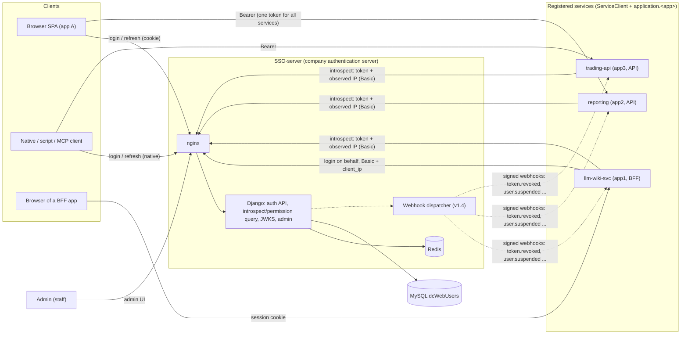

Principles:

- The SSO-server is **the** company authentication server: it owns users, passwords and permissions for every
  application. myFinance is being phased out; `dcWebUsers` is shared with it only during the transition.
- One issuer (`SSO_ISSUER`), one key set (JWKS), one user table, many services.
- **One token for all services**: a client gets one access token with the single audience `SSO_AUDIENCE`; it is
  valid at every registered service.
- Each service is a **registered ServiceClient** with its own app permission `application.<app>`. Services
  authorise by **asking the SSO** (introspect / permission query, §4.4) with the token and the client IP they
  observe; the SSO returns `active`, the user, the current permission list and `ip_match`.

## 3. Service registry

### 3.1 Today

- `ServiceClient` (`sso/models.py`): `client_id`, `name`, hashed secret, `redirect_uris` (future),
  `allowed_origins` (informational), `is_active`. Created by `manage.py create_service_client <id> --name ...` or
  the admin (secret shown once).
- App permissions are separate: `manage.py create_app_permission app2 "Can use app2 (reporting)"`.
- All tokens carry the same `aud` (`SSO_AUDIENCE`, default `myfin-services`). **This stays** (decision 5); the
  permission check (`application.<app>` in the SSO's answer) separates apps.

### 3.2 Model changes (new, v1.2a)

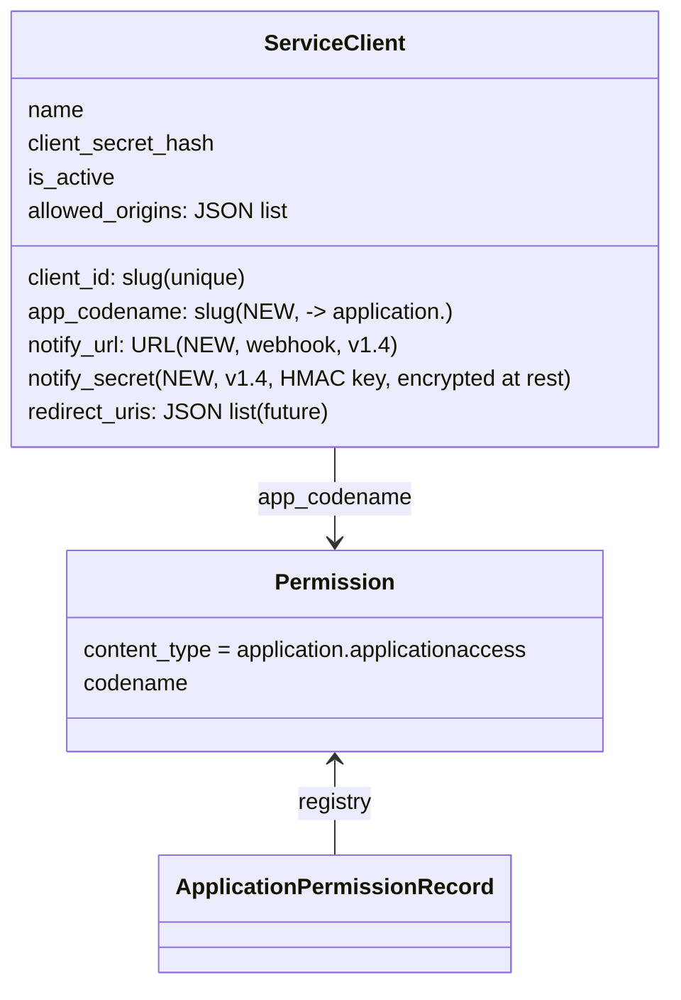

- `app_codename` ties a service to its permission so the admin can show "who can use this service".
- **As built (v1.2a):** `app_codename` and `notify_url` are added as **nullable** columns (rollback-safe on the
  shared MySQL: an older image's INSERTs still work). `notify_url` must be HTTPS and is stored only.
  `notify_secret` is **not** added in v1.2a: it must be encrypted at rest and shown once, which needs a key
  and rotation design that belongs with the webhooks (v1.4).
- No per-service audience and no per-service IP-binding override: IP binding is one server-wide setting (§4).

### 3.3 Onboarding a new service

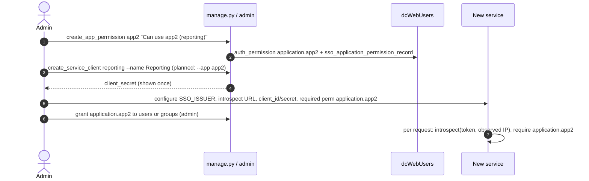

Implemented (v1.2a): `manage.py register_service <client_id> --name <name> --app <codename> [--app-name "<desc>"]
[--notify-url https://…] [--origin …]` does both steps in one transaction and prints the secret once. An
existing `client_id` is refused (rotate with `create_service_client <id> --rotate-secret`). An existing
permission is reused and keeps its description unless `--app-name` is given.

## 4. Client-IP token binding

### 4.1 Goal

Thomas: "use IP + token to avoid multiple clients accessing the system using the same token issued to one client
instance". Threat: a copied access/refresh token is replayed from another machine.

### 4.2 Design (new, v1.2b)

1. **Trusted IP at login.** The SSO already computes a trusted client IP: DRF `NUM_PROXIES = SSO_NUM_PROXIES`
   over `X-Forwarded-For` (nginx overwrites it), or the `client_ip` body field when an authenticated ServiceClient
   logs in on behalf of a browser (`sso/delegation.py`). This value is bound. **Exact IP only**, no prefixes
   (IPv6 is normalised to its canonical compressed form, IPv4-mapped IPv6 to IPv4).
2. **Claim `cip`.** Added to access and refresh tokens:
   `cip = base64url_nopad(HMAC-SHA256(SSO_IP_BINDING_KEY, canonical_ip))`. `SSO_IP_BINDING_KEY` is a server
   secret (default: derived from `DJANGO_SECRET_KEY` with a fixed label). **Why HMAC and not a bare SHA-256:**
   the IPv4 space has only 2^32 addresses; anyone holding a token could hash all of them in minutes and recover
   the IP. A keyed HMAC cannot be reversed or recomputed without the server secret, so the token does not leak the
   client's IP, and services cannot check `cip` locally — they ask the SSO (§4.4).
3. **Service check.** The service sends the token and the IP it observes (its own trusted-proxy logic) to the
   introspect / permission query; the SSO recomputes the HMAC and compares in constant time.
4. **Refresh.** `/refresh` compares the refresh token's `cip` with the caller's trusted IP (or delegated
   `client_ip`). There is **no rebind**: in `ENFORCE` mode a mismatch ends the session.
5. **Configuration.** One server setting `SSO_IP_BINDING_MODE`:

| Mode | `cip` issued | On mismatch (introspect or refresh) |
|---|---|---|
| `NOIP` (default) | no | no check |
| `WARNING` | yes | allowed; `ip_match:false` returned, `sso.auth` log + audit line `ip_mismatch` |
| `ENFORCE` | yes | introspect answers `active:false`; refresh 401 `token_invalid`; **the session is revoked** (refresh-token family blacklisted); client must log in again to get a token for its new IP |

Tokens issued under `NOIP` carry no `cip`; after switching to `WARNING`/`ENFORCE` they are treated as unbound
until they expire (≤ 15 min access, refresh re-issues with `cip`). Removed from the earlier proposal:
`SSO_BIND_CLIENT_IP`, `SSO_BIND_PREFIX_V4/V6`, `SSO_REFRESH_IP_POLICY`, `ServiceClient.bind_client_ip`.

"Session" = the refresh-token family started by one login. Implementation: refresh tokens carry a `sid`
(family id) claim; revoking a session blacklists all outstanding refresh tokens with that `sid` and records the
`sid` in a revoked-session set (Redis + DB) that introspect checks, so access tokens of that session fail at once.

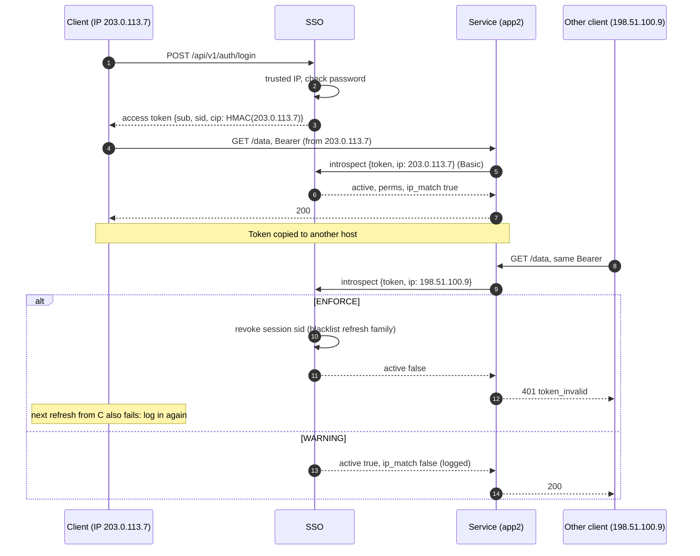

Note: in `ENFORCE` the legitimate client loses its session too when its token is replayed elsewhere (by design:
the token is compromised) or when its own IP changes (Wi-Fi ↔ mobile): it must log in again.

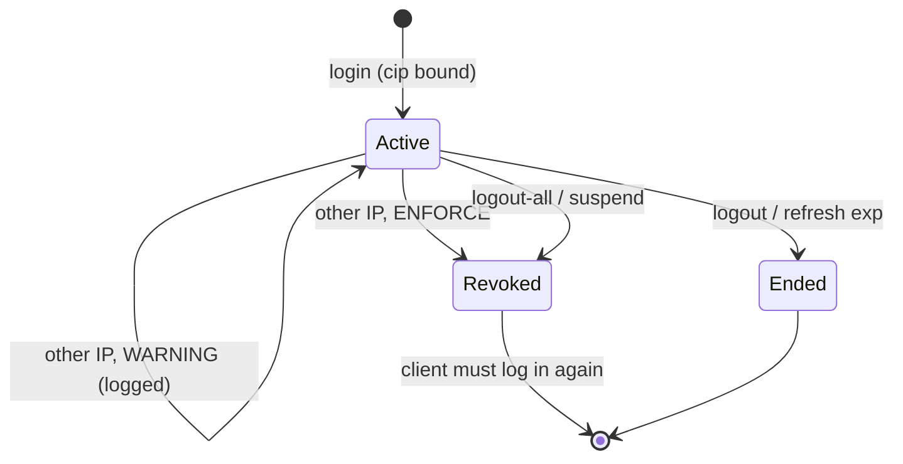

BFF case (llm-wiki-svc):

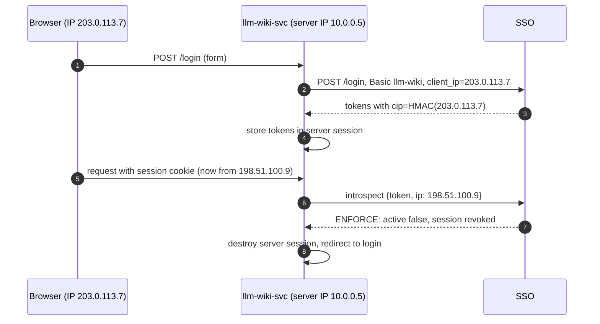

The BFF must always pass the **browser's** IP (`client_ip` on login/refresh/logout, `ip` on introspect), never
its own.

### 4.3 Pitfalls (accepted)

| Pitfall | Effect |
|---|---|
| NAT / shared IP (office, carrier-grade NAT, VPN exit) | Clients behind one address look identical: binding does not stop sharing inside one office/VPN |
| Mobile clients, Wi-Fi ↔ 4G, IPv6 privacy addresses | IP changes mid-session; in `ENFORCE` the user must log in again (accepted by decision 3) |
| Proxies / load balancers | Services must trust and parse `X-Forwarded-For` correctly; wrong config breaks binding or allows spoofing |
| Service-to-service calls with a user token | Calling service's IP differs; it must forward the original client IP |
| Spoofing | IP is not a secret; an attacker on the same network/NAT passes the check |

IP binding is the agreed control (decision 4: no DPoP). Use `WARNING` first to measure mismatch rates.

### 4.4 Introspect / permission query (v1.2b)

Services verify every request (or per short cache window) by asking the SSO. `POST /api/v1/auth/introspect`,
ServiceClient Basic auth (required).

Request:

```json
{"token": "eyJ...", "ip": "203.0.113.7"}
```

`ip` = client IP observed by the service. Optional in `NOIP`; **required** in `WARNING`/`ENFORCE` for tokens with
`cip` (missing → treated as mismatch).

Response (active):

```json
{"active": true, "sub": "42", "username": "thomas", "email": "thomas@example.com", "is_staff": false,
 "groups": ["trader"], "perms": ["application.app1", "application.app2"],
 "ip_binding": "ENFORCE", "ip_match": true,
 "token_type": "access", "iat": 1791800000, "exp": 1791800900, "iss": "https://sso.example.com",
 "aud": "myfin-services", "client_id": "reporting"}
```

- `perms` / `groups` are **current** database values, so permission changes and suspensions take effect
  immediately for services that query.
- `ip_binding`: active mode. `ip_match`: `true`, `false` (only possible in `WARNING`), or `null` (`NOIP` or token
  without `cip`).
- Inactive: `{"active": false}` (invalid, expired, revoked session, suspended user, `ENFORCE` IP mismatch). The
  reason is logged on the SSO, not returned.
- Optional convenience field `"require": "application.app2"` in the request: response adds `"allowed": bool`.

Local JWKS verification remains available as a cheap pre-check (signature, `exp`, `iss`, `aud`) to reject garbage
without a network call, but **authority for permissions and IP is the SSO's answer**.

Caching and load: services may cache an `active:true` answer keyed by `(sha256(token), ip)` for a short TTL
(default recommendation 30 s, never beyond `exp`); never cache `active:false`. Load is one indexed lookup plus
Redis checks per call; with 30 s caching, N services × active users gives ≤ 1 query per user per service per 30 s.
Introspect gets its own throttle scope per ServiceClient (`introspect`, e.g. 6000/min) and runs on the existing
gunicorn workers; scale horizontally behind nginx if needed.

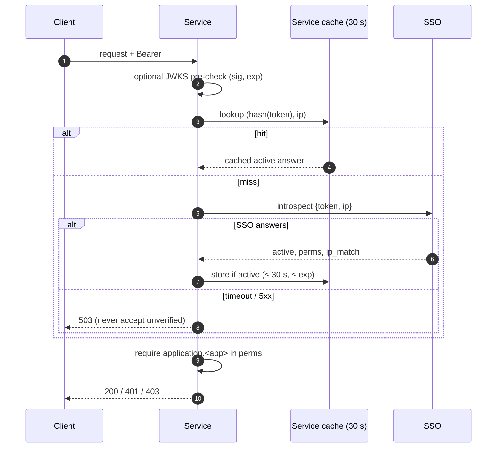

### 4.5 How the client IP is determined

The IP that the SSO binds into a token (`cip`) and the IP that a service sends to introspect must be the
**same address, derived the same way**. This section defines that derivation. It is implemented once, in the
planned `sso_client` library ([SSO-CLIENT-LIBRARY-DESIGN.md](SSO-CLIENT-LIBRARY-DESIGN.md)), and mirrored in the SSO.

#### 4.5.1 Root of trust: the socket peer

The only address the client cannot forge is the **TCP peer address** that the OS returns from
`accept()` / `getpeername()`. Each stack exposes it as:

| Stack | Where the socket peer appears |
|---|---|
| Raw socket server | `conn, addr = sock.accept()` / `sock.getpeername()` |
| WSGI (Django, Flask, gunicorn sync) | `environ["REMOTE_ADDR"]` (`request.META["REMOTE_ADDR"]`, `request.environ["REMOTE_ADDR"]`) |
| ASGI (FastAPI, Starlette, uvicorn) | `scope["client"][0]` (`request.client.host`) |

Everything in an HTTP header (`X-Forwarded-For`, `X-Real-IP`, `Forwarded`) is **client-supplied data** unless it
was written by a proxy we operate.

#### 4.5.2 Reverse proxies: trusted-hop walk

Behind nginx / a load balancer, the socket peer is the proxy. The original client IP is then taken from
`X-Forwarded-For` **only when the socket peer is a configured trusted proxy**:

1. `ip = peer` (socket address). If `peer` is not in the trusted list → return `peer`; ignore all headers.
2. Otherwise read `X-Forwarded-For` (all header instances joined, comma-split, trimmed) and walk it
   **right to left**. For each entry: parse and normalise it (malformed → stop, use last good value);
   set `ip = entry`; if `entry` is **not** trusted → stop, `ip` is the client.
3. If every hop is trusted, use the leftmost valid entry.

Trusted proxies are a list of IPs/CIDRs (e.g. `127.0.0.1/32,172.18.0.0/16`). Never configure `0.0.0.0/0`.
Taking the leftmost entry blindly, or trusting the header from any peer, lets any client spoof its IP.

| Side | Setting today | Recommendation |
|---|---|---|
| SSO-server | DRF `NUM_PROXIES=1` (count of hops behind our nginx) | **Decided (2026-10-13), v1.2b:** move to `SSO_TRUSTED_PROXIES` (CIDR list) using the same algorithm as the library, so SSO and services cannot disagree. `SSO_NUM_PROXIES` stays as a deprecated fallback (used only when `SSO_TRUSTED_PROXIES` is unset, with a deprecation warning). Not implemented in v1.2a. |
| llm-wiki-svc | `TRUSTED_PROXY_IPS` | Replace its own code with `sso_client.get_client_ip` (v1.2b). |
| Other services | — | `SSO_TRUSTED_PROXIES` via `sso_client`. |

#### 4.5.3 Delegated (BFF) calls

When a backend (e.g. llm-wiki-svc) logs a user in, refreshes, logs out, or introspects on the user's behalf, the
SSO's socket peer is the **backend**. The backend sends `client_ip` = the browser IP it derived from **its own**
socket (4.5.1–4.5.2). The SSO accepts `client_ip` only from an authenticated, active `ServiceClient`
(Basic auth). From any other caller the field is ignored and the socket-derived IP is used.

#### 4.5.4 Normalisation

Before hashing (`cip`) or comparing, both sides apply `ipaddress.ip_address()` and:

- IPv6 → canonical compressed form (lower case, `::` compression, zone id `%eth0` stripped).
- IPv4-mapped IPv6 `::ffff:a.b.c.d` → IPv4 `a.b.c.d` (dual-stack sockets report IPv4 clients this way).
- Ports are stripped (`1.2.3.4:5678`, `[2001:db8::1]:443`); `Forwarded`/`for=` quoting removed.
- Unparseable value → treated as no IP (in `WARNING`/`ENFORCE` that is a mismatch, per 4.4).

#### 4.5.5 Docker and nginx specifics

- nginx (in front of SSO or a service):
  `proxy_set_header X-Forwarded-For $proxy_add_x_forwarded_for;` and `proxy_set_header X-Real-IP $remote_addr;`.
  If nginx itself sits behind another LB, use `set_real_ip_from <LB CIDR>; real_ip_header X-Forwarded-For;
  real_ip_recursive on;` so `$remote_addr` is already the client.
- The app container must trust **only** the nginx container's address/network (e.g. the compose network CIDR).
- **Docker userland-proxy** (`docker-proxy`) can terminate published-port connections and make every client
  appear as the bridge gateway (e.g. `172.17.0.1`). Then every user has the same IP and binding is useless.
  Recommended: run the edge nginx with `network_mode: host`, or set `"userland-proxy": false` in
  `/etc/docker/daemon.json` (iptables DNAT preserves the source IP). On WSL2/Docker Desktop, check the observed
  address with `/healthz` logs before enabling `ENFORCE`.
- Verify: log the derived IP in `WARNING` mode and confirm it matches the real client before switching to `ENFORCE`.

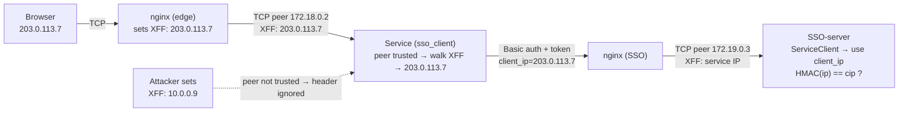

## 5. Admin page

| Need | Django admin today | Gap / proposal (v1.2a) |
|---|---|---|
| Create user | stock User admin | none |
| Delete user | stock User admin (CASCADE deletes revocation row, blacklist rows) | allowed; prefer suspend to keep audit history. During the myFinance transition the row is shared |
| Suspend user | untick `is_active` | **Decision 6: suspend revokes immediately.** Any change to `is_active=false` (admin action, form edit, shell) triggers a `pre_save`/`post_save` signal: `UserTokenRevocation.revoke(user)` + blacklist all outstanding refresh tokens + emit `user.suspended` webhook. Introspect returns `active:false` at once |
| Grant / revoke user permission | User admin "user permissions", Group admin | Proposal: actions "Grant app access…" / "Revoke app access…"; effective immediately for services that query the SSO |
| Create service permission | `create_app_permission` command only | allow add/change(name) in `ApplicationPermissionAdmin` through `ensure_permission()` |
| Delete service permission | not allowed in admin (deliberate) | delete action with confirmation listing affected users/groups; refuses `app1` while code-defined |
| Register service | `ServiceClient` admin (secret shown once) | fields of §3.2, link to permission, "users with access" count |
| Audit | `sso.auth` logs only | Django `LogEntry` + `sso.admin` JSON log lines for new actions |

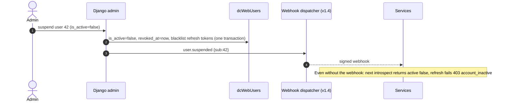

## 6. Event notifications: signed webhooks

Decision 7: the API supports **one** mechanism — **signed webhooks to registered services** (v1.4). SSE/WebSocket
push to clients is not planned (see [TODOS.md](../TODOS.md)); clients learn about expiry or revocation when a
service or `/refresh` rejects their token.

### 6.1 Registration

`ServiceClient.notify_url` (HTTPS) and `notify_secret` (shown once, used as HMAC key). Set in the admin or
`register_service --notify-url`.

### 6.2 Events

| Event | Payload (besides `id`, `type`, `time`) |
|---|---|
| `token.revoked` | `sub`, `revoked_at`, optional `sid` (logout-all, password change, `ENFORCE` IP mismatch) |
| `user.suspended` / `user.reactivated` | `sub` |
| `user.deleted` | `sub` |
| `permission.changed` | `sub`, `app`, `granted: bool` |
| `keys.rotated` | `kid` list (hint to refetch JWKS) |

No per-token `token.expired` events: expiry is already in `exp` and enforced on every check.

### 6.3 Request format and delivery

```http
POST <notify_url>
Content-Type: application/json
X-SSO-Event-Id: 46
X-SSO-Timestamp: 1791800123
X-SSO-Signature: v1=<hex HMAC-SHA256(notify_secret, timestamp + "." + body)>

{"id": 46, "type": "user.suspended", "time": "2026-10-13T09:15:23Z", "sub": "42"}
```

- Receiver verifies the signature in constant time and rejects timestamps older than 5 min (replay).
- Any 2xx = delivered. **At-least-once**: retries with exponential backoff + jitter (1 s, 2 s, 4 s … capped at
  10 min) for up to 24 h; then marked failed and visible in the admin. Consumers must dedupe on `id`.
- Queue: Redis list/stream with a worker process (`manage.py run_webhook_worker`); events persisted in DB for
  the retry window.
- Webhooks speed up reaction; they are never required for correctness: services still introspect and enforce
  `exp`.

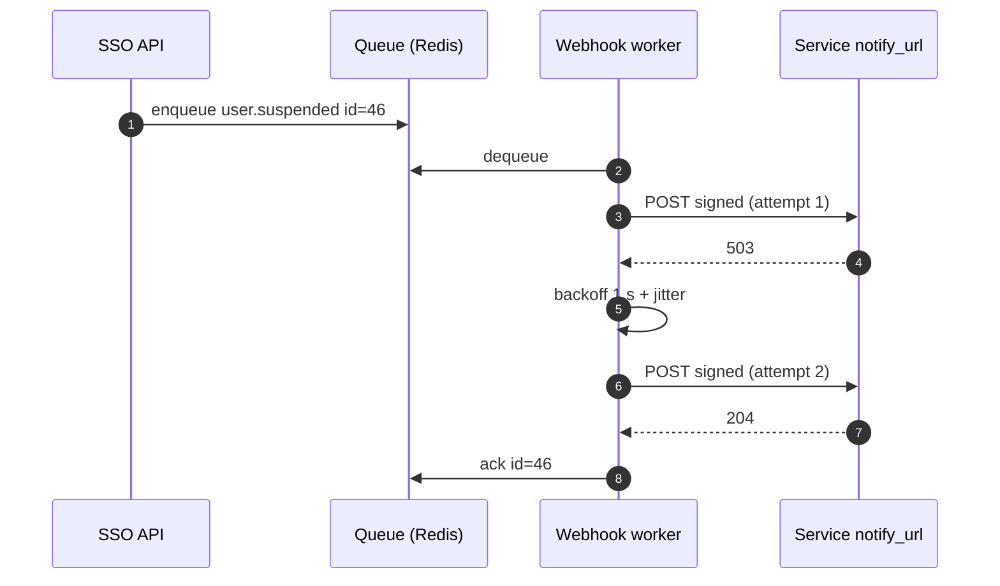

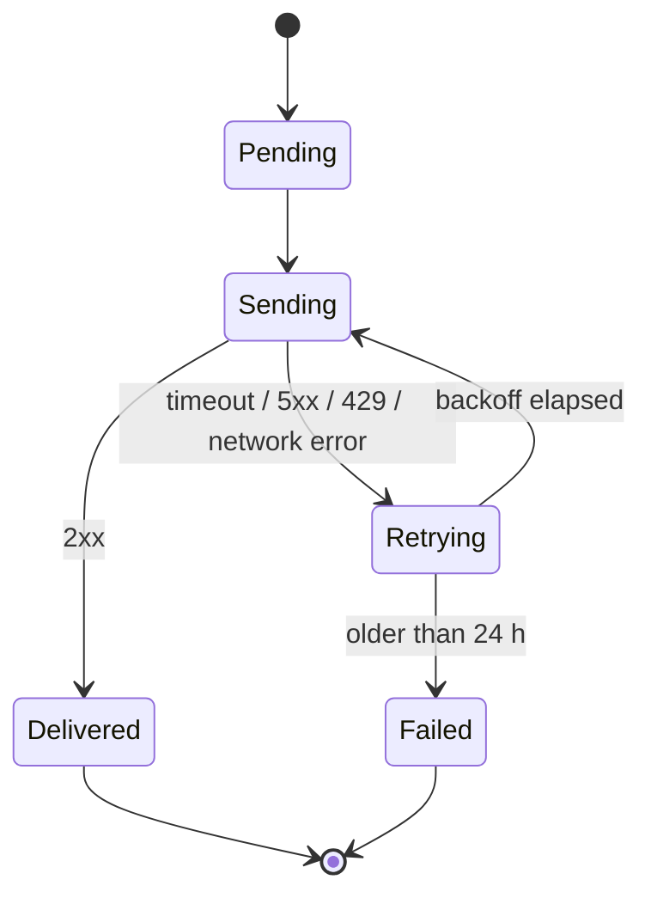

## 7. Online sign-up and password change (future)

Decision 8: kept for a future phase; tracked in [TODOS.md](../TODOS.md). Reserved routes (`urls.py` comment):
`api/v1/account/*` — sign-up, activation, password change, password reset. Password changes through Django
already revoke tokens (`sso/signals.py`).

Decision 9: myFinance is being phased out and the SSO-server is the authentication server, so password changes
happen only through the SSO. No myFinance → SSO password sync is designed; during the transition users should not
change passwords in myFinance.

## 8. Phasing plan

| Phase | Content |
|---|---|
| current (v1.1) | REST API, login/refresh/logout/introspect/JWKS, `application.*` perms, admin (stock), llm-wiki-svc integration |
| v1.2a (**implemented**, §10) | Suspend revokes immediately (signal), admin actions (grant/revoke app, service permission CRUD), `register_service`, ServiceClient `app_codename`, refresh-reuse family revocation, `sid` session claim |
| v1.2b | `SSO_IP_BINDING_MODE` (`NOIP`/`WARNING`/`ENFORCE`), `cip` HMAC claim, introspect `ip` + `ip_match` + session revocation, `introspect` throttle scope, llm-wiki-svc passes browser IP everywhere, client-IP derivation (§4.5) incl. `SSO_TRUSTED_PROXIES` (`SSO_NUM_PROXIES` deprecated fallback), **`sso-client` Python library** ([design](SSO-CLIENT-LIBRARY-DESIGN.md)); llm-wiki-svc migrates to it |
| v1.3a (**new, proposed 2026-10-13**) | SSO admin REST API `/api/v1/admin/…` + `sso_adminauditlog`, ecosystem permissions (`application.fund`, `fund_admin`, `llmwiki`, `llmwiki_write`, `gateway`, `gateway_trade`, `gateway_live`, `sso_admin`), `import_users` dry-run for FUND users ([ecosystem design](ECOSYSTEM-INTEGRATION.md) §2, §7) |
| v1.3b (FUND repo) | FUND frontend login migration to the SSO (F1 dual-accept → F3 cutover), FUND agents on `sso-client`, llm-wiki behind `/proxy/llmwiki/` (§3, §4, §6) |
| v1.3c (FUND repo) | Admin UI `/admin` in the FUND frontend on the v1.3a API; Django admin stays break-glass (§7) |
| v1.3d (SGMCP + FUND auto-trade) | Smart_Gateway_MCP verifies SSO tokens, `owner_sub` on strategies, trade/live permissions, static token becomes fallback (§5) |
| v1.3e (FUND repo) | Retire `fund-auth` (F4) |
| v1.4 | Signed webhooks to registered services; SGMCP reacts to `user.suspended` |
| future | See [TODOS.md](../TODOS.md): sign-up, password change/reset, hosted login, client push, … |

The v1.3 rows come from Thomas's ecosystem picture (FUND-Financial-Research as the core); they are a proposal
pending his review, see [ECOSYSTEM-INTEGRATION.md](ECOSYSTEM-INTEGRATION.md) §9. §5 (Django admin) stays as the
break-glass tool once the FUND Admin UI exists.

## 9. Decisions (2026-10-13)

Recorded from Thomas:

1. IP binding is a server setting `SSO_IP_BINDING_MODE` with `NOIP`, `WARNING`, `ENFORCE`.
2. Exact IP only; the token holds a (keyed) hash of the IP (`cip`).
3. `ENFORCE` + new IP: service requests are rejected, the session is disconnected, the client logs in again to
   get a token for the new IP. No rebind.
4. No DPoP; IP binding is sufficient (DPoP listed in TODOS as not planned).
5. One token for all services (single audience). Services verify permissions by querying the SSO with the token
   and get the permission list back.
6. Suspending a user immediately invalidates all of the user's tokens.
7. One notification mechanism in the API: signed webhooks to services.
8. Sign-up and other future items are tracked in TODOS.md.
9. myFinance is phasing out; the SSO-server is the new authentication server.
10. Client IP is derived from the socket peer (`getpeername`); forwarded headers only from trusted proxies (§4.5).
11. A Python library (`sso-client`) provides this and the SSO permission query for all services (v1.2b).

Library and proxy decisions, reported as approved by Thomas (relayed 2026-10-13; they settle the open decisions
of [SSO-CLIENT-LIBRARY-DESIGN.md §16](SSO-CLIENT-LIBRARY-DESIGN.md#16-open-decisions)):

12. The library lives in **`clients/python/` of this repo** and services install it with **pip from git**
    (tag `sso-client-vX.Y.Z`, `#subdirectory=clients/python`); no package index for now.
13. Distribution name **`sso-client`** (import `sso_client`). `nm-sso-client` is recorded as the alternative if
    the name ever clashes on a public index.
14. **Fail closed**: when the SSO is unreachable (timeout, connect error, 5xx) the service answers **503**, never
    accepts an unverified token. No stale-cache mode by default.
15. Cache: only **active** results, **30 s** (never beyond `exp`); `active:false` is never cached.
16. HTTP client: **httpx** (sync and async).
17. The SSO-server moves from `SSO_NUM_PROXIES` to **`SSO_TRUSTED_PROXIES`** (CIDR list, §4.5.2 algorithm), with
    `SSO_NUM_PROXIES` kept as a deprecated fallback. This is **v1.2b** work: documented here, not implemented.

## 10. v1.2a as built (implementation notes and decisions)

Branch `feat/v1.2a`. Where this section is more specific than §3–§5 it records how the design was implemented.

**Suspend (decision 6).** `pre_save`/`post_save` receivers on `User` (`sso/signals.py`) detect an `is_active`
change written by `save()` (admin form, admin action, shell, any code; `save(update_fields=[…])` only when
`is_active` is among them). True→False: `UserTokenRevocation` marker + every outstanding refresh token
blacklisted (`sso/revocation.py`), inside the save's transaction, plus an `sso.admin` log line
`user.suspended`. False→True (unsuspend) **revokes again**, so tokens issued before the reactivation stay dead
even if the suspension itself bypassed the signal; new logins work at once.
`QuerySet.update(is_active=…)` and writes by other processes (myFinance) **cannot be caught** (Django sends no
signals for them). Handled by defence in depth: (1) refresh, introspect and `/me` reject inactive users anyway;
(2) the first refresh or introspect that sees a still-valid token of an inactive user revokes the user on the
spot; (3) `manage.py revoke_inactive_users [--dry-run]` sweeps all inactive users that still hold live tokens
(cron-able). Residual gap: suspended and reactivated with `update()` both times, with no token use in between,
and no sweep → pre-suspension tokens survive. Refresh by a suspended user answers 403 `account_inactive` (as
in §5), also when the suspension already blacklisted that refresh token. The `user.suspended` webhook is v1.4.

**Sessions and reuse.** Login creates `sid` (`secrets.token_urlsafe(16)`), on both tokens; refresh copies it to
the new pair. The `sid` is written into the refresh token **before** simplejwt stores it as an
`OutstandingToken`, so a session's refresh tokens (its "family") are found by decoding the stored token strings
of that user; no table links tokens to sessions. Revoking a session: a row in the new SSO-owned table
`sso_revokedsession` (sid, user, revoked_at, reason) plus the family blacklisted; refresh, introspect and `/me`
reject any token whose `sid` is there (DB lookup; the Redis set of §4.2 is deferred to v1.2b, where introspect
load matters). Reuse = a validly signed, unexpired refresh token of ours that is already blacklisted.
**Concurrency (decision taken):** a reuse less than `SSO_REFRESH_REUSE_GRACE_SECONDS` (default **10 s**, `0`
disables the grace) after the token was first used is treated as two legitimate concurrent refreshes (two
tabs, a retry after a lost response): the late request gets 401 and **no** tokens, but the session is kept.
The same holds for requests that validated the token at the same time and lost the blacklist insert. Later
reuse revokes the session (`reason=refresh_reuse`, `sso.auth` warning `session_revoked`). The losing tab is
still logged out (accepted; cross-tab coordination is in TODOS). Tokens from before v1.2a have no `sid`: their
reuse is only rejected, and refreshing one starts a new session. Replays of tokens blacklisted by logout or
logout-all also revoke the (already ended) session; replays by a suspended user do not (already revoked).

**Admin** (`sso/admin.py`, `application/admin.py`): User actions *Suspend*, *Unsuspend* (a user cannot suspend
themself), *Grant / Revoke app access…* (intermediate page, only `application.*` permissions); the same grant /
revoke actions on Groups. Application permissions: add and rename through `ensure_permission`
(codename read-only after creation); delete one at a time (bulk delete action removed) with a confirmation page
listing direct users, groups and the count of active users with access; `app1` (code-defined) cannot be
deleted. ServiceClient: `app_codename` (validated against existing `application.*`, accepts `application.app2`
or `app2`), `notify_url`, users-with-access count, link to the permission. Read-only `RevokedSession` admin.
Every action writes a Django `LogEntry` and an `sso.admin` JSON line.

**Migration** `sso/0002_v12a_service_registry_sessions`: additive only, SSO-owned tables only: two nullable
columns on `sso_serviceclient`, new table `sso_revokedsession`. No shared table is touched; a previous image
keeps working against the migrated schema (rollback-safe).

**Open questions** (decided provisionally as above): grace default 10 s; should replaying a token that was
ended by a plain logout revoke the session (today: yes, harmless); retention of `sso_revokedsession` rows (rows
are only useful until the session's last refresh token expires, ≤ `SSO_REFRESH_TTL_DAYS`; no prune command yet);
whether `revoke_inactive_users` should be scheduled in the deployment.
