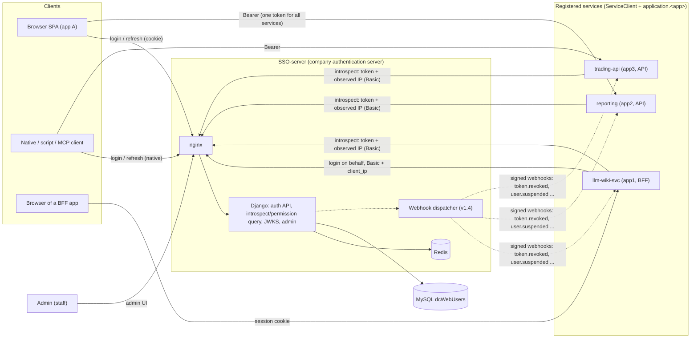
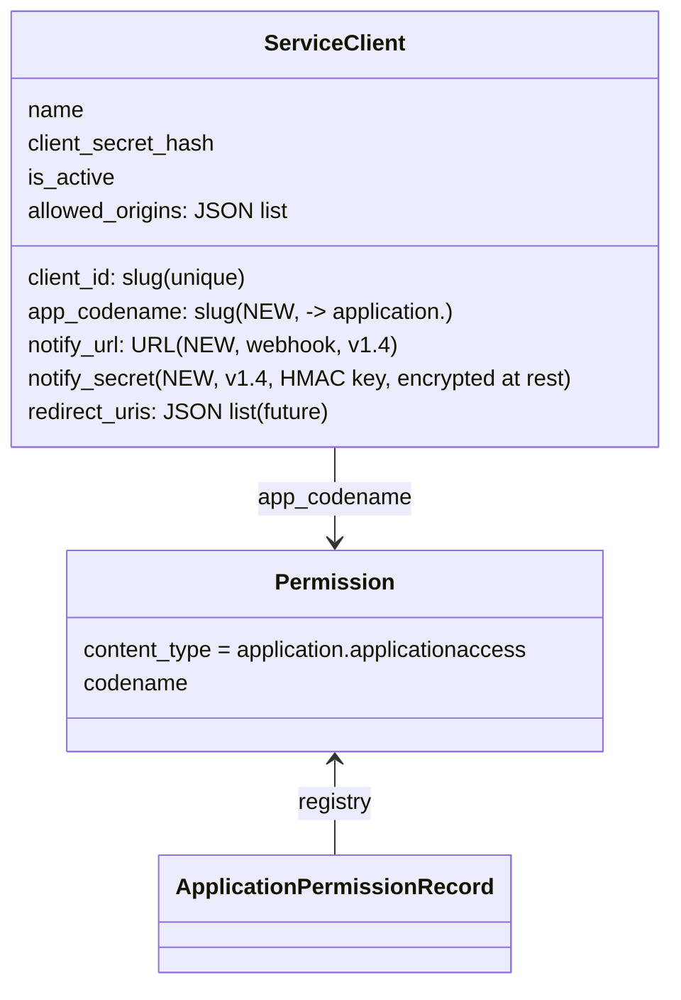
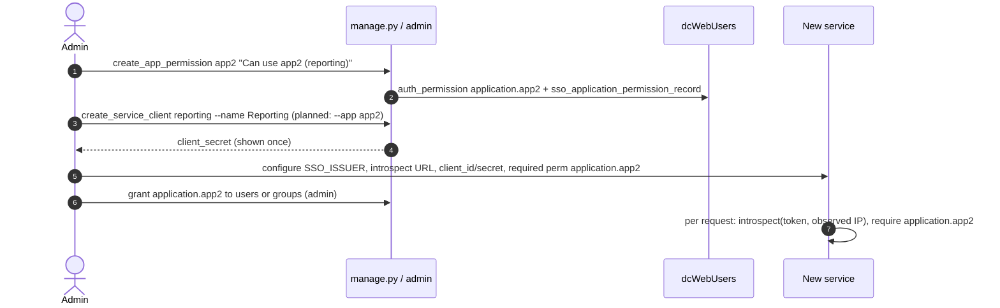
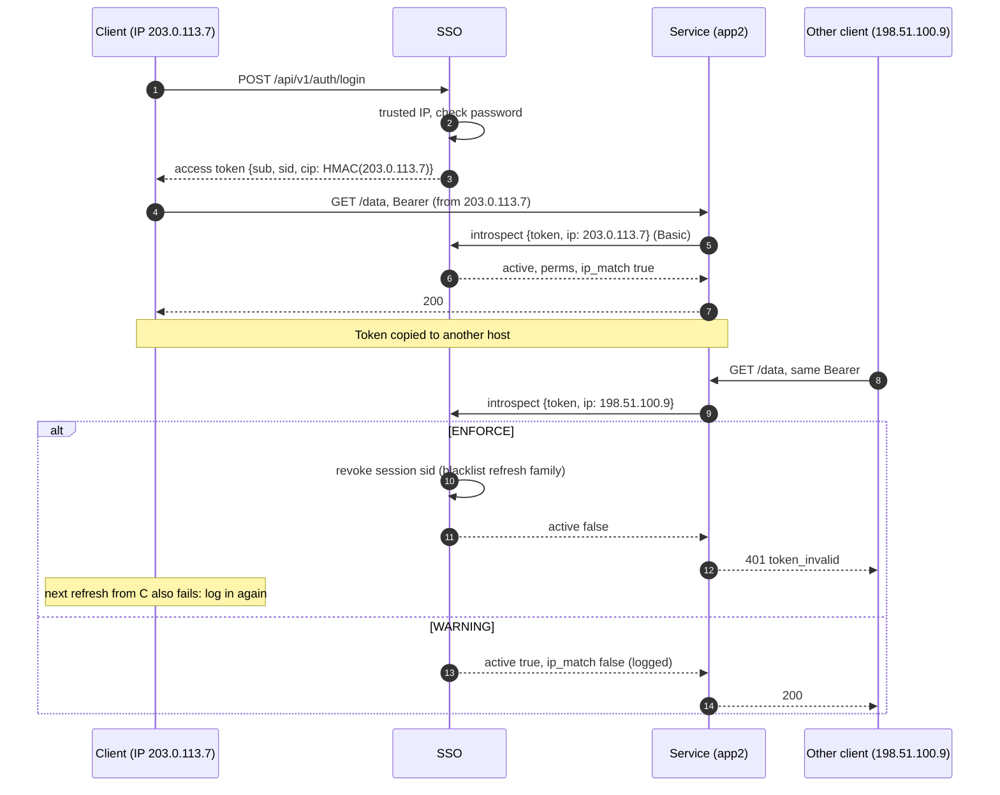
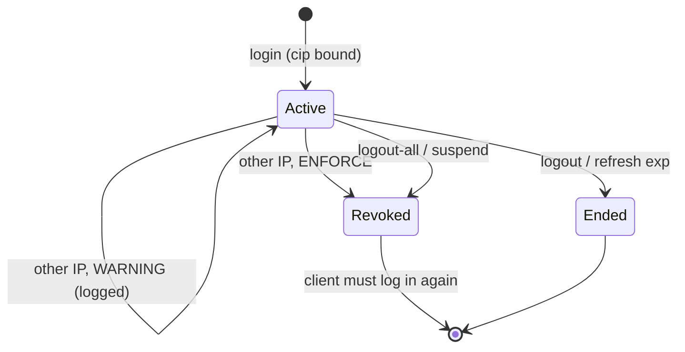
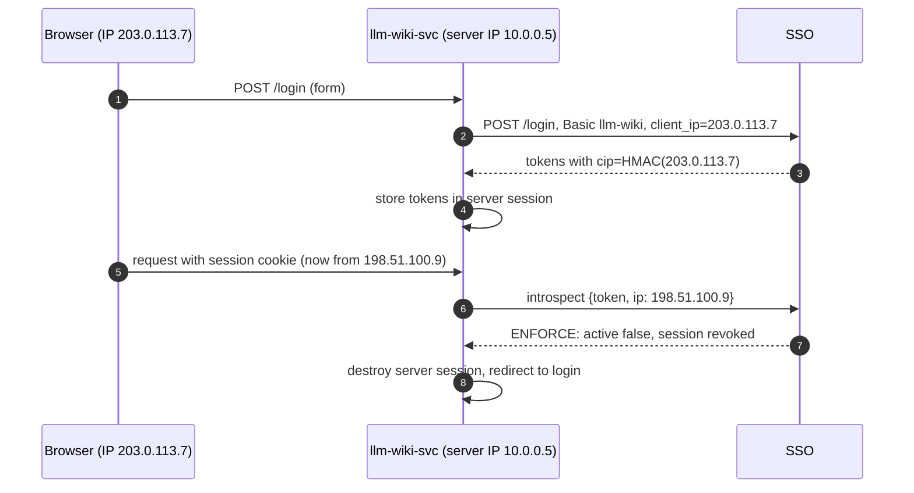
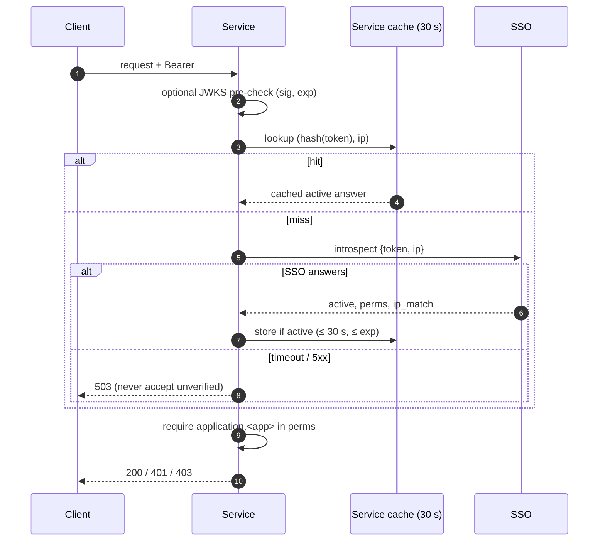
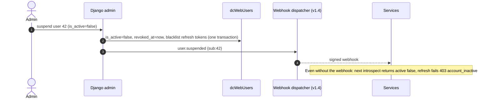
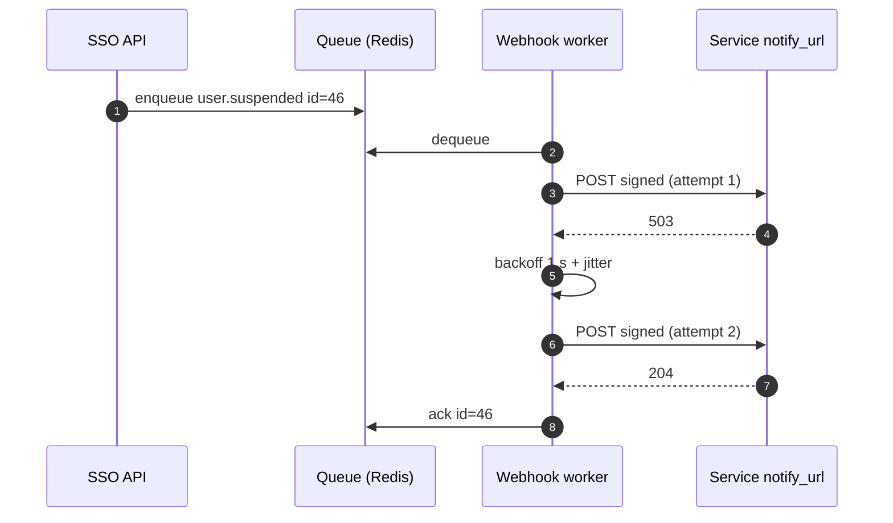
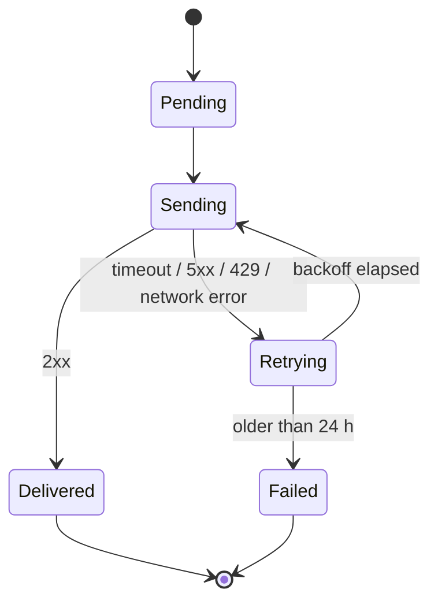

# SSO-server design v1.2: company-wide auth server requirements

Status: **design agreed** — Thomas's decisions of 2026-10-13 are applied (see §9). Documentation only, nothing here is implemented unless the
traceability table says "implemented". Baseline: branch `feat/app-permissions` @ `ea115b6`, see
[ARCHITECTURE.md](ARCHITECTURE.md) for the as-built system and [API-REFERENCE-MANUAL.md](API-REFERENCE-MANUAL.md)
for the developer manual.

## Contents

1. [Requirements traceability](#1-requirements-traceability)
2. [Target architecture: many registered services](#2-target-architecture-many-registered-services)
3. [Service registry](#3-service-registry)
4. [Client-IP token binding](#4-client-ip-token-binding)
5. [Admin page](#5-admin-page)
6. [Event notifications: signed webhooks](#6-event-notifications-signed-webhooks)
7. [Online sign-up and password change (future)](#7-online-sign-up-and-password-change-future)
8. [Phasing plan](#8-phasing-plan)
9. [Decisions (2026-10-13)](#9-decisions-2026-10-13)

Future-phase and not-planned items are tracked in [../TODOS.md](../TODOS.md).

## 1. Requirements traceability

Status legend: **implemented** (in code today), **gap** (partly there, needs work), **new** (new design in this
document), **future** (agreed later phase).

| # | Requirement | Status | Evidence in the repo / design section |
|---|---|---|---|
| 1a | REST API | implemented | JSON-only DRF views, `ssoproject/urls.py`, `sso/views.py`; reference in ARCHITECTURE §8 |
| 1b | SSO informs about token expiry/revocation | new (services) / future (clients) | §6: signed webhooks to registered services (v1.4). Client push (SSE/WebSocket) moved to [TODOS.md](../TODOS.md); clients learn of expiry by rejection |
| 2a-1 | Client logs in to the SSO and gets a token | implemented | `LoginView` (`sso/views.py`), `issue_token_pair` (`sso/tokens.py`) |
| 2a-2 | SSO embeds the client IP into the verification | new | §4 (`cip` = HMAC of the exact IP). Today the IP is only used for throttling/logging (`sso/delegation.py`, `sso/throttles.py`) |
| 2a-3 | Service verifies the token and gets the permission list from the SSO | gap | `/api/v1/auth/introspect` exists (`IntrospectView`); v1.2b adds the observed `ip`, `ip_match` and session revocation (§4.4). Local JWKS check stays optional for signature/`exp` |
| 2a-4 | Service verifies token **and client IP**, so one client's token cannot be used by other clients | new | §4, `SSO_IP_BINDING_MODE = NOIP / WARNING / ENFORCE` |
| 2b-1 | SSO sends an Expire message to client and services | new (services, v1.4) | §6 webhooks; clients: rejection only (push in TODOS) |
| 2b-2 | Requests with an expired token are rejected | implemented | `exp` checked with 30 s leeway (`sso/tokens.py`, verifier step 4); 401 `token_invalid` on the SSO |
| 2c | One SSO for all company applications/services | gap | Permission namespace `application.<codename>` (`application/models.py`, `create_app_permission`), many `ServiceClient` rows (`sso/models.py`). Decision: **one token / one `aud` for all services** (kept). Missing: link between a ServiceClient and its app permission. §2, §3 |
| 3a | Admin: create / delete / suspend users | gap | Django admin stock User admin at `SSO_ADMIN_PATH` covers create/delete and `is_active` (suspend). Gap: suspending does not revoke already issued tokens. Decision: suspend revokes immediately (v1.2a). §5 |
| 3b | Admin: create / modify / delete a user's permissions | implemented | Stock User/Group admin "user permissions" / "group permissions"; `perms` built by `user_app_perms` (`application/permissions.py`). Gap: no bulk grant/revoke action, change does not reach existing access tokens until refresh (≤ 15 min) |
| 3c | Admin: create / modify / delete a service's permissions | gap | Create: `manage.py create_app_permission <codename> "<desc>"` only; admin list is read-only (`application/admin.py`, `has_add/change/delete_permission = False`). §5 |
| 4 | Online sign-up and change password | future | Reserved, not routed (`api/v1/account/*` comment in `urls.py`). Password change through Django revokes tokens (`sso/signals.py`). Tracked in [TODOS.md](../TODOS.md). §7 |
| 5 | API Reference Manual for client and service developers | implemented (doc) | [API-REFERENCE-MANUAL.md](API-REFERENCE-MANUAL.md) |

## 2. Target architecture: many registered services



Principles:

- The SSO-server is **the** company authentication server: it owns users, passwords and permissions for every
  application. myFinance is being phased out; `dcWebUsers` is shared with it only during the transition.
- One issuer (`SSO_ISSUER`), one key set (JWKS), one user table, many services.
- **One token for all services**: a client gets one access token with the single audience `SSO_AUDIENCE`; it is
  valid at every registered service.
- Each service is a **registered ServiceClient** with its own app permission `application.<app>`. Services
  authorise by **asking the SSO** (introspect / permission query, §4.4) with the token and the client IP they
  observe; the SSO returns `active`, the user, the current permission list and `ip_match`.

## 3. Service registry

### 3.1 Today

- `ServiceClient` (`sso/models.py`): `client_id`, `name`, hashed secret, `redirect_uris` (future),
  `allowed_origins` (informational), `is_active`. Created by `manage.py create_service_client <id> --name ...` or
  the admin (secret shown once).
- App permissions are separate: `manage.py create_app_permission app2 "Can use app2 (reporting)"`.
- All tokens carry the same `aud` (`SSO_AUDIENCE`, default `myfin-services`). **This stays** (decision 5); the
  permission check (`application.<app>` in the SSO's answer) separates apps.

### 3.2 Model changes (new, v1.2a)



- `app_codename` ties a service to its permission so the admin can show "who can use this service".
- No per-service audience and no per-service IP-binding override: IP binding is one server-wide setting (§4).

### 3.3 Onboarding a new service



Proposed: one command `manage.py register_service <client_id> --name --app <codename> [--notify-url]` doing both
steps (new).

## 4. Client-IP token binding

### 4.1 Goal

Thomas: "use IP + token to avoid multiple clients accessing the system using the same token issued to one client
instance". Threat: a copied access/refresh token is replayed from another machine.

### 4.2 Design (new, v1.2b)

1. **Trusted IP at login.** The SSO already computes a trusted client IP: DRF `NUM_PROXIES = SSO_NUM_PROXIES`
   over `X-Forwarded-For` (nginx overwrites it), or the `client_ip` body field when an authenticated ServiceClient
   logs in on behalf of a browser (`sso/delegation.py`). This value is bound. **Exact IP only**, no prefixes
   (IPv6 is normalised to its canonical compressed form, IPv4-mapped IPv6 to IPv4).
2. **Claim `cip`.** Added to access and refresh tokens:
   `cip = base64url_nopad(HMAC-SHA256(SSO_IP_BINDING_KEY, canonical_ip))`. `SSO_IP_BINDING_KEY` is a server
   secret (default: derived from `DJANGO_SECRET_KEY` with a fixed label). **Why HMAC and not a bare SHA-256:**
   the IPv4 space has only 2^32 addresses; anyone holding a token could hash all of them in minutes and recover
   the IP. A keyed HMAC cannot be reversed or recomputed without the server secret, so the token does not leak the
   client's IP, and services cannot check `cip` locally — they ask the SSO (§4.4).
3. **Service check.** The service sends the token and the IP it observes (its own trusted-proxy logic) to the
   introspect / permission query; the SSO recomputes the HMAC and compares in constant time.
4. **Refresh.** `/refresh` compares the refresh token's `cip` with the caller's trusted IP (or delegated
   `client_ip`). There is **no rebind**: in `ENFORCE` mode a mismatch ends the session.
5. **Configuration.** One server setting `SSO_IP_BINDING_MODE`:

| Mode | `cip` issued | On mismatch (introspect or refresh) |
|---|---|---|
| `NOIP` (default) | no | no check |
| `WARNING` | yes | allowed; `ip_match:false` returned, `sso.auth` log + audit line `ip_mismatch` |
| `ENFORCE` | yes | introspect answers `active:false`; refresh 401 `token_invalid`; **the session is revoked** (refresh-token family blacklisted); client must log in again to get a token for its new IP |

Tokens issued under `NOIP` carry no `cip`; after switching to `WARNING`/`ENFORCE` they are treated as unbound
until they expire (≤ 15 min access, refresh re-issues with `cip`). Removed from the earlier proposal:
`SSO_BIND_CLIENT_IP`, `SSO_BIND_PREFIX_V4/V6`, `SSO_REFRESH_IP_POLICY`, `ServiceClient.bind_client_ip`.

"Session" = the refresh-token family started by one login. Implementation: refresh tokens carry a `sid`
(family id) claim; revoking a session blacklists all outstanding refresh tokens with that `sid` and records the
`sid` in a revoked-session set (Redis + DB) that introspect checks, so access tokens of that session fail at once.



Note: in `ENFORCE` the legitimate client loses its session too when its token is replayed elsewhere (by design:
the token is compromised) or when its own IP changes (Wi-Fi ↔ mobile): it must log in again.



BFF case (llm-wiki-svc):



The BFF must always pass the **browser's** IP (`client_ip` on login/refresh/logout, `ip` on introspect), never
its own.

### 4.3 Pitfalls (accepted)

| Pitfall | Effect |
|---|---|
| NAT / shared IP (office, carrier-grade NAT, VPN exit) | Clients behind one address look identical: binding does not stop sharing inside one office/VPN |
| Mobile clients, Wi-Fi ↔ 4G, IPv6 privacy addresses | IP changes mid-session; in `ENFORCE` the user must log in again (accepted by decision 3) |
| Proxies / load balancers | Services must trust and parse `X-Forwarded-For` correctly; wrong config breaks binding or allows spoofing |
| Service-to-service calls with a user token | Calling service's IP differs; it must forward the original client IP |
| Spoofing | IP is not a secret; an attacker on the same network/NAT passes the check |

IP binding is the agreed control (decision 4: no DPoP). Use `WARNING` first to measure mismatch rates.

### 4.4 Introspect / permission query (v1.2b)

Services verify every request (or per short cache window) by asking the SSO. `POST /api/v1/auth/introspect`,
ServiceClient Basic auth (required).

Request:

```json
{"token": "eyJ...", "ip": "203.0.113.7"}
```

`ip` = client IP observed by the service. Optional in `NOIP`; **required** in `WARNING`/`ENFORCE` for tokens with
`cip` (missing → treated as mismatch).

Response (active):

```json
{"active": true, "sub": "42", "username": "thomas", "email": "thomas@example.com", "is_staff": false,
 "groups": ["trader"], "perms": ["application.app1", "application.app2"],
 "ip_binding": "ENFORCE", "ip_match": true,
 "token_type": "access", "iat": 1791800000, "exp": 1791800900, "iss": "https://sso.example.com",
 "aud": "myfin-services", "client_id": "reporting"}
```

- `perms` / `groups` are **current** database values, so permission changes and suspensions take effect
  immediately for services that query.
- `ip_binding`: active mode. `ip_match`: `true`, `false` (only possible in `WARNING`), or `null` (`NOIP` or token
  without `cip`).
- Inactive: `{"active": false}` (invalid, expired, revoked session, suspended user, `ENFORCE` IP mismatch). The
  reason is logged on the SSO, not returned.
- Optional convenience field `"require": "application.app2"` in the request: response adds `"allowed": bool`.

Local JWKS verification remains available as a cheap pre-check (signature, `exp`, `iss`, `aud`) to reject garbage
without a network call, but **authority for permissions and IP is the SSO's answer**.

Caching and load: services may cache an `active:true` answer keyed by `(sha256(token), ip)` for a short TTL
(default recommendation 30 s, never beyond `exp`); never cache `active:false`. Load is one indexed lookup plus
Redis checks per call; with 30 s caching, N services × active users gives ≤ 1 query per user per service per 30 s.
Introspect gets its own throttle scope per ServiceClient (`introspect`, e.g. 6000/min) and runs on the existing
gunicorn workers; scale horizontally behind nginx if needed.



## 5. Admin page

| Need | Django admin today | Gap / proposal (v1.2a) |
|---|---|---|
| Create user | stock User admin | none |
| Delete user | stock User admin (CASCADE deletes revocation row, blacklist rows) | allowed; prefer suspend to keep audit history. During the myFinance transition the row is shared |
| Suspend user | untick `is_active` | **Decision 6: suspend revokes immediately.** Any change to `is_active=false` (admin action, form edit, shell) triggers a `pre_save`/`post_save` signal: `UserTokenRevocation.revoke(user)` + blacklist all outstanding refresh tokens + emit `user.suspended` webhook. Introspect returns `active:false` at once |
| Grant / revoke user permission | User admin "user permissions", Group admin | Proposal: actions "Grant app access…" / "Revoke app access…"; effective immediately for services that query the SSO |
| Create service permission | `create_app_permission` command only | allow add/change(name) in `ApplicationPermissionAdmin` through `ensure_permission()` |
| Delete service permission | not allowed in admin (deliberate) | delete action with confirmation listing affected users/groups; refuses `app1` while code-defined |
| Register service | `ServiceClient` admin (secret shown once) | fields of §3.2, link to permission, "users with access" count |
| Audit | `sso.auth` logs only | Django `LogEntry` + `sso.admin` JSON log lines for new actions |



## 6. Event notifications: signed webhooks

Decision 7: the API supports **one** mechanism — **signed webhooks to registered services** (v1.4). SSE/WebSocket
push to clients is not planned (see [TODOS.md](../TODOS.md)); clients learn about expiry or revocation when a
service or `/refresh` rejects their token.

### 6.1 Registration

`ServiceClient.notify_url` (HTTPS) and `notify_secret` (shown once, used as HMAC key). Set in the admin or
`register_service --notify-url`.

### 6.2 Events

| Event | Payload (besides `id`, `type`, `time`) |
|---|---|
| `token.revoked` | `sub`, `revoked_at`, optional `sid` (logout-all, password change, `ENFORCE` IP mismatch) |
| `user.suspended` / `user.reactivated` | `sub` |
| `user.deleted` | `sub` |
| `permission.changed` | `sub`, `app`, `granted: bool` |
| `keys.rotated` | `kid` list (hint to refetch JWKS) |

No per-token `token.expired` events: expiry is already in `exp` and enforced on every check.

### 6.3 Request format and delivery

```http
POST <notify_url>
Content-Type: application/json
X-SSO-Event-Id: 46
X-SSO-Timestamp: 1791800123
X-SSO-Signature: v1=<hex HMAC-SHA256(notify_secret, timestamp + "." + body)>

{"id": 46, "type": "user.suspended", "time": "2026-10-13T09:15:23Z", "sub": "42"}
```

- Receiver verifies the signature in constant time and rejects timestamps older than 5 min (replay).
- Any 2xx = delivered. **At-least-once**: retries with exponential backoff + jitter (1 s, 2 s, 4 s … capped at
  10 min) for up to 24 h; then marked failed and visible in the admin. Consumers must dedupe on `id`.
- Queue: Redis list/stream with a worker process (`manage.py run_webhook_worker`); events persisted in DB for
  the retry window.
- Webhooks speed up reaction; they are never required for correctness: services still introspect and enforce
  `exp`.





## 7. Online sign-up and password change (future)

Decision 8: kept for a future phase; tracked in [TODOS.md](../TODOS.md). Reserved routes (`urls.py` comment):
`api/v1/account/*` — sign-up, activation, password change, password reset. Password changes through Django
already revoke tokens (`sso/signals.py`).

Decision 9: myFinance is being phased out and the SSO-server is the authentication server, so password changes
happen only through the SSO. No myFinance → SSO password sync is designed; during the transition users should not
change passwords in myFinance.

## 8. Phasing plan

| Phase | Content |
|---|---|
| current (v1.1) | REST API, login/refresh/logout/introspect/JWKS, `application.*` perms, admin (stock), llm-wiki-svc integration |
| v1.2a | Suspend revokes immediately (signal), admin actions (grant/revoke app, service permission CRUD), `register_service`, ServiceClient `app_codename`, refresh-reuse family revocation, `sid` session claim |
| v1.2b | `SSO_IP_BINDING_MODE` (`NOIP`/`WARNING`/`ENFORCE`), `cip` HMAC claim, introspect `ip` + `ip_match` + session revocation, `introspect` throttle scope, llm-wiki-svc passes browser IP everywhere |
| v1.4 | Signed webhooks to registered services |
| future | See [TODOS.md](../TODOS.md): sign-up, password change/reset, hosted login, client push, … |

## 9. Decisions (2026-10-13)

Recorded from Thomas:

1. IP binding is a server setting `SSO_IP_BINDING_MODE` with `NOIP`, `WARNING`, `ENFORCE`.
2. Exact IP only; the token holds a (keyed) hash of the IP (`cip`).
3. `ENFORCE` + new IP: service requests are rejected, the session is disconnected, the client logs in again to
   get a token for the new IP. No rebind.
4. No DPoP; IP binding is sufficient (DPoP listed in TODOS as not planned).
5. One token for all services (single audience). Services verify permissions by querying the SSO with the token
   and get the permission list back.
6. Suspending a user immediately invalidates all of the user's tokens.
7. One notification mechanism in the API: signed webhooks to services.
8. Sign-up and other future items are tracked in TODOS.md.
9. myFinance is phasing out; the SSO-server is the new authentication server.
