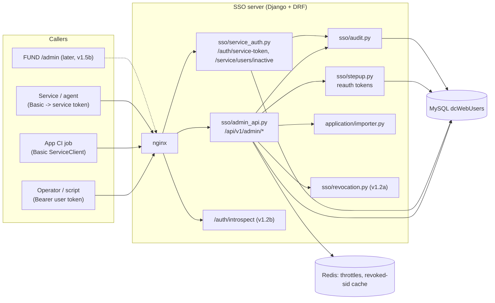
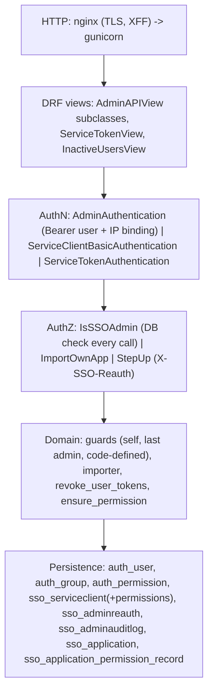
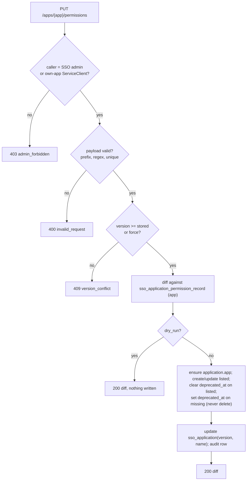
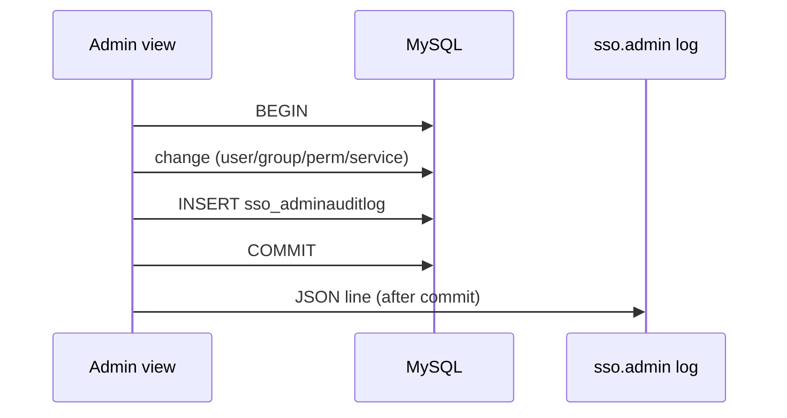
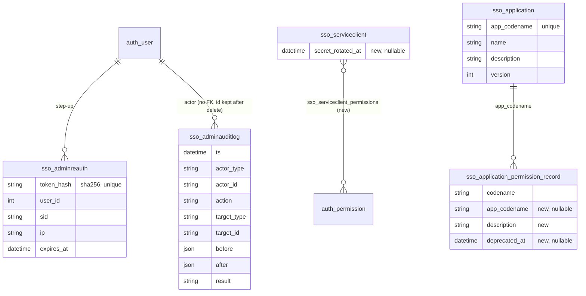

# v1.3a design: SSO admin REST API, permission import, step-up re-auth, service credentials

| | |
|---|---|
| Status | **Design for review, implemented on branch `feat/v1.3a` (local, not pushed)** |
| Date | 2026-10-15 |
| Phase | First of the three **SSO-server completion** phases (v1.3a → v1.3b → v1.3c), see [ECOSYSTEM-INTEGRATION.md §9.1](ECOSYSTEM-INTEGRATION.md#91-phasing-updated-2026-10-15-component-order) |
| Base | `feat/v1.2b` @ `68fd31f` |
| Related | [ECOSYSTEM-INTEGRATION.md](ECOSYSTEM-INTEGRATION.md) §2 (permission model), §4.1 (service credentials), §7 (admin), [API-REFERENCE-MANUAL.md §8](API-REFERENCE-MANUAL.md#8-admin-rest-api-v13a) |

## 0. Why now, and who calls it

Thomas's component order (2026-10-15): **1) complete the SSO server, 2) migrate Smart_Gateway_MCP (incl. the local
broker gateway) to full SSO, 3) FUND last.** Until FUND migrates there is no FUND `/admin` page, so the admin REST
API is used by:

| Caller | How it authenticates | Typical use |
|---|---|---|
| An operator with `curl` / a script / later the FUND Admin UI | Bearer **user** access token of an SSO admin | users, groups, permissions, services, audit |
| An application's CI/deploy job | HTTP Basic of **its own** ServiceClient | import **its own** `sso_permissions.py` (only `PUT /apps/{own app}/permissions`) |
| Django admin (`SSO_ADMIN_PATH`) | Django session login, superusers/staff | break-glass; unchanged |

## 1. Scope

In v1.3a:

1. Admin REST API `/api/v1/admin/…` (users, groups, app permissions, service clients, applications, audit).
2. Permission import (bulk upsert) from each app's `sso_permissions.py`, **never deletes, marks missing permissions
   deprecated**.
3. Step-up re-authentication (`POST /api/v1/admin/reauth` → `X-SSO-Reauth`) for destructive actions.
4. **Per-service credentials**: every service has its own ServiceClient (already true since v1.2a); new in v1.3a:
   permissions granted to a ServiceClient, `rotate-secret`, and **service tokens**
   (`POST /api/v1/auth/service-token`, client credentials, `typ=service`, no IP binding), accepted by introspect.
5. Inactive-users feed `GET /api/v1/service/users/inactive?since=` (for the suspend sweep of SGMCP/FUND).
6. Audit table `sso_adminauditlog` + `sso.admin` JSON log lines.

Not in v1.3a (later SSO completion phases): device clients with `private_key_jwt` and on-behalf-of headers (v1.3b),
signed webhooks (v1.3c). No user import (FUND users are already in `dcWebUsers`).

## 2. Architecture



### 2.1 Software layers



## 3. Authentication and authorization

### 3.1 Admin principal

- `Authorization: Bearer <user access token>` verified exactly like `/me` (signature by `kid`, `iss`, `aud`, `exp`,
  user revocation epoch, revoked `sid`).
- **IP binding applies** (user token): `ENFORCE` + different IP → `401 token_invalid` and the session is revoked;
  `WARNING` logs.
- The user is reloaded from the DB on every call and must be **active** and be an **SSO admin**:
  holds `application.sso_admin` (directly or via a group) **or** `is_superuser`. The token's embedded `perms` are
  never trusted. Otherwise `403 admin_forbidden`.
- `application.sso_admin` is a code-defined permission (recreated after every migrate, never deletable).
- A **ServiceClient** (Basic) is accepted on exactly one endpoint: `PUT /api/v1/admin/apps/{app}/permissions`, and
  only when `ServiceClient.app_codename == {app}`. Anything else → `403 admin_forbidden`.

### 3.2 Guards (same as the v1.2a Django-admin rules)

| Guard | Error |
|---|---|
| no self-suspend, no self-delete, no removing your own `sso_admin` | `409 self_action_forbidden` |
| at least one active SSO admin (superuser or `sso_admin` holder) must remain after suspend / delete / revoke / group change | `409 last_admin` |
| code-defined permissions (`app1`, `sso_admin`) cannot be deleted; codename is immutable (PATCH: name/description only) | `409 conflict` |
| a permission still granted to users/groups is deleted only with `?revoke_all=true` | `409 conflict` |
| duplicate username / group name / client_id | `409 conflict` |

### 3.3 Step-up re-authentication

```mermaid
sequenceDiagram
  autonumber
  actor A as Admin
  participant C as Client (curl / FUND /admin later)
  participant SSO as SSO admin API
  participant DB as dcWebUsers
  A->>C: suspend user 42
  C->>SSO: POST /api/v1/admin/users/42/suspend (Bearer T)
  SSO-->>C: 401 reauth_required
  C->>A: confirm password
  C->>SSO: POST /api/v1/admin/reauth {password} (Bearer T)
  SSO->>SSO: throttle admin_reauth 5/min per user
  SSO->>DB: check password; insert sso_adminreauth(sha256(token), user, sid, ip, expires=+300s); audit reauth
  SSO-->>C: 200 {reauth_token, expires_in: 300}
  C->>SSO: POST /api/v1/admin/users/42/suspend, X-SSO-Reauth (Bearer T)
  SSO->>DB: verify reauth (user, sid, ip, not expired); is_active=false; revoke tokens; audit (one transaction)
  SSO-->>C: 200 user
```

- Token: 32 random bytes (urlsafe); only its SHA-256 is stored (`sso_adminreauth`). Bound to user, the access
  token's `sid` and the client IP. Valid `SSO_ADMIN_REAUTH_SECONDS` (default 300), reusable inside the window.
- Dead when: expired, other user, other `sid` (new login), other IP, the session or user was revoked (logout-all,
  suspend, password change, refresh reuse) because the Bearer token itself then fails.
- Wrong password → `401 invalid_credentials` (audited `result=denied`); 6th attempt per minute → `429`.
- Missing / invalid / expired header on a step-up endpoint → `401 reauth_required`.
- Expired rows are deleted by `manage.py revoke_inactive_users` (the hourly sweep).

Step-up required for: delete user, suspend user, set password, delete group, grant or revoke `application.sso_admin`
(to a user or a group), delete permission, delete a ServiceClient, deactivate a ServiceClient (`PATCH is_active=false`),
rotate a client secret. Not required: reads, create user/group/permission/service, profile edits, unsuspend,
ordinary grants/revokes, logout-all of another user, permission import (dry run and apply).

## 4. Endpoints (base `/api/v1/admin`)

All bodies are JSON; errors use the standard `{"error","detail"}` shape. Lists are paginated with
`?page=` (1-based) and `?page_size=` (default 50, max 200) and return `{"count","page","page_size","results"}`.
🔒 = step-up (`X-SSO-Reauth`) required.

| Method + path | Body / query | Response | Audit action |
|---|---|---|---|
| `POST /reauth` | `{password}` | `{reauth_token, expires_in}` | `reauth` |
| `GET /users` | `q` (username/email/name contains), `active=true\|false`, `group=<name>`, `page` | list of user | |
| `POST /users` | `{username, email?, first_name?, last_name?, password?, is_active?=true, groups?[]}` | 201 user | `user.create` |
| `GET /users/{id}` | | user (+ `direct_perms`, `last_login`, `date_joined`) | |
| `PATCH /users/{id}` | `{email?, first_name?, last_name?}` | user | `user.update` |
| 🔒 `DELETE /users/{id}` | | 204 | `user.delete` |
| 🔒 `POST /users/{id}/suspend` | | user (`is_active:false`, all tokens revoked) | `user.suspend` |
| `POST /users/{id}/unsuspend` | | user (old tokens stay dead) | `user.unsuspend` |
| `POST /users/{id}/logout-all` | | 204 (all tokens revoked) | `user.logout_all` |
| 🔒 `POST /users/{id}/set-password` | `{password}` (Django validators) | 204, all tokens revoked | `user.set_password` |
| `GET /users/{id}/permissions` | | `{direct:[…], via_groups:{group:[…]}, effective:[…]}` | |
| `POST /users/{id}/permissions/{codename}` | (🔒 if `sso_admin`) | 204 | `user.grant` |
| `DELETE /users/{id}/permissions/{codename}` | (🔒 if `sso_admin`) | 204 | `user.revoke` |
| `PUT /users/{id}/groups` | `{groups:[names]}` (existing groups only) | user | `user.groups` |
| `GET /groups` · `POST /groups` | `{name}` | list · 201 group | `group.create` |
| `GET /groups/{id}` · `PATCH /groups/{id}` | `{name}` | group (`members`, `perms`) | `group.update` |
| 🔒 `DELETE /groups/{id}` | | 204 | `group.delete` |
| `POST` / `DELETE /groups/{id}/permissions/{codename}` | (🔒 if `sso_admin`) | 204 | `group.grant` / `group.revoke` |
| `PUT /groups/{id}/members` | `{user_ids:[…]}` | group | `group.members` |
| `GET /permissions` | `app=`, `deprecated=` | list of permission | |
| `POST /permissions` | `{codename, name, description?}` | 201 permission | `permission.create` |
| `GET /permissions/{codename}` · `PATCH` | `{name?, description?}` | permission (+ `users`, `groups` counts) | `permission.update` |
| 🔒 `DELETE /permissions/{codename}` | `?revoke_all=true` when granted | 204 | `permission.delete` |
| `GET /services` · `POST /services` | `{client_id, name, app_codename?, notify_url?, perms?[]}` | list · 201 service **+ `client_secret` once** | `service.create` |
| `GET /services/{client_id}` · `PATCH` | `{name?, app_codename?, notify_url?, is_active?, perms?[]}` (🔒 if `is_active:false`) | service | `service.update` |
| 🔒 `DELETE /services/{client_id}` | | 204 | `service.delete` |
| 🔒 `POST /services/{client_id}/rotate-secret` | | `{client_id, client_secret}` (old secret dead at once) | `service.rotate_secret` |
| `GET /apps` | | list of app (`app_codename`, `name`, `description`, `version`, permission counts) | |
| `GET /apps/{app}` | | app + permissions (incl. `deprecated`) | |
| `PUT /apps/{app}/permissions` | import payload (§5), `?dry_run=true`, `?force=true` | import result | `app.import` (+ `app.import_noop`) |
| `GET /audit` | `actor=<user id\|svc:client_id>`, `target_type=`, `target_id=`, `action=`, `since=` (ISO 8601), `page` | list of audit rows, newest first | |

Not under `/admin`:

| Method + path | Auth | Response |
|---|---|---|
| `POST /api/v1/auth/service-token` | Basic ServiceClient, body `{"grant_type":"client_credentials"}` | `{access_token, token_type:"Bearer", expires_in:300}` |
| `GET /api/v1/service/users/inactive?since=<ISO 8601>` | Basic ServiceClient or Bearer service token | `{users:[{id, username, is_active, event, at}], next_since}` |
| `POST /api/v1/auth/introspect` (v1.2b, extended) | Basic ServiceClient | a service token → `{active, token_type:"service", sub:"svc:<id>", subject_client_id, perms, app, exp, iat}` |

### 4.1 Resource shapes

```json
// user
{"id": 42, "username": "amy", "email": "amy@x.org", "first_name": "Amy", "last_name": "Li",
 "is_active": true, "is_staff": false, "is_superuser": false, "groups": ["trader"],
 "perms": ["application.app1"], "last_login": "2026-10-15T08:00:00Z", "date_joined": "2026-01-02T00:00:00Z"}
// group
{"id": 3, "name": "trader", "perms": ["application.gateway_trade"], "members": [42, 43]}
// permission
{"codename": "gateway_trade", "perm": "application.gateway_trade", "name": "Trade (paper/sim)",
 "description": "…", "app_codename": "gateway", "deprecated": false, "deprecated_at": null,
 "code_defined": false, "users": 3, "groups": 1}
// service
{"client_id": "sgmcp", "name": "Smart Gateway MCP", "app_codename": "gateway", "notify_url": null,
 "is_active": true, "perms": ["application.gateway"], "created": "…"}
// audit row
{"id": 9, "ts": "…", "actor": "42", "actor_ip": "203.0.113.5", "action": "user.suspend",
 "target_type": "user", "target_id": "43", "before": {"is_active": true}, "after": {"is_active": false},
 "request_id": "…", "result": "ok", "stepup": true}
```

## 5. Permission import

### 5.1 From `sso_permissions.py` to JSON

The app keeps `sso_permissions.py` (schema in [ECOSYSTEM-INTEGRATION.md §2.1](ECOSYSTEM-INTEGRATION.md#21-sso_permissionspy-schema-decision-2026-10-14-round-2-separate-file)).
`scripts/sso_permissions_to_json.py <file>` converts it with `ast.literal_eval` on top-level assignments only
(**the file is never imported or executed**; any non-literal → error):

```json
{"app_name": "Smart Gateway MCP", "description": "Broker connectivity and strategy execution", "version": 3,
 "permissions": [
   {"codename": "gateway_trade", "name": "Trade (paper/sim)", "description": "Submit, stop, delete strategies"},
   {"codename": "gateway_live",  "name": "Trade live",        "description": "Allows environment=live"}]}
```

`curl -X PUT …/api/v1/admin/apps/gateway/permissions?dry_run=true -d @gateway.json` shows the diff; the same call
without `dry_run` applies it.

### 5.2 Rules

- `{app}` in the URL is the `APP_CODENAME` (`[a-z][a-z0-9_]{1,40}`); the app permission `application.<app>` is
  implicit and always ensured.
- Each codename must start with `<app>_`, match `[a-z][a-z0-9_]{1,62}`, appear once; `name` ≤ 255 chars,
  `description` ≤ 1000. Violations → `400 invalid_request` (nothing written).
- `version` (int ≥ 1) lower than the stored one → `409 version_conflict` unless `?force=true`. Equal version with a
  different list is allowed (re-import after a fix).
- Result: `created` (new), `updated` (name/description changed, or un-deprecated because it is listed again),
  `unchanged`, `missing` (in the SSO for this app but not in the file), `deprecated` (subset of `missing` newly marked
  now), `version`, `dry_run`.
- **Never deletes.** Missing permissions get `deprecated_at` set; they keep working (introspect/`perms` unchanged)
  and are flagged `deprecated:true` in the API. Deleting one is the separate 🔒 `DELETE /permissions/{codename}`.
- Idempotent: the same body twice → all `unchanged`, one `app.import_noop` audit row.
- One transaction; one audit row with the full diff.



## 6. Service credentials (per-service)

```mermaid
sequenceDiagram
  autonumber
  participant S as Service (e.g. SGMCP scheduler)
  participant SSO as SSO
  participant R as Receiving service (sso-client)
  S->>SSO: POST /api/v1/auth/service-token (Basic client_id:secret, grant_type=client_credentials)
  SSO->>SSO: ServiceClient active? secret ok? perms of the client
  SSO-->>S: access_token (RS256, typ=service, sub=svc:client_id, perms, exp=+300s, no cip, no sid)
  S->>R: request, Authorization: Bearer service token
  R->>SSO: POST /introspect {token} (Basic R's own client)
  SSO->>SSO: verify; client still active and not rotated after iat
  SSO-->>R: active:true, token_type:service, perms
```

- Claims: `iss`, `aud`, `exp` (`SSO_SERVICE_TOKEN_TTL_SECONDS`, default 300), `iat`, `jti`, `token_type="service"`,
  `typ="service"`, `sub="svc:<client_id>"`, `client_id`, `app` (`app_codename` or null), `perms` (the client's
  granted `application.*`), `rot` (secret generation: microsecond timestamp of the last rotation, 0 if never). No refresh token, no `cip`, no `sid`; `SSO_IP_BINDING_MODE` does not apply.
- Introspect returns `active:false` once the client is deactivated, deleted, or its secret was rotated after the token was issued (`rot` claim ≠ current generation)
  (`ServiceClient.secret_rotated_at`, compared through the `rot` claim, so a token issued in the same second
  as the rotation is also dead).
- A service token is **not** accepted by the admin API, `/me` or `/logout-all`.
- Throttle scope `service_token` (default 60/min per client_id).

## 7. Inactive-users feed

`GET /api/v1/service/users/inactive?since=2026-10-15T00:00:00Z` lists users suspended or deleted (from the audit
table and `UserTokenRevocation` of inactive users) after `since`, oldest first, max 500, with `next_since` as the
cursor. Used by SGMCP (v1.4) and FUND (v1.5) as the 60 s suspend sweep until webhooks (v1.3c).

## 8. Audit logging

Table `sso_adminauditlog`: `id, ts, actor_type (user|service|system), actor_id, actor_ip, action, target_type,
target_id, before JSON, after JSON, request_id, result (ok|denied|error), stepup bool`.

- Written **in the same transaction** as the change; denied step-up attempts and denied admin calls on
  write endpoints are recorded with `result=denied` (outside the rolled-back transaction).
- Never contains passwords, secrets, reauth or access tokens (`set-password` records only `{"password":"changed"}`).
- Each row is also emitted as one JSON line on logger `sso.admin`.
- `request_id` = `X-Request-ID` header (≤ 64 chars, `[A-Za-z0-9._-]`) or a new UUID4; echoed back as `X-Request-ID`.
- Read-only in Django admin. Retention: kept (no pruning in v1.3a; audit is needed for compliance).



## 9. Network events

```mermaid
sequenceDiagram
  autonumber
  participant C as Admin client
  participant N as nginx
  participant G as gunicorn/Django
  participant DB as MySQL
  participant R as Redis
  C->>N: TLS + HTTP request
  N->>G: proxied, X-Forwarded-For = peer
  G->>R: throttle counter (admin 120/min per user)
  alt Redis down
    G-->>C: 5xx (throttle counter unavailable, same as login today; fail closed)
  end
  G->>DB: auth checks + change + audit (connect timeout 3 s, v1.2b fix)
  alt DB unreachable / timeout
    G-->>C: 503 service_unavailable, ERROR sso.db log
  else ok
    G-->>C: 2xx JSON, X-Request-ID
  end
```

| Event | Effect |
|---|---|
| Client disconnects mid-request | the DB transaction completes or rolls back as a unit; the client retries; creates return `409 conflict` on retry (not duplicated) |
| DB connect timeout / error | `503 service_unavailable`; nothing half-written (single transaction) |
| Redis error during throttle | request fails (fail closed, same behaviour as the existing login/refresh throttles) |
| Step-up token used from another IP (mobile network change) | `401 reauth_required`; re-confirm the password |
| Access token expires during a step-up window | refresh the access token (same `sid`), the reauth token stays valid |

## 10. Error codes (new in v1.3a)

| HTTP | `error` | When |
|---|---|---|
| 401 | `reauth_required` | step-up endpoint without a valid `X-SSO-Reauth` |
| 401 | `invalid_credentials` | wrong password at `/admin/reauth` |
| 401 | `token_invalid` | missing/invalid Bearer, or a service token on admin endpoints |
| 401 | `invalid_client` | bad Basic credentials (service-token, feed, import) |
| 403 | `admin_forbidden` | not an active SSO admin / ServiceClient outside its own app import |
| 404 | `not_found` | unknown user, group, permission, service, app |
| 409 | `self_action_forbidden` | suspend/delete yourself, remove your own `sso_admin` |
| 409 | `last_admin` | would leave no active SSO admin |
| 409 | `conflict` | duplicate, code-defined permission, permission still granted without `revoke_all` |
| 409 | `version_conflict` | import with an older `version` without `force` |
| 429 | `rate_limited` | `admin` 120/min per user, `admin_reauth` 5/min per user, `service_token` 60/min per client |

## 11. Configuration

| Variable | Default | Meaning |
|---|---|---|
| `SSO_ADMIN_REAUTH_SECONDS` | `300` | step-up window |
| `SSO_SERVICE_TOKEN_TTL_SECONDS` | `300` | service token lifetime |
| `SSO_THROTTLE_ADMIN` | `120/min` | per admin user |
| `SSO_THROTTLE_ADMIN_REAUTH` | `5/min` | per user |
| `SSO_THROTTLE_SERVICE_TOKEN` | `60/min` | per client_id |

## 12. Data model changes (migrations `sso.0003`, `application.0002`)



All new columns are nullable / have Python defaults so a rollback to the v1.2b image keeps working (same rule as
v1.2a). No shared Django table is altered. `ApplicationAccess.Meta.permissions` gains `sso_admin` (Django
`AlterModelOptions`, no schema change).

## 13. Tests (sso/tests/test_admin_api_v13a.py, test_service_token_v13a.py, test_import_v13a.py)

Auth matrix (anonymous, non-admin, inactive admin, service token, ServiceClient), each guard, step-up (missing,
wrong password, expired, other sid, other IP, reuse inside window, throttle), audit rows in the same transaction
(rollback on error), import (create, idempotent, rename, deprecate, un-deprecate, prefix/regex errors, version
conflict, force, dry run writes nothing, own-app ServiceClient only), service tokens (issue, introspect, deactivate,
rotate → inactive, no IP binding in ENFORCE), inactive feed.
