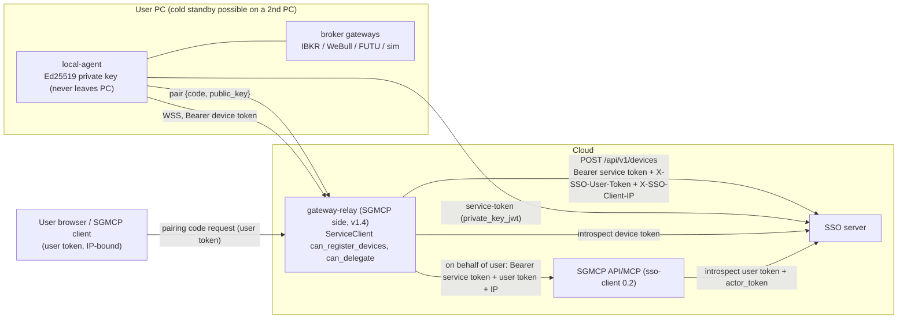
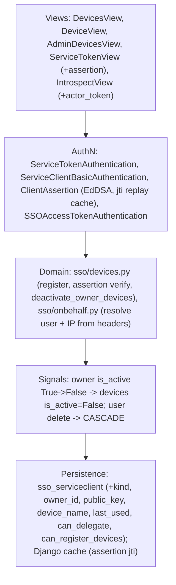
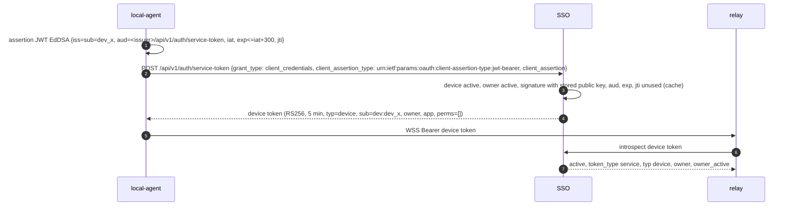
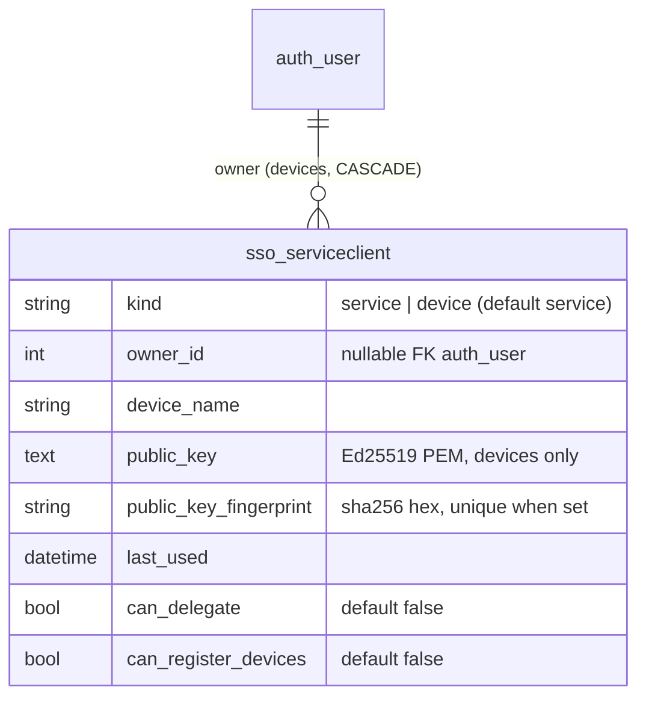

# v1.3b design: gateway device credentials, on-behalf-of calls, sso-client 0.2

| | |
|---|---|
| Status | **Design for review, implemented on branch `feat/sso-v1.3` (local, not pushed)** |
| Date | 2026-10-15 |
| Phase | Second SSO-server completion phase ([ECOSYSTEM-INTEGRATION.md §9.1](ECOSYSTEM-INTEGRATION.md)); needed by SGMCP (v1.4) |
| Builds on | v1.3a ([DESIGN-v1.3a-admin-api.md](DESIGN-v1.3a-admin-api.md)): service tokens, admin API, audit, step-up |
| Related | [ECOSYSTEM-INTEGRATION.md](ECOSYSTEM-INTEGRATION.md) §4.1 (service-to-service, on behalf of a user), §5.2 (pairing) |

## 0. Problem

1. The **local broker gateway** (`local-agent` on the user's PC) must authenticate to the cloud relay without any
   shared secret leaving the cloud, without the user's password, and without IP binding (home IPs change). Broker
   credentials never leave the PC. Suspending the user must cut the PC off at once.
2. A cloud service (e.g. the relay, FUND auto-trade) sometimes acts **for a user**: the receiving service must see
   both who is calling (service) and for whom (user, IP-bound to the browser IP).
3. Services need a library for all of this: `sso-client` 0.2.

## 1. Scope

| Item | Delivered |
|---|---|
| Device clients | `ServiceClient.kind = service \| device`, `owner` (user), Ed25519 `public_key`, `device_name`, `last_used` |
| Device registration | `POST /api/v1/devices` by a registering service (`can_register_devices`) on behalf of the user (on-behalf-of headers) |
| Device tokens | `POST /api/v1/auth/service-token` with `private_key_jwt` (RFC 7523 client assertion, EdDSA): 5-min token `typ=device`, `sub=dev:<id>`, `owner`, no IP binding |
| Device lifecycle | owner lists/deletes own devices (`GET/DELETE /api/v1/devices…`, user token); admin `GET /api/v1/admin/devices`, 🔒 `DELETE /api/v1/admin/devices/{id}`; **owner suspended → all devices deactivated** (stay off after unsuspend), owner deleted → devices deleted |
| On-behalf-of | introspect accepts `actor_token` (caller's service token): response adds `act` and `delegation_allowed`; `ServiceClient.can_delegate` |
| sso-client 0.2 | `ServiceTokenSource` (client credentials, cached), `DeviceTokenSource` (`private_key_jwt`), `on_behalf_of_headers()`, `check(…, actor_token=)`, `check_service()`, adapters accept the on-behalf-of headers |

Not in v1.3b: the relay itself and the pairing code (SGMCP / v1.4); webhooks (v1.3c).

## 2. Architecture



### 2.1 Layers



## 3. Device registration (pairing, SSO part)

```mermaid
sequenceDiagram
  autonumber
  actor U as User
  participant RL as gateway-relay
  participant SSO as SSO
  participant LA as local-agent
  U->>RL: request pairing code (Bearer user token U, from IP 203.0.113.7)
  RL-->>U: code (relay-side, v1.4)
  LA->>LA: generate Ed25519 key pair
  LA->>RL: pair {code, device_name, public_key}
  RL->>SSO: POST /api/v1/devices {device_name, public_key} Bearer S (relay service token), X-SSO-User-Token U, X-SSO-Client-IP 203.0.113.7
  SSO->>SSO: S valid + can_register_devices; U active, ip match, not revoked; U holds application.<relay app> if set
  SSO->>SSO: create ServiceClient kind=device, owner=U.sub, client_id=dev_<16 hex>, app=relay app; audit device.create
  SSO-->>RL: 201 {client_id, kind, owner, app, token_endpoint, assertion_audience}
  RL-->>LA: client_id
```

The relay stores the user token only for the duration of the pairing request (§4.1 rule: never forward a user token
you did not receive in the current request).

Rules: max `SSO_DEVICE_MAX_PER_USER` (default 10) active devices per owner (409 `conflict`); `public_key` is an Ed25519
public key in PEM (`-----BEGIN PUBLIC KEY-----`) or base64url raw 32 bytes; the same key cannot be registered twice
(409). A device has no secret (`client_secret_hash` is unusable); Basic auth with a device id always fails.

## 4. Device tokens (`private_key_jwt`)



Device token claims: `token_type="service"`, `typ="device"`, `sub="dev:<client_id>"`, `client_id`, `owner`
(user id string), `app`, `perms` (always `[]`; the device acts as a pipe, the relay decides), `rot`, no `cip`/`sid`.
Introspect returns `active:false` when the device is inactive/deleted or its **owner is inactive** (checked live).
Assertion errors → `401 invalid_client` (no detail which check failed); `jti` replay → `401 invalid_client`.

## 5. On-behalf-of

```mermaid
sequenceDiagram
  autonumber
  participant B as Browser (IP 203.0.113.7)
  participant A as Service A (can_delegate)
  participant G as Service B (sso-client 0.2)
  participant SSO as SSO
  B->>A: request, Bearer U
  A->>G: Bearer S_A, X-SSO-User-Token U, X-SSO-Client-IP 203.0.113.7
  G->>SSO: introspect {token: U, ip: 203.0.113.7, actor_token: S_A, require}
  SSO->>SSO: S_A valid service token AND client can_delegate; U active, IP binding on 203.0.113.7
  SSO-->>G: active, user claims, act {sub: svc:A, client_id: A}, delegation_allowed true, allowed
  G->>G: effective principal = user, via = A
```

- Without `actor_token` introspect is unchanged (v1.2b). With it: an invalid actor token → `{"active": false}`
  (fail closed); a valid one from a client without `can_delegate` → `active:true` with `delegation_allowed:false`
  and `allowed:false` (if `require` was sent). The receiving library treats `delegation_allowed:false` as 403.
- The `ip` in introspect is the **browser IP** from `X-SSO-Client-IP`; the receiving service accepts that header
  **only** together with a service token (else it uses its own socket peer, v1.2b).
- `POST /api/v1/devices` uses the same rule internally.

## 6. API reference (new / changed)

| Method + path | Auth | Request | Response / errors |
|---|---|---|---|
| `POST /api/v1/devices` | Bearer service token (client `can_register_devices`) + `X-SSO-User-Token` + `X-SSO-Client-IP` | `{"device_name", "public_key"}` | 201 device; 401 `invalid_client` (service token), 401 `token_invalid` (user token missing/inactive/IP mismatch in ENFORCE), 403 `forbidden` (no can_register_devices / user lacks app permission), 409 `conflict` (limit, duplicate key), 400 bad key |
| `GET /api/v1/devices` | Bearer user token | | 200 `{"results":[device]}` (own devices) |
| `DELETE /api/v1/devices/{client_id}` | Bearer user token (owner) | | 204; 404 if not own |
| `POST /api/v1/auth/service-token` | Basic (service) **or** `client_assertion` (device) | `grant_type=client_credentials` (+ `client_assertion_type`, `client_assertion`) | 200 token; 401 `invalid_client` |
| `POST /api/v1/auth/introspect` | Basic | adds optional `actor_token` | adds `act`, `delegation_allowed`; device tokens: `typ`, `owner`, `owner_active` |
| `GET /api/v1/admin/devices?owner=` | admin | | list of device |
| 🔒 `DELETE /api/v1/admin/devices/{client_id}` | admin + step-up | | 204 |
| `PATCH /api/v1/admin/services/{id}` | admin | adds `can_delegate`, `can_register_devices` (🔒 when turning either on) | service |

Device resource: `{"client_id", "kind": "device", "device_name", "owner", "app_codename", "is_active", "created",
"last_used", "public_key_fingerprint"}` (SHA-256 of the raw key, hex; the key itself is not returned).

Error code added: `403 forbidden` reused for `can_register_devices` / app permission.

## 7. Events and failure handling

| Event | Effect |
|---|---|
| Owner suspended (any path that saves `is_active=False`) | all owner devices `is_active=false` in the same transaction; device tokens inactive at once at introspect; assertion refused; v1.3c sends `user.suspended` (relay disconnects) |
| Owner reactivated | devices stay inactive (re-pair, like old tokens staying dead) |
| Owner deleted | devices deleted (CASCADE) |
| Admin or owner deletes a device | token inactive at introspect immediately; within ≤ 5 min a JWKS-only verifier still accepts it (use introspect for the relay WSS handshake and every 60 s heartbeat) |
| PC clock skew | assertion `iat` may be up to 60 s in the future; `exp - iat` ≤ 300 s |
| Assertion replay | `jti` remembered in the shared cache until `exp`; replay → 401 |
| Cache (Redis) down during assertion | 503 `service_unavailable` (fail closed: cannot check replay) |

## 8. sso-client 0.2

```python
from sso_client import SSOClient, SSOConfig, ServiceTokenSource, DeviceTokenSource, on_behalf_of_headers

cfg = SSOConfig.from_env()                       # SSO_BASE_URL, SSO_CLIENT_ID, SSO_CLIENT_SECRET
tokens = ServiceTokenSource(cfg)                 # cached, renewed 30 s before exp, thread-safe
headers = on_behalf_of_headers(tokens.get(), user_token, browser_ip)   # Authorization + X-SSO-User-Token + X-SSO-Client-IP

sso = SSOClient(cfg)
result = sso.check(user_token, browser_ip, require=["application.gateway_trade"], actor_token=caller_service_token)
result.via            # "svc:relay" (None without actor)
svc = sso.check_service(service_token)   # ServiceCheck(client_id, perms, typ, owner)

dev = DeviceTokenSource(base_url=..., client_id="dev_8f3a", private_key_pem=open("device.key","rb").read())
dev.get()             # device token via private_key_jwt (needs extra: sso-client[device])
```

Adapters (Django/FastAPI/Flask): when the request carries `X-SSO-User-Token` **and** a Bearer token, the adapter
treats the Bearer as the actor service token, takes the client IP from `X-SSO-Client-IP`, and introspects the
user token with `actor_token`; `request.sso.via` is set. Otherwise unchanged (0.1 behaviour).

## 9. Data model



All new columns nullable or with defaults (rollback-safe). Migration `sso.0005_v13b`.

## 10. Configuration

| Variable | Default | Meaning |
|---|---|---|
| `SSO_DEVICE_MAX_PER_USER` | `10` | active devices per owner |
| `SSO_DEVICE_ASSERTION_MAX_AGE` | `300` | max `exp - iat` of a client assertion (s) |
