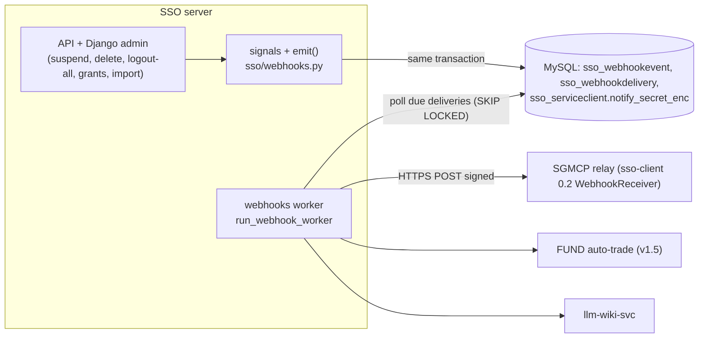
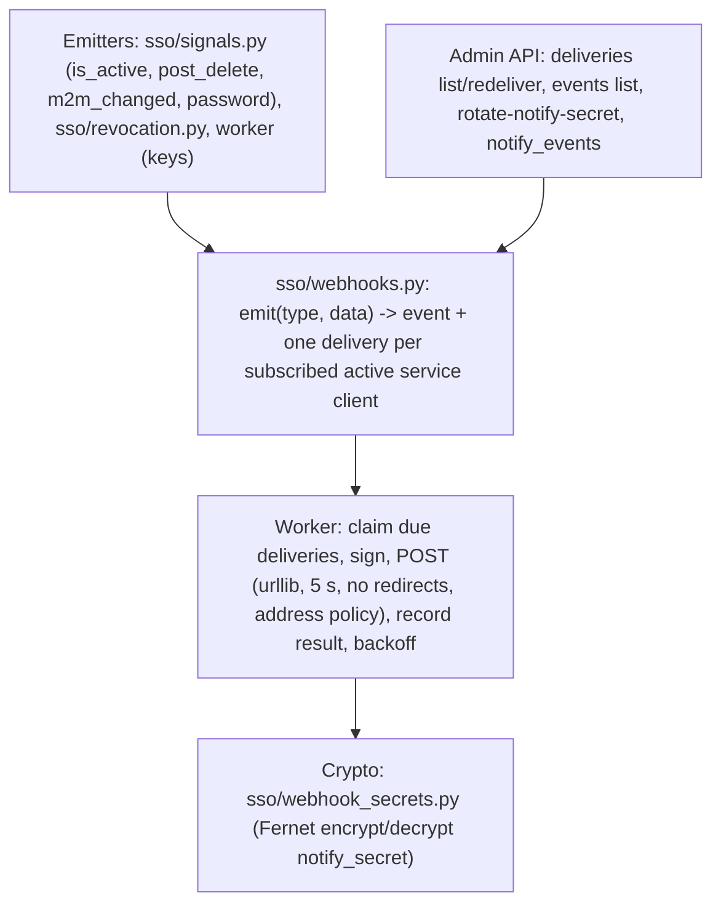
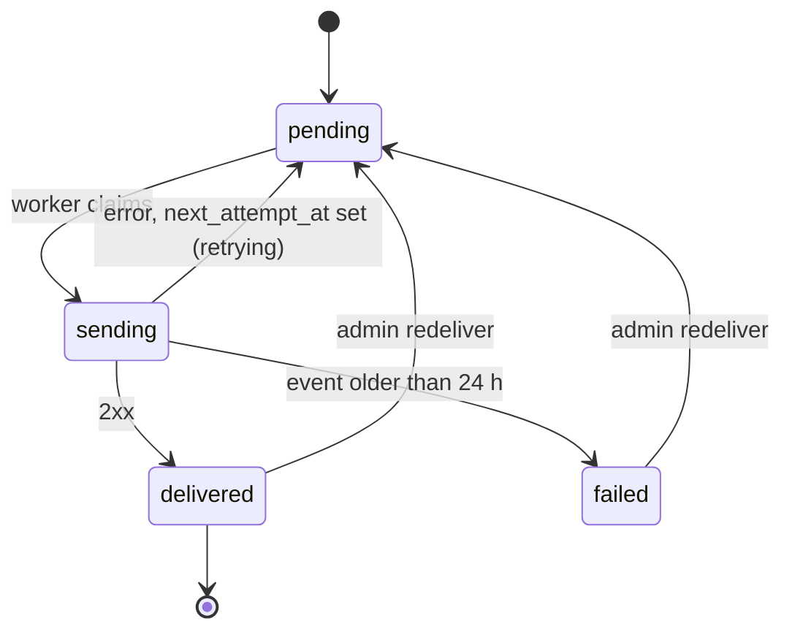
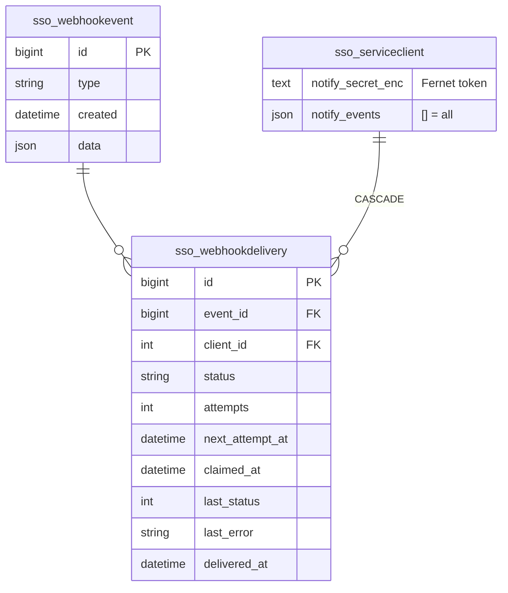

# v1.3c design: signed webhooks to registered services

| | |
|---|---|
| Status | **Design for review, implemented on branch `feat/sso-v1.3` (local, not pushed)** |
| Date | 2026-10-15 |
| Phase | Last SSO-server completion phase (moved from the old v1.4, decision 2026-10-15). After v1.3c the SSO server is **complete** for SGMCP (v1.4) and FUND (v1.5) |
| Based on | [DESIGN-v1.2-requirements.md §6](DESIGN-v1.2-requirements.md) (decision 7: one mechanism, signed webhooks to services; clients learn by rejection) |
| Deviation from §6 | queue = **database outbox** (`sso_webhookevent` / `sso_webhookdelivery`) instead of Redis: the event is written in the **same transaction** as the change (never lost, never sent for a rolled-back change), Redis stays a cache without persistence |

## 1. Scope

- `ServiceClient.notify_url` (HTTPS, v1.2a) + **`notify_secret` encrypted at rest** (Fernet, key from
  `SSO_WEBHOOK_SECRET_KEY` or derived from `SSO_SECRET_KEY`), shown once on rotation; `notify_events` filter.
- Events: `user.suspended`, `user.reactivated`, `user.deleted`, `token.revoked`, `permission.changed`, `keys.rotated`.
- Worker `manage.py run_webhook_worker` (compose service `webhooks`): signed POST, at-least-once, exponential backoff
  with jitter, 24 h, then `failed`; admin can list and redeliver.
- `sso-client` 0.2: `verify_webhook()` + `WebhookReceiver` (signature, timestamp tolerance, dedupe by id).
- Webhooks speed up reaction only. Correctness stays with introspect / `exp` / the 60 s inactive-users sweep (v1.3a).

## 2. Architecture



### 2.1 Layers



## 3. Events

Body (JSON, compact, UTF-8): `{"id": <int>, "type": "<type>", "time": "<ISO 8601 Z>", ...fields}`.

| Type | Fields | Emitted when |
|---|---|---|
| `user.suspended` | `sub` | `is_active` True→False saved anywhere (admin API, Django admin, code) |
| `user.reactivated` | `sub` | `is_active` False→True |
| `user.deleted` | `sub`, `username` | any user deletion (`post_delete`) |
| `token.revoked` | `sub`, `reason` (`logout_all`, `password_change`, `suspended`, `admin`), or `sub` + `sid` + `reason` (`refresh_reuse`, `ip_mismatch`) | user or session revocation |
| `permission.changed` | `sub`, `perm`, `granted` (direct grant) · `group`, `perm`, `granted` (group grant) · `sub`, `group`, `granted` (membership) · `app`, `created`/`updated`/`deprecated` (import) | `m2m_changed` on user permissions, group permissions, user groups (`application.*` only); permission import |
| `keys.rotated` | `kids` (published key ids) | the worker sees a different published `kid` set than in the last `keys.rotated` event |

Services subscribe with `notify_events` (list of types; empty = all). Device clients never receive webhooks.

## 4. Delivery

```http
POST <notify_url>
Content-Type: application/json
User-Agent: sso-webhooks/1
X-SSO-Event-Id: 46
X-SSO-Event-Type: user.suspended
X-SSO-Timestamp: 1791800123
X-SSO-Signature: v1=<hex HMAC-SHA256(notify_secret, timestamp + "." + body)>

{"id":46,"type":"user.suspended","time":"2026-10-15T09:15:23Z","sub":"42"}
```

```mermaid
sequenceDiagram
  autonumber
  participant A as Admin API
  participant DB as MySQL
  participant W as Worker
  participant R as Service notify_url
  A->>DB: BEGIN; is_active=false; revoke tokens; INSERT event 46 + deliveries; audit; COMMIT
  loop every SSO_WEBHOOK_POLL_SECONDS (2 s)
    W->>DB: SELECT due deliveries FOR UPDATE SKIP LOCKED (limit 50); mark sending
  end
  W->>W: decrypt notify_secret, sign ts.body
  W->>R: POST (timeout 5 s, no redirects)
  alt 2xx
    R-->>W: 204
    W->>DB: delivered, attempts=1
  else timeout / network error / 3xx / 4xx / 5xx
    R-->>W: 503
    W->>DB: retrying, next_attempt = now + min(2^(n-1), 600) s + jitter
  end
  Note over W,DB: older than 24 h -> failed (admin can redeliver)
```



- **At-least-once**; receivers must dedupe on `id` (the library does). Order is not guaranteed across retries.
- A worker crash leaves `sending` rows; rows `sending` for more than 60 s are claimed again.
- Any HTTP status other than 2xx is a failure (redirects are not followed). The response body is not stored
  (only status and a 200-char error class).
- **Address policy (SSRF)**: the host is resolved at send time; loopback, link-local, multicast, unspecified and
  reserved addresses are refused unless `SSO_WEBHOOK_ALLOW_LOOPBACK=true` (dev/QA). Private RFC 1918 / ULA addresses
  are allowed (internal services). URLs are set by admins only.
- TLS is verified with the system CAs plus `SSO_WEBHOOK_CA_FILE` if set (internal CA).
- A service with no `notify_url` or no `notify_secret` gets no deliveries. Deactivating a service stops new
  deliveries; pending ones are dropped at send time (`skipped`).

## 5. Network events

| Event | Behaviour |
|---|---|
| Receiver down / timeout | retry with backoff for 24 h, then `failed` |
| Receiver slow (> 5 s) | counted as timeout; the receiver should answer fast and process asynchronously |
| DB unreachable (worker) | worker logs `ERROR sso.webhooks` and sleeps `SSO_WEBHOOK_POLL_SECONDS`; nothing lost (outbox) |
| Clock skew receiver vs SSO | receivers accept `X-SSO-Timestamp` within ±300 s; sync clocks with NTP |
| Secret rotated | deliveries after the rotation use the new secret; receivers should accept old+new for a short overlap (library: list of secrets) |
| Two workers | `SKIP LOCKED` claims, so each delivery is sent by one worker at a time |

## 6. API reference

| Method + path | Auth | Request | Response |
|---|---|---|---|
| 🔒 `POST /api/v1/admin/services/{client_id}/rotate-notify-secret` | admin + step-up | | `{"client_id","notify_secret"}` (once) |
| `PATCH /api/v1/admin/services/{client_id}` | admin | adds `notify_events` (list of types, `[]` = all) | service (+ `notify_events`, `has_notify_secret`) |
| `GET /api/v1/admin/webhooks/events` | admin | `type`, `since`, page | `{id, type, time, data}` list, newest first |
| `GET /api/v1/admin/webhooks/deliveries` | admin | `status` (`pending\|sending\|delivered\|failed\|skipped`), `client_id`, `event`, page | `{id, event_id, event_type, client_id, status, attempts, next_attempt_at, last_status, last_error, delivered_at}` |
| `POST /api/v1/admin/webhooks/deliveries/{id}/redeliver` | admin | | delivery (status `pending`, attempts reset, window restarts) |
| `manage.py run_webhook_worker [--once]` | operator | | runs the worker (compose service `webhooks`) |
| `manage.py rotate_notify_secret <client_id>` | operator | | prints the new secret once |

Errors: standard; `404 not_found` for unknown ids; `400 invalid_request` for unknown event types.

## 7. Data model



Retention: events and deliveries older than `SSO_WEBHOOK_RETENTION_DAYS` (30) are pruned by
`revoke_inactive_users` (hourly sweep); the audit log (kept forever) is separate.

## 8. Receiver side (sso-client 0.2)

```python
from sso_client.webhooks import WebhookReceiver, WebhookError
rx = WebhookReceiver(secrets=[os.environ["SSO_NOTIFY_SECRET"]])     # list: old + new during rotation
def endpoint(request):                       # any framework: raw body bytes + headers
    try:
        event = rx.verify(request.headers, request.body)   # signature, ±300 s, dedupe on id
    except WebhookError:
        return 400
    if event is None:                         # duplicate
        return 204
    if event["type"] == "user.suspended":
        stop_and_delete_strategies(owner_sub=event["sub"])  # positions untouched (decision)
    return 204
```

## 9. Configuration

| Variable | Default | Meaning |
|---|---|---|
| `SSO_WEBHOOK_SECRET_KEY` | derived from `SSO_SECRET_KEY` (HKDF) | Fernet key (urlsafe base64, 32 bytes) for `notify_secret` at rest. Set it explicitly so rotating `SSO_SECRET_KEY` does not make secrets unreadable |
| `SSO_WEBHOOK_TIMEOUT` | `5` | seconds per POST |
| `SSO_WEBHOOK_MAX_AGE_HOURS` | `24` | retry window |
| `SSO_WEBHOOK_POLL_SECONDS` | `2` | worker poll interval |
| `SSO_WEBHOOK_ALLOW_LOOPBACK` | `false` | allow loopback/link-local targets (dev/QA only) |
| `SSO_WEBHOOK_CA_FILE` | empty | extra CA bundle for receiver TLS |
| `SSO_WEBHOOK_RETENTION_DAYS` | `30` | prune delivered/failed history |
