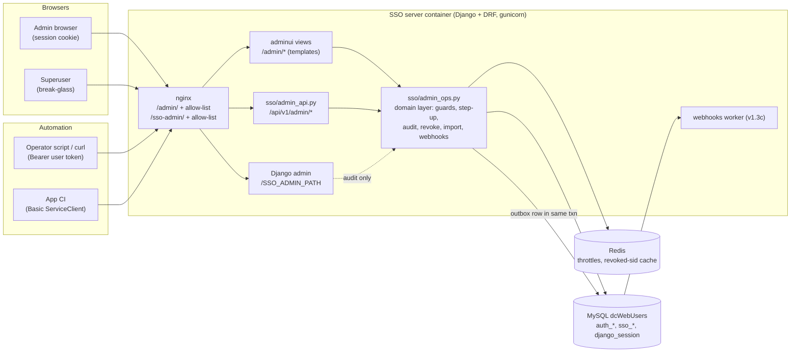
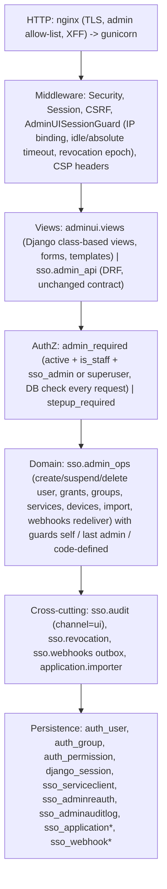
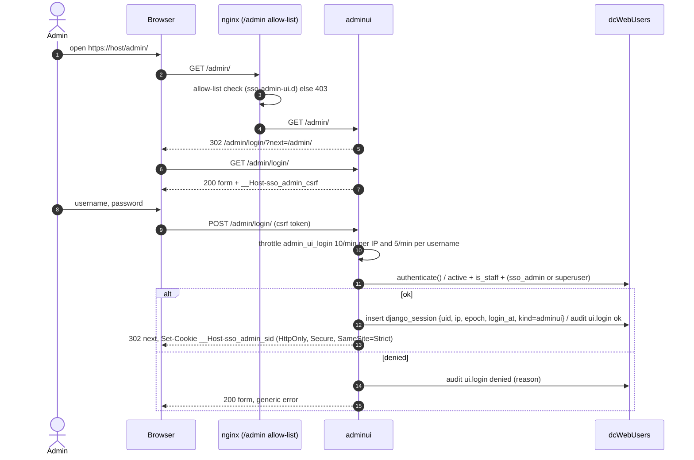
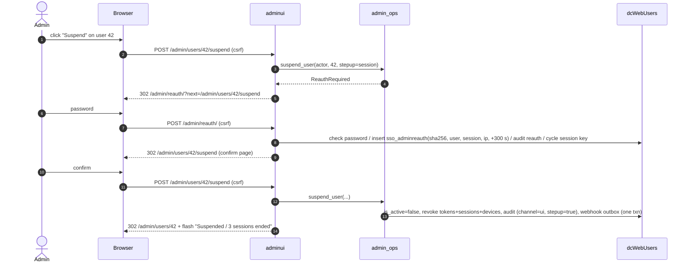
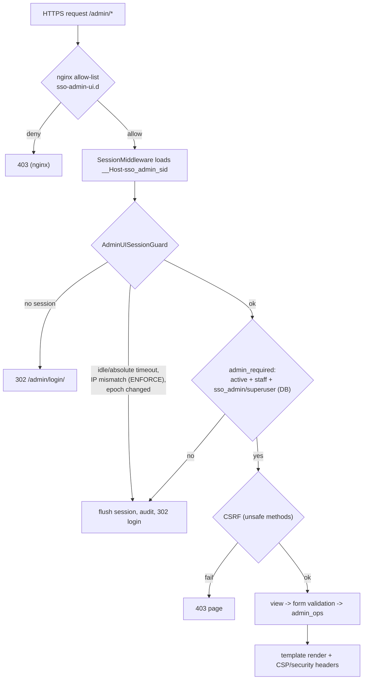
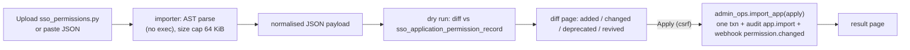
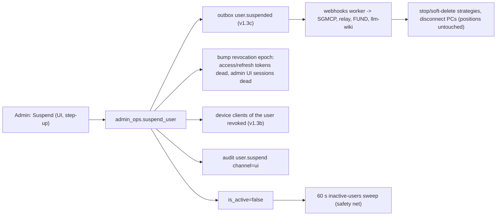
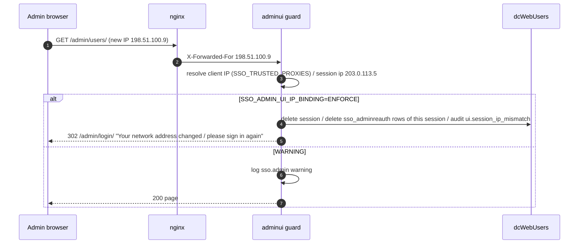
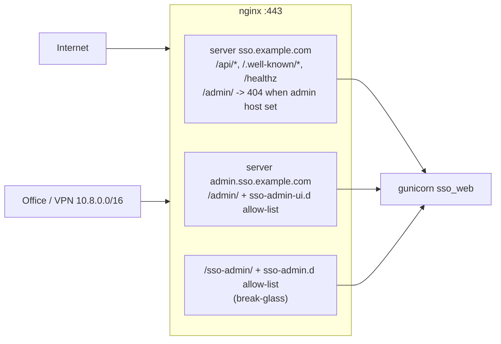

# v1.3d design: SSO-hosted admin web UI (`/admin` on the SSO server)

| | |
|---|---|
| Status | **Design for review** (no code yet). Branch `docs/sso-admin-ui` |
| Date | 2026-10-15 |
| Phase | Fourth and last **SSO-server completion** phase (v1.3a → v1.3b → v1.3c → **v1.3d**), before SGMCP v1.4. See [ECOSYSTEM-INTEGRATION.md §9.1](ECOSYSTEM-INTEGRATION.md#91-phasing-updated-2026-10-15-component-order) |
| Base | `feat/sso-v1.3` @ `bc721e5` |
| Decision | **Thomas, 2026-10-15:** the admin UI moves from FUND `/admin` to the SSO server's own `/admin`. FUND is client-facing; the SSO owns administration. This replaces the earlier plan (admin UI in FUND v1.5b on the v1.3a API). |
| Related | [DESIGN-v1.3a-admin-api.md](DESIGN-v1.3a-admin-api.md) (rules, guards, step-up, audit), [DESIGN-v1.3b-devices-on-behalf-of.md](DESIGN-v1.3b-devices-on-behalf-of.md), [DESIGN-v1.3c-webhooks.md](DESIGN-v1.3c-webhooks.md), [API-REFERENCE-MANUAL.md §11](API-REFERENCE-MANUAL.md#11-admin-web-ui-v13d), [ARCHITECTURE.md](ARCHITECTURE.md) |

Labels: **[Decision]** agreed with Thomas, **[Proposal]** a design choice for Thomas to accept or change,
**[Repo]** a fact from this repository.

## Contents

0. Why, and what changes
1. Scope
2. Technology choice: server-rendered Django templates
3. Architecture and software layers
4. Who can access
5. Login, session, CSRF and IP binding
6. Step-up re-authentication in the UI
7. Pages
8. Data flows
9. Network events
10. Routes (complete reference)
11. nginx exposure
12. Security headers and CSP
13. Audit
14. Accessibility, i18n
15. Configuration
16. Test plan for QA
17. Rollout
18. Open questions

---

## 0. Why, and what changes

| | Before (plan up to 2026-10-15) | Now [Decision 2026-10-15] |
|---|---|---|
| Day-to-day admin UI | FUND frontend `/admin` (TanStack route), phase v1.5b | **SSO server `/admin`** (this design), phase **v1.3d** |
| Admin back end | SSO admin REST API (v1.3a), called cross-origin from FUND | Same domain rules, called **in-process** by the UI; REST API unchanged for scripts and CI |
| Django admin (`SSO_ADMIN_PATH`) | break-glass | **break-glass, unchanged** (superusers; ops network) |
| FUND | client-facing app + admin | **client-facing only**; no admin screens, no `application.sso_admin` checks |
| Available | after FUND migrates (last) | **before SGMCP v1.4**, so operators have a UI for pairing devices, webhooks, imports and suspends during the SGMCP migration |

Consequences:

- FUND v1.5b loses the admin UI (keeps the cloud-strategy UI). FUND needs no CORS access to `/api/v1/admin/*`.
- Admin credentials never touch the client-facing FUND origin (no admin tokens in FUND's `localStorage`).
- The admin REST API stays the contract for automation (CI permission import, scripts). The UI does **not** add a
  second rule set: both call one domain layer.

## 1. Scope

In v1.3d:

1. A server-rendered admin UI at `/<SSO_ADMIN_UI_PATH>` (default `admin/`), Django app `adminui`.
2. Its own login page and session (Django session cookie), separate from the token API and from Django admin.
3. Pages for everything the v1.3a-c admin API offers: users, groups, permissions, applications + permission import,
   services (incl. device clients and webhooks), audit log, sessions/logout-all, plus a dashboard.
4. Step-up re-authentication with a password-confirm page, same rules as v1.3a.
5. Refactor: business logic of `sso/admin_api.py` moves to `sso/admin_ops.py` (domain functions), used by the API
   views and the UI views. No behaviour change to the API (its test suite must pass unchanged).
6. Audit column `channel` (`api` | `ui` | `django_admin` | `system`) on `sso_adminauditlog`.
7. nginx: separate location (and an optional separate admin hostname) with its own IP allow-list directory.
8. Strict CSP, security headers, accessibility basics.

Not in v1.3d: self-service user account pages, sign-up/password reset (TODOS), MFA/WebAuthn for admins (open
question Q3), i18n.

## 2. Technology choice: server-rendered Django templates [Proposal]

| Option | For | Against |
|---|---|---|
| **A. Server-rendered Django templates + small vanilla JS (chosen)** | No frontend build or Node toolchain in the image; ships in the existing Django/gunicorn container; CSRF and session handling are Django built-ins; a strict CSP (`script-src 'self'`) is easy; no admin token ever exists in browser JS; same test stack (pytest + Django test client) | Less "app-like"; each action is a page load (fine for an admin tool used by few people) |
| B. SPA (React/TanStack) on the v1.3a REST API | Reuses the API 1:1; rich UI | Needs a build pipeline, a token in the browser (XSS = admin takeover), refresh handling, CORS or same-origin hosting; double the code to review |
| C. Extend Django admin (`ModelAdmin` customisation) | Least code for CRUD | Django admin is model-centric: suspend + revoke, step-up, import diff, last-admin guards and audit all fight its save hooks; it is also our break-glass tool and should stay boring |

**Recommendation: A.** Django admin stays as is (break-glass, superusers). A dedicated `adminui` app renders HTML
with Django templates, calls the domain layer directly (no HTTP hop to its own API), and uses a few kilobytes of
`static/adminui/admin.js` for progressive enhancement only (confirm dialogs, copy-to-clipboard of a one-time secret,
filter-as-you-type). Every page works with JavaScript disabled.

## 3. Architecture and software layers



### 3.1 Software layers



### 3.2 Code layout [Proposal]

| Path | Content |
|---|---|
| `adminui/` (new Django app) | `urls.py`, `views/` (one module per page group), `forms.py`, `middleware.py`, `auth.py` (login/logout/step-up), `templates/adminui/*.html`, `static/adminui/{admin.css,admin.js}` |
| `sso/admin_ops.py` (new) | domain functions extracted from `sso/admin_api.py`; raise typed errors (`SelfActionForbidden`, `LastAdmin`, `Conflict`, `ReauthRequired`) that the API maps to JSON and the UI to form errors/messages |
| `sso/admin_api.py` | thin DRF views over `admin_ops` (contract unchanged) |
| `sso/stepup.py` | gains `issue_for_session()` / `verify_for_session()` beside the token-based functions |
| `sso/migrations/0007_audit_channel.py` | adds `channel` to `sso_adminauditlog` (default `api`, backfilled) |

## 4. Who can access [Decision 2026-10-15, same as the API]

Every request (not only login) reloads the user from the DB and requires:

1. `is_active = true`, **and**
2. `is_staff = true`, **and**
3. `application.sso_admin` (directly or via a group) **or** `is_superuser`.

Failing any of these at login → the generic "invalid username or password, or no admin access" message (no account
enumeration; audited `ui.login` `result=denied` with the reason in `after`). Failing later (e.g. the admin was
suspended or lost `sso_admin` in another tab) → session flushed, redirect to login with "Your admin access ended".

Guards are those of v1.3a §3.2 (no self-suspend/delete, no removing your own `sso_admin`, last admin, code-defined
permissions). The UI hides buttons that would fail, but the domain layer is the enforcement point.

## 5. Login, session, CSRF and IP binding

### 5.1 Session vs token [Proposal: session]

The UI uses a **Django server-side session** (`django_session` table already exists [Repo]), **not** SSO JWTs:

- no token in browser JS (XSS cannot exfiltrate a bearer token; cookie is `HttpOnly`),
- CSRF is handled by Django's `CsrfViewMiddleware` (already installed [Repo]),
- immediate server-side revocation (delete the session row).

Cookie: dedicated name `__Host-sso_admin_sid` (prefix forces `Secure`, `Path=/`, no `Domain`), `HttpOnly`,
`SameSite=Strict`. Django admin keeps the default `sessionid`; the two logins are independent. CSRF cookie
`__Host-sso_admin_csrf`, `SameSite=Strict`; forms carry `csrfmiddlewaretoken`; `CSRF_TRUSTED_ORIGINS` must contain
the admin origin (`https://<SSO_ADMIN_UI_HOSTNAME or SSO_HOSTNAME>`).

Session lifetime: idle `SSO_ADMIN_UI_IDLE_SECONDS` (default 1800), absolute `SSO_ADMIN_UI_MAX_AGE_SECONDS`
(default 28800). Session key rotated at login (`cycle_key`) and at step-up.

### 5.2 IP binding

At login the client IP (resolved with the existing `SSO_TRUSTED_PROXIES` logic, `sso/clientip.py` [Repo]) is
stored in the session. Policy follows `SSO_IP_BINDING_MODE` [Repo]: `ENFORCE` → a request from another IP flushes the
session and is audited `ui.session_ip_mismatch`; `WARNING` → logged, request served; `NOIP` → nothing.
`SSO_ADMIN_UI_IP_BINDING` can override it for the UI only (e.g. `ENFORCE` for admins even when users run `WARNING`).

### 5.3 Revocation

The session stores the user's revocation epoch (`UserTokenRevocation`, v1.2a [Repo]) at login. The guard middleware
compares it on every request, so **logout-all, suspend, set-password and password change of the admin also end
their UI sessions**, exactly like their tokens. "Log out everywhere" in the UI header bumps the epoch (tokens and
UI sessions) and deletes the admin's own `django_session` rows tagged `adminui`.

### 5.4 Login sequence



Login does **not** issue access/refresh tokens and does not create an `sid` for the token API.

## 6. Step-up re-authentication in the UI

Same rule set as v1.3a §3.3 (same list of destructive actions, `SSO_ADMIN_REAUTH_SECONDS` default 300, reusable in
the window, 5 attempts/min). Difference: the proof is a row in `sso_adminreauth` bound to **user + session key + IP**
instead of user + token `sid` + IP; the UI never shows the reauth token.

UX:

1. The admin clicks e.g. **Suspend** on a user page. Destructive buttons are styled red and labelled with the effect
   ("Suspend and log out all sessions").
2. If no valid step-up exists, the action POST is answered with `302 /admin/reauth/?next=<confirm page>`; the
   pending action is **not** replayed automatically (no stored POST bodies).
3. The reauth page shows what the admin is about to do, a password field and "Confirm". On success → back to the
   confirm page, which shows a summary (target, effect, e.g. "3 active sessions, 1 device client will be revoked")
   and a final "Suspend" button. For **delete user / delete group / delete service** the admin also types the target
   name (GitHub-style).
4. A banner "Elevated until 14:05 (PT)" with a "Drop now" button is shown while the window is open.
5. Wrong password → inline error, audited `reauth` `result=denied`; 6th try in a minute → 429 page.



## 7. Pages

All lists: server-side pagination (50/page), search box, filters as query strings (bookmarkable), sortable columns,
CSV export where useful (users, audit) [Proposal]. 🔒 = step-up.

| Page | Path | Contents and actions | Domain call (= API endpoint) |
|---|---|---|---|
| Dashboard | `/admin/` | counts (users active/suspended, admins, services, devices, failed webhook deliveries last 24 h), last 20 audit rows, key status (active `kid`, next rotation), links | read-only |
| Users | `/admin/users/` | search (username/email/name), filter active/suspended/group/staff, last login | `GET /users` |
| User create | `/admin/users/new/` | username, email, names, initial password (validated), groups, `is_staff` (only superusers may set) | `POST /users` |
| User detail | `/admin/users/{id}/` | profile edit; status; **effective permissions** (direct + via groups, deprecated in red); groups; devices owned; active sessions count; last 20 audit rows for this user | `GET/PATCH /users/{id}`, `GET …/permissions` |
| User actions | same page | 🔒 Suspend · Unsuspend · Log out everywhere · 🔒 Set password · 🔒 Delete (type username; "prefer suspend") · grant/revoke permission (🔒 for `sso_admin`) · set groups | `/users/{id}/…` |
| Groups | `/admin/groups/`, `/admin/groups/{id}/` | create, rename, members (add/remove), permissions (🔒 for `sso_admin`), 🔒 delete | `/groups…` |
| Permissions | `/admin/permissions/` | list by app, deprecated filter, user/group counts, create custom, edit name/description, 🔒 delete (`revoke_all` checkbox when granted; code-defined not deletable) | `/permissions…` |
| Applications | `/admin/apps/`, `/admin/apps/{app}/` | registered apps, version, counts, permissions incl. deprecated | `GET /apps…` |
| Permission import | `/admin/apps/import/` | upload `sso_permissions.py` **or** paste JSON; server converts (`application/importer.py`, AST-only parse, no code execution) → **dry-run diff** (added / changed / deprecated / revived) → "Apply" (with `force` checkbox for app-codename mismatch) | `PUT /apps/{app}/permissions?dry_run=` |
| Services | `/admin/services/`, `/admin/services/{client_id}/` | ServiceClients (`kind=service`): app, perms, `notify_url`, active; **Register** (secret shown **once** with copy button, never again); edit; 🔒 deactivate; 🔒 rotate secret; 🔒 delete | `/services…` |
| Devices | `/admin/devices/` | device clients (`kind=device`, v1.3b): owner, label, created, last seen, key fingerprint; filter by owner; 🔒 revoke | `/devices…` |
| Webhooks | `/admin/webhooks/` | events (type, ts, subject), deliveries per service (status, attempts, next try, last error); **Redeliver**; per service: 🔒 rotate notify secret (shown once) | `/webhooks/events`, `/webhooks/deliveries`, `…/redeliver`, `…/rotate-notify-secret` |
| Audit log | `/admin/audit/` | newest first; filter actor, action, target, channel, result, since; row detail shows before/after JSON diff; CSV export of the filtered view | `GET /audit` |
| My session | `/admin/me/` | own profile, elevated-until, **Log out**, **Log out everywhere** | `POST /users/{self}/logout-all` |

Read-only for non-superusers: setting `is_staff`/`is_superuser` (superuser-only, and `is_superuser` only in Django
admin) [Proposal].

## 8. Data flows

### 8.1 Request pipeline (every UI request)



### 8.2 Permission import



### 8.3 Suspend (cross-system)



## 9. Network events

| Event | Where detected | Effect | Audit / log |
|---|---|---|---|
| Admin IP changes mid-session | guard middleware | `ENFORCE`: session flushed, re-login; `WARNING`: log only | `ui.session_ip_mismatch` |
| Request from outside the allow-list | nginx | 403, never reaches Django | nginx access log |
| Idle / absolute timeout | guard | session flushed | `ui.session_expired` (log only) |
| Admin suspended or loses `sso_admin` elsewhere | guard (DB check) | session flushed on next request | `ui.access_lost` |
| Step-up window expires during confirm | `stepup_required` | redirect to reauth page | none |
| DB unavailable | Django | 503 page; `/healthz` already reports it [Repo] | error log |
| Redis unavailable | throttle | login throttle falls back to DB-cache/ fail-closed for `admin_ui_login` [Proposal] | warning log |
| Webhook receiver down | worker (v1.3c) | deliveries retry; dashboard shows failed count; Redeliver button | delivery rows |



## 10. Routes (complete reference)

All routes are relative to `/<SSO_ADMIN_UI_PATH>` (default `/admin/`), return HTML, and use the session cookie.
Unsafe methods require a CSRF token. **No new JSON endpoints**: the JSON admin contract stays `/api/v1/admin/*`
(API reference §8-10). Every POST answers `302` (Post/Redirect/Get) on success, `200` with form errors on
validation failure, `409` page for guard violations (`self_action_forbidden`, `last_admin`, `conflict`), `429` on
throttle.

| Method | Route | Step-up | Purpose | Audit action |
|---|---|---|---|---|
| GET/POST | `login/` | | sign in | `ui.login` |
| POST | `logout/` | | end this session | `ui.logout` |
| POST | `logout-everywhere/` | | own tokens + UI sessions | `user.logout_all` |
| GET/POST | `reauth/?next=` | | password confirm | `reauth` |
| POST | `reauth/drop/` | | end elevation | `reauth.drop` |
| GET | `` (dashboard) · `me/` | | | |
| GET | `users/` · `users/export.csv` | | list / export | `ui.export` (export only) |
| GET/POST | `users/new/` | | create | `user.create` |
| GET/POST | `users/{id}/` | | detail / edit profile | `user.update` |
| GET/POST | `users/{id}/suspend` | 🔒 | confirm / suspend | `user.suspend` |
| POST | `users/{id}/unsuspend` | | | `user.unsuspend` |
| POST | `users/{id}/logout-all` | | | `user.logout_all` |
| GET/POST | `users/{id}/password` | 🔒 | set password | `user.set_password` |
| GET/POST | `users/{id}/delete` | 🔒 | type-to-confirm | `user.delete` |
| POST | `users/{id}/permissions` | 🔒 if `sso_admin` | `{codename, op=grant\|revoke}` | `user.grant` / `user.revoke` |
| POST | `users/{id}/groups` | 🔒 if it changes `sso_admin` | set groups | `user.groups` |
| GET/POST | `groups/` · `groups/new/` · `groups/{id}/` | | list, create, rename | `group.create` / `group.update` |
| POST | `groups/{id}/members` | | set members | `group.members` |
| POST | `groups/{id}/permissions` | 🔒 if `sso_admin` | grant/revoke | `group.grant` / `group.revoke` |
| GET/POST | `groups/{id}/delete` | 🔒 | | `group.delete` |
| GET/POST | `permissions/` · `permissions/new/` · `permissions/{codename}/` | | list, create, edit | `permission.create` / `permission.update` |
| GET/POST | `permissions/{codename}/delete` | 🔒 | `revoke_all` checkbox | `permission.delete` |
| GET | `apps/` · `apps/{app}/` | | | |
| GET/POST | `apps/import/` | | upload → dry-run diff | `app.import` (dry run: none) |
| POST | `apps/import/apply` | | apply previewed diff (hash of payload in hidden field; mismatch → re-preview) | `app.import` / `app.import_noop` |
| GET/POST | `services/` · `services/new/` · `services/{client_id}/` | 🔒 if `is_active` → false | list, register (secret once), edit | `service.create` / `service.update` |
| GET/POST | `services/{client_id}/rotate-secret` | 🔒 | secret shown once | `service.rotate_secret` |
| GET/POST | `services/{client_id}/rotate-notify-secret` | 🔒 | shown once | `service.rotate_notify_secret` |
| GET/POST | `services/{client_id}/delete` | 🔒 | | `service.delete` |
| GET | `devices/` · `devices/{client_id}/` | | | |
| GET/POST | `devices/{client_id}/revoke` | 🔒 | | `device.delete` |
| GET | `webhooks/` · `webhooks/deliveries/` | | | |
| POST | `webhooks/deliveries/{id}/redeliver` | | | `webhook.redeliver` |
| GET | `audit/` · `audit/{id}/` · `audit/export.csv` | | | `ui.export` (export only) |
| GET | `static/…` | | served by WhiteNoise [Repo] under `STATIC_URL`, not under this path | |

One-time secrets (service secret, notify secret) are rendered once in the POST response with
`Cache-Control: no-store`; they are never stored in the session or flash messages.

## 11. nginx exposure

Today [Repo]: `location /${SSO_ADMIN_PATH}` includes `/etc/nginx/sso-admin.d/*.conf` (mounted from
`SSO_ADMIN_ALLOW_DIR`, default `./docker/nginx-admin.d`) for an optional allow-list.

v1.3d [Proposal]:

```nginx
# Admin web UI (v1.3d). Same allow-list mechanism, own directory so ops can open the UI
# wider (e.g. office VPN) than break-glass Django admin.
location /${SSO_ADMIN_UI_PATH} {
    include /etc/nginx/sso-admin-ui.d/*.conf;   # e.g. allow 10.8.0.0/16; deny all;
    limit_req zone=sso_login burst=10 nodelay;  # applies to login POSTs too
    proxy_pass http://sso_web;
}
```

- `SSO_ADMIN_UI_ALLOW_DIR` (default `./docker/nginx-admin-ui.d`, empty = open) mounted at
  `/etc/nginx/sso-admin-ui.d`.
- **Optional separate hostname**: with `SSO_ADMIN_UI_HOSTNAME=admin.sso.example.com` nginx renders a second
  `server` block (own cert via `SSO_ADMIN_UI_TLS_CERT_FILE`/`_KEY_FILE`, defaults to the main pair) that serves
  only `/${SSO_ADMIN_UI_PATH}`, static files and `/healthz`; the main hostname then returns 404 for the admin UI
  path. Django additionally rejects UI requests whose `Host` is not the configured admin host
  (`AdminUISessionGuard`), so a misconfigured nginx cannot expose it.
- Recommended production: separate hostname + VPN/office allow-list; break-glass Django admin allow-list limited
  to the ops jump host.



## 12. Security headers and CSP

Set by `adminui` middleware on every UI response (Django already sets nosniff, `X-Frame-Options: DENY`, HSTS
[Repo]):

| Header | Value |
|---|---|
| `Content-Security-Policy` | `default-src 'none'; script-src 'self'; style-src 'self'; img-src 'self' data:; font-src 'self'; connect-src 'self'; form-action 'self'; frame-ancestors 'none'; base-uri 'none'` |
| `Cache-Control` | `no-store` (every authenticated page) |
| `Referrer-Policy` | `same-origin` |
| `Permissions-Policy` | `camera=(), microphone=(), geolocation=(), payment=()` |
| `Cross-Origin-Opener-Policy` | `same-origin` |
| `Cross-Origin-Resource-Policy` | `same-origin` |

No inline scripts or styles, no CDN, no third-party fonts. Templates use Django auto-escaping only (no `|safe` on
user data; audit JSON is pretty-printed server-side and escaped). Uploads (`sso_permissions.py`) are parsed with
`ast` only and never executed or stored on disk.

## 13. Audit

- Every UI mutation writes the same `sso_adminauditlog` row as the API (via `admin_ops`), with new column
  **`channel = ui`** and `request_id` from the request; `stepup = true` when a step-up was used. Kept forever
  [Decision 2026-10-15].
- UI-only actions: `ui.login` (ok/denied + reason), `ui.logout`, `ui.session_ip_mismatch`, `ui.access_lost`,
  `ui.export` (filters in `after`), `reauth`, `reauth.drop`.
- Django admin writes keep `channel = django_admin`; worker/sweep writes `channel = system`; API `channel = api`
  (backfill default for existing rows).
- Also emitted as `sso.admin` JSON log lines (unchanged format + `channel`).

## 14. Accessibility, i18n

- i18n: **not needed** (English only; dates shown in the admin's configured zone `SSO_ADMIN_UI_TIME_ZONE`, default
  `UTC`, with the zone label).
- Accessibility basics: semantic HTML (`<main>`, `<nav>`, `<table>` with `<th scope>`), every input has a
  `<label>`, visible focus outline, skip-to-content link, colour contrast ≥ 4.5:1, status never by colour alone
  (e.g. "Suspended" text + colour), errors linked with `aria-describedby`, confirm pages instead of JS-only
  dialogs, keyboard-only operation tested, text scales with browser zoom (rem units).

## 15. Configuration

| Variable | Default | Meaning |
|---|---|---|
| `SSO_ADMIN_UI_ENABLED` | `true` | `false` = no routes (API-only deployments) |
| `SSO_ADMIN_UI_PATH` | `admin/` | URL prefix; must differ from `SSO_ADMIN_PATH` (system check error otherwise) |
| `SSO_ADMIN_UI_HOSTNAME` | empty | separate admin host (nginx second server block + Django host check) |
| `SSO_ADMIN_UI_TLS_CERT_FILE` / `_KEY_FILE` | main cert | cert for the admin host |
| `SSO_ADMIN_UI_ALLOW_DIR` | `./docker/nginx-admin-ui.d` | nginx allow-list snippets |
| `SSO_ADMIN_UI_IDLE_SECONDS` | `1800` | idle timeout |
| `SSO_ADMIN_UI_MAX_AGE_SECONDS` | `28800` | absolute session lifetime |
| `SSO_ADMIN_UI_IP_BINDING` | = `SSO_IP_BINDING_MODE` | `NOIP` / `WARNING` / `ENFORCE` for UI sessions |
| `SSO_ADMIN_UI_TIME_ZONE` | `UTC` | display zone |
| `SSO_ADMIN_REAUTH_SECONDS` | `300` (existing) | step-up window, shared with the API |
| `SSO_CSRF_TRUSTED_ORIGINS` | existing | must include the admin origin |

Throttle scopes (DRF/Django cache, Redis): `admin_ui_login` 10/min per IP + 5/min per username, `admin_reauth`
5/min per user (existing scope, shared).

## 16. Test plan for QA

| Area | Cases |
|---|---|
| Access | anonymous → login redirect; active+staff+`sso_admin` ok; superuser+staff ok; missing staff / missing `sso_admin` / inactive → denied with generic message, audited; access lost mid-session → flushed |
| Login | wrong password; throttle (11th per IP, 6th per username → 429); session cookie flags (`__Host-`, HttpOnly, Secure, SameSite=Strict); key cycled; no tokens issued |
| Session | idle + absolute timeout; IP change under ENFORCE/WARNING/NOIP; logout; logout-everywhere kills UI sessions and tokens; suspend/set-password of the admin by another admin kills their UI session |
| CSRF | every POST without/with wrong token → 403; cross-site form post blocked (SameSite + CSRF) |
| Step-up | each 🔒 action redirects to reauth; window reuse; expiry; other session/IP cannot reuse; 6th wrong password → 429; drop now |
| Guards | self-suspend/delete, remove own `sso_admin`, last admin (user, group, permission revoke), code-defined permission delete → 409 page, nothing changed |
| Parity | for each page action, the DB state, audit row (`channel=ui`) and webhook outbox equal the API equivalent (shared fixtures) |
| Import | upload `.py` (AST only; file with `import os; os.system(...)` is rejected, not executed), JSON paste, dry-run diff, apply, payload changed between preview and apply → re-preview, deprecated marking, never deletes |
| Services/devices/webhooks | secret shown once and absent on reload and in history; rotate; deactivate; device revoke; redeliver |
| Audit | filters, detail, CSV export (formula-injection safe: cells starting `=+-@` prefixed with `'`) |
| Headers | CSP and other headers present on every UI page; no inline script (CSP report in a browser test) |
| nginx | allow-list deny → 403; separate hostname: UI 404 on main host, served on admin host; Django host check |
| A11y | axe-core scan of each page (no serious violations); keyboard-only walk-through of suspend |
| Regression | full v1.3a-c suite unchanged after the `admin_ops` refactor (MySQL 8.4 + 8.0, Django 5.2 + 4.2); black-box suite 47/47 |
| Migration | `0007_audit_channel` forward/backward; `scripts/upgrade_db.sh` and `sso_schema_check` know the new column; `docs/db/upgrade-v1.3-to-v1.3d.sql` |

## 17. Rollout

1. Merge v1.3d; run `scripts/upgrade_db.sh` (one new column).
2. Create `docker/nginx-admin-ui.d/allow.conf` (office/VPN) **before** starting; optionally set
   `SSO_ADMIN_UI_HOSTNAME` + DNS + cert.
3. Add the admin origin to `SSO_CSRF_TRUSTED_ORIGINS`; `docker compose up -d --build`.
4. Check: `https://<host>/admin/` login with an `sso_admin` + staff account; dashboard shows key status.
5. Operators move day-to-day work from `curl` / Django admin to the UI; Django admin allow-list tightened to the
   ops jump host (break-glass only).
6. Rollback: `SSO_ADMIN_UI_ENABLED=false` (API and Django admin unaffected); the audit column is harmless.

## 18. Open questions

1. **Path:** keep the default `/admin/` (as Thomas said "SSO /admin"), or a less guessable path? Earlier hardening
   moved Django admin off `/admin/` to `sso-admin/` to cut scanner noise; the allow-list makes this mostly
   cosmetic. [Proposal: `/admin/` + allow-list or separate admin hostname]
2. **Separate admin hostname** in production (e.g. `admin.<domain>`) or path-only on the main SSO host?
3. **MFA for admins** (TOTP/WebAuthn) — not in v1.3d; add to TODOS as a follow-up, or required before go-live?
