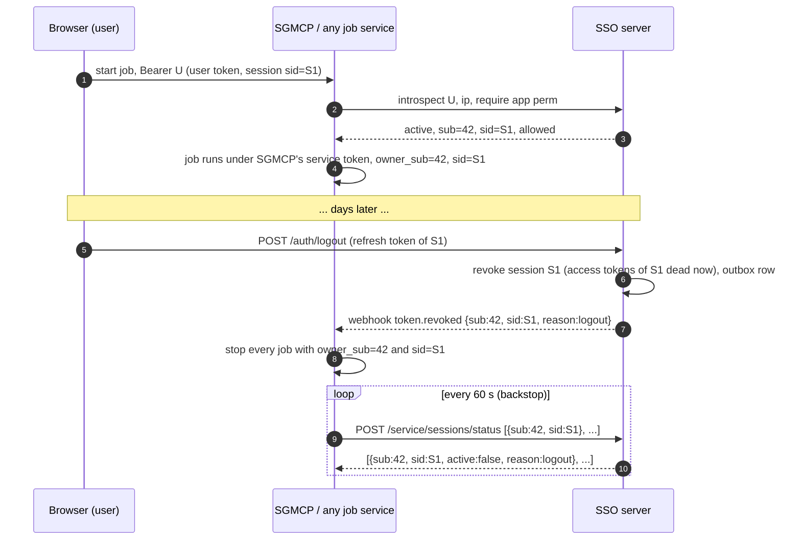

# v1.3e design: long-running jobs are bound to the login session

| | |
|---|---|
| Status | **Implemented** (v1.3e and the v1.3f keep-jobs logout, §6, 2026-11-03). As-built API: [API-REFERENCE-MANUAL.md](API-REFERENCE-MANUAL.md) §2.6, §8.2, §10 |
| Decision | Thomas, 2026-11-03: logout and password change stop the running jobs (services) of the user's session; the user may instead log out and keep the jobs (v1.3f) |
| Builds on | v1.2a sessions (`sid`), v1.3a service tokens, v1.3c signed webhooks |
| Changes | [ECOSYSTEM-INTEGRATION.md](ECOSYSTEM-INTEGRATION.md) §4.1 "Long-running work", §5.6, §8.2 |

## 1. Problem

A user access token lives 15 minutes, but a job a user starts (a SGMCP strategy, a webhook subscription, an
auto-trade job, a scheduled task) can run for days. Since v1.3a the service runs such a job under its **own**
service identity and records the owner (`owner_sub`); it never keeps the user's token. Until v1.3e the job then
ran until the user was **suspended** or deleted: logging out, or changing the password, did not stop it, and a
plain logout did not even tell services that it happened.

## 2. Rule

**A long-running job lives as long as the login session that started it.**

| User action | Session effect | What services do with the user's jobs |
|---|---|---|
| Logout (`POST /auth/logout`) | that session (`sid`) ends | stop the jobs started from that `sid` |
| Logout with `keep_jobs: true` (v1.3f, §6) | that session (`sid`) ends | **detach** the jobs of that `sid`: they keep running until a row below ends them |
| Logout-all, password change, admin "logout everywhere" / set-password | every session of the user ends | stop **all** the user's session-bound jobs |
| Suspend, delete | every session ends | stop and delete all the user's jobs (unchanged, ECOSYSTEM §5.6) |
| Refresh-token reuse, IP mismatch in `ENFORCE` | that session ends (security) | stop the jobs of that `sid` |
| Idle past the refresh lifetime (default 7 days without a refresh) | the session expires, **no webhook** | found by the status sweep (§4.3); stop the jobs of that `sid` |
| Refresh | same `sid` continues | nothing |

Consequence for users: **to keep jobs running, keep the front-end application signed in** (open, refreshing its
tokens), or log out with "keep my jobs running" (§6). Closing the browser without logging out keeps the
session until the refresh token runs out; the front end must refresh at least once per refresh lifetime.

## 3. Flow

## 4. SSO server changes (implemented)

### 4.1 Logout ends the whole session

`POST /api/v1/auth/logout` with a token that carries a `sid` now calls `revoke_session(user, sid, "logout")`:

- `RevokedSession(sid, reason="logout")`; every outstanding refresh token of the session is blacklisted;
- the session's **access tokens fail at once** at introspect and `/me` (`token_invalid`); before v1.3e they stayed
  valid until `exp`. Local JWKS verifiers still accept them until `exp` (≤ 15 min), as for every revocation;
- the session's step-up tokens are dropped (as since v1.3a);
- `token.revoked {sub, sid, reason: "logout"}` is written to the outbox in the same transaction;
- the `session_revoked` log line is INFO for `logout` (WARNING for the security reasons); no token or sid logged.

Other sessions of the same user are untouched. A token without `sid` (pre-v1.2a) is only blacklisted, no event.

`revoke_session` emits `token.revoked` only when it actually ends the session: a refresh token replayed after
logout is still handled as reuse, but the recorded reason stays `logout` and no second event is sent.

### 4.2 Password change

Unchanged in the server, now part of the contract: a password change saved through the SSO (admin API
`set-password`, admin UI, Django admin, `changepassword`, shell) sets the user's revocation epoch and emits
`token.revoked {sub, reason: "password_change"}` **without `sid`**: every session of the user ends. Setting the
same password again, or the transparent re-hash on login, emits nothing.

**Limit:** a password change written by myFinance into the shared `auth_user` is not seen by the SSO (no signal
in another process, and the hash also changes on every re-hash, so it cannot be compared). Until myFinance tells
the SSO (TODOS.md), such a change ends neither the SSO sessions nor the jobs.

### 4.3 Session status sweep: `POST /api/v1/service/sessions/status`

Backstop for lost webhooks (deliveries give up after 24 h) and for sessions that expire without an event.

| | |
|---|---|
| Auth | ServiceClient Basic, or Bearer service token (same as the inactive-users feed) |
| Request | `{"sessions": [{"sub": "42", "sid": "Yp3…"}, …]}`, 1 to 100 entries, `sub` numeric string, `sid` ≤ 64 chars |
| Response 200 | `{"sessions": [{"sub", "sid", "active": true}` or `{"sub", "sid", "active": false, "reason"}]}`, in request order, `Cache-Control: no-store` |
| Errors | 400 `invalid_request`, 401 `invalid_client` |

`reason` values: the `RevokedSession` reason (`logout`, `refresh_reuse`, `ip_mismatch`), `revoked` (every token of
the user revoked: logout-all, password change, admin; the webhook carries the exact reason), `expired` (no live
refresh token: idle past the refresh lifetime, or an unknown sid), `user_inactive`, `user_deleted`.

A session is alive while it has a refresh token that is unexpired, not blacklisted and issued after the user's
revocation epoch. A `sid` that belongs to another user is not alive for this `sub`.

### 4.4 Unchanged

Token lifetimes (`SSO_ACCESS_TTL_MIN=15`, `SSO_REFRESH_TTL_DAYS=7`, sliding), logout-all, suspend, webhook
transport and signature, introspect (already returns `sid`). No migration, no new setting, no new env var.

## 5. What a job service must do (SGMCP v1.4, FUND auto-trade v1.5)

1. **Start:** authorize the user's request with introspect (`ip`, `require`; on behalf of a user also the
   actor service token, §4.1 of ECOSYSTEM). Store `owner_sub = sub` **and `owner_sid = sid`** from the answer with
   the job. A job started by an agent on behalf of a user takes the `sid` of the user token it was given.
2. **Run:** under the service's own service token; never keep or refresh the user's tokens.
3. **Stop** the jobs on:
   - `token.revoked` with `sid` → jobs with `owner_sub = sub` and `owner_sid = sid`; with `keep_jobs: true`
     (v1.3f) **detach** those jobs instead (§6);
   - `token.revoked` without `sid` (`logout_all`, `password_change`, `suspended`, `admin`, …) → all jobs of `sub`;
   - `user.suspended` / `user.deleted` → stop **and delete** all jobs of `sub` (ECOSYSTEM §5.6);
   - sweep: every 60 s, `POST /service/sessions/status` with the `(owner_sub, owner_sid)` of the running jobs
     (batches of 100), detached ones included; stop every job whose session answers `active: false`, except
     `reason: "detached"` (v1.3f): detach it and keep it running.
4. "Stop" for SGMCP means what suspend does to a strategy, minus deletion: cancel open orders through the relay,
   **leave broker positions untouched**, keep history (ECOSYSTEM §5.7), state `STOPPED (session_ended: <reason>)`,
   and notify the user. The user starts it again after signing in.
5. Webhooks are at-least-once and unordered: stopping is idempotent; dedupe on the event `id`.

Jobs with no user session (a service acting for itself, an admin's scheduled maintenance) are not session-bound
and keep their v1.3a behaviour.

## 6. Log out and keep the jobs (v1.3f, implemented)

The user may choose "log out, keep my jobs running" (for example on a shared or public computer, while a strategy
must keep trading).

**Request.** `POST /api/v1/auth/logout {"refresh_token": "…", "keep_jobs": true}` (cookie mode: `{"keep_jobs":
true}`). `keep_jobs` must be a JSON boolean; anything else is 400 `invalid_request` and nothing is consumed (a
typo never logs out). Default `false` = the v1.3e logout. The browser helper: `logout({keepJobs: true})`
(`examples/frontend/auth.js`).

**The session still ends.** Exactly as in §4.1: refresh tokens of the `sid` blacklisted, its access tokens rejected
at once by introspect and `/me`, step-up tokens dropped, cookie cleared. Only the jobs outlive it; the logged-out
token cannot start new jobs. A token without `sid` is only blacklisted (no event), as for every logout.

**Event.** `token.revoked {sub, sid, reason: "logout", keep_jobs: true}`, once per session. The reason stays
`logout` on purpose: a v1.3e service that does not know `keep_jobs` stops the jobs, which is the safe fallback.

**Stored as** `RevokedSession(sid, reason="logout_keep_jobs")` (fits the existing `CharField(32)`: no migration, no
setting, no env var). The `session_revoked` log line is INFO, without token or sid.

**Session status.** The sweep answers `{"active": false, "reason": "detached"}` for that `sid` until a later
user-wide revocation (logout-all, password change, admin "logout everywhere" / set-password), after which it answers
`revoked`; a suspended or deleted user answers `user_inactive` / `user_deleted` as before. An older user-wide
revocation (before the keep-jobs logout) does not count. Services keep sending the detached jobs' `(owner_sub,
owner_sid)` in the sweep; that is how a lost password-change webhook is still caught.

**Retention.** Normal `RevokedSession` rows are pruned after the refresh lifetime + 1 day (v1.2b). A
`logout_keep_jobs` row is kept past that while it is still detached (no later user-wide revocation), otherwise the
sweep would answer `expired` and stop the jobs; deleting the user deletes it (cascade).

**Service duties (on top of §5).**

| Signal | Detached job |
|---|---|
| `token.revoked` with `sid` + `keep_jobs: true`, or sweep `detached` | mark detached, keep running, notify the user once ("keeps running after logout"); idempotent |
| `token.revoked` without `sid` (logout-all, password change, admin, suspended) or sweep `revoked` | stop |
| `user.suspended` / `user.deleted`, sweep `user_inactive` / `user_deleted` | stop and delete |
| A later logout of another session (with or without `keep_jobs`) | nothing (other `sid`) |

**Jobs belong to the user; the session is only a binding (decision Thomas, 2026-11-03).** Services key jobs by
`owner_sub` and keep `owner_sid` as the current binding. When the user signs in again, the new session (any live
session of the owner) lists the user's jobs including detached ones, can **stop** them, and can **re-attach** them
(`owner_sid` = the new `sid`, `detached = false`; from then on a plain logout stops them, a keep-jobs logout detaches
them again). Re-attaching is an explicit user choice, never automatic at login. Control calls are authorized by
introspecting the caller's token; another user's job answers 404. Guide for service developers with endpoints and
code: [API-REFERENCE-MANUAL.md §3.6](API-REFERENCE-MANUAL.md#36-long-running-jobs-bind-detach-re-attach-v13e--v13f).
Nothing changes in the SSO for this: the job registry lives in each service. An SSO admin view of detached jobs is
a future item (TODOS.md).

**Known limits.** A refresh token replayed after a keep-jobs logout is still rejected and handled as reuse, but the
session already ended, so no second event: the detached jobs keep running (as for any revocation, one event per
session end). The user ends them with logout-all or a password change. Password changes written by myFinance stay
invisible (§4.2).

## 7. Tests

`sso/tests/test_session_bound_jobs_v13e.py`: logout ends the session but not the user's other sessions; event
`token.revoked {sub, sid, reason: logout}` emitted, delivered and signed; logout after refresh ends the whole sid
family; cookie-mode logout; second logout 401 with one event; token without sid; INFO log without token or sid;
outbox rollback; replay after logout emits nothing more; password change (model save and admin API) ends every
session with `password_change` and no sid; same password and login re-hash emit nothing; session status: alive
across refresh, logout, password change, logout-all, refresh reuse, expired and unknown sid, inactive and deleted
user, many users in request order, auth, validation. Black-box: `qa/tests/test_logout.py::test_LOGOUT_03`.

**Dummy job service (end to end).** `sso/tests/dummy_job_service.py` is a stand-in for SGMCP / auto-trade and the
reference implementation of §5: `start_job()` authorizes with introspect and records `owner_sub` + `owner_sid`
(never the user token); `receive_webhook()` verifies with the shipped `sso_client.WebhookReceiver` (signature,
timestamp, dedupe) and stops jobs on `token.revoked` (with `sid`: that session; without: all) or stops and deletes on
`user.suspended` / `user.deleted`; `sweep()` calls `/service/sessions/status` in batches of 100. Each `DummyJob`
records `state` (`RUNNING`, `STOPPED`, `DELETED`), `stop_reason`, `stopped_by` (`webhook` / `sweep`) and `ticks`
(work done). `sso/tests/test_dummy_jobs_v13e.py` drives it through the real outbox, worker and signatures:

| Case | Expected dummy-job behaviour |
|---|---|
| Logout of one of two sessions (native, and browser cookie mode) | that session's jobs `STOPPED (logout, webhook)`, no more ticks, user notified; other session's jobs keep running |
| Front end stays signed in and keeps refreshing | jobs keep running; sweep finds nothing |
| Job started before and after a refresh, then logout | both stopped (same `sid`) |
| Password change (model save, admin API set-password) | every job of the user `STOPPED (password_change)`; other users untouched; new login can start new jobs |
| Same password again / login re-hash | jobs keep running |
| Logout-all | every job `STOPPED (logout_all)` |
| Webhook lost (network down) after logout or password change | sweep stops them (`logout` / `revoked`, `sweep`); the late retried webhook changes nothing |
| Idle session expiry (no refresh for the refresh lifetime) | no webhook; sweep stops with `expired` |
| Sweep batching; SSO unavailable during the sweep | batches of `sweep_batch`; on error jobs keep running until the next round |
| Suspend, then reactivate; user deleted | jobs stopped and `DELETED`; reactivation does not restart them |
| Duplicate delivery (admin redeliver) | applied once |
| Wrong webhook secret | 401, job keeps running, SSO retries; after the fix the retry stops it |
| Start: missing permission / logged-out session | `JobRefused` (`forbidden` / `token_inactive`) |
| Job started by an agent on behalf of the user (`actor_token`) | bound to the user's session; logout stops it |

**v1.3f keep-jobs logout.** `sso/tests/test_keep_jobs_v13f.py` (SSO side and the same dummy job service):

| Case | Expected |
|---|---|
| Keep-jobs logout (native, cookie mode) | session ends (introspect inactive, `/me` and refresh 401); event `token.revoked {…, reason: logout, keep_jobs: true}`; stored `logout_keep_jobs`; INFO log without token or sid; other sessions untouched |
| `keep_jobs: false` / omitted | plain v1.3e logout, no `keep_jobs` in the event |
| `keep_jobs` = `"true"`, `1`, `0`, `"yes"`, `null`, `[]`, `{}` | 400 `invalid_request`, session still alive, no event |
| Token without `sid`; replay after keep-jobs logout | blacklist only, no event; reason kept, one event |
| Session status | `detached`, also after the refresh lifetime; `revoked` after a later password change / logout-all / admin; `detached` if the user-wide revocation came first; `user_inactive` / `user_deleted` |
| Prune | detached rows kept; pruned after a later user-wide revocation; cascade on user delete |
| Dummy jobs: keep-jobs logout | the session's jobs `RUNNING`, detached, ticks go on, one notification; sweep agrees; the logged-out token cannot start jobs |
| Dummy jobs: later normal logout of another session | only that session's jobs stop |
| Dummy jobs: password change (model, admin API), logout-all | detached jobs `STOPPED` |
| Dummy jobs: suspend / delete | detached jobs `DELETED` |
| Dummy jobs: keep-jobs webhook lost | sweep detaches (does not stop); late retry harmless |
| Dummy jobs: password-change webhook lost after detaching | sweep stops with `revoked` |
| Dummy jobs: refresh lifetime passed, prune ran | detached jobs keep running |
| Dummy jobs: user signs in again | new session lists the user's jobs by user ID (detached included, not other users'); can stop them; can re-attach (then a plain logout stops, a keep-jobs logout detaches again); other users and the logged-out session are refused; a stopped job cannot be re-attached |
