# FUND-Financial-Research ecosystem: integration design

> **See also:** [ARCHITECTURE.md §0 System context](ARCHITECTURE.md#0-system-context-fund-financial-research-ecosystem),
> [v1.2 requirements design](DESIGN-v1.2-requirements.md), [sso-client library design](SSO-CLIENT-LIBRARY-DESIGN.md),
> [API Reference Manual](API-REFERENCE-MANUAL.md) §8 (planned admin API), [TODOS.md](../TODOS.md).

| | |
|---|---|
| Status | **Design proposal, docs only (2026-10-13).** Nothing here is implemented. No development starts until Thomas has reviewed it |
| Scope | How the SSO server, FUND-Financial-Research (frontend + backend services), Smart_Gateway_MCP (SGMCP) and llm-wiki-svc fit together |
| Sources read | `Neural-Matrix-LLC/FUND-financial-Research` `main` @ `dfffe5e` (2026-09-02), `Neural-Matrix-LLC/Smart_Gateway_MCP` `main` @ `39b3acd` (2026-10-08), `llm-wiki-svc` `feat/sso-login`, this repo `feat/v1.2a` @ `107ae38` |

Labels used in this document:

- **[Repo]** a fact read from the named repository (file given where useful).
- **[Assumption]** something not found in the repos; needs confirmation (most are also in §9 Open questions).
- **[Proposal]** a design choice made here for Thomas to accept or change.

## Contents

1. What exists today (facts from the repos)
2. Permission model for the ecosystem
3. (a) FUND frontend: login migration to the SSO
4. (b) FUND backend services: verifying tokens with `sso-client`
5. (c) Smart_Gateway_MCP: users, agents and services
6. (d) llm-wiki-svc behind FUND
7. (e) Admin UI in FUND and the SSO admin REST API (new phase)
8. (f) End-to-end flows
9. (g) Phasing plan and open questions

---

## 1. What exists today (facts from the repos)

### 1.1 FUND-Financial-Research [Repo]

| Component | Container / port | Language | Notes |
|---|---|---|---|
| Frontend `app/` | `fund-frontend`, host `${FRONTEND_HOST_PORT:-3000}` → nginx :80 | React 18 + Vite + TypeScript, TanStack Router/Query, Tailwind | nginx (`app/nginx.conf`) serves the SPA and reverse-proxies `/proxy/<svc>/` to each agent on the `fund-network` bridge, setting `X-Real-IP` / `X-Forwarded-For`. Adds `X-Storage-Key` for storage |
| Legacy frontend `front-end/` | dev only (`npm run dev`, :3000) | React 18 + react-router + axios + zustand | Described in README §Frontend; not in compose. The compose frontend is `app/` |
| Orchestrator | :8000 | Python / FastAPI | Routing, state, scheduler. `_require_admin` checks HS256 JWT `role=="admin"` |
| Analytic agent | `fund-analytic` :8001 | Python | Turns PDFs/text/video into a strategy summary |
| Coding agent | `fund-coding` :8002 | Python | Generates code + tests |
| Backtesting agent | `fund-backtesting` :8003 | Python | |
| Dataserver | `fund-dataserver` :8004 | Python | Market data |
| Discovery agent | `fund-discovery` :8005 | Python / FastAPI | Can run on a separate host; admin-JWT scheduler endpoints |
| Storage agent | `fund-storage` :8006 | Python | Protected by shared `STORAGE_AGENT_SECRET` header injected by nginx |
| Management | `fund-management` :8008 | Python / FastAPI | Also serves `/proxy/orchestrator/`; `_require_admin` (HS256) |
| Auto-trade agent | `fund-auto-trade` :8009 | Python | **The only FUND component that calls SGMCP**: MCP Streamable HTTP client to `host.docker.internal:8080` with static `SGMCP_AUTH_TOKEN` (`agents/auto-trade/src/gateway.py`) |
| Auth agent | `fund-auth` :8011 | Django + DRF (`runserver`) | `POST /api/login/`, `POST /api/logout/`. Custom `UserModel(AbstractUser)` with unique email, `db_table='auth_user'`, MySQL `DB_NAME` default `userauth_db` |
| Research (deep research) | `fund-research` :8015 | Python | proxied as `/proxy/deep-research/` |

**Current login flow [Repo]** (`agents/auth/api/views.py`, `app/src/pages/Login.tsx`, `app/src/api/client.ts`):
`POST /proxy/auth/api/login/` with username + password → response holds a DRF token (`token`), an
**HS256 JWT `access_token` `{sub, role, exp}`** signed with the shared `AUTH_SECRET_KEY` (default life 480 min,
no refresh), `role` (`admin` if `is_staff`) and the user object. The SPA stores all of them in **`localStorage`**
and sends `Authorization: Bearer <access_token>` on every call. Only admin endpoints (scheduler start/stop) verify
the JWT; most agent endpoints are **not authenticated** (they rely on the network and nginx). Logout deletes the
DRF token only; the JWT stays valid until `exp`.

### 1.2 Smart_Gateway_MCP (SGMCP) [Repo]

- Python 3.10+, FastMCP 1.27 over **Streamable HTTP** (`/mcp`, uvicorn/starlette, default `:8080`), stdio for dev.
  Runs **outside** FUND's compose, on the host next to the broker daemons.
- Auth: one static bearer `SGMCP_AUTH_TOKEN`, constant-time compare; `SGMCP_ALLOW_LIVE=1` gate for live trading;
  `SGMCP_ALLOWED_HOSTS` host check. Operator page **`/ui`** (broker logins, Futu unlock) with its own token→session
  cookie, in-memory sessions.
- Brokers: **Futu** (FutuOpenD), **IBKR** (Client Portal Gateway REST; the official IBKR MCP server is a
  companion, not used for execution), **Webull** (OpenAPI SDK; official Webull MCP as companion), and a built-in
  **simulator** (`broker="sim"`, GBM market, no daemon). Multi-login / multi-account gateways.
- Tools: strategy lifecycle (`submit_strategy`, `stop_strategy`, `delete_strategy`, `list_strategies`, …),
  account (`get_account_snapshot`, `get_positions`, `get_orders`), gateways, metrics, market data, telemetry;
  resources `trading://…`; push notifications (`fill`, `tick`, `risk_breach`, `status_changed`, …).
- Data: own MySQL database `sgmcp` (`strategies`, `accounts`, `positions`, `orders`). **No user/owner column**:
  instances are keyed by `process_id`, grouped by `workflow_id::strategy_name`.
- `docker/` builds the **FUND Local Gateway** (FutuOpenD, CP Gateway, Webull SDK) bound to 127.0.0.1;
  `Local_login.md` (proposal, not built) moves SGMCP to the cloud with broker logins on the user's machine and a
  per-**FUND user ID** broker access list. Broker secrets never leave the gateway host.

### 1.3 llm-wiki-svc [Repo]

FastAPI service (container port 8000, host 8010 by default), research knowledge base with HTTP API and MCP tools.
Already an SSO consumer on `feat/sso-login` (server-side BFF login, `client_ip` delegation, ServiceClient).
**FUND does not reference llm-wiki-svc anywhere yet.** Host port clash to note: llm-wiki's dev profile uses
host port 8011, the same as `fund-auth`.

### 1.4 Other repos seen (not read in depth)

`FUND-dashboard` (older public React dashboard, matches `front-end/`), `FUND-finance-dashboard`
(`myfinance-dashboard` + `financeagentserver`, **[Assumption]** the myFinance app being phased out), `futu-mcp`.

---

## 2. Permission model for the ecosystem [Proposal]

One SSO token for all services (decision 5). Access is checked by asking the SSO (introspect / permission query,
v1.2b) with the token and the client IP. Permissions keep the existing `application.<codename>` convention
(Django permission on the `application` app); Django codenames cannot contain dots, so finer permissions use an
underscore.

| Permission | Meaning | Checked by |
|---|---|---|
| `application.fund` | May use the FUND app at all (login to FUND frontend, call research agents) | FUND frontend (UX) and every FUND agent |
| `application.fund_admin` | FUND operator actions: scheduler start/stop, discovery admin (replaces `role=="admin"`) | orchestrator, management, discovery |
| `application.llmwiki` | Read/query the knowledge base | llm-wiki-svc |
| `application.llmwiki_write` | Ingest / upload sources | llm-wiki-svc |
| `application.gateway` | Gateway read: broker status, capabilities, positions, orders, metrics, market data | auto-trade, SGMCP |
| `application.gateway_trade` | Submit / stop / delete strategies on **paper and simulator** environments | auto-trade, SGMCP |
| `application.gateway_live` | Additionally allowed `environment="live"` (still needs `SGMCP_ALLOW_LIVE=1`) | SGMCP |
| `application.sso_admin` | Use the SSO admin REST API and the FUND Admin UI | SSO server |

Rules: `gateway_trade` implies nothing without `gateway`; services require both (`require=[…]`). Groups bundle them:
**FUND users** = `fund, llmwiki, gateway, gateway_trade`; **FUND operators** = + `fund_admin, llmwiki_write`;
**Traders (live)** = + `gateway_live`; **SSO admins** = `sso_admin` (kept separate from trading on purpose).

---

## 3. (a) FUND frontend: login migration to the SSO

### 3.1 Target

The FUND SPA uses the SSO **browser mode** (`auth.js` pattern, ARCHITECTURE §6.1/§6.4): access token (15 min) in
memory only, refresh token in an HttpOnly cookie on the SSO origin, silent restore on load. Nothing in
`localStorage` any more (today the 8-hour HS256 JWT sits there, readable by any XSS).

- **[Assumption]** SSO at `sso.<domain>` and FUND at `fund.<domain>` (same site), so the SameSite=Lax/Strict
  refresh cookie works. FUND's origin is added to `SSO_ALLOWED_ORIGINS` / CORS.
- The SPA reads `/api/v1/auth/me` for the display name and `perms` (hides Admin, trading buttons). The UI check is
  cosmetic; each service enforces.

### 3.2 Login: today vs target

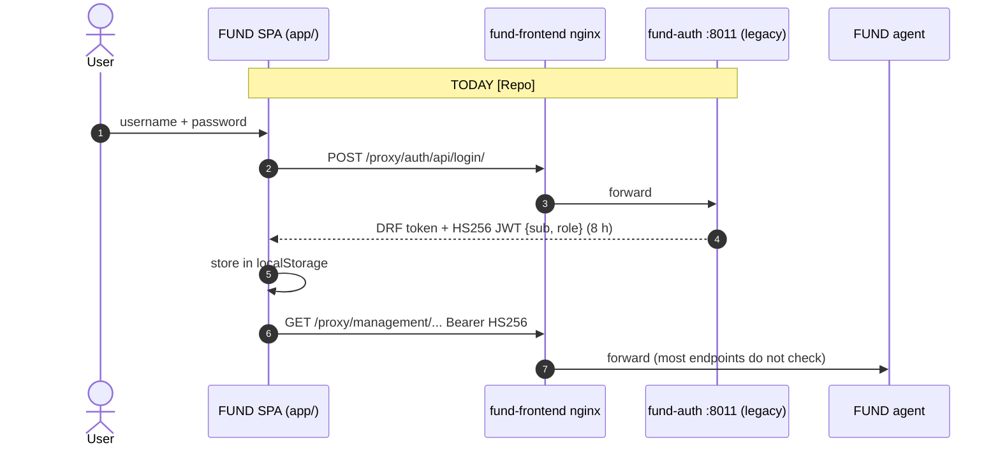

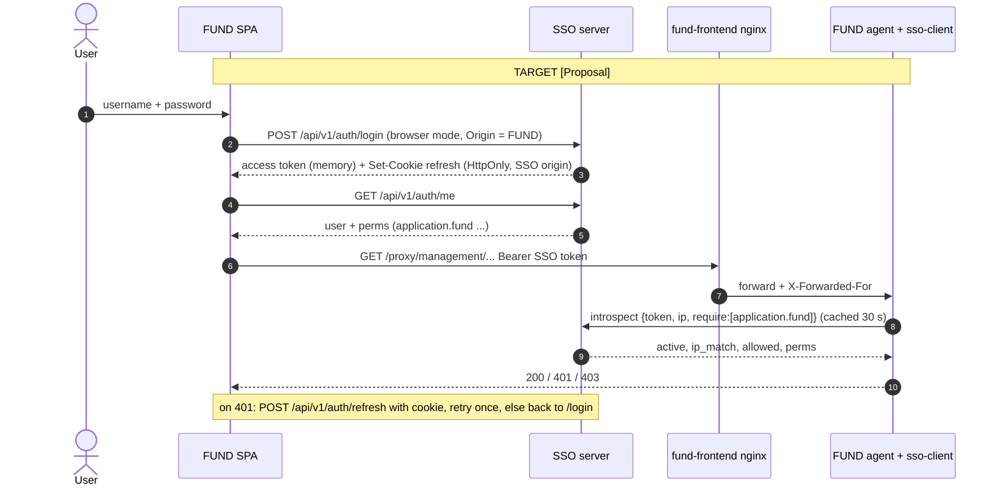

### 3.3 User and permission mapping

| FUND today [Repo] | SSO target [Proposal] |
|---|---|
| `userauth_db.auth_user` (custom `UserModel`, unique email) | `dcWebUsers.auth_user` (stock User). Same `AbstractUser` columns, so rows copy 1:1 |
| password hash (Django hasher) | copied as is; users keep their password |
| `is_staff` → `role:"admin"` | `application.fund_admin` (group FUND operators). `is_staff` stays meaningful only for Django admin |
| any active user → `role:"user"` | `application.fund` (group FUND users) |
| JWT `sub` = username | SSO `sub` = user id; `username`/`email` claims carry the name. FUND data keyed by username keeps working via the `username` claim |

Migration command (FUND-side script or SSO `import_users`, **[Proposal]**): dry-run report first; match on username,
then email; on a username that already exists in `dcWebUsers` with a different email → do not merge, list for
Thomas. **[Assumption]** FUND's production `DB_NAME` is not already `dcWebUsers` (open question Q1).

### 3.4 Cutover and coexistence

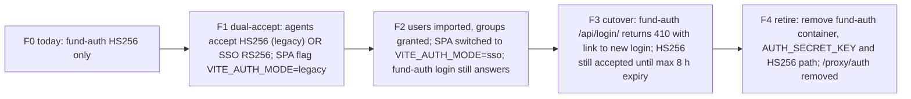

- Dual-accept is decided per request by the JWT header: `alg=RS256` + `kid` + `iss`=SSO → `sso-client`;
  `alg=HS256` → legacy check (`role`). Never accept HS256 with the SSO issuer.
- Length of F1–F3: one release; F3→F4 at least the legacy token lifetime (8 h) plus a buffer.
- Rollback: F2→F1 flips the SPA flag back; nothing is deleted before F4.
- During F1–F3 a password change in `fund-auth` does not reach the SSO (same accepted rule as myFinance).

---

## 4. (b) FUND backend services verifying tokens via `sso-client`

Each FUND agent (FastAPI) adds the `sso-client` FastAPI dependency (library design §FastAPI). Settings per agent:
`SSO_URL`, ServiceClient id/secret (one ServiceClient **per agent** or one shared `fund-backend` client,
open question Q4), `TRUSTED_PROXY_IPS` = the `fund-frontend` nginx container address / `fund-network` subnet.

| Agent | Required permission(s) [Proposal] |
|---|---|
| orchestrator, management (read/submit) | `application.fund` |
| orchestrator/management/discovery scheduler start/stop | `application.fund` + `application.fund_admin` |
| analytic, coding, backtesting, dataserver, research | `application.fund` |
| storage | keep `X-Storage-Key` (service secret) **and** `application.fund` for browser-originated calls |
| auto-trade | read routes `application.gateway`; submit/stop `application.gateway_trade` |
| internal agent→agent calls (orchestrator → analytic …) | ServiceClient credentials (Basic) or forwarded user token; [Proposal] forward the user token + `client_ip` when the call is on behalf of a user, ServiceClient when scheduled |

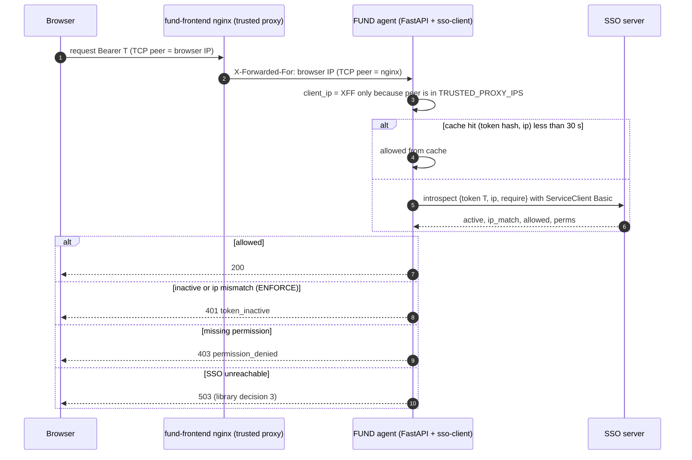

Docker note: `fund-frontend` publishes `3000:80` with Docker's default userland proxy, so nginx may see the Docker
gateway as the client. Same fix as in the library design: host networking for the edge nginx or
`"userland-proxy": false`. **[Assumption]** production puts another TLS proxy in front; then it becomes the first
trusted hop and `fund-frontend` nginx the second.

---

## 5. (c) Smart_Gateway_MCP

### 5.1 Three kinds of caller

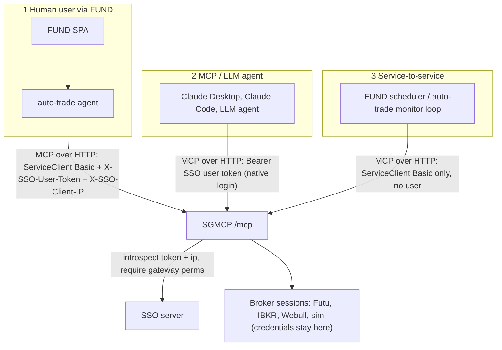

| Caller | Credential at SGMCP [Proposal] | Permissions checked | IP binding |
|---|---|---|---|
| Human via FUND (auto-trade relays) | auto-trade's ServiceClient + the user's SSO token + browser IP as `client_ip` | user must hold `gateway` (+`gateway_trade` for submit/stop, +`gateway_live` for live) | yes, browser IP |
| MCP / LLM agent run by a user | that user's SSO token (native-mode login) as Bearer | same as above | yes, the agent host's IP; in `ENFORCE` an agent on a changing IP must re-login (Q6) |
| Service-to-service (monitor polls, resume, scheduled jobs) | ServiceClient only | ServiceClient `app_codename=gateway` and an allow-list of read tools; **no trading tools without a user** | not applicable (service creds, no user token) |
| Operator `/ui` broker login | unchanged (local token) in phase 1; later SSO login with `gateway_live` (Q7) | | |

- The static `SGMCP_AUTH_TOKEN` stays as a break-glass / dev fallback, off in production after cutover.
- **Broker credentials stay in the gateway** (or in the Local Gateway container per `Local_login.md`). The SSO
  never stores broker secrets; the SSO only says *who* may trade.
- **Ownership** (new in SGMCP): `strategies` gets `owner_sub` (SSO user id). `list_strategies`/`get_*` filter by owner
  unless the caller holds `fund_admin`; stop/delete only by owner or `fund_admin`. This also gives `Local_login.md`'s
  "broker access list per FUND user ID" its key: the SSO `sub`.
- **Trading needs stronger permission**: `submit_strategy`, `stop_strategy`, `delete_strategy` require
  `gateway_trade`; `environment="live"` requires `gateway_live` **and** `SGMCP_ALLOW_LIVE=1`. Trading tools never use
  the 30 s cache: introspect on every call (fresh suspend/permission state).
- MCP transport: the `sso-client` ASGI/Starlette middleware wraps the Streamable HTTP app; the MCP session keeps the
  principal of the request that opened it, and every tool call re-checks for trading tools.

### 5.2 Failure events

**SSO down while a user submits**:

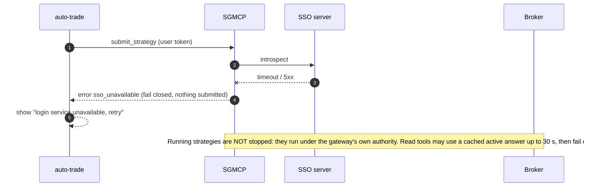

**Broker down mid-strategy** (existing SGMCP behaviour [Repo]: reconnect window `SGMCP_RECONNECT_MAX_SECS`, `WAITING_GATEWAY`):

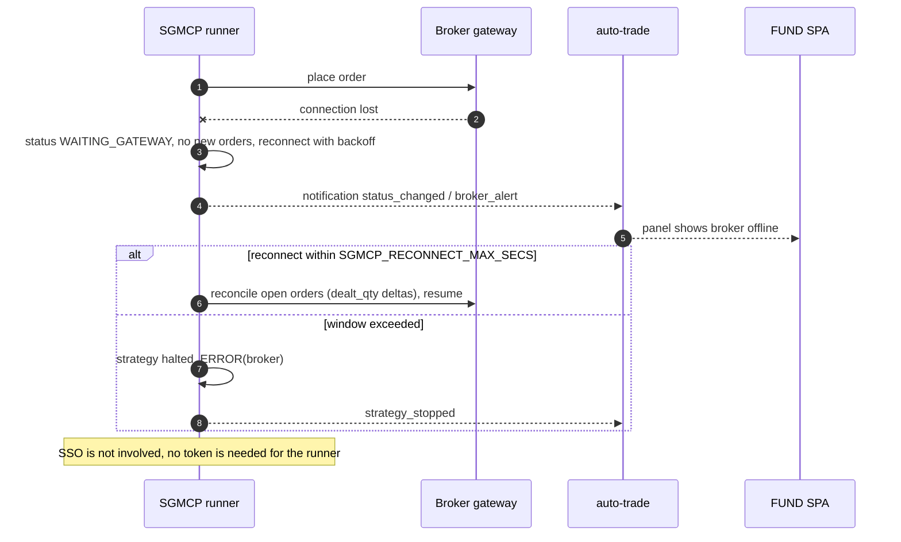

**User token expires or user is suspended mid-order**:

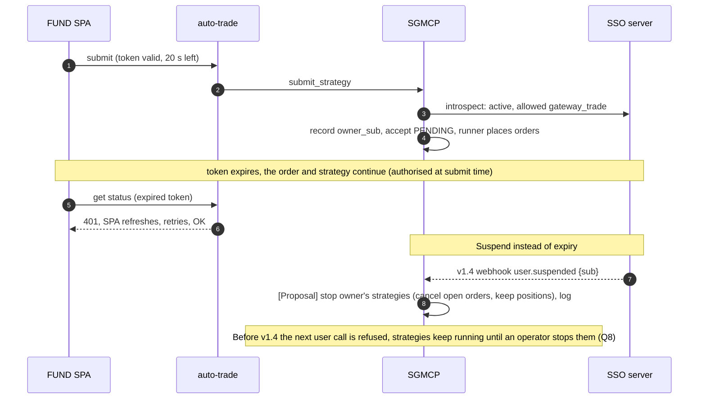

---

## 6. (d) llm-wiki-svc behind FUND

- llm-wiki-svc becomes one more FUND backend service: FUND nginx adds `location /proxy/llmwiki/` →
  `llmwiki-api:8000` (same host) or the llm-wiki host (**[Assumption]** separate host/VPS, see its compose with
  cloudflared). The SPA calls it with the same SSO Bearer token; llm-wiki checks `application.llmwiki`
  (`llmwiki_write` for ingest/upload) through `sso-client` (v1.2b migration).
- Its own `/login` (BFF, server-rendered) becomes **optional**: kept for standalone use and MCP, can be disabled with a
  setting when FUND is the only front door ([Proposal] `LLMWIKI_LOCAL_LOGIN=0`).
- FUND agents (research, analytic) may call llm-wiki on a user's behalf with the forwarded user token + `client_ip`, or
  with a ServiceClient for background ingestion.
- If llm-wiki is on another origin and called directly from the browser, add FUND to its CORS list; the proxy route
  avoids that and is preferred.

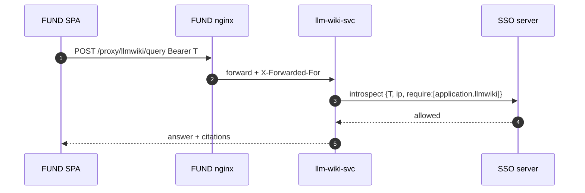

---

## 7. (e) Admin UI in FUND and SSO admin REST API (new phase v1.3a/v1.3c)

### 7.1 Decision

The day-to-day admin page lives in the **FUND frontend** (`/admin`, TanStack route) and calls a **new SSO admin REST
API**. **Django admin** on the SSO (`SSO_ADMIN_PATH`) stays as the **break-glass ops tool** (superusers only, ideally
reachable only from the ops network/VPN).

### 7.2 Screens

| Screen | Contents | API |
|---|---|---|
| Users list | search, filter active/suspended, groups, last login | `GET /users` |
| User create | username, email, first/last name, initial password or "send invite" (invite later, with sign-up) | `POST /users` |
| User detail | profile edit, **Suspend / Unsuspend** (confirm; shows "all sessions will be logged out"), **Log out everywhere**, Delete (type username to confirm; prefer suspend) | `PATCH`, `POST …/suspend`, `…/unsuspend`, `…/logout-all`, `DELETE` |
| User permissions | effective permissions (direct + via groups), toggle app permissions, group membership | `GET/PUT …/permissions`, `PUT …/groups` |
| Groups | create, members, permissions | `/groups…` |
| Services | registered ServiceClients: client_id, app permission, notify_url, active; **Register service** (secret shown once), rotate secret, deactivate | `/services…` |
| App permissions | list `application.*`, create, rename, delete (blocked for code-defined, shows affected users) | `/permissions…` |
| Audit log | who did what, when, from which IP; filter by actor/target | `GET /audit` |

The Admin menu item shows only when `/me` perms include `application.sso_admin`.

### 7.3 Proposed endpoints (`/api/v1/admin/…`) [Proposal]

| Method + path | Action |
|---|---|
| `GET /users?q=&active=&group=&page=` · `POST /users` | list, create |
| `GET/PATCH/DELETE /users/{id}` | read, edit profile, delete |
| `POST /users/{id}/suspend` · `/unsuspend` · `/logout-all` · `/set-password` | lifecycle (suspend reuses v1.2a revoke path) |
| `GET /users/{id}/permissions` · `POST` / `DELETE /users/{id}/permissions/{codename}` | app access |
| `PUT /users/{id}/groups` | group membership |
| `GET/POST /groups` · `GET/PATCH/DELETE /groups/{id}` · `POST/DELETE /groups/{id}/permissions/{codename}` | groups |
| `GET/POST /permissions` · `PATCH/DELETE /permissions/{codename}` | `application.*` permissions via `ensure_permission()` |
| `GET/POST /services` · `GET/PATCH/DELETE /services/{client_id}` · `POST /services/{client_id}/rotate-secret` | ServiceClient registry |
| `GET /audit?actor=&target=&action=&since=` | audit log |

**Auth and safety**

- Bearer SSO access token from the FUND SPA, called **directly from the browser** to the SSO (CORS allow-list =
  FUND origin; no cookie auth, so no CSRF). Requires active user + `application.sso_admin` (and `is_staff`,
  [Proposal], so Django admin and the API agree on who is staff).
- Checked against the DB on every call (no cache, no reliance on the token's embedded perms); IP binding applies.
- Same guards as v1.2a admin: no self-suspend, no self-delete, no removing your own `sso_admin`, last
  `sso_admin` cannot be removed, code-defined permissions not deletable, codename immutable.
- Destructive calls need `If-Match`/version or a confirm field; [Proposal] re-auth (password) within 5 min for
  delete user, rotate secret, grant `sso_admin` (Q9).
- Own throttle scope `admin` (e.g. 120/min per user).

**Audit log**: new table `sso_adminauditlog` (id, ts, actor_id, actor_ip, action, target_type, target_id,
before JSON, after JSON, request_id, result). Written in the same transaction as the change; Django admin writes
also log here (plus `LogEntry`). Also emitted as `sso.admin` JSON log lines. Read-only in Django admin.

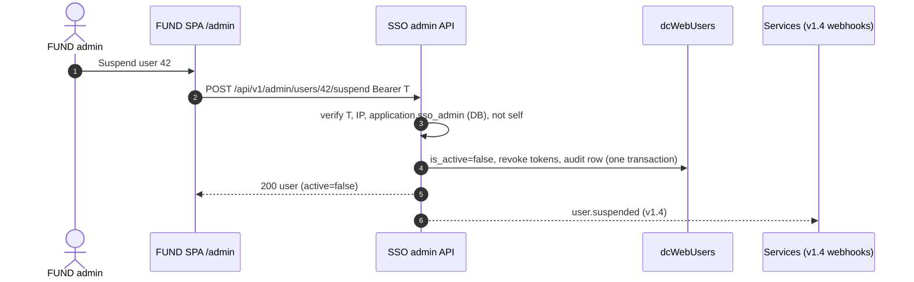

---

## 8. (f) End-to-end flows

### 8.1 Login → research → llm-wiki → simulated order

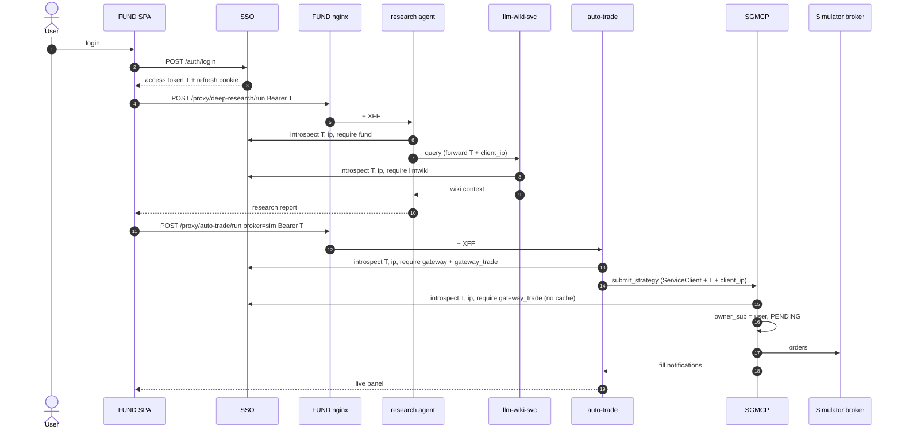

### 8.2 Logout and suspend propagation

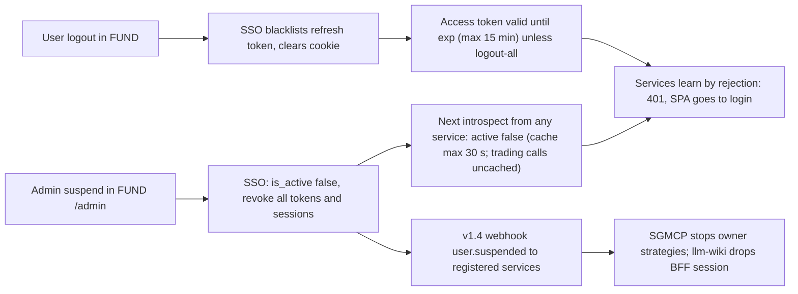

Logout of one FUND tab logs out that browser session (refresh cookie gone); other devices stay logged in.
"Log out everywhere" = `POST /auth/logout-all`.

---

## 9. (g) Phasing plan and open questions

### 9.1 Phasing [Proposal]

| Phase | Repo(s) | Content | Depends on |
|---|---|---|---|
| v1.2a | SSO | **Done** (pushed `107ae38`) | |
| v1.2b | SSO, llm-wiki | IP binding modes, introspect/permission query, `SSO_TRUSTED_PROXIES`, `sso-client` library, llm-wiki migrates | v1.2a |
| v1.3a | SSO | **SSO admin REST API + audit log** (§7), ecosystem permissions created (§2) via `create_app_permission`, `import_users` dry-run tool | v1.2b |
| v1.3b | FUND | **Login migration** F1–F3 (§3), FUND agents on `sso-client` (§4), llm-wiki behind `/proxy/llmwiki/` (§6) | v1.2b (+ v1.3a for import) |
| v1.3c | FUND | **Admin UI** `/admin` (§7.2) | v1.3a, v1.3b |
| v1.3d | SGMCP, FUND auto-trade | **Gateway integration** (§5): SSO auth middleware, `owner_sub`, trade/live permissions, auto-trade forwards user token; static token becomes fallback | v1.2b, v1.3b |
| v1.3e | FUND | F4: retire `fund-auth` | v1.3b stable |
| v1.4 | SSO, SGMCP, llm-wiki | Signed webhooks; SGMCP reacts to `user.suspended` | v1.3d |
| later | | TODOS.md: sign-up/invite, password change/reset, `Local_login.md` access list keyed by SSO `sub`, SSO login for SGMCP `/ui` | |

### 9.2 Open questions for Thomas

1. **FUND user DB**: is FUND's production `fund-auth` `DB_NAME` a separate DB (`userauth_db`) or already `dcWebUsers`? Do FUND users overlap with myFinance users?
2. **Permission names**: accept §2 (`fund`, `fund_admin`, `llmwiki`, `llmwiki_write`, `gateway`, `gateway_trade`, `gateway_live`, `sso_admin`)?
3. **Domains**: SSO and FUND hostnames (same site for the refresh cookie)? Does production put a TLS proxy in front of `fund-frontend` nginx?
4. **ServiceClients**: one per FUND agent, or one shared `fund-backend` client?
5. **Unauthenticated agents today**: OK that every FUND agent endpoint will require a token after F3 (scripts like `curl /submit` need a native login)?
6. **IP binding for MCP agents**: the mode is server-wide; is `ENFORCE` acceptable for LLM agents on changing IPs, or do we need a per-client exception (would reopen a TODO)?
7. **SGMCP `/ui` broker login**: keep its local token, or move to SSO login with `gateway_live`?
8. **On suspend**: should SGMCP stop the user's running strategies (cancel orders, keep positions), or only block new calls?
9. **Admin API step-up**: require password re-entry for destructive admin actions?
10. **Where SGMCP runs** for this phase: on the host next to FUND (today), or cloud per `Local_login.md`?
11. **llm-wiki placement**: same host as FUND (compose network) or separate VPS behind cloudflared? Keep its own `/login`?
12. Your earlier message ended with "4) the": was there another point?
