# FUND-Financial-Research ecosystem: integration design

> **See also:** [ARCHITECTURE.md §0 System context](ARCHITECTURE.md#0-system-context-fund-financial-research-ecosystem),
> [v1.2 requirements design](DESIGN-v1.2-requirements.md), [sso-client library design](SSO-CLIENT-LIBRARY-DESIGN.md),
> [API Reference Manual](API-REFERENCE-MANUAL.md) §8 (planned admin API), [TODOS.md](../TODOS.md).

| | |
|---|---|
| Status | **Design.** Drafted 2026-10-13; Thomas's answers applied 2026-10-14 (§10); phase order changed 2026-10-15 (§9.1: SSO complete → SGMCP → FUND). v1.3a/b/c designed in [DESIGN-v1.3a-admin-api.md](DESIGN-v1.3a-admin-api.md), [DESIGN-v1.3b-devices-on-behalf-of.md](DESIGN-v1.3b-devices-on-behalf-of.md), [DESIGN-v1.3c-webhooks.md](DESIGN-v1.3c-webhooks.md) and implemented on branch `feat/sso-v1.3` (local, not pushed) |
| Scope | How the SSO server, FUND-Financial-Research (frontend + backend services), Smart_Gateway_MCP (SGMCP) and llm-wiki-svc fit together |
| Sources read | `Neural-Matrix-LLC/FUND-financial-Research` `main` @ `dfffe5e` (2026-09-02), `Neural-Matrix-LLC/Smart_Gateway_MCP` `main` @ `39b3acd` (2026-10-08), `llm-wiki-svc` `feat/sso-login`, this repo `feat/v1.2a` @ `107ae38` |

Labels used in this document:

- **[Repo]** a fact read from the named repository (file given where useful).
- **[Assumption]** something not found in the repos; needs confirmation (most are also in §9 Open questions).
- **[Proposal]** a design choice made here for Thomas to accept or change.

## Contents

1. What exists today (facts from the repos)
2. Permission model for the ecosystem
3. (a) FUND frontend: login migration to the SSO
4. (b) FUND backend services: verifying tokens with `sso-client`
5. (c) Smart_Gateway_MCP: cloud strategies, local broker pass-through
6. (d) llm-wiki-svc behind FUND
7. (e) Admin UI in FUND and the SSO admin REST API (new phase)
8. (f) End-to-end flows
9. (g) Phasing plan and open questions
10. Decisions (2026-10-14)

---

## 1. What exists today (facts from the repos)

### 1.1 FUND-Financial-Research [Repo]

| Component | Container / port | Language | Notes |
|---|---|---|---|
| Frontend `app/` | `fund-frontend`, host `${FRONTEND_HOST_PORT:-3000}` → nginx :80 | React 18 + Vite + TypeScript, TanStack Router/Query, Tailwind | nginx (`app/nginx.conf`) serves the SPA and reverse-proxies `/proxy/<svc>/` to each agent on the `fund-network` bridge, setting `X-Real-IP` / `X-Forwarded-For`. Adds `X-Storage-Key` for storage |
| Legacy frontend `front-end/` | dev only (`npm run dev`, :3000) | React 18 + react-router + axios + zustand | Described in README §Frontend; not in compose. The compose frontend is `app/` |
| Orchestrator | :8000 | Python / FastAPI | Routing, state, scheduler. `_require_admin` checks HS256 JWT `role=="admin"` |
| Analytic agent | `fund-analytic` :8001 | Python | Turns PDFs/text/video into a strategy summary |
| Coding agent | `fund-coding` :8002 | Python | Generates code + tests |
| Backtesting agent | `fund-backtesting` :8003 | Python | |
| Dataserver | `fund-dataserver` :8004 | Python | Market data |
| Discovery agent | `fund-discovery` :8005 | Python / FastAPI | Can run on a separate host; admin-JWT scheduler endpoints |
| Storage agent | `fund-storage` :8006 | Python | Protected by shared `STORAGE_AGENT_SECRET` header injected by nginx |
| Management | `fund-management` :8008 | Python / FastAPI | Also serves `/proxy/orchestrator/`; `_require_admin` (HS256) |
| Auto-trade agent | `fund-auto-trade` :8009 | Python | **The only FUND component that calls SGMCP**: MCP Streamable HTTP client to `host.docker.internal:8080` with static `SGMCP_AUTH_TOKEN` (`agents/auto-trade/src/gateway.py`) |
| Auth agent | `fund-auth` :8011 | Django + DRF (`runserver`) | `POST /api/login/`, `POST /api/logout/`. Custom `UserModel(AbstractUser)` with unique email, `db_table='auth_user'`. Code default `DB_NAME=userauth_db` [Repo], but **in production it already points at `dcWebUsers`** (Thomas, 2026-10-14): FUND users are the same `auth_user` rows the SSO uses |
| Research (deep research) | `fund-research` :8015 | Python | proxied as `/proxy/deep-research/` |

**Current login flow [Repo]** (`agents/auth/api/views.py`, `app/src/pages/Login.tsx`, `app/src/api/client.ts`):
`POST /proxy/auth/api/login/` with username + password → response holds a DRF token (`token`), an
**HS256 JWT `access_token` `{sub, role, exp}`** signed with the shared `AUTH_SECRET_KEY` (default life 480 min,
no refresh), `role` (`admin` if `is_staff`) and the user object. The SPA stores all of them in **`localStorage`**
and sends `Authorization: Bearer <access_token>` on every call. Only admin endpoints (scheduler start/stop) verify
the JWT; most agent endpoints are **not authenticated** (they rely on the network and nginx). Logout deletes the
DRF token only; the JWT stays valid until `exp`.

### 1.2 Smart_Gateway_MCP (SGMCP) [Repo]

- Python 3.10+, FastMCP 1.27 over **Streamable HTTP** (`/mcp`, uvicorn/starlette, default `:8080`), stdio for dev.
  Runs **outside** FUND's compose, on the host next to the broker daemons.
- Auth: one static bearer `SGMCP_AUTH_TOKEN`, constant-time compare; `SGMCP_ALLOW_LIVE=1` gate for live trading;
  `SGMCP_ALLOWED_HOSTS` host check. Operator page **`/ui`** (broker logins, Futu unlock) with its own token→session
  cookie, in-memory sessions.
- Brokers: **Futu** (FutuOpenD), **IBKR** (Client Portal Gateway REST; the official IBKR MCP server is a
  companion, not used for execution), **Webull** (OpenAPI SDK; official Webull MCP as companion), and a built-in
  **simulator** (`broker="sim"`, GBM market, no daemon). Multi-login / multi-account gateways.
- Tools: strategy lifecycle (`submit_strategy`, `stop_strategy`, `delete_strategy`, `list_strategies`, …),
  account (`get_account_snapshot`, `get_positions`, `get_orders`), gateways, metrics, market data, telemetry;
  resources `trading://…`; push notifications (`fill`, `tick`, `risk_breach`, `status_changed`, …).
- Data: own MySQL database `sgmcp` (`strategies`, `accounts`, `positions`, `orders`). **No user/owner column**:
  instances are keyed by `process_id`, grouped by `workflow_id::strategy_name`.
- `docker/` builds the **FUND Local Gateway** (FutuOpenD, CP Gateway, Webull SDK) bound to 127.0.0.1;
  `Local_login.md` (proposal, not built; adopted in principle by §5) moves SGMCP to the cloud with broker logins on the user's machine and a
  per-**FUND user ID** broker access list. Broker secrets never leave the gateway host.

### 1.3 llm-wiki-svc [Repo]

FastAPI service (container port 8000, host 8010 by default; production host and domain **TBD / configurable**, under development), research knowledge base with HTTP API and MCP tools.
Already an SSO consumer on `feat/sso-login` (server-side BFF login, `client_ip` delegation, ServiceClient).
**FUND does not reference llm-wiki-svc anywhere yet.** Host port clash to note: llm-wiki's dev profile uses
host port 8011, the same as `fund-auth`.

### 1.4 Other repos seen (not read in depth)

`FUND-dashboard` (older public React dashboard, matches `front-end/`), `FUND-finance-dashboard`
(`myfinance-dashboard` + `financeagentserver`, **[Assumption]** the myFinance app being phased out), `futu-mcp`.

---

## 2. Permission model: each application declares its own permissions [Decision 2026-10-14]

One SSO token for all services (decision 5). Access is checked by asking the SSO (introspect / permission query,
v1.2b). Permissions are **not** a fixed list in the SSO: **each application ships a separate `sso_permissions.py`** (not inside its existing `config.py`) declaring its own
permissions, and an admin imports them into the SSO from the FUND Admin UI (§7.4).

### 2.1 `sso_permissions.py` schema [Decision 2026-10-14 round 2: separate file]

```python
# <app repo>/sso_permissions.py  (separate from the app's config.py)
APP_CODENAME = "gateway"            # [a-z][a-z0-9_]{1,40}; becomes application.<APP_CODENAME>
APP_NAME = "Smart Gateway MCP"
APP_DESCRIPTION = "Broker connectivity and strategy execution"
PERMISSIONS_VERSION = 3             # bump on every change; the import shows a diff
PERMISSIONS = [
    # (codename, name, description); codename must start with APP_CODENAME + "_"
    ("gateway_trade", "Trade (paper/sim)", "Submit, stop, delete strategies on paper and simulator"),
    ("gateway_live",  "Trade live",        "Allows environment=live (still needs SGMCP_ALLOW_LIVE=1)"),
]
```

- The app-access permission `application.<APP_CODENAME>` ("may use this app") is implicit and always created.
- Codenames are prefixed with `APP_CODENAME_` (Django codenames cannot contain dots), so two apps can never clash.
- The file is plain data (no imports); the Admin UI parses it as Python literals or the app exposes the same data as
  `GET /.well-known/sso-permissions.json` (either feeds the same API).

### 2.2 Examples only (each app decides its real list)

| App (`APP_CODENAME`) | Example permissions |
|---|---|
| `fund` | `application.fund`, `application.fund_admin` (scheduler start/stop, replaces `role=="admin"`) |
| `llmwiki` | `application.llmwiki`, `application.llmwiki_write` (ingest/upload) |
| `gateway` | `application.gateway` (read), `application.gateway_trade`, `application.gateway_live` |
| `sso` (built in) | `application.sso_admin` (SSO admin API and FUND Admin UI) |

Services require the app permission plus the finer one (`require=[...]`). Groups bundle permissions and are managed
in the Admin UI.

---

## 3. (a) FUND frontend: login migration to the SSO

### 3.1 Target

The FUND SPA uses the SSO **browser mode** (`auth.js` pattern, ARCHITECTURE §6.1/§6.4): access token (15 min) in
memory only, refresh token in an HttpOnly cookie on the SSO origin, silent restore on load. Nothing in
`localStorage` any more (today the 8-hour HS256 JWT sits there, readable by any XSS).

- **[Assumption]** SSO at `sso.<domain>` and FUND at `fund.<domain>` (same site), so the SameSite=Lax/Strict
  refresh cookie works. FUND's origin is added to `SSO_ALLOWED_ORIGINS` / CORS.
- The SPA reads `/api/v1/auth/me` for the display name and `perms` (hides Admin, trading buttons). The UI check is
  cosmetic; each service enforces.

### 3.2 Login: today vs target

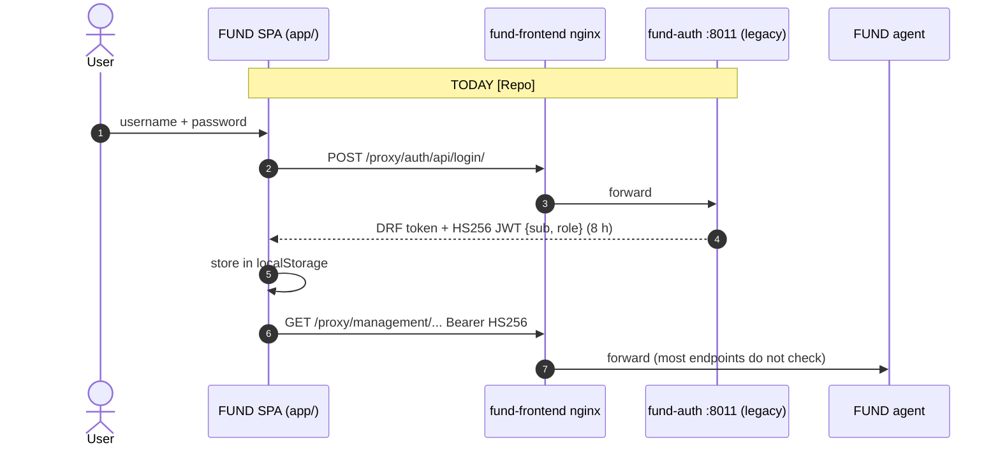

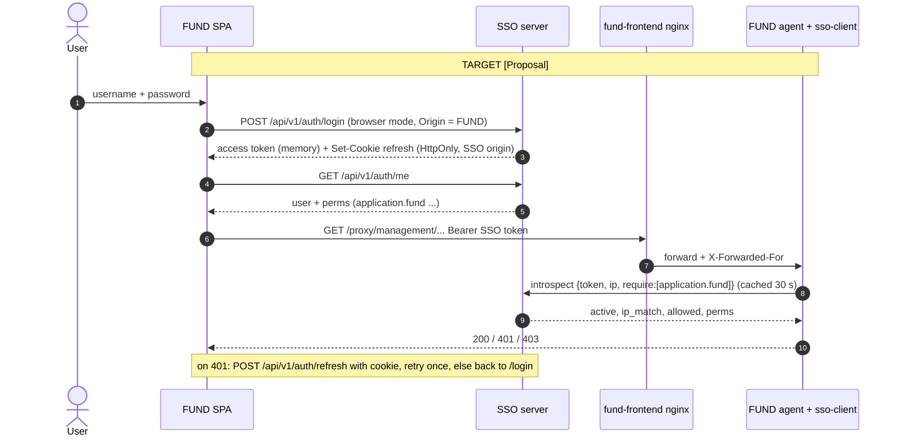

### 3.3 Users and permissions [Decision 2026-10-14]

FUND users are **already in `dcWebUsers`**: `fund-auth` writes the same `auth_user` table the SSO reads. **No user
import is needed**; users keep their passwords. FUND migrates its authentication to the SSO just like the other new
services.

| FUND today [Repo] | SSO target |
|---|---|
| `is_staff` → `role:"admin"` | `application.fund_admin` (example permission from FUND's `sso_permissions.py`) |
| any active user → `role:"user"` | `application.fund` |
| JWT `sub` = username | SSO `sub` = user id; the `username` claim carries the name, so FUND data keyed by username keeps working |

One-off step at cutover: import FUND's `sso_permissions.py` permissions (§7.4), then grant `application.fund` (and
`fund_admin` to today's `is_staff` users) through groups. Caveat [Repo]: FUND's custom model declares `email`
unique; the stock model the SSO uses does not, so FUND's DB constraint (if migrated) stays and SSO admin create
must not insert duplicate emails.

### 3.4 Cutover and coexistence: `AUTH_PROVIDER` switch [Decision 2026-10-14]

A single switch in FUND's **root `.env`** selects the login provider for the frontend and every agent:

| `AUTH_PROVIDER` | Frontend login | Agents accept | Unauthenticated endpoints |
|---|---|---|---|
| `legacy` (default today) | `fund-auth` `/api/login/` | HS256 (as today) | allowed (as today) |
| `both` (transition) | SSO login page; legacy kept for rollback | SSO RS256 **or** HS256 | **refused** (401) |
| `sso` (after cutover) | SSO only | SSO RS256 only | **refused**: every FUND endpoint requires a token |

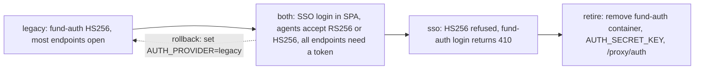

- The frontend reads the value at build/start (`VITE_AUTH_PROVIDER` generated from the root `.env`); agents read it
  from the shared root `.env` they already load (`env_file: .env`).
- In `both`, the token is routed by its header: `alg=RS256` + `kid` + SSO `iss` → `sso-client`; `alg=HS256` →
  legacy check. Never accept HS256 with the SSO issuer.
- `both` → `sso` once no HS256 token has been seen for the legacy lifetime (8 h) plus a buffer; health endpoints
  (`/health`) stay open.
- Scripts that call agents (e.g. `curl /submit`) must use a service client (§4.1) or a native user login.

---

## 4. (b) FUND backend services verifying tokens via `sso-client`

Each FUND agent (FastAPI) adds the `sso-client` FastAPI dependency (library design §FastAPI). Settings per agent:
`SSO_URL`, ServiceClient id/secret (**one ServiceClient per service/agent**, each with its own
credentials [Decision 2026-10-14 round 3]), `TRUSTED_PROXY_IPS` = the `fund-frontend` nginx container address / `fund-network` subnet.

| Agent | Required permission(s) [Proposal] |
|---|---|
| orchestrator, management (read/submit) | `application.fund` |
| orchestrator/management/discovery scheduler start/stop | `application.fund` + `application.fund_admin` |
| analytic, coding, backtesting, dataserver, research | `application.fund` |
| storage | keep `X-Storage-Key` (service secret) **and** `application.fund` for browser-originated calls |
| auto-trade | read routes `application.gateway`; submit/stop `application.gateway_trade` |
| internal agent→agent calls (orchestrator → analytic …) | service token; on behalf of a user also the user token + browser IP (§4.1) |

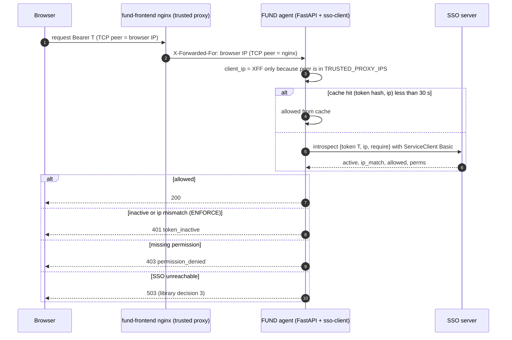

### 4.1 Service-to-service and acting on behalf of a user [Decision 2026-10-14, confirmed]

> **Confirmed by Thomas:** SSO user login is for external clients (mostly real people) and IP binding applies to
> them. Internal processes (AI agents, MCP clients, other services, and the FUND Local Gateway's device credential,
> §5.2) authenticate as registered service clients with their own credentials; IP binding does not apply.

**Service tokens [Proposal, v1.3a]**: a registered ServiceClient calls `POST /api/v1/auth/service-token`
(OAuth2 `grant_type=client_credentials`, HTTP Basic `client_id:secret`) and gets a short RS256 access token
(5 min, no refresh; fetch a new one). Claims: `sub="svc:<client_id>"`, `typ="service"`, `app`, `perms` = the
permissions granted to that service client (in the Admin UI, like a user), **no `cip`**, no `sid`. Services verify
it locally with JWKS or by introspect; `SSO_IP_BINDING_MODE` is ignored for `typ=service`. Revoking or deactivating
the ServiceClient makes introspect return `active:false` at once and blocks new service tokens.

| Caller | Credential | IP binding | Permissions come from |
|---|---|---|---|
| Person in a browser / native app | SSO user token (login) | yes (`NOIP`/`WARNING`/`ENFORCE`) | the user |
| Service acting for itself (scheduler, monitor loop, MCP/AI agent, scripts) | service token | no | the service client |
| Service acting **on behalf of** a user | service token **+** the user's token + the browser IP | yes, checked against the **browser IP**, not the service's | **both**: the service client must be allowed to delegate, the user must hold the permission |

**On behalf of a user**: the calling service sends
`Authorization: Bearer <service token>`, `X-SSO-User-Token: <user access token>`, `X-SSO-Client-IP: <browser IP
the caller saw on its own socket>`. The receiver (via `sso-client`) verifies the service token, then introspects the
user token with `ip = X-SSO-Client-IP`; the SSO accepts that IP only because a service token is attached (same rule
as today's `client_ip` from a ServiceClient). The effective principal is the **user**, recorded with `via=<client_id>`
in logs. Services must not forward a user token they did not receive in the current request.

**Long-running work** (a strategy running for days, a scheduled job) does not keep the user token: the service runs
it under its own service identity and records the `owner_sub` of the user who started it. Suspend handling (§5.6)
uses that owner. OAuth token exchange / delegated tokens (RFC 8693) are not planned (TODOS).

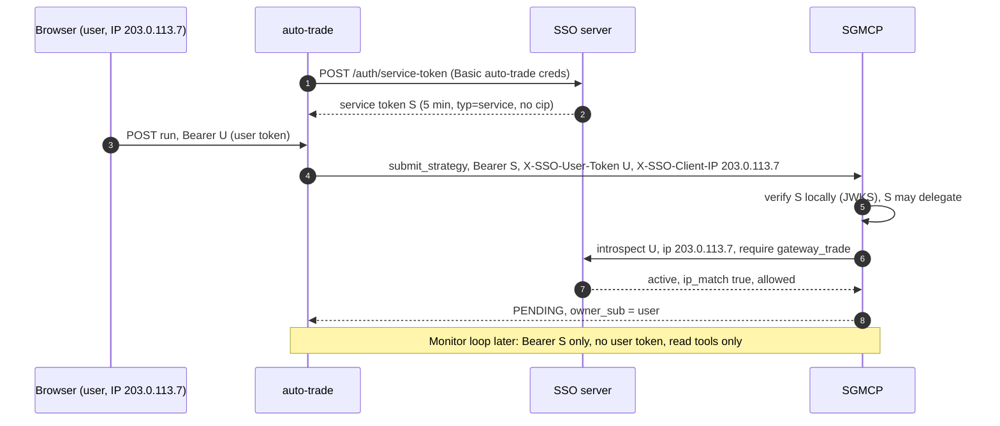

Docker note: `fund-frontend` publishes `3000:80` with Docker's default userland proxy, so nginx may see the Docker
gateway as the client. Same fix as in the library design: host networking for the edge nginx or
`"userland-proxy": false`. **[Assumption]** production puts another TLS proxy in front; then it becomes the first
trusted hop and `fund-frontend` nginx the second.

---

## 5. (c) Smart_Gateway_MCP: cloud strategies, local broker pass-through [Decisions 2026-10-14 rounds 2-4]

**Strategies run in the cloud; broker logins stay local.** The user submits a strategy in the FUND UI and picks the
broker (and account) to trade. The strategy runs in the cloud (FUND auto-trade + Smart_Gateway_MCP, strategy runner,
risk guards, ledgers). The user logs in to the broker **on their own PC**, where the **FUND Local Gateway** (Docker)
runs only the broker gateways (FutuOpenD, IBKR CP Gateway, Webull SDK) behind a **pure pass-through** `local-agent`
that connects **outbound** to FUND's `gateway-relay`. No strategy logic, risk logic, retry logic or ledger runs on the
PC (this matches the forwarder-only rule in SGMCP's `Local_login.md` [Repo]). The simulator (`broker="sim"`) needs no
PC and runs in the cloud.

**Operating requirement**: while any strategy that trades through a PC is running, **that PC must stay on and
connected** (no sleep, no hibernate, network up). FUND warns the user at submit, shows a heartbeat status per PC, and
alerts when the link drops (§5.5).

### 5.1 Components

| Component | Where | Role |
|---|---|---|
| auto-trade + SGMCP (strategy runner, `OrderManager`, risk and capital guards, `VirtualAccount`, MySQL `sgmcp`) | **FUND cloud** | runs every strategy; decides and sends orders; **system of record** for strategies, orders and fills |
| `gateway-relay` (new FUND service, behind FUND nginx `wss://<fund>/relay/`) [Proposal] | FUND cloud | terminates device links, keeps `device → broker accounts`, enforces **one live connection per broker account**, forwards broker requests/replies between SGMCP and the PC |
| FUND Local Gateway (Docker, from SGMCP `docker/`) | user's PC | `local-agent` (pairing, outbound link, byte/request forwarding; Webull request signing stays local [Repo]) + broker daemons. Ports on `127.0.0.1` only, **no inbound port**, no state beyond its link |
| Broker login UI (SGMCP `/ui` login pages or the daemons' own login) | user's PC, `127.0.0.1` | broker passwords, 2FA, Futu unlock, Webull App Key/Secret: **never leave the PC** |
| SSO server | SSO host | issues/revokes the **device credential** (ServiceClient `kind=device` bound to the FUND user) |

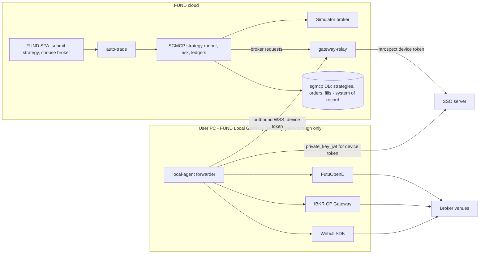

### 5.2 Pairing: provisioning the device credential after SSO login [Proposal]

1. The user, logged in to FUND (SSO user token, IP-bound), opens **Brokers → Connect this PC**. The SPA calls
   `POST /relay/devices/pairing-code` → one-time code (8 chars, 10 min, single use) + install command.
2. On the PC, `local-agent` generates an **Ed25519 key pair; the private key never leaves the PC** and sends
   `{code, device_name, public_key}` to `POST /relay/devices/pair`.
3. The relay, with its service token on behalf of the user who created the code, calls the SSO `POST /api/v1/devices`
   → ServiceClient `kind=device`, `owner=<user sub>`, `client_id=dev_…`, public key registered.
4. `local-agent` gets **5-min device tokens** from `POST /api/v1/auth/service-token` (`private_key_jwt`); claims
   `typ="device"`, `sub="dev:<id>"`, `owner=<user sub>`, **no `cip`: IP binding is not applied** (user-facing calls
   only).
5. The user logs in to each broker locally; `local-agent` reports the connected broker accounts in `hello`.

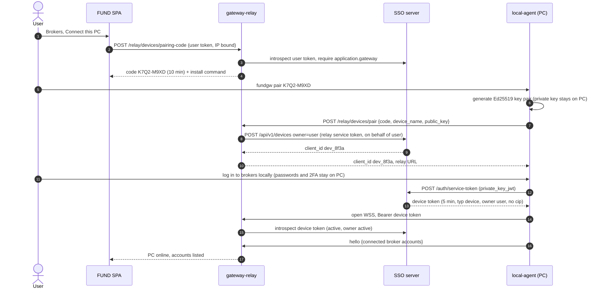

### 5.3 Authorization: the user's own submission is the grant [Decision 2026-10-14 round 4]

The user submits the strategy in the FUND UI and **chooses the broker and account**; that submission (by a user holding
`gateway_trade`, plus `gateway_live` for live) **is the authorization** for the cloud strategy to send orders to that
account through the user's PC. There is **no separate per-agent grant**: an AI agent acts through the same path (its
own service token, on behalf of the user per §4.1) and is bound by the same rules.

The relay only forwards a broker request when **all** hold:

- it comes from SGMCP's service client;
- the strategy's `owner_sub` equals the device's `owner` (a strategy can only trade the owner's own PC/accounts);
- the target broker account is in that device's `hello` list and the device holds the account's **live connection**;
- device token active and owner active (introspect, cached ≤ 30 s; refreshed on every `reauth`).

| Caller | Path | Credential | IP binding |
|---|---|---|---|
| Person via FUND | SPA → auto-trade → SGMCP | user token + browser IP; auto-trade/SGMCP service tokens (§4.1) | yes, browser IP |
| AI agent / MCP client (FUND side) | agent → auto-trade / SGMCP | its own service token on behalf of the user | no (the user token inside is checked against the user's IP) |
| SGMCP → relay | cloud | SGMCP service token | no |
| local-agent → relay | outbound WSS | device token | **no** |
| Broker login on the PC | `127.0.0.1` | local only | n/a |

Rules kept: trading needs `gateway_trade`; live needs `gateway_live` and `SGMCP_ALLOW_LIVE=1`; strategies record
`owner_sub`; the static `SGMCP_AUTH_TOKEN` is dev/break-glass only.

### 5.4 One live connection per broker account; cold standby [Decision 2026-10-14 round 4]

**Only one live connection per broker account.** The FUND Local Gateway may be installed on a second PC as a **cold
standby**: installed and paired, but **not connected** to that broker account. Activating it requires the first
connection to be disconnected. The relay enforces this: a `hello` claiming an account that already has a live
connection is refused for that account (`account_in_use`), and the SPA shows which PC holds it.

Switching hosts: the user disconnects PC-A (in FUND **Brokers → Disconnect**, or by stopping the gateway), PC-A's
live connection is released (or expires after 3 missed heartbeats, 60 s), then PC-B connects and claims the account.
Strategies using that account stay paused (§5.5) until the new connection is up, then resume with a broker
reconcile.

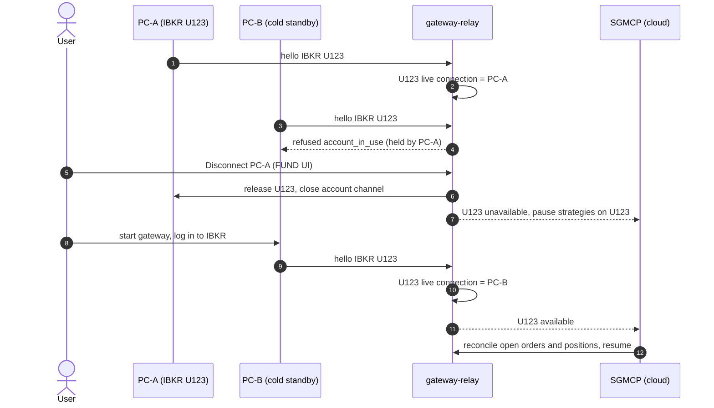

### 5.5 Failure events

**PC offline / link lost, then reconnect.** Since no logic runs locally, an offline PC simply means its broker
accounts are unreachable. Behaviour [Proposal]:

- relay marks the device offline after 3 missed heartbeats (20 s each, so 60 s); SGMCP sets every strategy on those
  accounts to **`WAITING_GATEWAY`** (existing SGMCP state [Repo]): no new orders, signals skipped, alert to the user
  (UI banner + notification "PC offline: strategies paused");
- an order **in flight** when the link drops has an unknown outcome: SGMCP marks it `UNKNOWN`, never resends it, and
  reconciles with the broker (open orders + fills) when the link returns;
- if the link is not back within `SGMCP_RECONNECT_MAX_SECS` (default 300 s [Repo]), the strategies **halt**
  (`ERROR(gateway_offline)`), alert again; the user restarts them after checking positions. Positions at the broker
  are untouched;
- the earlier **15-min relay lease is dropped**: the PC never opens positions on its own, so there is nothing to lease.

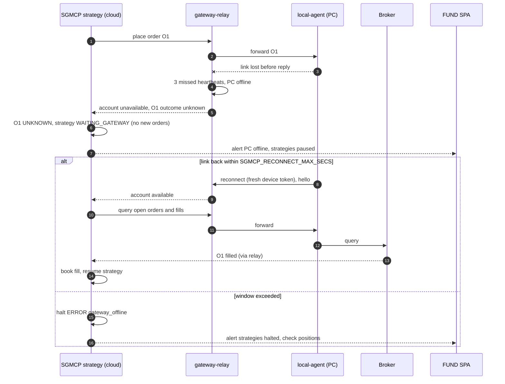

**Device token expiry / SSO down.** The device token is renewed over the open link every ~4 min. If the SSO is
unreachable at renewal, the link stays up until `exp` + 60 s grace, then the relay closes it (same as PC offline
above). The user's own 15-min token only matters for user calls; a running strategy does not need it.

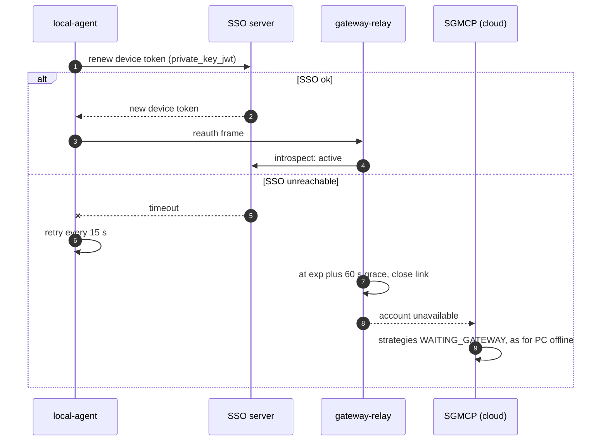

**Broker down** (PC on, daemon logged out or venue down): the local daemon reports it, `local-agent` forwards the
status, SGMCP applies its existing `WAITING_GATEWAY` / reconnect / halt rules and sends `broker_alert` [Repo].

**SSO down while a user submits**: auto-trade/SGMCP fail closed (`sso_unavailable`, nothing submitted); running
strategies are unaffected.

### 5.6 Suspend: cloud strategies stopped and deleted, PC disconnected [Decisions 2026-10-14]

On suspend, **all the user's strategies / auto-trade jobs are stopped and deleted in the cloud** (open orders
cancelled through the relay while the link is still up, instances soft-deleted, §5.7). **No action on open broker
positions.** Then the relay **disconnects the user's PCs**, and the SSO **revokes all their device credentials**, so
no PC can reconnect.

| Phase | Trigger | Backstop |
|---|---|---|
| Interim (before webhooks) | FUND `/admin`, after the suspend call returns 200, calls auto-trade `POST /internal/users/{sub}/suspend-cleanup` and `gateway-relay` `POST /internal/users/{sub}/disconnect` (service tokens) | auto-trade, SGMCP and relay sweep `GET /api/v1/service/users/inactive?since=` every 60 s |
| v1.3c | signed webhook `user.suspended` | same 60 s sweep |

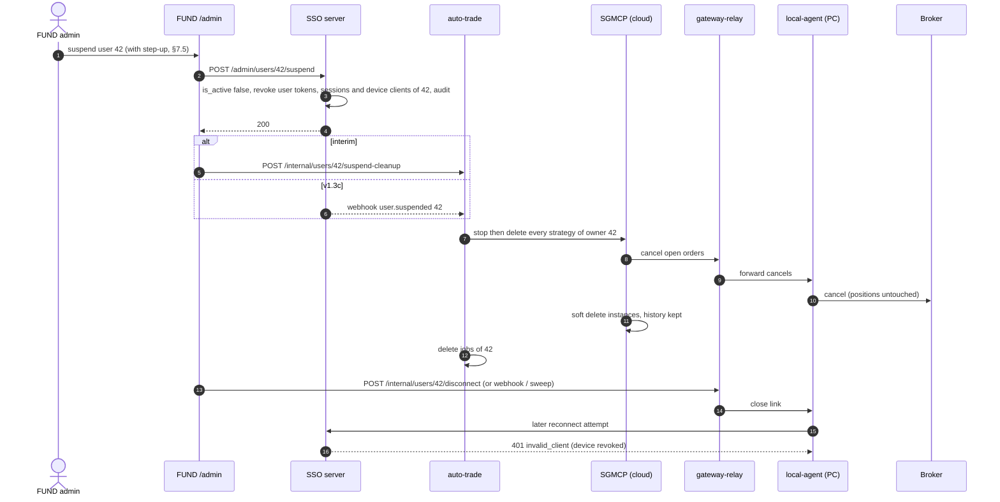

If a PC is offline at suspend time, the open-order cancels cannot reach the broker; SGMCP records them as
`CANCEL_PENDING`, the strategies are still deleted (no further orders can be sent, the device can never reconnect), and
the admin and user are told which orders may still be open at the broker.

### 5.7 Trade and order history is always kept; FUND cloud is the system of record [Decisions 2026-10-14 rounds 3-4]

All orders, fills/trades and their strategy context are kept for audit **no matter what**: suspend, strategy
deletion, user deletion. Because strategies run in the cloud, the **cloud `sgmcp` database is the system of record**;
the PC holds no ledger.

- **Gateway work item (v1.4)** [Repo: today `delete_strategy` purges the instance's rows, "purge-on-delete"]: change
  `delete_strategy` to a **soft delete**: `strategies.status = DELETED`, `deleted_at`, `deleted_by` (sub or
  `svc:<client_id>`), `delete_reason` (`user`, `suspend`, `admin`). Orders (with `realized_pl`, `dealt_qty`) and the
  strategy row stay; `positions`/`accounts` get a final snapshot before the live rows are cleared. Deleted instances
  are hidden unless `include_deleted=true` (owner or `fund_admin`), never auto-resumed, `process_id` never reused.
- Archive [Proposal]: old rows may move to `*_archive` tables; moving is allowed, deleting is not. No service DB user
  gets `DELETE` on order/fill/archive tables. Backups follow the FUND backup policy.
- **User deletion**: trade records keep `owner_sub` and a copied `owner_username`; the Admin UI recommends suspend over
  delete for users with trade history.

---

## 6. (d) llm-wiki-svc behind FUND

- llm-wiki-svc becomes one more FUND backend service: FUND nginx adds `location /proxy/llmwiki/` → a
  **configurable** upstream (`LLMWIKI_UPSTREAM` in FUND's `.env`); host and domain are **TBD**, under development. The SPA calls it with the same SSO Bearer token; llm-wiki checks `application.llmwiki`
  (`llmwiki_write` for ingest/upload) through `sso-client` (v1.2b migration).
- Its own `/login` (BFF, server-rendered) becomes **optional**: kept for standalone use and MCP, can be disabled with a
  setting when FUND is the only front door ([Proposal] `LLMWIKI_LOCAL_LOGIN=0`).
- FUND agents (research, analytic) call llm-wiki on a user's behalf with their service token + the user token +
  browser IP (§4.1), or with the service token alone for background ingestion. MCP/AI agents use their own service
  client.
- If llm-wiki is on another origin and called directly from the browser, add FUND to its CORS list; the proxy route
  avoids that and is preferred.

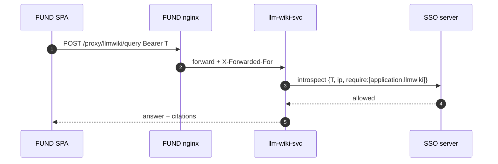

---

## 7. (e) Admin UI in FUND and SSO admin REST API (new phase v1.3a/v1.5b)

### 7.1 Decision

> **2026-10-15:** FUND migrates last, so until v1.5b the admin REST API is called directly (operators with
> `curl`/scripts; an app's own ServiceClient for its permission import) and Django admin stays available. The API
> as built is specified in [DESIGN-v1.3a-admin-api.md](DESIGN-v1.3a-admin-api.md), which supersedes §7.3–7.5 where
> they differ.

The day-to-day admin page lives in the **FUND frontend** (`/admin`, TanStack route) and calls a **new SSO admin REST
API**. **Django admin** on the SSO (`SSO_ADMIN_PATH`) stays as the **break-glass ops tool** (superusers only, ideally
reachable only from the ops network/VPN).

### 7.2 Screens

| Screen | Contents | API |
|---|---|---|
| Users list | search, filter active/suspended, groups, last login | `GET /users` |
| User create | username, email, first/last name, initial password or "send invite" (invite later, with sign-up) | `POST /users` |
| User detail | profile edit, **Suspend / Unsuspend** (confirm; shows "all sessions will be logged out"), **Log out everywhere**, Delete (type username to confirm; prefer suspend) | `PATCH`, `POST …/suspend`, `…/unsuspend`, `…/logout-all`, `DELETE` |
| User permissions | effective permissions (direct + via groups), toggle app permissions, group membership | `GET/PUT …/permissions`, `PUT …/groups` |
| Groups | create, members, permissions | `/groups…` |
| Services | registered ServiceClients: client_id, app permission, notify_url, active; **Register service** (secret shown once), rotate secret, deactivate | `/services…` |
| Applications | registered apps from their `sso_permissions.py`: **Import / update permissions** (upload `sso_permissions.py` or fetch the app's `/.well-known/sso-permissions.json`), preview diff, apply | `PUT /apps/{app_codename}/permissions` |
| App permissions | list `application.*`, grant counts, delete stale ones | `/permissions…` |
| Audit log | who did what, when, from which IP; filter by actor/target | `GET /audit` |

The Admin menu item shows only when `/me` perms include `application.sso_admin`.

### 7.3 Proposed endpoints (`/api/v1/admin/…`) [Proposal]

| Method + path | Action |
|---|---|
| `GET /users?q=&active=&group=&page=` · `POST /users` | list, create |
| `GET/PATCH/DELETE /users/{id}` | read, edit profile, delete |
| `POST /users/{id}/suspend` · `/unsuspend` · `/logout-all` · `/set-password` | lifecycle (suspend reuses v1.2a revoke path) |
| `GET /users/{id}/permissions` · `POST` / `DELETE /users/{id}/permissions/{codename}` | app access |
| `PUT /users/{id}/groups` | group membership |
| `GET/POST /groups` · `GET/PATCH/DELETE /groups/{id}` · `POST/DELETE /groups/{id}/permissions/{codename}` | groups |
| `GET/POST /permissions` · `PATCH/DELETE /permissions/{codename}` | `application.*` permissions via `ensure_permission()` |
| `GET/POST /services` · `GET/PATCH/DELETE /services/{client_id}` · `POST /services/{client_id}/rotate-secret` | ServiceClient registry |
| `GET /apps` · `PUT /apps/{app_codename}/permissions?dry_run=` | applications; bulk upsert of an app's permissions (§7.4) |
| `POST /reauth` | step-up password re-confirmation (§7.5) |
| `GET /devices?owner=` · `DELETE /devices/{client_id}` | FUND Local Gateway device credentials (§5.2) |
| `GET /audit?actor=&target=&action=&since=` | audit log |

**Auth and safety**

- Bearer SSO access token from the FUND SPA, called **directly from the browser** to the SSO (CORS allow-list =
  FUND origin; no cookie auth, so no CSRF). Requires active user + `application.sso_admin` (and `is_staff`,
  [Proposal], so Django admin and the API agree on who is staff).
- Checked against the DB on every call (no cache, no reliance on the token's embedded perms); IP binding applies.
- Same guards as v1.2a admin: no self-suspend, no self-delete, no removing your own `sso_admin`, last
  `sso_admin` cannot be removed, code-defined permissions not deletable, codename immutable.
- Destructive calls need a **recent password re-confirmation (step-up, §7.5)** [Decision 2026-10-14 round 2].
- Own throttle scope `admin` (e.g. 120/min per user).

### 7.5 Step-up: password re-confirmation for destructive actions [Decision 2026-10-14 round 2]

`POST /api/v1/admin/reauth` with Bearer user token and `{"password": "..."}` → `{"reauth_token": "...",
"expires_in": 300}`. The reauth token is an opaque random value stored server-side (hash) and bound to the user,
the session `sid` and the client IP; valid 5 min, usable for several actions in that window, revoked on logout.
Destructive endpoints require header `X-SSO-Reauth: <reauth_token>`; missing/expired → `401 reauth_required`,
wrong password → `401 invalid_credentials` (throttled like login: 5/min per user, lockout logged). Every reauth
attempt and every step-up action is audited.

Step-up required for: delete user, suspend user, set password, delete group, grant/revoke `application.sso_admin`,
delete permission (incl. `revoke_all`), delete / deactivate service client or device, rotate client secret.
Not required: list/read, create user, grant/revoke ordinary app permissions, unsuspend, import permissions
(dry-run and apply). Django admin (break-glass) keeps Django's own login; no step-up there.

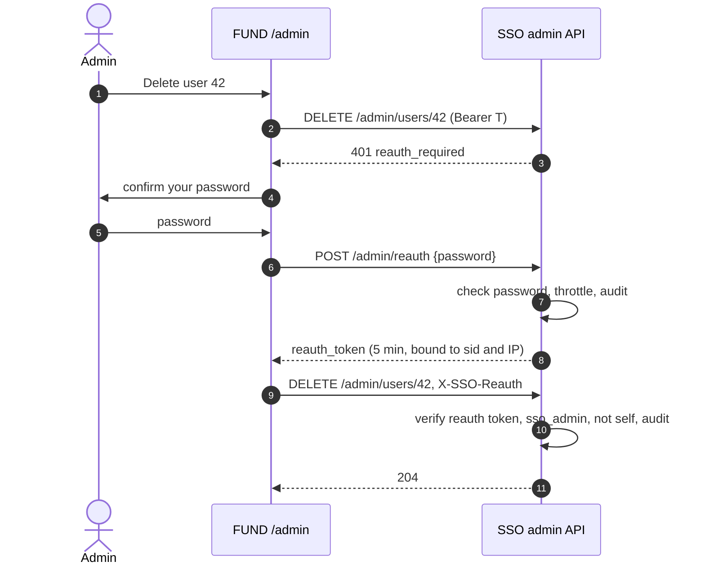

### 7.4 Importing an application's permissions [Decision 2026-10-14]

Flow: admin opens **Applications → Import** in FUND `/admin`, uploads the app's `sso_permissions.py` (or enters the app URL to
fetch `/.well-known/sso-permissions.json`). The SPA parses it (Python literals only, never executed), calls the
bulk upsert with `dry_run=true`, shows the diff, and on confirm calls it again without `dry_run`.

`PUT /api/v1/admin/apps/{app_codename}/permissions`
```json
{"app_name": "Smart Gateway MCP", "version": 3,
 "permissions": [{"codename": "gateway_trade", "name": "Trade (paper/sim)", "description": "..."}]}
```
Response: `{"created": [...], "updated": [...], "unchanged": [...], "missing": [...], "version": 3}`.

- **Idempotent**: same body twice → everything `unchanged`, no audit noise beyond one "no-op import" row.
- Creates `application.<app_codename>` if absent; creates or renames (name/description) the listed permissions via
  `ensure_permission()`. Codenames outside the `<app_codename>_` prefix → 400. Older `version` than stored → 409
  unless `force=true`.
- **Removal policy** [Proposal]: a permission in the SSO but not in the file is reported as `missing` and marked
  **deprecated** (still works, shown in red); it is **never deleted by import**. Deleting is a separate admin action
  that lists affected users/groups and needs confirmation; it is refused while any group/user holds it unless
  `revoke_all=true`. The app permission `application.<app_codename>` is only deleted with the app's ServiceClients.
- Requires `application.sso_admin`; one audit row per import with the full diff.

**Audit log**: new table `sso_adminauditlog` (id, ts, actor_id, actor_ip, action, target_type, target_id,
before JSON, after JSON, request_id, result). Written in the same transaction as the change; Django admin writes
also log here (plus `LogEntry`). Also emitted as `sso.admin` JSON log lines. Read-only in Django admin.

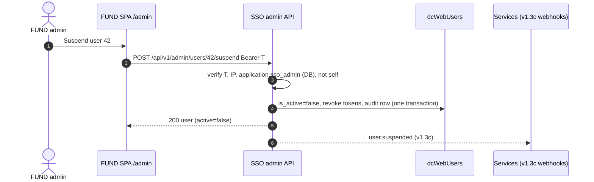

---

## 8. (f) End-to-end flows

### 8.1 Login → research → llm-wiki → simulated order

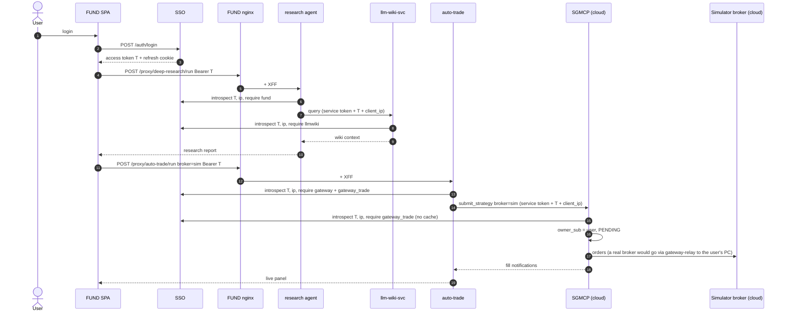

### 8.2 Logout and suspend propagation

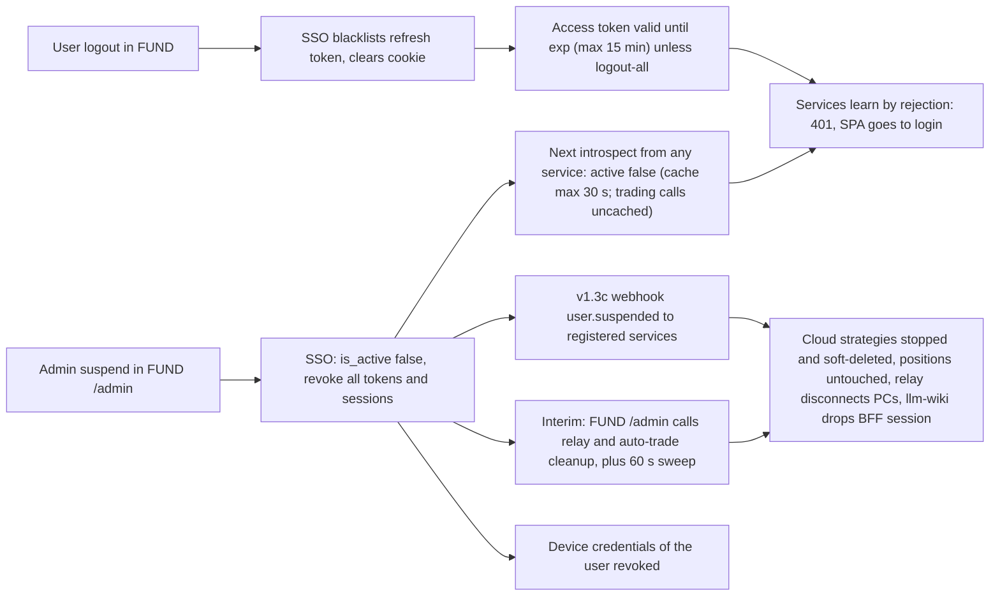

Logout of one FUND tab logs out that browser session (refresh cookie gone); other devices stay logged in.
"Log out everywhere" = `POST /auth/logout-all`.

---

## 9. (g) Phasing plan and open questions

### 9.1 Phasing [updated 2026-10-15: component order]

**Thomas's component order (2026-10-15):** 1) **complete the SSO server**, 2) **migrate Smart_Gateway_MCP (incl. the
local broker gateway) to full SSO**, 3) **FUND last**. Until FUND migrates, administration runs through the SSO's own
Django admin (break-glass, unchanged) **plus the admin REST API** (`curl`/scripts); the FUND `/admin` UI comes with
the FUND phase. Phase labels were renumbered to follow this order (old → new mapping below).

**"SSO complete" means** (decided 2026-10-15): everything SGMCP and FUND need from the SSO exists, so neither
migration has to wait for SSO work: admin API + permission import + step-up + per-service credentials (v1.3a),
device credentials + on-behalf-of (v1.3b, needed by the local broker gateway), signed webhooks incl.
`user.suspended` (v1.3c, moved forward from the old v1.4 because it is SSO-side). Sign-up, password reset, PKCE and
RFC 8693 stay in [TODOS.md](../TODOS.md) (not needed by SGMCP or FUND).

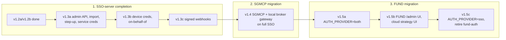

| Phase | Repo(s) | Content | Depends on |
|---|---|---|---|
| v1.2a | SSO | **Done** (pushed `107ae38`) | |
| v1.2b | SSO, llm-wiki | **Done** (QA passed; startup fix `68fd31f`): IP binding modes, introspect/permission query, `SSO_TRUSTED_PROXIES`, `sso-client`, llm-wiki migrated | v1.2a |
| **v1.3a** | SSO | Admin REST API `/api/v1/admin/…` + audit log `sso_adminauditlog`; **step-up reauth** (§7.5); **permission import** from `sso_permissions.py` (never deletes, marks missing deprecated, §7.4); **per-service credentials**: ServiceClient permissions, rotate-secret, service tokens `POST /api/v1/auth/service-token` (no IP binding, §4.1); inactive-users feed (§5.6). Design: [DESIGN-v1.3a-admin-api.md](DESIGN-v1.3a-admin-api.md) | v1.2b |
| **v1.3b** | SSO, sso-client | **Device credentials** for the local broker gateway (`POST /api/v1/devices`, `kind=device`, owner, Ed25519 `private_key_jwt`, revoked on suspend, §5.2); **on-behalf-of** (`X-SSO-User-Token` + `X-SSO-Client-IP` with a service token, §4.1); `sso-client` 0.2 (service tokens, on-behalf-of) | v1.3a |
| **v1.3c** | SSO, sso-client | **Signed webhooks** (`user.suspended`, `user.reactivated`, `user.deleted`, `token.revoked`, `permission.changed`, `keys.rotated`), `notify_secret` encrypted at rest, receiver helper in `sso-client`. **SSO server complete** | v1.3a |
| **v1.4** | SGMCP (+ relay) | **SGMCP and the local broker gateway on full SSO** (§5): SGMCP's `sso_permissions.py` imported; SGMCP API/MCP behind `sso-client` (user tokens for people, service tokens for agents); `gateway-relay` + pairing + device credentials + outbound WSS from the local broker gateway; one live connection per broker account (cold standby); `WAITING_GATEWAY`/halt + heartbeats; suspend (webhook + sweep) stops and deletes strategies, disconnects PCs, **positions untouched**; **`delete_strategy` soft delete, history always kept** (§5.7). Until FUND migrates, strategies are submitted through SGMCP's own API/MCP with an SSO token | v1.3a–c |
| **v1.5a** | FUND | `sso_permissions.py`; `AUTH_PROVIDER=legacy\|both\|sso` (§3.4), start with `both`; agents on `sso-client`, one ServiceClient per service; llm-wiki behind configurable `/proxy/llmwiki/` (§6) | v1.3a–c, v1.4 |
| **v1.5b** | FUND | Admin UI `/admin` on the v1.3a API (step-up, import, devices); FUND UI for cloud strategies (submit, broker pick, stay-on warnings, §5) | v1.5a |
| **v1.5c** | FUND | `AUTH_PROVIDER=sso`, retire `fund-auth` | v1.5a stable |
| later | | TODOS.md: sign-up, password change/reset, PKCE, delegated tokens (RFC 8693), llm-wiki host/domain (TBD) | |

Old → new labels (documents written before 2026-10-15 used the old ones): v1.3a (SSO) → v1.3a + v1.3b (devices,
on-behalf-of); v1.3b (FUND auth) → v1.5a; v1.3c (FUND admin UI) → v1.5b; v1.3d (FUND + SGMCP) → v1.4 (SGMCP part) +
v1.5b (FUND UI part); v1.3e → v1.5c; v1.4 (webhooks) → v1.3c. "Interim suspend calls from FUND `/admin`" are no longer
needed: webhooks (v1.3c) exist before FUND migrates; the 60 s sweep stays as the safety net.

### 9.2 Open questions for Thomas

**None remaining** (2026-10-14, after round 4). All earlier questions were answered in rounds 1-4 (§10). Items still
marked **[Proposal]** in this document (e.g. `WAITING_GATEWAY` timings, pairing code format, archive tables) are
implementation defaults to be confirmed during review of each phase, not open design questions.

## 10. Decisions (2026-10-14)

### Round 5 (2026-10-15)

18. **Component order: SSO server first, then SGMCP (incl. local broker gateway), FUND last** (§9.1). Until FUND migrates, admin work uses the SSO's Django admin and the admin REST API.

Recorded from Thomas:

1. **FUND users are already in `dcWebUsers`.** `fund-auth` shares it. FUND migrates authentication to the SSO like the other new services; **no user import**.
2. **Each application ships its own permissions file** (round 2: a separate `sso_permissions.py`, not inside `config.py`); the admin imports them into the SSO from FUND `/admin` (bulk upsert, idempotent, §2, §7.4). The permission names in this document are examples only.
3. **After cutover every FUND endpoint requires a token**, controlled by `AUTH_PROVIDER` in FUND's root `.env` (`legacy` / `both` / `sso`) (§3.4).
4. **SSO user login is for external clients (mostly people) and IP binding applies to them; internal processes (AI agents, MCP, services) authenticate as registered service clients with their own credentials, without IP binding.** Confirmed in round 2 (§4.1).
5. **Suspend stops and deletes the user's running strategies / auto-trade jobs**: interim call from FUND `/admin` + 60 s sweep, then v1.3c webhook (§5.6). Round 2: **no action on open broker positions**.
6. **llm-wiki deployment location and domains are TBD / configurable** (ongoing development). The gateway location is now decided (round 2, below).
7. The cut-off "4)" in the earlier message is ignored.

### Round 2 (2026-10-14)

8. **Broker login is local to the user**: FUND Local Gateway (Docker) on the user's PC runs the Smart Gateway(s) and connects **outbound** to FUND's `gateway-relay`; device credential provisioned by pairing after SSO login; broker credentials never leave the PC; `/ui` stays local; no cloud gateway (§5).
9. **IP binding applies to user-facing calls only**; the local gateway uses its device credential.
10. **Destructive admin actions require password re-confirmation** (step-up, §7.5).
11. Per-service credentials as the recommended default (confirmed in round 3).

### Round 3 (2026-10-14)

12. **Per-service credentials confirmed**: every service and agent has its own ServiceClient.
13. **All trade/order history is always kept for audit** (suspend, strategy deletion, user deletion). `delete_strategy` must become a soft delete (gateway work item in v1.4, §5.7).

### Round 4 (2026-10-14)

14. **Strategies run in the cloud** (FUND auto-trade + SGMCP). The user's PC runs only the broker gateways as a **pure pass-through** (no strategy, risk or ledger logic). **The PC must stay on while its strategies trade** (operating requirement; heartbeat alerts). When the PC is offline, strategies on its accounts pause (`WAITING_GATEWAY`) and halt after `SGMCP_RECONNECT_MAX_SECS`; the 15-min relay lease is dropped (§5.5). Suspend stops and deletes the strategies in the cloud; the relay disconnects and device credentials are revoked (§5.6). The cloud is the system of record for orders/fills (§5.7). This supersedes the round-2 wording that SGMCP and strategies run on the PC.
15. **The user's own submission is the authorization**: the user submits the strategy in the FUND UI, chooses the broker/account, and logs in to the broker on their PC. No separate explicit-grant mechanism for AI agents (§5.3).
16. **One live connection per broker account**; the Local Gateway may be installed on a second PC as **cold standby** (installed, not connected; activation requires the first to disconnect; enforced by the relay, §5.4).
17. **Permission import removal policy agreed**: import never deletes, missing permissions are marked deprecated (§7.4).
