# FUND-Financial-Research ecosystem: integration design

> **See also:** [ARCHITECTURE.md §0 System context](ARCHITECTURE.md#0-system-context-fund-financial-research-ecosystem),
> [v1.2 requirements design](DESIGN-v1.2-requirements.md), [sso-client library design](SSO-CLIENT-LIBRARY-DESIGN.md),
> [API Reference Manual](API-REFERENCE-MANUAL.md) §8 (planned admin API), [TODOS.md](../TODOS.md).

| | |
|---|---|
| Status | **Design proposal, docs only.** Drafted 2026-10-13; Thomas's answers applied 2026-10-14 (§10). Nothing here is implemented |
| Scope | How the SSO server, FUND-Financial-Research (frontend + backend services), Smart_Gateway_MCP (SGMCP) and llm-wiki-svc fit together |
| Sources read | `Neural-Matrix-LLC/FUND-financial-Research` `main` @ `dfffe5e` (2026-09-02), `Neural-Matrix-LLC/Smart_Gateway_MCP` `main` @ `39b3acd` (2026-10-08), `llm-wiki-svc` `feat/sso-login`, this repo `feat/v1.2a` @ `107ae38` |

Labels used in this document:

- **[Repo]** a fact read from the named repository (file given where useful).
- **[Assumption]** something not found in the repos; needs confirmation (most are also in §9 Open questions).
- **[Proposal]** a design choice made here for Thomas to accept or change.

## Contents

1. What exists today (facts from the repos)
2. Permission model for the ecosystem
3. (a) FUND frontend: login migration to the SSO
4. (b) FUND backend services: verifying tokens with `sso-client`
5. (c) Smart_Gateway_MCP: users, agents and services
6. (d) llm-wiki-svc behind FUND
7. (e) Admin UI in FUND and the SSO admin REST API (new phase)
8. (f) End-to-end flows
9. (g) Phasing plan and open questions
10. Decisions (2026-10-14)

---

## 1. What exists today (facts from the repos)

### 1.1 FUND-Financial-Research [Repo]

| Component | Container / port | Language | Notes |
|---|---|---|---|
| Frontend `app/` | `fund-frontend`, host `${FRONTEND_HOST_PORT:-3000}` → nginx :80 | React 18 + Vite + TypeScript, TanStack Router/Query, Tailwind | nginx (`app/nginx.conf`) serves the SPA and reverse-proxies `/proxy/<svc>/` to each agent on the `fund-network` bridge, setting `X-Real-IP` / `X-Forwarded-For`. Adds `X-Storage-Key` for storage |
| Legacy frontend `front-end/` | dev only (`npm run dev`, :3000) | React 18 + react-router + axios + zustand | Described in README §Frontend; not in compose. The compose frontend is `app/` |
| Orchestrator | :8000 | Python / FastAPI | Routing, state, scheduler. `_require_admin` checks HS256 JWT `role=="admin"` |
| Analytic agent | `fund-analytic` :8001 | Python | Turns PDFs/text/video into a strategy summary |
| Coding agent | `fund-coding` :8002 | Python | Generates code + tests |
| Backtesting agent | `fund-backtesting` :8003 | Python | |
| Dataserver | `fund-dataserver` :8004 | Python | Market data |
| Discovery agent | `fund-discovery` :8005 | Python / FastAPI | Can run on a separate host; admin-JWT scheduler endpoints |
| Storage agent | `fund-storage` :8006 | Python | Protected by shared `STORAGE_AGENT_SECRET` header injected by nginx |
| Management | `fund-management` :8008 | Python / FastAPI | Also serves `/proxy/orchestrator/`; `_require_admin` (HS256) |
| Auto-trade agent | `fund-auto-trade` :8009 | Python | **The only FUND component that calls SGMCP**: MCP Streamable HTTP client to `host.docker.internal:8080` with static `SGMCP_AUTH_TOKEN` (`agents/auto-trade/src/gateway.py`) |
| Auth agent | `fund-auth` :8011 | Django + DRF (`runserver`) | `POST /api/login/`, `POST /api/logout/`. Custom `UserModel(AbstractUser)` with unique email, `db_table='auth_user'`. Code default `DB_NAME=userauth_db` [Repo], but **in production it already points at `dcWebUsers`** (Thomas, 2026-10-14): FUND users are the same `auth_user` rows the SSO uses |
| Research (deep research) | `fund-research` :8015 | Python | proxied as `/proxy/deep-research/` |

**Current login flow [Repo]** (`agents/auth/api/views.py`, `app/src/pages/Login.tsx`, `app/src/api/client.ts`):
`POST /proxy/auth/api/login/` with username + password → response holds a DRF token (`token`), an
**HS256 JWT `access_token` `{sub, role, exp}`** signed with the shared `AUTH_SECRET_KEY` (default life 480 min,
no refresh), `role` (`admin` if `is_staff`) and the user object. The SPA stores all of them in **`localStorage`**
and sends `Authorization: Bearer <access_token>` on every call. Only admin endpoints (scheduler start/stop) verify
the JWT; most agent endpoints are **not authenticated** (they rely on the network and nginx). Logout deletes the
DRF token only; the JWT stays valid until `exp`.

### 1.2 Smart_Gateway_MCP (SGMCP) [Repo]

- Python 3.10+, FastMCP 1.27 over **Streamable HTTP** (`/mcp`, uvicorn/starlette, default `:8080`), stdio for dev.
  Runs **outside** FUND's compose, on the host next to the broker daemons.
- Auth: one static bearer `SGMCP_AUTH_TOKEN`, constant-time compare; `SGMCP_ALLOW_LIVE=1` gate for live trading;
  `SGMCP_ALLOWED_HOSTS` host check. Operator page **`/ui`** (broker logins, Futu unlock) with its own token→session
  cookie, in-memory sessions.
- Brokers: **Futu** (FutuOpenD), **IBKR** (Client Portal Gateway REST; the official IBKR MCP server is a
  companion, not used for execution), **Webull** (OpenAPI SDK; official Webull MCP as companion), and a built-in
  **simulator** (`broker="sim"`, GBM market, no daemon). Multi-login / multi-account gateways.
- Tools: strategy lifecycle (`submit_strategy`, `stop_strategy`, `delete_strategy`, `list_strategies`, …),
  account (`get_account_snapshot`, `get_positions`, `get_orders`), gateways, metrics, market data, telemetry;
  resources `trading://…`; push notifications (`fill`, `tick`, `risk_breach`, `status_changed`, …).
- Data: own MySQL database `sgmcp` (`strategies`, `accounts`, `positions`, `orders`). **No user/owner column**:
  instances are keyed by `process_id`, grouped by `workflow_id::strategy_name`.
- `docker/` builds the **FUND Local Gateway** (FutuOpenD, CP Gateway, Webull SDK) bound to 127.0.0.1;
  `Local_login.md` (proposal, not built) moves SGMCP to the cloud with broker logins on the user's machine and a
  per-**FUND user ID** broker access list. Broker secrets never leave the gateway host.

### 1.3 llm-wiki-svc [Repo]

FastAPI service (container port 8000, host 8010 by default; production host and domain **TBD / configurable**, under development), research knowledge base with HTTP API and MCP tools.
Already an SSO consumer on `feat/sso-login` (server-side BFF login, `client_ip` delegation, ServiceClient).
**FUND does not reference llm-wiki-svc anywhere yet.** Host port clash to note: llm-wiki's dev profile uses
host port 8011, the same as `fund-auth`.

### 1.4 Other repos seen (not read in depth)

`FUND-dashboard` (older public React dashboard, matches `front-end/`), `FUND-finance-dashboard`
(`myfinance-dashboard` + `financeagentserver`, **[Assumption]** the myFinance app being phased out), `futu-mcp`.

---

## 2. Permission model: each application declares its own permissions [Decision 2026-10-14]

One SSO token for all services (decision 5). Access is checked by asking the SSO (introspect / permission query,
v1.2b). Permissions are **not** a fixed list in the SSO: **each application ships a `config.py`** declaring its own
permissions, and an admin imports them into the SSO from the FUND Admin UI (§7.4).

### 2.1 `config.py` schema [Proposal]

```python
# <app repo>/config.py  (or sso_permissions.py if config.py is already taken)
APP_CODENAME = "gateway"            # [a-z][a-z0-9_]{1,40}; becomes application.<APP_CODENAME>
APP_NAME = "Smart Gateway MCP"
APP_DESCRIPTION = "Broker connectivity and strategy execution"
PERMISSIONS_VERSION = 3             # bump on every change; the import shows a diff
PERMISSIONS = [
    # (codename, name, description); codename must start with APP_CODENAME + "_"
    ("gateway_trade", "Trade (paper/sim)", "Submit, stop, delete strategies on paper and simulator"),
    ("gateway_live",  "Trade live",        "Allows environment=live (still needs SGMCP_ALLOW_LIVE=1)"),
]
```

- The app-access permission `application.<APP_CODENAME>` ("may use this app") is implicit and always created.
- Codenames are prefixed with `APP_CODENAME_` (Django codenames cannot contain dots), so two apps can never clash.
- The file is plain data (no imports); the Admin UI parses it as Python literals or the app exposes the same data as
  `GET /.well-known/sso-permissions.json` (either feeds the same API).

### 2.2 Examples only (each app decides its real list)

| App (`APP_CODENAME`) | Example permissions |
|---|---|
| `fund` | `application.fund`, `application.fund_admin` (scheduler start/stop, replaces `role=="admin"`) |
| `llmwiki` | `application.llmwiki`, `application.llmwiki_write` (ingest/upload) |
| `gateway` | `application.gateway` (read), `application.gateway_trade`, `application.gateway_live` |
| `sso` (built in) | `application.sso_admin` (SSO admin API and FUND Admin UI) |

Services require the app permission plus the finer one (`require=[...]`). Groups bundle permissions and are managed
in the Admin UI.

---

## 3. (a) FUND frontend: login migration to the SSO

### 3.1 Target

The FUND SPA uses the SSO **browser mode** (`auth.js` pattern, ARCHITECTURE §6.1/§6.4): access token (15 min) in
memory only, refresh token in an HttpOnly cookie on the SSO origin, silent restore on load. Nothing in
`localStorage` any more (today the 8-hour HS256 JWT sits there, readable by any XSS).

- **[Assumption]** SSO at `sso.<domain>` and FUND at `fund.<domain>` (same site), so the SameSite=Lax/Strict
  refresh cookie works. FUND's origin is added to `SSO_ALLOWED_ORIGINS` / CORS.
- The SPA reads `/api/v1/auth/me` for the display name and `perms` (hides Admin, trading buttons). The UI check is
  cosmetic; each service enforces.

### 3.2 Login: today vs target

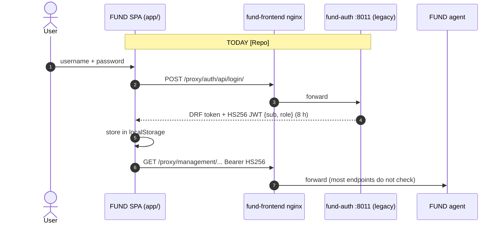

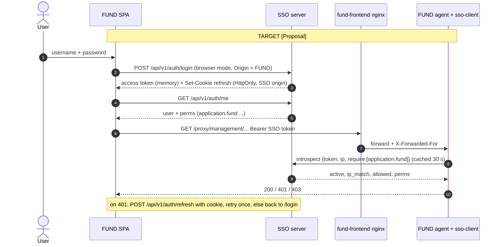

### 3.3 Users and permissions [Decision 2026-10-14]

FUND users are **already in `dcWebUsers`**: `fund-auth` writes the same `auth_user` table the SSO reads. **No user
import is needed**; users keep their passwords. FUND migrates its authentication to the SSO just like the other new
services.

| FUND today [Repo] | SSO target |
|---|---|
| `is_staff` → `role:"admin"` | `application.fund_admin` (example permission from FUND's `config.py`) |
| any active user → `role:"user"` | `application.fund` |
| JWT `sub` = username | SSO `sub` = user id; the `username` claim carries the name, so FUND data keyed by username keeps working |

One-off step at cutover: import FUND's `config.py` permissions (§7.4), then grant `application.fund` (and
`fund_admin` to today's `is_staff` users) through groups. Caveat [Repo]: FUND's custom model declares `email`
unique; the stock model the SSO uses does not, so FUND's DB constraint (if migrated) stays and SSO admin create
must not insert duplicate emails.

### 3.4 Cutover and coexistence: `AUTH_PROVIDER` switch [Decision 2026-10-14]

A single switch in FUND's **root `.env`** selects the login provider for the frontend and every agent:

| `AUTH_PROVIDER` | Frontend login | Agents accept | Unauthenticated endpoints |
|---|---|---|---|
| `legacy` (default today) | `fund-auth` `/api/login/` | HS256 (as today) | allowed (as today) |
| `both` (transition) | SSO login page; legacy kept for rollback | SSO RS256 **or** HS256 | **refused** (401) |
| `sso` (after cutover) | SSO only | SSO RS256 only | **refused**: every FUND endpoint requires a token |

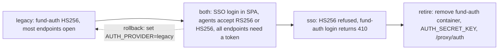

- The frontend reads the value at build/start (`VITE_AUTH_PROVIDER` generated from the root `.env`); agents read it
  from the shared root `.env` they already load (`env_file: .env`).
- In `both`, the token is routed by its header: `alg=RS256` + `kid` + SSO `iss` → `sso-client`; `alg=HS256` →
  legacy check. Never accept HS256 with the SSO issuer.
- `both` → `sso` once no HS256 token has been seen for the legacy lifetime (8 h) plus a buffer; health endpoints
  (`/health`) stay open.
- Scripts that call agents (e.g. `curl /submit`) must use a service client (§4.1) or a native user login.

---

## 4. (b) FUND backend services verifying tokens via `sso-client`

Each FUND agent (FastAPI) adds the `sso-client` FastAPI dependency (library design §FastAPI). Settings per agent:
`SSO_URL`, ServiceClient id/secret (one ServiceClient **per agent** or one shared `fund-backend` client,
open question Q1), `TRUSTED_PROXY_IPS` = the `fund-frontend` nginx container address / `fund-network` subnet.

| Agent | Required permission(s) [Proposal] |
|---|---|
| orchestrator, management (read/submit) | `application.fund` |
| orchestrator/management/discovery scheduler start/stop | `application.fund` + `application.fund_admin` |
| analytic, coding, backtesting, dataserver, research | `application.fund` |
| storage | keep `X-Storage-Key` (service secret) **and** `application.fund` for browser-originated calls |
| auto-trade | read routes `application.gateway`; submit/stop `application.gateway_trade` |
| internal agent→agent calls (orchestrator → analytic …) | service token; on behalf of a user also the user token + browser IP (§4.1) |

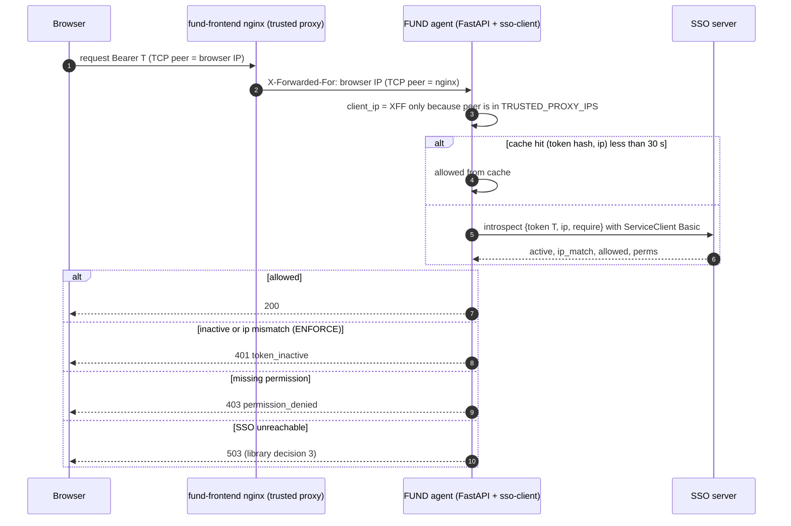

### 4.1 Service-to-service and acting on behalf of a user [Decision 2026-10-14, interpretation]

> Thomas's answer here was cut off; this is our interpretation, to be confirmed: **SSO user login is for external
> clients (mostly real people) and IP binding applies to them. Internal processes (AI agents, MCP clients, other
> services) authenticate as registered service clients with their own credentials; IP binding does not apply.**

**Service tokens [Proposal, v1.3a]**: a registered ServiceClient calls `POST /api/v1/auth/service-token`
(OAuth2 `grant_type=client_credentials`, HTTP Basic `client_id:secret`) and gets a short RS256 access token
(5 min, no refresh; fetch a new one). Claims: `sub="svc:<client_id>"`, `typ="service"`, `app`, `perms` = the
permissions granted to that service client (in the Admin UI, like a user), **no `cip`**, no `sid`. Services verify
it locally with JWKS or by introspect; `SSO_IP_BINDING_MODE` is ignored for `typ=service`. Revoking or deactivating
the ServiceClient makes introspect return `active:false` at once and blocks new service tokens.

| Caller | Credential | IP binding | Permissions come from |
|---|---|---|---|
| Person in a browser / native app | SSO user token (login) | yes (`NOIP`/`WARNING`/`ENFORCE`) | the user |
| Service acting for itself (scheduler, monitor loop, MCP/AI agent, scripts) | service token | no | the service client |
| Service acting **on behalf of** a user | service token **+** the user's token + the browser IP | yes, checked against the **browser IP**, not the service's | **both**: the service client must be allowed to delegate, the user must hold the permission |

**On behalf of a user**: the calling service sends
`Authorization: Bearer <service token>`, `X-SSO-User-Token: <user access token>`, `X-SSO-Client-IP: <browser IP
the caller saw on its own socket>`. The receiver (via `sso-client`) verifies the service token, then introspects the
user token with `ip = X-SSO-Client-IP`; the SSO accepts that IP only because a service token is attached (same rule
as today's `client_ip` from a ServiceClient). The effective principal is the **user**, recorded with `via=<client_id>`
in logs. Services must not forward a user token they did not receive in the current request.

**Long-running work** (a strategy running for days, a scheduled job) does not keep the user token: the service runs
it under its own service identity and records the `owner_sub` of the user who started it. Suspend handling (§5.3)
uses that owner. OAuth token exchange / delegated tokens (RFC 8693) are not planned (TODOS).

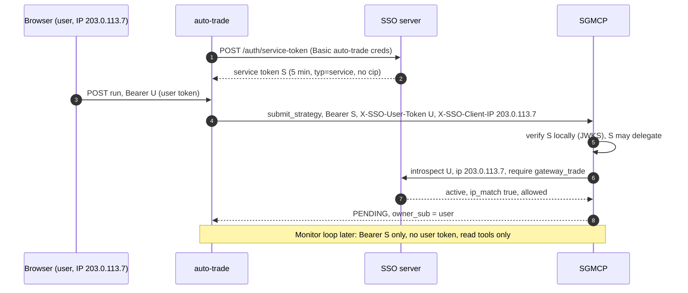

Docker note: `fund-frontend` publishes `3000:80` with Docker's default userland proxy, so nginx may see the Docker
gateway as the client. Same fix as in the library design: host networking for the edge nginx or
`"userland-proxy": false`. **[Assumption]** production puts another TLS proxy in front; then it becomes the first
trusted hop and `fund-frontend` nginx the second.

---

## 5. (c) Smart_Gateway_MCP

### 5.1 Three kinds of caller

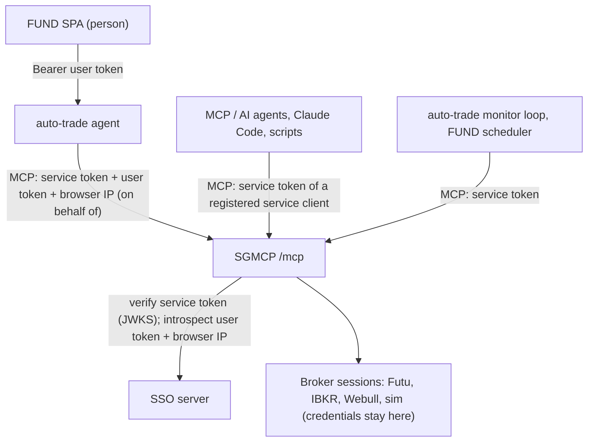

| Caller | Credential at SGMCP | Permissions checked | IP binding |
|---|---|---|---|
| Person via FUND (auto-trade relays) | auto-trade service token + user token + browser IP | user holds `gateway` (+`gateway_trade`, +`gateway_live` for live); auto-trade may delegate | yes, browser IP |
| MCP / AI agent | its own service client's service token | the service client's granted permissions; trading tools only if an admin granted `gateway_trade` to that client; `owner_sub` = `svc:<client_id>` | no |
| Monitor / scheduled jobs | service token | read tools only (allow-list) unless granted | no |
| Operator `/ui` broker login | unchanged local token for now (open question Q2) | | |

- The static `SGMCP_AUTH_TOKEN` stays as a break-glass / dev fallback, off in production after cutover.
- **Broker credentials stay in the gateway** (or the FUND Local Gateway per `Local_login.md`). The SSO only says
  *who* may trade.
- **Ownership** (new in SGMCP): `strategies` gets `owner_sub` (SSO user id, or `svc:<client_id>`). Lists filter by
  owner unless the caller holds `fund_admin`; stop/delete only by owner or `fund_admin`. This is also the key for
  `Local_login.md`'s per-user broker access list.
- **Trading needs stronger permission**: submit/stop/delete need `gateway_trade`; `environment="live"` needs
  `gateway_live` **and** `SGMCP_ALLOW_LIVE=1`. Trading tools never use the 30 s cache.
- Deployment location (same host as FUND or cloud per `Local_login.md`) and domain are **TBD / configurable**:
  ongoing development. Everything above depends only on `SSO_URL`, the ServiceClient credentials and the trusted
  proxy list, all set in `.env`.

### 5.2 Failure events

**SSO down while a user submits**:

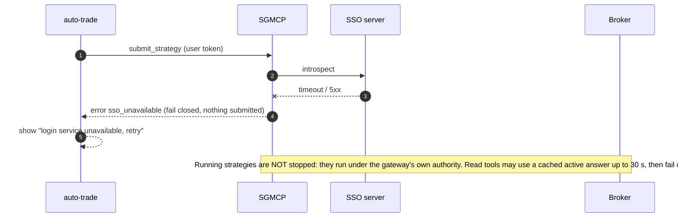

**Broker down mid-strategy** (existing SGMCP behaviour [Repo]: reconnect window `SGMCP_RECONNECT_MAX_SECS`, `WAITING_GATEWAY`):

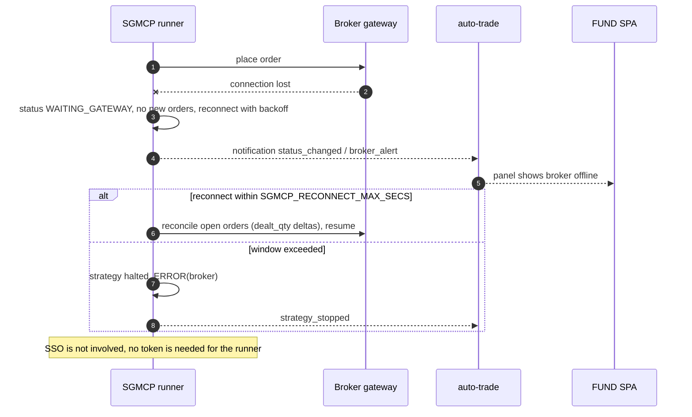

**User token expires mid-order**:

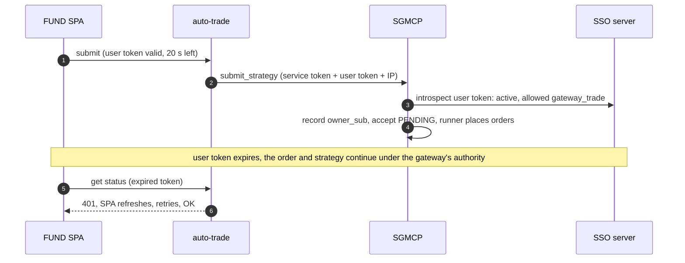

### 5.3 Suspend stops and deletes the user's strategies [Decision 2026-10-14]

When a user is suspended, **all their running strategies / auto-trade jobs are stopped and deleted** (SGMCP
`stop_strategy` then `delete_strategy`, which cancels open orders and purges the instance [Repo: purge-on-delete]).
[Proposal] Positions left open at the broker are reported to the operator, not market-closed automatically (open
question Q4).

Mechanism by phase:

| Phase | Trigger | Backstop |
|---|---|---|
| **Interim (v1.3c/d, before webhooks)** | The FUND Admin UI, after `POST /api/v1/admin/users/{id}/suspend` returns 200, calls auto-trade `POST /internal/users/{sub}/suspend-cleanup` (service token, `fund_admin`), which stops and deletes that owner's strategies in SGMCP and its own jobs | SGMCP (and auto-trade) run a **sweep every 60 s**: `GET /api/v1/service/users/inactive?since=<cursor>` (service token, new SSO endpoint) and clean up any owner returned. Catches suspends made in Django admin, shell or `QuerySet.update()` |
| **v1.4** | SSO sends signed webhook `user.suspended {sub}` to SGMCP and auto-trade, which clean up immediately | the same 60 s sweep stays as a backstop (webhooks are at-least-once but can be delayed) |

Cleanup is idempotent (stopping an already-stopped strategy is a no-op), logged with the suspend event id, and
retried on broker errors; a strategy whose cancel fails stays `STOPPING` and alerts the operator.

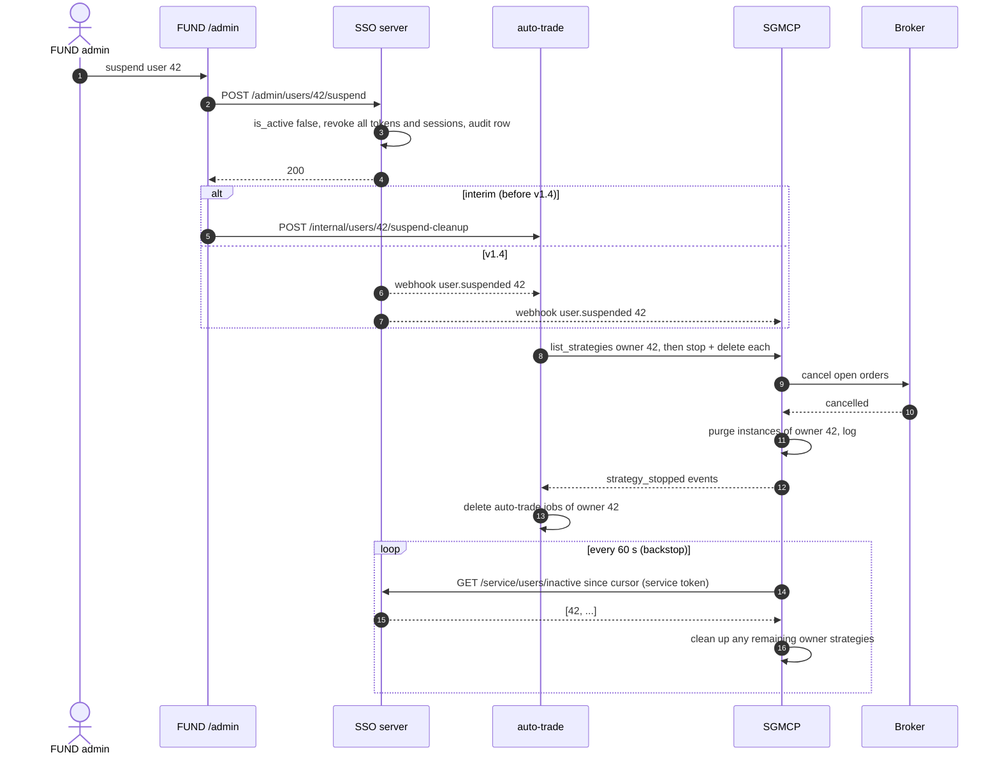

---

## 6. (d) llm-wiki-svc behind FUND

- llm-wiki-svc becomes one more FUND backend service: FUND nginx adds `location /proxy/llmwiki/` → a
  **configurable** upstream (`LLMWIKI_UPSTREAM` in FUND's `.env`); host and domain are **TBD**, under development. The SPA calls it with the same SSO Bearer token; llm-wiki checks `application.llmwiki`
  (`llmwiki_write` for ingest/upload) through `sso-client` (v1.2b migration).
- Its own `/login` (BFF, server-rendered) becomes **optional**: kept for standalone use and MCP, can be disabled with a
  setting when FUND is the only front door ([Proposal] `LLMWIKI_LOCAL_LOGIN=0`).
- FUND agents (research, analytic) call llm-wiki on a user's behalf with their service token + the user token +
  browser IP (§4.1), or with the service token alone for background ingestion. MCP/AI agents use their own service
  client.
- If llm-wiki is on another origin and called directly from the browser, add FUND to its CORS list; the proxy route
  avoids that and is preferred.

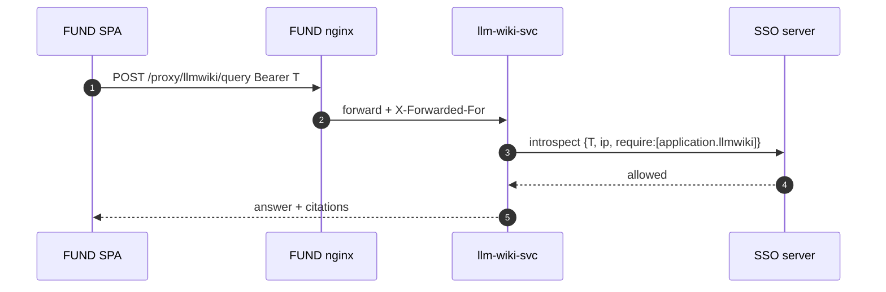

---

## 7. (e) Admin UI in FUND and SSO admin REST API (new phase v1.3a/v1.3c)

### 7.1 Decision

The day-to-day admin page lives in the **FUND frontend** (`/admin`, TanStack route) and calls a **new SSO admin REST
API**. **Django admin** on the SSO (`SSO_ADMIN_PATH`) stays as the **break-glass ops tool** (superusers only, ideally
reachable only from the ops network/VPN).

### 7.2 Screens

| Screen | Contents | API |
|---|---|---|
| Users list | search, filter active/suspended, groups, last login | `GET /users` |
| User create | username, email, first/last name, initial password or "send invite" (invite later, with sign-up) | `POST /users` |
| User detail | profile edit, **Suspend / Unsuspend** (confirm; shows "all sessions will be logged out"), **Log out everywhere**, Delete (type username to confirm; prefer suspend) | `PATCH`, `POST …/suspend`, `…/unsuspend`, `…/logout-all`, `DELETE` |
| User permissions | effective permissions (direct + via groups), toggle app permissions, group membership | `GET/PUT …/permissions`, `PUT …/groups` |
| Groups | create, members, permissions | `/groups…` |
| Services | registered ServiceClients: client_id, app permission, notify_url, active; **Register service** (secret shown once), rotate secret, deactivate | `/services…` |
| Applications | registered apps from their `config.py`: **Import / update permissions** (upload `config.py` or fetch the app's `/.well-known/sso-permissions.json`), preview diff, apply | `PUT /apps/{app_codename}/permissions` |
| App permissions | list `application.*`, grant counts, delete stale ones | `/permissions…` |
| Audit log | who did what, when, from which IP; filter by actor/target | `GET /audit` |

The Admin menu item shows only when `/me` perms include `application.sso_admin`.

### 7.3 Proposed endpoints (`/api/v1/admin/…`) [Proposal]

| Method + path | Action |
|---|---|
| `GET /users?q=&active=&group=&page=` · `POST /users` | list, create |
| `GET/PATCH/DELETE /users/{id}` | read, edit profile, delete |
| `POST /users/{id}/suspend` · `/unsuspend` · `/logout-all` · `/set-password` | lifecycle (suspend reuses v1.2a revoke path) |
| `GET /users/{id}/permissions` · `POST` / `DELETE /users/{id}/permissions/{codename}` | app access |
| `PUT /users/{id}/groups` | group membership |
| `GET/POST /groups` · `GET/PATCH/DELETE /groups/{id}` · `POST/DELETE /groups/{id}/permissions/{codename}` | groups |
| `GET/POST /permissions` · `PATCH/DELETE /permissions/{codename}` | `application.*` permissions via `ensure_permission()` |
| `GET/POST /services` · `GET/PATCH/DELETE /services/{client_id}` · `POST /services/{client_id}/rotate-secret` | ServiceClient registry |
| `GET /apps` · `PUT /apps/{app_codename}/permissions?dry_run=` | applications; bulk upsert of an app's permissions (§7.4) |
| `GET /audit?actor=&target=&action=&since=` | audit log |

**Auth and safety**

- Bearer SSO access token from the FUND SPA, called **directly from the browser** to the SSO (CORS allow-list =
  FUND origin; no cookie auth, so no CSRF). Requires active user + `application.sso_admin` (and `is_staff`,
  [Proposal], so Django admin and the API agree on who is staff).
- Checked against the DB on every call (no cache, no reliance on the token's embedded perms); IP binding applies.
- Same guards as v1.2a admin: no self-suspend, no self-delete, no removing your own `sso_admin`, last
  `sso_admin` cannot be removed, code-defined permissions not deletable, codename immutable.
- Destructive calls need `If-Match`/version or a confirm field; [Proposal] re-auth (password) within 5 min for
  delete user, rotate secret, grant `sso_admin` (Q3).
- Own throttle scope `admin` (e.g. 120/min per user).

### 7.4 Importing an application's permissions [Decision 2026-10-14]

Flow: admin opens **Applications → Import** in FUND `/admin`, uploads the app's `config.py` (or enters the app URL to
fetch `/.well-known/sso-permissions.json`). The SPA parses it (Python literals only, never executed), calls the
bulk upsert with `dry_run=true`, shows the diff, and on confirm calls it again without `dry_run`.

`PUT /api/v1/admin/apps/{app_codename}/permissions`
```json
{"app_name": "Smart Gateway MCP", "version": 3,
 "permissions": [{"codename": "gateway_trade", "name": "Trade (paper/sim)", "description": "..."}]}
```
Response: `{"created": [...], "updated": [...], "unchanged": [...], "missing": [...], "version": 3}`.

- **Idempotent**: same body twice → everything `unchanged`, no audit noise beyond one "no-op import" row.
- Creates `application.<app_codename>` if absent; creates or renames (name/description) the listed permissions via
  `ensure_permission()`. Codenames outside the `<app_codename>_` prefix → 400. Older `version` than stored → 409
  unless `force=true`.
- **Removal policy** [Proposal]: a permission in the SSO but not in the file is reported as `missing` and marked
  **deprecated** (still works, shown in red); it is **never deleted by import**. Deleting is a separate admin action
  that lists affected users/groups and needs confirmation; it is refused while any group/user holds it unless
  `revoke_all=true`. The app permission `application.<app_codename>` is only deleted with the app's ServiceClients.
- Requires `application.sso_admin`; one audit row per import with the full diff.

**Audit log**: new table `sso_adminauditlog` (id, ts, actor_id, actor_ip, action, target_type, target_id,
before JSON, after JSON, request_id, result). Written in the same transaction as the change; Django admin writes
also log here (plus `LogEntry`). Also emitted as `sso.admin` JSON log lines. Read-only in Django admin.

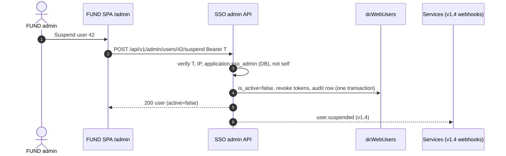

---

## 8. (f) End-to-end flows

### 8.1 Login → research → llm-wiki → simulated order

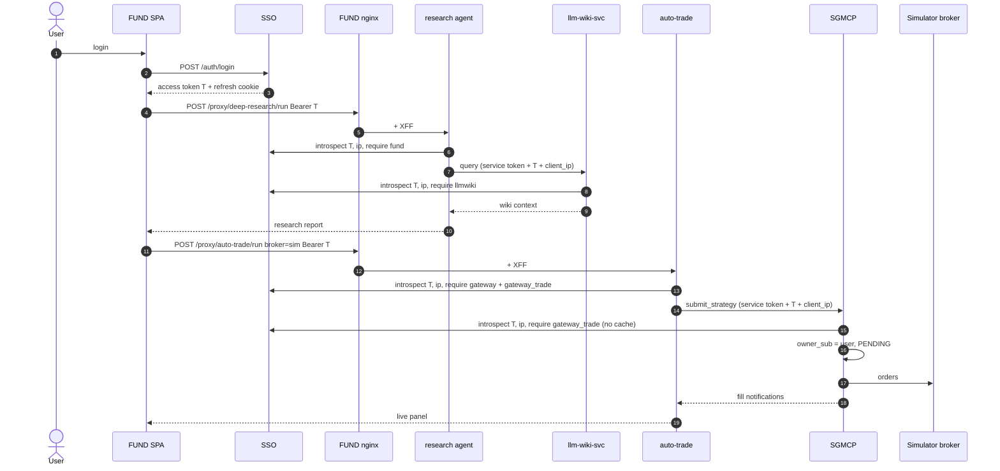

### 8.2 Logout and suspend propagation

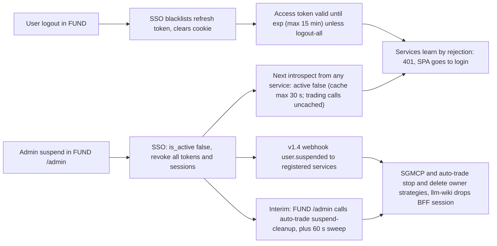

Logout of one FUND tab logs out that browser session (refresh cookie gone); other devices stay logged in.
"Log out everywhere" = `POST /auth/logout-all`.

---

## 9. (g) Phasing plan and open questions

### 9.1 Phasing [Proposal, updated 2026-10-14]

| Phase | Repo(s) | Content | Depends on |
|---|---|---|---|
| v1.2a | SSO | **Done** (pushed `107ae38`) | |
| v1.2b | SSO, llm-wiki | IP binding modes (user tokens only), introspect/permission query, `SSO_TRUSTED_PROXIES`, `sso-client` library, llm-wiki migrates | v1.2a |
| v1.3a | SSO | **SSO admin REST API + audit log** (§7), **bulk permission import** `PUT /admin/apps/{app}/permissions` (§7.4), **service tokens** `POST /auth/service-token` + on-behalf-of rules (§4.1), `GET /service/users/inactive` feed (§5.3). No user import (FUND users already in `dcWebUsers`) | v1.2b |
| v1.3b | FUND | `config.py` permissions; `AUTH_PROVIDER=legacy\|both\|sso` switch (§3.4); agents on `sso-client`, all endpoints need a token in `both`/`sso`; llm-wiki behind configurable `/proxy/llmwiki/` (§6) | v1.2b, v1.3a |
| v1.3c | FUND | **Admin UI** `/admin` incl. Applications import and interim suspend-cleanup call (§7, §5.3) | v1.3a, v1.3b |
| v1.3d | SGMCP, FUND auto-trade | Gateway integration (§5): service tokens, on-behalf-of, `owner_sub`, trade/live permissions, suspend-cleanup endpoint + 60 s sweep; static token becomes fallback | v1.3a, v1.3b |
| v1.3e | FUND | `AUTH_PROVIDER=sso`, retire `fund-auth` | v1.3b stable |
| v1.4 | SSO, SGMCP, auto-trade, llm-wiki | Signed webhooks; `user.suspended` replaces the interim call (sweep stays as backstop) | v1.3d |
| later | | TODOS.md: sign-up, password change/reset, delegated tokens (RFC 8693), SSO login for SGMCP `/ui`, `Local_login.md` access list keyed by SSO `sub`; deployment hosts/domains (TBD) | |

### 9.2 Open questions for Thomas

Answered 2026-10-14 and removed: FUND user DB, permission names, domains/locations, unauthenticated endpoints,
IP binding for agents, suspend behaviour, gateway/llm-wiki placement, the cut-off "4)". See §10.

1. **ServiceClients for FUND**: one per FUND agent (finer audit, more secrets) or one shared `fund-backend` client?
2. **SGMCP `/ui` broker login**: keep its local token, or move to SSO login with `gateway_live`?
3. **Admin API step-up**: require password re-entry for destructive admin actions (delete user, rotate secret, grant `sso_admin`)?
4. **Suspend and open positions** (new): after strategies are stopped and deleted, should open broker positions be left as they are (proposal), or market-closed? Should deleted instances keep their order history for audit (today `delete_strategy` purges)?
5. **Service-to-service interpretation** (new): please confirm §4.1 (service tokens via client credentials, no IP binding; on-behalf-of = service token + user token + browser IP), since your sentence was cut off.
6. **Permission removal policy** (new): OK that import never deletes, only marks `missing` permissions deprecated (§7.4)?
7. **Config file name** (new): `config.py` already exists in some apps (e.g. FUND `utils/config.py`, SGMCP `smart_gateway_mcp/config.py`); use a top-level `sso_permissions.py` instead, or a `SSO_PERMISSIONS` block inside the existing `config.py`?

## 10. Decisions (2026-10-14)

Recorded from Thomas:

1. **FUND users are already in `dcWebUsers`.** `fund-auth` shares it. FUND migrates authentication to the SSO like the other new services; **no user import**.
2. **Each application ships a `config.py` declaring its own permissions**; the admin imports them into the SSO from FUND `/admin` (bulk upsert, idempotent, §2, §7.4). The permission names in this document are examples only.
3. **After cutover every FUND endpoint requires a token**, controlled by `AUTH_PROVIDER` in FUND's root `.env` (`legacy` / `both` / `sso`) (§3.4).
4. **SSO user login is for external clients (mostly people) and IP binding applies to them; internal processes (AI agents, MCP, services) authenticate as registered service clients with their own credentials, without IP binding.** Thomas's sentence was cut off; §4.1 is our interpretation (Q5).
5. **Suspend stops and deletes the user's running strategies / auto-trade jobs**: interim call from FUND `/admin` + 60 s sweep, then v1.4 webhook (§5.3).
6. **Gateway and llm-wiki deployment locations and domains are TBD / configurable** (ongoing development).
7. The cut-off "4)" in the earlier message is ignored.
