# SSO Admin User Manual

This manual is for the people who run the SSO day to day: creating users, granting app access, suspending accounts,
registering services and reading the audit log. Every task is shown three ways: in the **admin web UI**, with
**`manage.py` commands** on the server, and with the **admin REST API** from a shell.

Installing and upgrading the server is in [SSO-Setup.md](SSO-Setup.md). The full API is in
[API-REFERENCE-MANUAL.md](API-REFERENCE-MANUAL.md).

## Contents

1. [Which tool to use](#1-which-tool-to-use)
2. [Getting admin access](#2-getting-admin-access)
3. [Signing in to the admin UI](#3-signing-in-to-the-admin-ui)
4. [Admin UI pages](#4-admin-ui-pages): [reading the guides](#41-reading-the-page-guides),
   [Permissions](#42-permissions-page), [Applications](#43-applications-page), [Services](#44-services-page),
   [Devices](#45-devices-page), [Webhooks](#46-webhooks-page)
5. [Command line: `manage.py` commands and scripts](#5-command-line-managepy-commands-and-scripts)
6. [Command line: the admin REST API with curl](#6-command-line-the-admin-rest-api-with-curl)
7. [Task cookbook: UI and CLI side by side](#7-task-cookbook-ui-and-cli-side-by-side)
8. [Application permissions](#8-application-permissions)
9. [Routine operations](#9-routine-operations)
10. [Rules that protect the system](#10-rules-that-protect-the-system)
11. [Troubleshooting](#11-troubleshooting)

---

## 1. Which tool to use

| Tool | Where | Use it for |
|---|---|---|
| **Admin web UI** | `https://<SSO host>/admin/` (`SSO_ADMIN_UI_PATH`) | Daily work: users, groups, permissions, app imports, services, devices, webhooks, audit log |
| **`manage.py` commands** | On the server: `docker compose exec web python manage.py …` | Things only the server can do: the first superuser, registering a service with its permission in one step, scheduled clean-up, schema checks |
| **Admin REST API** | `https://<SSO host>/api/v1/admin/…` with curl or a script | Automation and bulk work: the same actions as the UI, scriptable, for example in CI |
| **Django admin** | `https://<SSO host>/sso-admin/` (`SSO_ADMIN_PATH`) | Emergencies only: when the admin UI is down or no admin is left. Superusers only |

The UI and the REST API use the same rules underneath: the same checks, the same step-up for dangerous actions and
the same audit log. An action that the UI refuses, the API refuses too.

With the local `.env` of this repo (`SSO_ISSUER=https://192.168.0.213`), the URLs are
`https://192.168.0.213/admin/` (UI), `https://192.168.0.213/sso-admin/` (Django admin) and
`https://192.168.0.213/api/v1/admin/` (API). On the server itself, `https://localhost/…` works too.

## 2. Getting admin access

### 2.1 Who counts as an admin

An SSO admin is a user who is checked on **every** request (UI page or API call) and must be:

1. **active** (not suspended), **and**
2. **staff** (`is_staff`), **and**
3. holding **`application.sso_admin`** (directly or through a group), **or** a superuser.

Losing any of these ends the admin's UI session at the next click and makes their API calls fail with 403.

### 2.2 The first admin (CLI, on the server)

```bash
docker compose run --rm web python manage.py createsuperuser
```

A superuser is staff and counts as an admin, but gets **no app access** automatically
(`SSO_SUPERUSER_ALL_APPS=false`). Grant app permissions explicitly (§8).

An existing `dcWebUsers` account (from myFinance) can be made an admin instead: in Django admin at `/sso-admin/` set
*Staff status*, then grant `application.sso_admin` in the admin UI (§7).

### 2.3 More admins

Prefer a group over individual grants:

1. **UI → Groups → Create**: name it, for example `sso-admins`.
2. On the group page, under **Permissions**, grant `sso_admin` (asks for your password, §3.3).
3. Add the people under **Members**.
4. Each person must also be **staff**. *Staff* can be set when a user is created (**Users → Create**, only when you
   are a superuser) or in Django admin for an existing user.

### 2.4 Network access

nginx lets only allowed IP addresses reach the admin pages. The allow-lists are plain nginx files:

| Page | Allow-list directory | Example `allow.conf` |
|---|---|---|
| Admin UI `/admin/` | `docker/nginx-admin-ui.d/` (`SSO_ADMIN_UI_ALLOW_DIR`) | `allow 127.0.0.1;` `allow 192.168.0.0/24;` `deny all;` |
| Django admin `/sso-admin/` | `docker/nginx-admin.d/` (`SSO_ADMIN_ALLOW_DIR`) | `allow 127.0.0.1;` `deny all;` |

After changing a file: `docker compose up -d --force-recreate nginx`. An empty directory means no restriction.

The admin **REST API** (`/api/v1/admin/…`) is not behind these allow-lists; it is protected by the admin checks in
§2.1 and by step-up.

`SSO_CSRF_TRUSTED_ORIGINS` must contain the exact origin you open the UI with (for example `https://192.168.0.213`).
Without it every form submit fails with 403 (CSRF). Reaching the server by IP from another LAN machine:
[DESIGN-v1.3d §19](DESIGN-v1.3d-admin-ui.md#19-reaching-the-ui-from-another-lan-host).

## 3. Signing in to the admin UI

### 3.1 Login

Open `https://<SSO host>/admin/` and sign in with your SSO username and password. A failed login always shows the same
message ("invalid username or password, or no admin access"), whether the password was wrong or the account is not an
admin. The audit log records the real reason. Login is throttled: 10 per minute per IP and 5 per minute per username.

The UI login is separate from Django admin and from the token API: it issues no tokens.

### 3.2 Session

- Ends after **30 minutes idle** or **8 hours** in total (`SSO_ADMIN_UI_IDLE_SECONDS`,
  `SSO_ADMIN_UI_MAX_AGE_SECONDS`).
- Bound to your IP address (`SSO_IP_BINDING_MODE`, or `SSO_ADMIN_UI_IP_BINDING` for the UI only). With `ENFORCE`, a
  request from another IP ends the session.
- Ends at once when you are suspended, lose admin rights, your password is changed, or someone runs "log out
  everywhere" for you.
- **Log out** (header) ends this session. **Log out everywhere** (under **My session**) ends all your admin sessions
  **and** revokes all your tokens in every app.

### 3.3 Step-up: confirming dangerous actions

Dangerous actions (🔒 in this manual) ask for your password again. After you confirm, a banner shows "Elevated
until …" for **5 minutes** (`SSO_ADMIN_REAUTH_SECONDS`), and further 🔒 actions in that window don't ask again.
**Drop now** ends the window early. 5 password attempts per minute.

The 🔒 actions:

- suspend a user, set a user's password, delete a user;
- grant or revoke `sso_admin` (user or group), change members of a group that holds `sso_admin`;
- delete a group, delete a permission;
- deactivate, delete or rotate the secret of a service; rotate a webhook secret;
- revoke a device; turn on `can_delegate` / `can_register_devices` for a service.

Deleting a user, group or service also asks you to type its name.

## 4. Admin UI pages

The header has: **Dashboard · Users · Groups · Permissions · Applications · Services · Devices · Webhooks ·
Audit log · My session**. Lists show 50 rows per page, have a search box and filters, and the filters stay in the
URL, so a filtered list can be bookmarked.

| Page | What you see | What you can do |
|---|---|---|
| **Dashboard** | Active and suspended users, number of admins, services, devices, failed webhook deliveries in the last 24 h, the last 20 audit rows, the signing key (`kid`) and the published keys | Read only; follow the links |
| **Users** | Search by username, email or name; filter active / suspended / group / staff; last login | **Create**; export the filtered list as CSV |
| **User page** | Profile, status, **Effective permissions** (direct and through groups; deprecated ones in red), groups, devices, active sessions, the user's last 20 audit rows | **Save profile**; 🔒 **Suspend and log out all sessions**; **Unsuspend**; **Log out everywhere**; 🔒 **Set password**; 🔒 **Delete**; **Grant** / **Revoke** a permission (🔒 for `sso_admin`); **Save groups** |
| **Groups** | All groups | **Create**; on a group: **Rename**, **Save members**, grant / revoke permissions (🔒 for `sso_admin`), 🔒 **Delete group** |
| **Permissions** ([§4.2](#42-permissions-page)) | All `application.*` permissions by app, with user and group counts; deprecated filter | **Create custom permission**; edit name and description; 🔒 delete (tick *revoke all* when it is still granted; `app1` and `sso_admin` cannot be deleted) |
| **Applications** ([§4.3](#43-applications-page)) | Imported apps, their version and permissions | **Import / update permissions** (§8.2) |
| **Services** ([§4.4](#44-services-page)) | Back-end services (ServiceClients): app, permissions, webhook URL, active | **Register service** (the secret is shown **once**); edit; 🔒 deactivate; 🔒 **Rotate client secret**; 🔒 **Rotate webhook secret**; 🔒 delete |
| **Devices** ([§4.5](#45-devices-page)) | Users' paired gateway devices: owner, name, created, last used, key fingerprint | Filter by owner; 🔒 revoke |
| **Webhooks** ([§4.6](#46-webhooks-page)) | Webhook events and **Deliveries** per service: status, attempts, next try, last error | **Redeliver** a delivery |
| **Audit log** | Every admin action, newest first: who, from which IP, what, before and after, result, channel (`ui`, `api`, `django_admin`, `system`) | Filter by actor, action, target, channel, result, date; row detail; export CSV |
| **My session** | Your profile, login time, elevated-until | **Log out**, **Log out everywhere** |

Secrets (a service's client secret, a webhook secret) are shown **once**, on the page right after you create or
rotate them. Copy them straight into the service's secret store. They cannot be shown again; if lost, rotate.

### 4.1 Reading the page guides

Sections 4.2 to 4.6 walk through the five pages whose fields need explaining. Each one shows the screens in the
order you click through them, then explains every field. Labels in **bold** or in the drawings are written exactly
as the UI shows them.

Drawing conventions. The screens are drawn as Mermaid diagrams. GitHub renders them directly; in VS Code the
Markdown preview needs the *Markdown Preview Mermaid Support* extension (`bierner.markdown-mermaid`).

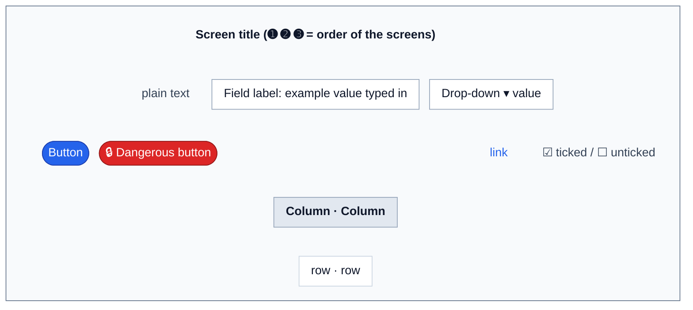

| In the drawing | On screen |
|---|---|
| white box `Label: value` | a text field (or drop-down, marked ▾), with the example value typed in |
| blue rounded box | a button |
| red rounded box | a button that changes access or deletes data; 🔒 = asks for your password first (§3.3) |
| blue text | a link |
| ☑ / ☐ | a ticked / unticked checkbox |
| grey bar, then white rows | a list: the column names, then one box per row, columns separated by `·` |
| ➊ ➋ ➌ | the order of the screens; each section starts with a small diagram of the whole sequence |

**Terms that look alike.** Most of the confusion on these pages comes from these terms:

| Term | What it is | Example |
|---|---|---|
| **Codename** (of a permission) | The fixed ID that apps check. The SSO puts `application.` in front of it, and that full string goes into the user's token (`perms`). Lowercase letters, digits and `_` only. **Cannot be changed later.** | `fund_report_export` → `application.fund_report_export` |
| **Name** (of a permission) | A label for people, shown in lists and on user pages. Apps never read it. Can be changed at any time. | `Export FUND reports` |
| **Description** (of a permission) | Optional longer note for admins: what the permission allows. Can be changed. | `Download monthly reports as CSV` |
| **App** (column on Permissions) | The application that owns the permission. Set **only by an import** (§4.3); a permission you create by hand has none. | `sgmcp` |
| **App codename** (field on a Service) | The application this service belongs to. Users need `application.<app codename>` to use it (for example to pair a device through it), and it is written into the service's tokens as `app`. **Not** the service's own rights. | `fund` |
| **Permissions** (field on a Service) | The service's **own** rights: the `application.*` permissions in the service's own token when it calls the SSO as itself. Unrelated to what users get. | often empty |
| **client_id** | The login name of a service (you choose it) or of a device (generated at pairing). | `fund` |
| **Client secret** vs **webhook secret** | The client secret is the service's password for calling the SSO. The webhook secret is the key the SSO signs webhooks with, so the service can check they are genuine. Two different secrets, rotated separately. | |

The password page (step-up) and the confirm page are shared by all 🔒 actions; they are drawn once, in §4.5.

### 4.2 Permissions page

**What it is for.** Every app permission (`application.<codename>`) in one list. Here you create a permission by
hand, fix its name or description, and delete one that is no longer used. You grant permissions to people on the
**User** or **Group** page, not here.

**Worked example.** The FUND app gets a new "export reports" button and checks `application.fund_report_export`.
You create that permission, then grant it to a group.

**Sequence**

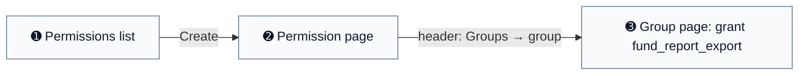

➊ **Permissions** (header link): the list, with the create form at the bottom.

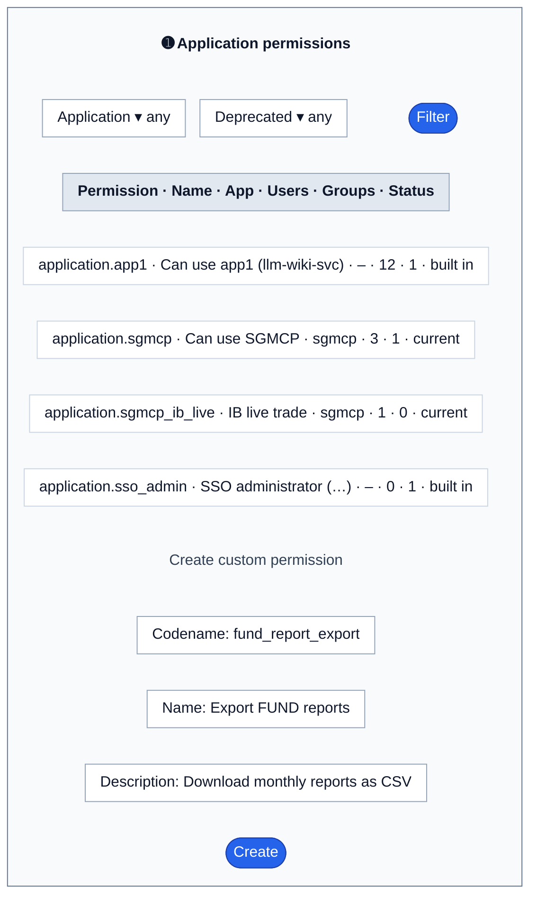

➋ After **Create**: the message "application.fund_report_export created." and the permission's own page.

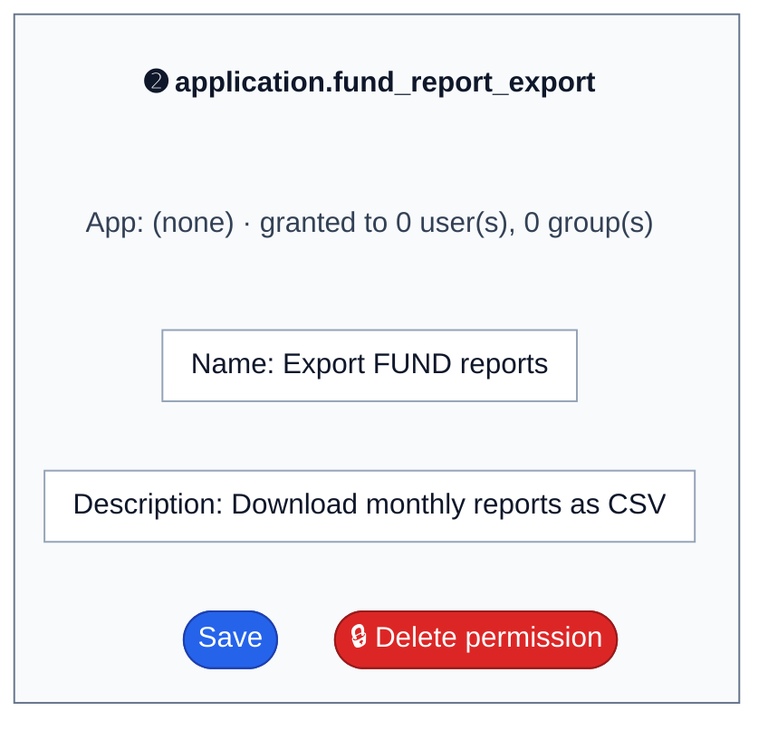

➌ Grant it: **Groups** → the group → under **Permissions**, grant `fund_report_export`. Members get it in their token
at their next login or token refresh (§8.1).

**Create custom permission: the fields**

| Field | What it means | Rules | Example | Change later? |
|---|---|---|---|---|
| **Codename** | The ID the app checks. Ask the app's developer for the exact string; a typo means the app never sees the grant. | Starts with a letter; then `a-z`, `0-9`, `_`; at most 63 characters. Start it with the app's codename and `_` (see the gotchas). Must not exist yet ("This permission exists.") | `fund_report_export` | **No.** To rename, create a new one, move the grants, delete the old one |
| **Name** | Label for admins. Shown in this list, in the user's **Effective permissions** and in grant drop-downs | Required, at most 255 characters | `Export FUND reports` | Yes, on the permission page |
| **Description** | What the permission allows, for the next admin | Optional, at most 1000 characters | `Download monthly reports as CSV` | Yes, on the permission page |

There is no App field: the App column stays empty until an import of that app lists the codename (§4.3).

**List: filters and columns**

| Filter / column | Meaning |
|---|---|
| **Application** filter | Only permissions owned by this imported app. Hand-made ones without an app never match |
| **Deprecated** filter | *deprecated* = removed from the app's last import but still working; *current* = the rest |
| **Permission** | The full string apps check (`application.<codename>`). Click it to open the permission page |
| **Users** / **Groups** | How many users hold it directly, and how many groups hold it |
| **Status** | *built in* (`app1`, `sso_admin`: defined in SSO code, cannot be deleted), *current*, or *deprecated* (red) |

**Buttons**

| Button | Effect | Audit action |
|---|---|---|
| **Create** | Creates `application.<codename>` | `permission.create` |
| **Save** (permission page) | Saves Name and Description. The codename cannot be edited | `permission.update` |
| 🔒 **Delete permission** (not shown for built-in ones) | Confirm page shows how many users and groups hold it. Tick **Revoke from everyone who still has it** if it is still granted to any user, group or service (§4.4 *Permissions*), otherwise the delete is refused ("Still granted to 0 user(s), 0 group(s), 1 service(s); pass revoke_all=true to delete anyway.") | `permission.delete` |

**Gotchas**

- Name the codename `<app>_<what>` (for example `fund_…`). An app's import only claims permissions that start with
  its own codename and `_`; when the FUND import later lists `fund_report_export`, it takes over your hand-made one
  (it shows as *Updated* in the preview, and its App becomes `fund`).
- Deleting a permission removes it from every user, group and service at once, and cannot be undone. Prefer to stop
  granting a permission you are unsure about.
- Changing Name or Description does not change anyone's access, and tokens are unaffected.

### 4.3 Applications page

**What it is for.** Loading an app's whole permission list in one go, from the file the app ships
(`sso_permissions.py`). Use it instead of creating an app's permissions one by one on the Permissions page.

**Worked example.** SGMCP releases a version that adds Schwab live trading. Its new `sso_permissions.py` has
`PERMISSIONS_VERSION = 3` and a new line for `sgmcp_schwab_live`. You import it.

**Sequence**

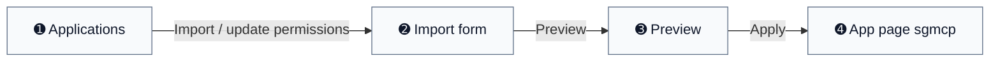

➊ **Applications** (header link): the imported apps.

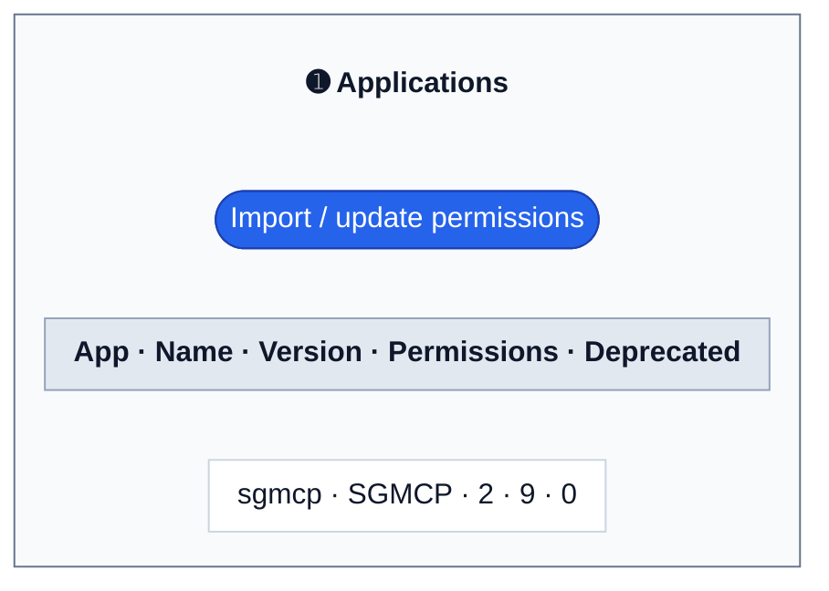

➋ **Import / update permissions**: upload the file (or paste JSON), then **Preview**.

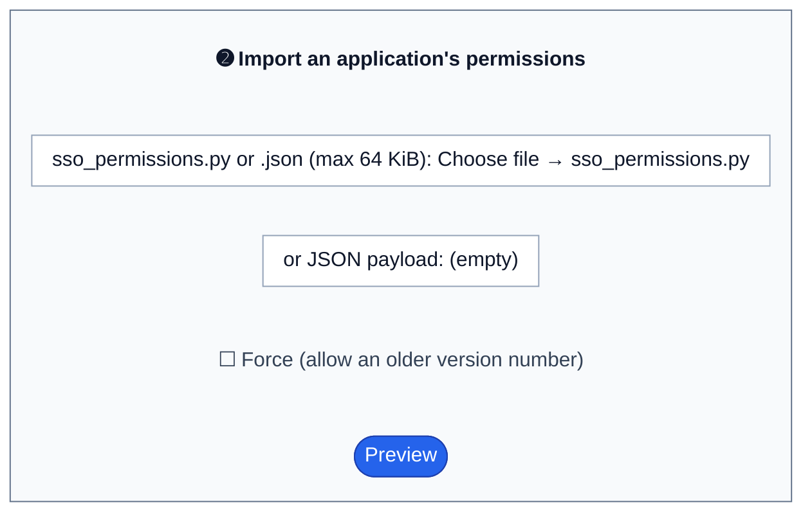

➌ Preview: nothing has changed yet.

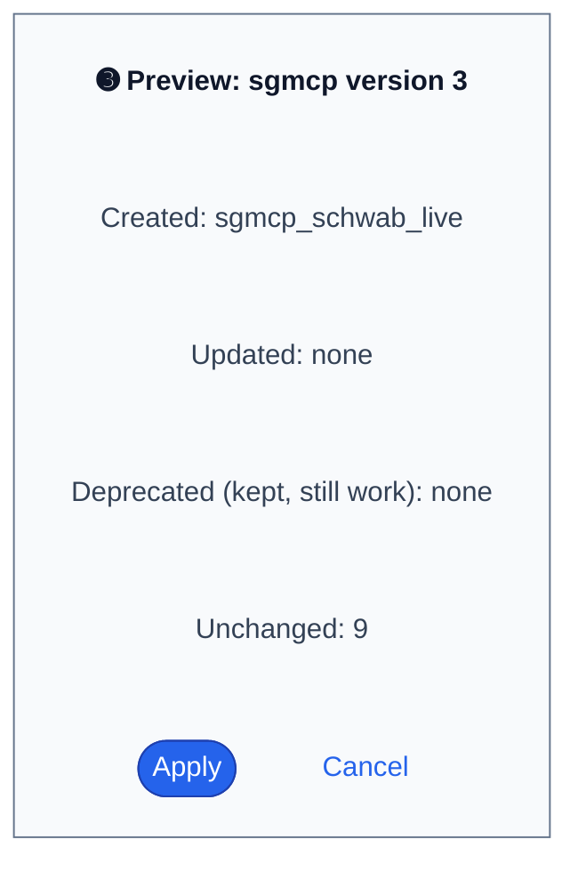

➍ **Apply**: the message "Imported sgmcp: 1 created, 0 updated, 0 deprecated." and the app's page, listing every
`application.sgmcp*` permission with its user and group counts and status. Then grant the new permission to the
right users or groups (§4.2 ➌).

**Import form: the fields**

| Field | What it means | Rules | Example |
|---|---|---|---|
| **sso_permissions.py or .json (max 64 KiB)** | The app's permission file. A `.py` file is read as plain data and never run; a `.json` file is the same data as JSON (`scripts/sso_permissions_to_json.py` converts one into the other, §8.2) | At most 64 KiB. When a file is chosen, the text box is ignored | SGMCP's `sso_permissions.py` |
| **or JSON payload** | Paste the JSON instead of uploading a file | Must contain `app_codename`, `app_name`, `version` (whole number ≥ 1) and `permissions` (at most 500, each with `codename`, `name`, optional `description`); every codename must start with `<app_codename>_` | `{"app_codename":"sgmcp","app_name":"SGMCP","version":3,"permissions":[…]}` |
| **Force (allow an older version number)** | Allows a file whose version is lower than the last import. Use only to roll back on purpose | Unticked by default | unticked |

**Preview: what the lines mean**

| Line | Meaning |
|---|---|
| **Created** | New permissions. The app's own access permission `application.<app>` ("Can use <app name>") is created automatically on the first import |
| **Updated** | Existing permissions whose name or description changed, a deprecated one listed again (revived), or a hand-made one that the app now claims |
| **Deprecated (kept, still work)** | Permissions of this app missing from the file. They keep working and stay granted; delete them yourself on the Permissions page when the app no longer uses them |
| **Unchanged** | How many permissions stay as they are |

**List columns** (Applications): **App** (codename, link to the app page), **Name**, **Version** (of the last
import), **Permissions** (count), **Deprecated** (count).

**Gotchas**

- An import never deletes and never grants: after importing, you still grant the new permissions.
- The preview is tied to that exact file. If the payload changed in between, **Apply** says "The previewed payload
  changed; preview it again."
- A file with a lower version than the last import is refused unless **Force** is ticked.

### 4.4 Services page

**What it is for.** Registering a back-end service (FUND, SGMCP, …) so it can call the SSO with its own
credentials (`client_id` and client secret), receive webhooks, act on behalf of users, or pair devices.

**Worked example.** The FUND back end is being deployed at `https://fund.example`. It must check user tokens and
receive a webhook when a user is suspended. Its users need `application.fund` (created by FUND's import, §4.3).

**Sequence**

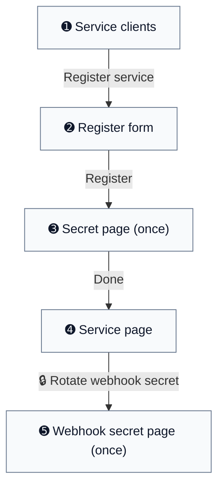

➊ **Services** (header link) → **Register service**.

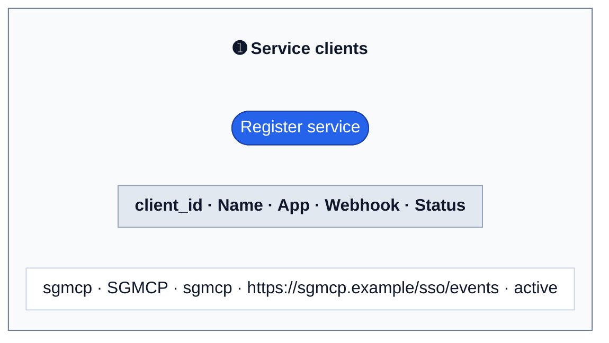

➋ The registration form, filled in.

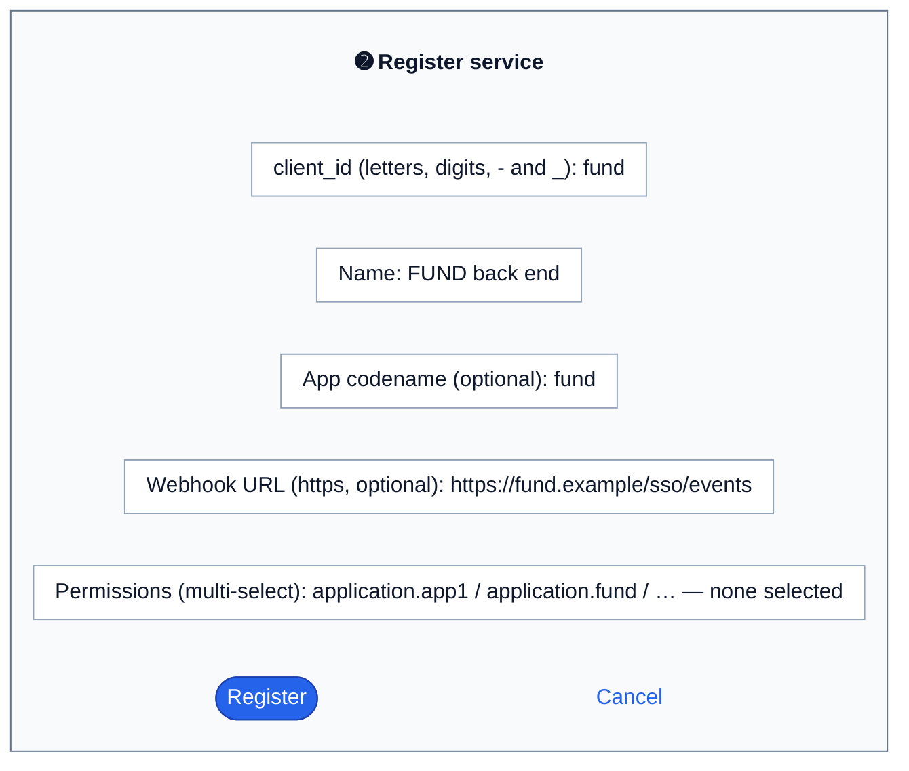

➌ **Register**: the secret page. Copy the secret now; it is never shown again.

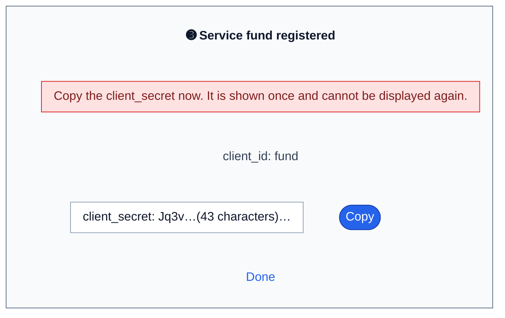

➍ **Done**: the service page. Here you edit the service, choose its webhook events and turn on extra rights.

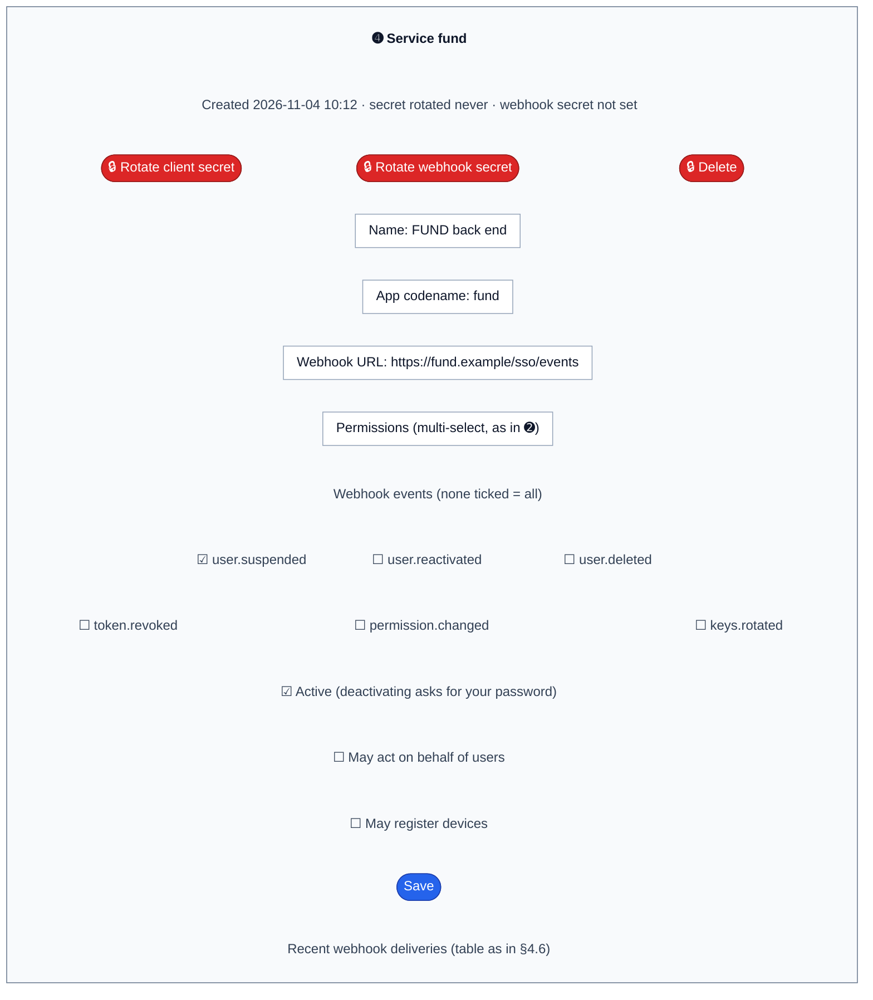

➎ 🔒 **Rotate webhook secret** → confirm → the secret page shows the `notify_secret` once. Put it in FUND's
configuration. Until this step "webhook secret not set" is shown and **no webhooks are sent** to the service.

**Register service: the fields**

| Field | What it means | Rules | Example | Change later? |
|---|---|---|---|---|
| **client_id (letters, digits, - and _)** | The service's login name. It goes into the service's configuration together with the secret | Required; letters, digits, `-`, `_`; at most 100 characters; must be unique ("A service client with this client_id exists.") | `fund` | **No.** Delete and register again |
| **Name** | Label for admins | Required, at most 200 characters | `FUND back end` | Yes |
| **App codename (optional)** | The app this service belongs to (see §4.1). A user must hold `application.<app codename>` before the service can pair a device for them, and devices paired through it carry the same app. It is also the `app` value in the service's tokens and in introspection | Optional; codename format. The UI does **not** check that the permission exists: import or create it first (§4.2, §4.3) | `fund` | Yes |
| **Webhook URL (https, optional)** | Where the SSO sends signed event notifications (§4.6). Empty = no webhooks | `https://` only, at most 500 characters | `https://fund.example/sso/events` | Yes |
| **Permissions** | The service's **own** rights, used when it calls the SSO as itself (its service token's `perms`). Not given to users. Most services need none | Pick zero or more (Ctrl/Cmd-click selects several) | none | Yes |

**Service page: the extra fields**

| Field | What it means | Default |
|---|---|---|
| **Webhook events (none ticked = all)** | Which events the service receives (§4.6). Ticking none means **all** of them, not none | none ticked (all) |
| **Active (deactivating asks for your password)** | Unticking 🔒 stops the service's login at once and stops its webhooks; ticking it again restores them | ticked |
| **May act on behalf of users** | 🔒 to turn on. The service may call other services and the SSO on behalf of a logged-in user (delegation; it may then pass the user's IP for the login limits, see [API manual §9](API-REFERENCE-MANUAL.md#9-devices-and-on-behalf-of-v13b)) | off |
| **May register devices** | 🔒 to turn on. The service may pair devices (gateway PCs) for its users (§4.5) | off |

**Buttons**

| Button | Effect | Audit action |
|---|---|---|
| **Register** | Creates the service and shows the client secret once | `service.create` |
| **Save** | Saves the form (🔒 when it deactivates the service or turns on one of the two *May …* boxes) | `service.update` |
| 🔒 **Rotate client secret** | New client secret, shown once. The old one stops working **immediately**, as do tokens issued with it: update the service's configuration right away | `service.rotate_secret` |
| 🔒 **Rotate webhook secret** | New webhook signing secret, shown once. Webhooks are signed with it from then on | `service.rotate_notify_secret` |
| 🔒 **Delete** | Confirm page asks you to type the `client_id`. Its credentials stop working immediately | `service.delete` |

**Gotchas**

- *App codename* and *Permissions* are different things (§4.1); filling *Permissions* with `application.fund` does
  **not** give users access to FUND.
- A webhook URL alone sends nothing: the service also needs a webhook secret (➎).
- Prefer unticking **Active** over **Delete**: it can be undone and keeps the delivery history.

### 4.5 Devices page

**What it is for.** Seeing and revoking users' paired devices: PCs running the local gateway that connect to a
service for a user. Devices are **never created here**. A user pairs one through a service that has
**May register devices** (§4.4); the device gets its own generated `client_id`.

**Worked example.** amy (user id 42) reports her "Trading PC" stolen. You revoke it.

**Sequence**

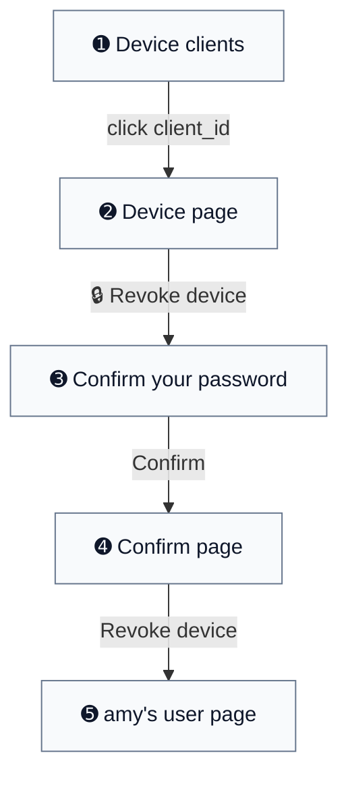

➊ **Devices** (header link), filtered to amy. The filter needs her **numeric user id** (on her user page and in
its URL `/admin/users/42/`), not her username.

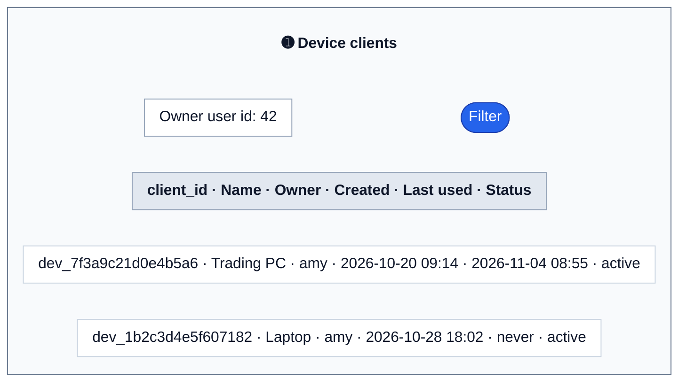

➋ Click the `client_id`: the device page.

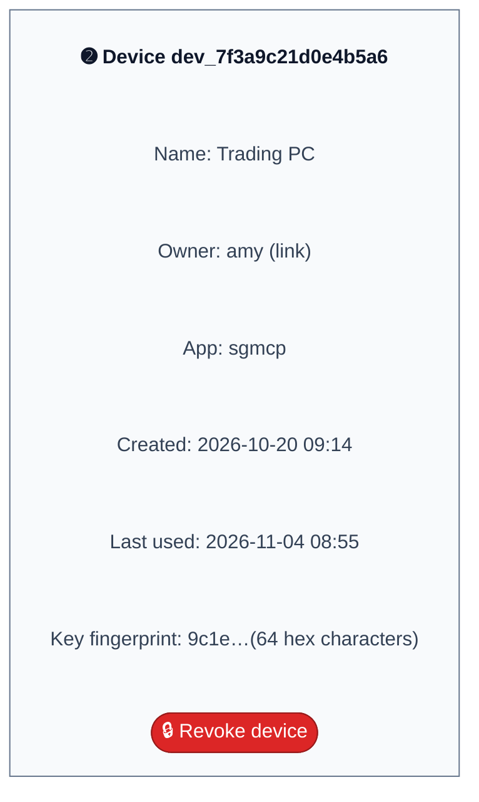

➌ 🔒 **Revoke device**. If you are not elevated yet, the shared password page comes first:

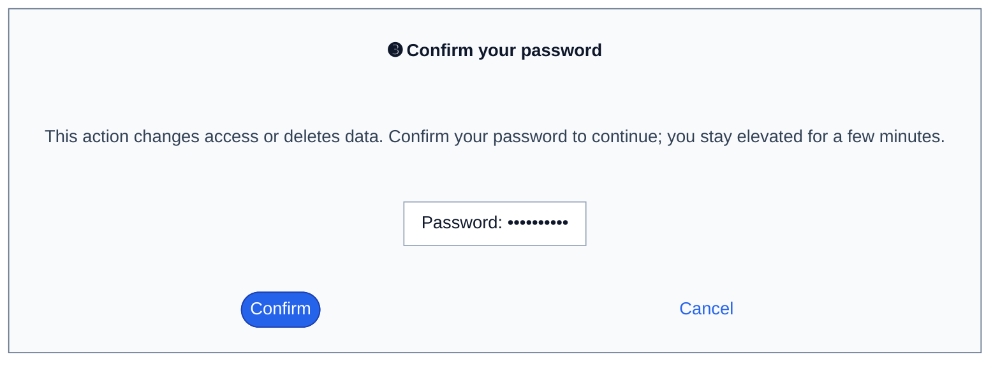

➍ The shared confirm page lists what will happen; nothing changes until you press its button.

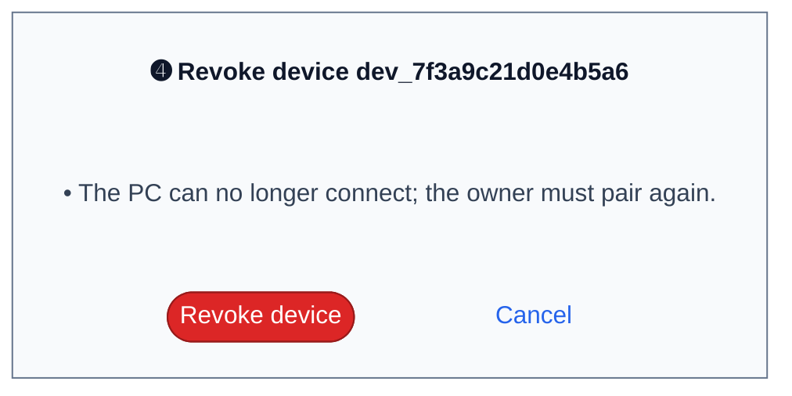

For a service or user delete, this page also asks you to type the name; for a permission delete it has the
**Revoke from everyone who still has it** box (§4.2).

➎ The message "Device dev_7f3a9c21d0e4b5a6 revoked." and amy's user page, where the device is gone.

**Fields and columns**

| Field / column | Meaning |
|---|---|
| **Owner user id** (filter) | The owner's numeric user id. A username gives the error "owner must be a user id." |
| **client_id** | The device's generated ID (`dev_` and 16 hex digits); click it for the device page |
| **Name** | The name the user gave the device when pairing |
| **Owner** | The user who paired it; click it for their user page |
| **App** (device page) | The app of the service it was paired through |
| **Created** / **Last used** | When it was paired / last connected ("never" = paired but never used) |
| **Key fingerprint** (device page) | SHA-256 of the device's public key. Ask the user to read the fingerprint shown on their PC to be sure you revoke the right one |
| **Status** | *active*, or *inactive* (red) for a device switched off by a suspend |

**Gotchas**

- Revoking is permanent; the user pairs the PC again if it comes back.
- Suspending a user (User page) switches off **all** their devices; unsuspending does not switch them back on.
- To revoke every device and session of a user at once, suspend the user instead.

### 4.6 Webhooks page

**What it is for.** Checking that services received the events the SSO sent them, and resending the ones that did
not arrive. Each **event** (something that happened, for example a user was suspended) creates one **delivery** per
service that subscribes to it.

**Worked example.** FUND's receiver was down overnight. amy was suspended, but FUND never heard about it. You find the
failed delivery and send it again.

**Sequence**

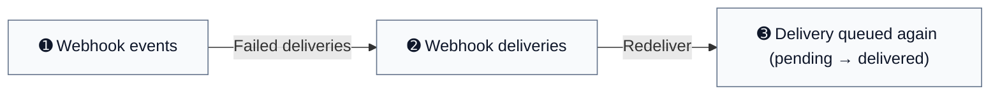

➊ **Webhooks** (header link): the events, newest first.

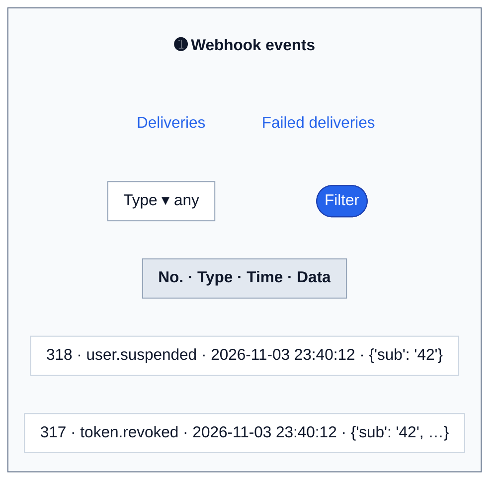

➋ **Failed deliveries** (or click an event's `#` to see only its deliveries).

```mermaid
%%{init: {"flowchart": {"wrappingWidth": 900, "rankSpacing": 14, "nodeSpacing": 14, "padding": 8}}}%%
flowchart TB
    subgraph w2[" "]
    direction TB
    w2_0_0["➋ Webhook deliveries"]:::title
    w2_1_0["Status ▾ failed"]:::inp
    w2_1_1["Service: fund"]:::inp
    w2_1_2(["Filter"]):::btn
    w2_2_0["No. · Event · Service · Status · Attempts · Next try · Last error"]:::th
    w2_3_0["611 · user.suspended (event 318) · fund · failed · 14 · 2026-11-04 23:39 · ConnectionRefusedError"]:::bad
    w2_3_1["Redeliver"]:::link
    w2_0_0 ~~~ w2_1_0 & w2_1_1 & w2_1_2
    w2_1_0 & w2_1_1 & w2_1_2 ~~~ w2_2_0
    w2_2_0 ~~~ w2_3_0 & w2_3_1
    end
    class w2 screen
    classDef screen fill:#f8fafc,stroke:#64748b,color:#0f172a
    classDef txt fill:none,stroke:none,color:#334155
    classDef inp fill:#ffffff,stroke:#94a3b8,color:#0f172a
    classDef btn fill:#2563eb,stroke:#1e40af,color:#ffffff
    classDef danger fill:#dc2626,stroke:#991b1b,color:#ffffff
    classDef link fill:none,stroke:none,color:#2563eb
    classDef th fill:#e2e8f0,stroke:#94a3b8,color:#0f172a,font-weight:bold
    classDef tr fill:#ffffff,stroke:#cbd5e1,color:#0f172a
    classDef bad fill:#fee2e2,stroke:#dc2626,color:#7f1d1d
    classDef title fill:none,stroke:none,color:#0f172a,font-weight:bold,font-size:16px
```

➌ Once FUND's receiver is fixed, click **Redeliver**: the message "Delivery 611 queued again." The status turns
*pending*, and the webhook sender (the `webhooks` service) delivers it within seconds. Reload to see *delivered*.

**Filters and columns**

| Filter / column | Meaning |
|---|---|
| **Type** (events filter) | One of `user.suspended`, `user.reactivated`, `user.deleted`, `token.revoked`, `permission.changed`, `keys.rotated` |
| **#** (event) | The event ID; click it for that event's deliveries |
| **Data** | What the event says, for example the user id (`sub`) |
| **Status** (deliveries filter) | *pending* (waiting for its next try), *sending* (in progress), *delivered* (the service answered 2xx), *failed* (still not delivered after `SSO_WEBHOOK_MAX_AGE_HOURS`, default 24 h, of retries), *skipped* (the service became inactive or lost its URL or webhook secret before sending) |
| **Service** (deliveries filter) | The service's exact `client_id` |
| **Attempts** | How many sends were tried. Retries wait longer each time, up to 10 minutes |
| **Next try** | When the next attempt is due (pending only) |
| **Last error** | Why the last attempt failed: `http_<code>` (the service answered with that status), a network error name, or `client_inactive_or_no_secret` |

**Buttons**

| Button | Effect | Audit action |
|---|---|---|
| **Redeliver** | Resets the delivery to *pending* with 0 attempts and a new 24 h window. Works on any status, so a *delivered* one can be sent again (receivers must ignore duplicates by `X-SSO-Event-Id`) | `webhook.redeliver` |

**Gotchas**

- A service receives nothing unless it is active and has a webhook URL **and** a webhook secret (§4.4 ➎), and only
  the events ticked on its page (none ticked = all).
- Events that happen while a service has no webhook secret are not queued for it, and redelivery cannot recover them.
- Many `http_401` errors usually mean the service checks signatures with an old webhook secret: give it the current
  one, or rotate again.

## 5. Command line: `manage.py` commands and scripts

Run commands in the running container:

```bash
docker compose exec web python manage.py <command> [options]
# or, when web is not running:
docker compose run --rm web python manage.py <command> [options]
```

### 5.1 SSO commands

| Command | What it does |
|---|---|
| `createsuperuser` | Django's command: create a superuser (§2.2) |
| `changepassword <username>` | Django's command: set a user's password from the server (prompts for it). Prefer the UI 🔒 **Set password**, which also revokes the user's tokens and is audited |
| `register_service <client_id> --app <codename> [--name "…"] [--app-name "Can use …"] [--notify-url URL] [--origin URL]` | New service in one step: creates `application.<codename>` if missing and a ServiceClient linked to it. Prints the client secret **once**. Refuses an existing `client_id` |
| `create_service_client <client_id> [--name "…"] [--app <codename>] [--origin URL]` | Create a ServiceClient (the permission must already exist). Prints the secret once |
| `create_service_client <client_id> --rotate-secret` | New secret for an existing service, printed once; the old one stops working at once |
| `create_app_permission <codename> "<name>"` | Create `application.<codename>` (idempotent). Codename `[a-z][a-z0-9_]{1,62}` |
| `rotate_notify_secret <client_id>` | New webhook signing secret for a service, printed once |
| `revoke_inactive_users [--dry-run]` | Revoke the tokens of users who were deactivated outside the SSO (for example by myFinance writing `auth_user`), and prune old session-revocation rows. Run hourly (§9) |
| `flushexpiredtokens` | simplejwt: delete expired refresh-token records. Run daily (§9) |
| `run_webhook_worker [--once]` | The webhook sender. Normally runs as the compose service `webhooks`; `--once` processes due deliveries and exits |
| `sso_schema_check [--counts]` | Read only: are all SSO migrations applied and all tables and columns present? Exit 1 if not |

Secrets printed by these commands go to your terminal only; never paste them into tickets or chat.

### 5.2 Scripts (on the host, in the repo or deploy kit)

| Script | What it does |
|---|---|
| `scripts/sso_login_check.py <username> [--url URL] [--cacert FILE \| --insecure]` | Logs in as that user (password prompted, or `SSO_PASSWORD`), prints groups and `perms`, logs out. Tokens are never printed. Exit 1 = login refused |
| `scripts/sso_permissions_to_json.py <sso_permissions.py>` | Converts an app's permission file to the import JSON without running it (§8.2) |
| `scripts/deploy_check.sh` | Checks a running deployment and prints `[PASS]` / `[WARN]` / `[FAIL]` with the fix |
| `scripts/upgrade_db.sh [--plan]` | The only way to change the SSO database schema (as `sso_migrator`). See [SSO-Setup.md §11](SSO-Setup.md#11-upgrading-the-database-later) |
| `scripts/gen_keys.sh` | New JWT signing key (key rotation). See [README §4](../README.md#4-key-generation-and-rotation) |

## 6. Command line: the admin REST API with curl

Use the API for scripts and bulk work. You authenticate as yourself (an admin, §2.1) with a normal SSO login.

### 6.1 Set up a shell session

```bash
SSO=https://192.168.0.213                   # your SSO_ISSUER
CURL="curl -s --cacert docker/certs/selfsigned.crt"   # or -k for a quick test; plain curl with a real certificate
read -rp "Admin user: " U; read -rsp "Password: " P; echo

AT=$($CURL $SSO/api/v1/auth/login -H 'Content-Type: application/json' \
  -d "{\"username\":\"$U\",\"password\":\"$P\",\"client\":\"native\"}" | jq -r .access_token)

api() {   # api METHOD PATH [JSON]
  $CURL -X "$1" "$SSO/api/v1/admin$2" -H "Authorization: Bearer $AT" -H 'Content-Type: application/json' \
    ${RT:+-H "X-SSO-Reauth: $RT"} ${3:+-d "$3"}; echo
}
stepup() {  # run before 🔒 actions; valid 5 minutes
  RT=$($CURL $SSO/api/v1/admin/reauth -H "Authorization: Bearer $AT" -H 'Content-Type: application/json' \
    -d "{\"password\":\"$P\"}" | jq -r .reauth_token)
}
```

- `read -s` keeps the password out of the shell history. Run `unset P AT RT` when you are done.
- The access token lasts **15 minutes**; log in again when calls return 401 `token_invalid`.
- A 🔒 call without step-up returns 401 `reauth_required`: run `stepup`, then repeat the call.
- Lists take `?page=` and `?page_size=` (max 200) and return `{"count","page","page_size","results"}`.
- Limits: 120 admin calls per minute per user, 5 step-ups per minute.

### 6.2 Examples

```bash
api GET  "/users?q=amy"                              # find a user; note the id
api GET  /users/42/permissions                       # direct, via_groups, effective
api POST /users/42/permissions/sgmcp                 # grant application.sgmcp
api DELETE /users/42/permissions/sgmcp               # revoke it
api PUT  /users/42/groups '{"groups":["traders"]}'   # set the user's groups (replaces the list)
stepup; api POST /users/42/suspend '{}'              # 🔒 suspend and revoke everything
api POST /users/42/unsuspend '{}'
api GET  "/audit?target_type=user&target_id=42"
```

Every endpoint, with its body and errors: [API-REFERENCE-MANUAL.md §8](API-REFERENCE-MANUAL.md#8-admin-rest-api-v13a)
(users, groups, permissions, services, import, audit), [§9](API-REFERENCE-MANUAL.md#9-devices-and-on-behalf-of-v13b)
(devices), [§10](API-REFERENCE-MANUAL.md#10-signed-webhooks-v13c) (webhooks).

## 7. Task cookbook: UI and CLI side by side

`api` and `stepup` are the shell helpers from §6.1. 🔒 = asks for your password.

### Users

| Task | Admin UI | CLI |
|---|---|---|
| Create a user | **Users → Create**: username, email, names, password (twice), groups | `api POST /users '{"username":"amy","email":"amy@x.org","password":"…","groups":["traders"]}'` (no password = cannot log in until one is set) |
| Edit email or name | User page → **Save profile** | `api PATCH /users/42 '{"email":"new@x.org"}'` |
| Set a password 🔒 | User page → **Set password** | `stepup; api POST /users/42/set-password '{"password":"…"}'`, or on the server `manage.py changepassword amy` |
| Suspend 🔒 (blocks login, ends every session and token, deactivates their devices, tells the services) | User page → **Suspend and log out all sessions** | `stepup; api POST /users/42/suspend '{}'` |
| Unsuspend | User page → **Unsuspend** (they log in again; devices stay off and must be paired again) | `api POST /users/42/unsuspend '{}'` |
| Log a user out everywhere | User page → **Log out everywhere** | `api POST /users/42/logout-all` |
| Delete 🔒 (prefer suspend: delete cannot be undone) | User page → **Delete**, type the username | `stepup; api DELETE /users/42` |
| See a user's access | User page → **Effective permissions** | `api GET /users/42/permissions`; or `scripts/sso_login_check.py amy` (needs their password) |

### Groups and permissions

| Task | Admin UI | CLI |
|---|---|---|
| Grant app access to a user | User page → permission → **Grant** | `api POST /users/42/permissions/<codename>` |
| Grant app access to many people | **Groups** → group → grant the permission, then **Save members** | `api POST /groups/3/permissions/<codename>`; `api PUT /groups/3/members '{"user_ids":[42,43]}'` |
| Create a group | **Groups → Create** | `api POST /groups '{"name":"traders"}'` |
| Delete a group 🔒 | Group page → **Delete group** | `stepup; api DELETE /groups/3` |
| Create a permission | **Permissions → Create custom permission** ([§4.2](#42-permissions-page)) | `api POST /permissions '{"codename":"sgmcp_schwab_live","name":"Schwab live trade"}'`, or `manage.py create_app_permission sgmcp_schwab_live "Schwab live trade"` |
| Import an app's permissions | **Applications → Import / update permissions**, upload the file, **Preview**, **Apply** ([§4.3](#43-applications-page)) | §8.2 |
| Delete a permission 🔒 | Permission page → **Delete permission** (tick *Revoke from everyone who still has it* if still granted) | `stepup; api DELETE "/permissions/<codename>?revoke_all=true"` |

### Services, devices, webhooks

| Task | Admin UI | CLI |
|---|---|---|
| Register a service | **Services → Register service**; copy the secret shown once ([§4.4](#44-services-page)) | `manage.py register_service fund --app fund --name "FUND" [--notify-url https://…/sso/events]`, or `api POST /services '{"client_id":"fund","name":"FUND","app_codename":"fund"}'` |
| Rotate a service secret 🔒 | Service page → **Rotate client secret** | `stepup; api POST /services/fund/rotate-secret`, or `manage.py create_service_client fund --rotate-secret` |
| Deactivate a service 🔒 | Service page → untick **Active**, **Save** | `stepup; api PATCH /services/fund '{"is_active":false}'` |
| Set webhook URL / events | Service page → **Webhook URL**, **Webhook events**, **Save** | `api PATCH /services/fund '{"notify_url":"https://…","notify_events":["user.suspended","token.revoked"]}'` (`[]` = all) |
| Rotate a webhook secret 🔒 | Service page → **Rotate webhook secret** | `stepup; api POST /services/fund/rotate-notify-secret`, or `manage.py rotate_notify_secret fund` |
| Find failed webhooks | **Webhooks → Failed deliveries** ([§4.6](#46-webhooks-page)) | `api GET "/webhooks/deliveries?status=failed"` |
| Resend a webhook | Delivery → **Redeliver** | `api POST /webhooks/deliveries/<id>/redeliver` |
| Revoke a user's device 🔒 | **Devices** → device → **Revoke device** ([§4.5](#45-devices-page)) | `stepup; api DELETE /devices/<client_id>` |

### Audit

| Task | Admin UI | CLI |
|---|---|---|
| Who did what | **Audit log**, filter by actor / action / target / channel / result / date; export CSV | `api GET "/audit?actor=7&since=2026-11-01T00:00:00Z"` |

## 8. Application permissions

### 8.1 How they work

Each app has its own permissions, all named `application.<codename>`. Granting one to a user or a group puts it in
that user's token (`perms`) at the next login or token refresh; services that ask the SSO (introspect) see the change
at once. Superusers get only what is granted explicitly.

Permissions are **data, not SSO code**: an admin or the app's import creates them, and adding one never needs an SSO
release. The SSO does not know what a permission means; the app checks it. Only `application.sso_admin` (used by the
SSO itself) and the legacy `application.app1` are built in and cannot be deleted.

Codenames are lowercase letters, digits and `_` (`sgmcp_ib_live`, not `SGMCP.IB.live`). Each app documents the
meaning of its permissions; SGMCP's set is in
[ECOSYSTEM-INTEGRATION.md §2.2](ECOSYSTEM-INTEGRATION.md#22-examples-only-each-app-decides-its-real-list).

### 8.2 Importing an app's permissions

Each app ships a `sso_permissions.py` listing its permissions. Import it whenever the app adds or changes permissions.

**Admin UI** (step by step in [§4.3](#43-applications-page)): **Applications → Import / update permissions** → upload `sso_permissions.py` (or paste the JSON)
→ **Preview** shows what will be created, changed, deprecated or revived → **Apply**. The file is read as data and
never run.

**CLI:**

```bash
python scripts/sso_permissions_to_json.py path/to/sso_permissions.py > sgmcp.json
api PUT "/apps/sgmcp/permissions?dry_run=true" "$(cat sgmcp.json)"    # preview
api PUT  /apps/sgmcp/permissions "$(cat sgmcp.json)"                  # apply
```

An import **never deletes**: a permission that disappeared from the file is marked *deprecated* and keeps working until
you delete it yourself. A file with an older `PERMISSIONS_VERSION` than the last import is refused unless you tick
*force* (`?force=true`).

## 9. Routine operations

| When | What | How |
|---|---|---|
| Hourly | Revoke tokens of users deactivated outside the SSO | cron: `docker compose exec -T web python manage.py revoke_inactive_users` |
| Daily | Delete expired refresh-token records | cron: `docker compose exec -T web python manage.py flushexpiredtokens` |
| Daily glance | Failed webhook deliveries, suspended users, recent admin actions | **Dashboard** |
| After each deploy | Deployment and schema checks | `scripts/deploy_check.sh`; `manage.py sso_schema_check` |
| When an app changes its permissions | Re-import | §8.2 |
| When a secret may have leaked | Rotate it | service secret / webhook secret (§7); a user: 🔒 set password + log out everywhere |
| Key rotation | New signing key | [README §4](../README.md#4-key-generation-and-rotation) and [SSO-Setup.md §4](SSO-Setup.md#4-jwt-signing-keys) |

Example `/etc/cron.d/sso` (write the real directory):

```cron
30 3 * * * root cd /opt/sso && docker compose exec -T web python manage.py flushexpiredtokens
5 * * * *  root cd /opt/sso && docker compose exec -T web python manage.py revoke_inactive_users
```

## 10. Rules that protect the system

The UI hides actions that would break these rules, and the API refuses them (409):

- You cannot suspend or delete yourself, or remove your own `sso_admin`.
- The **last admin** cannot be suspended, deleted, or lose `sso_admin`.
- `application.sso_admin` and `application.app1` cannot be deleted.

Rules for you:

- **Prefer suspend over delete.** Suspend is reversible and keeps the user's history; delete is permanent.
- The database `dcWebUsers` is **shared with myFinance**. Never run `clearsessions` or `remove_stale_contenttypes`
  against it; the latter deletes the `application.*` permissions and all their grants.
- Never paste tokens, passwords or secrets into chat, tickets or shell commands that stay in the history.
- Use Django admin only in emergencies; changes made there skip some of the SSO's checks.

## 11. Troubleshooting

| Symptom | Cause and fix |
|---|---|
| 403 page from nginx at `/admin/` | Your IP is not in `docker/nginx-admin-ui.d/*.conf` (§2.4) |
| "invalid username or password, or no admin access" | Wrong password, **or** the account is not active + staff + `sso_admin` (§2.1). The audit log (`ui.login`, result `denied`) has the reason |
| Every form submit fails with 403 CSRF | `SSO_CSRF_TRUSTED_ORIGINS` lacks the exact origin in your address bar (§2.4) |
| "Your admin access ended" / sent back to login | Session idle 30 min or older than 8 h, your IP changed, or your account changed (suspended, lost `sso_admin`, password changed) |
| TLS error when opening the server by IP from another machine | Use a hostname: [DESIGN-v1.3d §19](DESIGN-v1.3d-admin-ui.md#19-reaching-the-ui-from-another-lan-host) |
| 429 | Too many attempts: login 10/min per IP and 5/min per user; step-up 5/min; API 120/min. Wait a minute |
| API 401 `reauth_required` | Run `stepup`, repeat the call (§6.1) |
| API 401 `token_invalid` | Access token expired (15 min) or revoked: log in again |
| API 403 | Your account is not an admin (§2.1) |
| A user has the permission but the app still refuses | Their token predates the grant: they refresh or log in again. Check `perms` with `scripts/sso_login_check.py` |
| Webhook deliveries `failed` | The service's `notify_url` is unreachable or answers non-2xx; see *last error* on the delivery, fix the receiver, **Redeliver** |
| Log ERROR `application permissions … were deleted … ALL GRANTS OF THESE PERMISSIONS WERE LOST` | Someone ran `remove_stale_contenttypes` in myFinance (§10). Re-run `migrate` for the built-in ones, re-import apps' permissions, re-grant |

More: [SSO-Setup.md Troubleshooting](SSO-Setup.md#troubleshooting).
