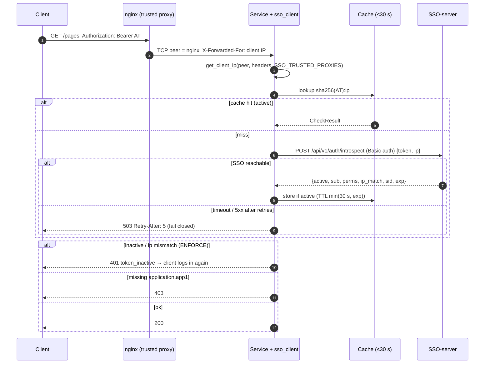

# `sso-client` — Python library for services (design)

> **Status: implemented as `sso-client` 0.1.0 (v1.2b, `clients/python/`).** What 0.1.0 leaves out (JWKS
> pre-check, circuit breaker, `cached` fail mode, generic WSGI/ASGI middleware, webhooks) is listed in
> [DESIGN-v1.2-requirements.md §11](DESIGN-v1.2-requirements.md#11-v12b-as-built-implementation-notes-and-decisions). Contract source of truth: the
> [API Reference Manual](API-REFERENCE-MANUAL.md) and [v1.2 design §4.4–4.5](DESIGN-v1.2-requirements.md#45-how-the-client-ip-is-determined).

| | |
|---|---|
| Distribution name | `sso-client` |
| Import name | `sso_client` |
| Python | 3.13 (3.11+ supported if cheap) |
| Runtime deps | `httpx` (sync + async). Optional extras: `[jwt]` → `PyJWT[crypto]`, `[django]`, `[fastapi]`, `[flask]` |
| First adopter | llm-wiki-svc (replaces its own IP/introspect code) |

## Contents

1. [Goals and non-goals](#1-goals-and-non-goals)
2. [Package layout](#2-package-layout)
3. [Client IP: core API](#3-client-ip-core-api)
4. [Framework adapters](#4-framework-adapters)
5. [`SSOClient`: permission query](#5-ssoclient-permission-query)
6. [Caching, timeouts, retries, failure policy](#6-caching-timeouts-retries-failure-policy)
7. [Decorators and dependencies](#7-decorators-and-dependencies)
8. [Webhook receiver (v1.4)](#8-webhook-receiver-v14)
9. [Configuration](#9-configuration)
10. [Errors, logging and redaction](#10-errors-logging-and-redaction)
11. [Testing utilities](#11-testing-utilities)
12. [Packaging, distribution and versioning](#12-packaging-distribution-and-versioning)
13. [Usage samples](#13-usage-samples)
14. [Request sequence](#14-request-sequence)
15. [llm-wiki-svc migration](#15-llm-wiki-svc-migration)
16. [Open decisions](#16-open-decisions)

## 1. Goals and non-goals

Goals
- One correct implementation of **client-IP derivation** from the socket peer (`getpeername` / `REMOTE_ADDR` /
  `scope["client"]`) plus trusted-proxy `X-Forwarded-For` walk, identical to the SSO (§4.5).
- One call to ask the SSO "is this token active for this IP, and which permissions does it carry?"
- Drop-in adapters for Django, FastAPI/Starlette, Flask and raw sockets.
- Safe defaults: fail closed, short cache, secrets never logged.

Non-goals
- Login UI / browser flows (clients use the SSO API directly; BFF login helpers may come later).
- Issuing or refreshing tokens on behalf of users (a service only verifies).
- Non-Python languages (see TODOS.md).

## 2. Package layout

```text
clients/python/
├── pyproject.toml
├── README.md
├── src/sso_client/
│   ├── __init__.py          # public API re-exports, __version__
│   ├── ip.py                # get_client_ip, normalize_ip, parse_trusted, peer_from_socket
│   ├── config.py            # SSOConfig.from_env()
│   ├── client.py            # SSOClient (sync), AsyncSSOClient
│   ├── models.py            # CheckResult, User dataclasses
│   ├── cache.py             # TTL cache (in-process; pluggable)
│   ├── jwks.py              # optional local JWT pre-check ([jwt] extra)
│   ├── errors.py            # typed exceptions
│   ├── webhooks.py          # verify_webhook (v1.4)
│   ├── testing.py           # FakeSSO, fixtures
│   └── adapters/
│       ├── wsgi.py          # generic WSGI middleware
│       ├── django.py        # middleware + decorator
│       ├── asgi.py          # generic ASGI middleware
│       ├── fastapi.py       # dependencies
│       └── flask.py         # extension + decorator
└── tests/
```

## 3. Client IP: core API

```python
def get_client_ip(
    peer_addr: str | tuple | None,          # socket peer: "1.2.3.4", ("1.2.3.4", 5555), ("::1", 80, 0, 0)
    headers: Mapping[str, str] | Iterable[tuple[str, str]],
    trusted_proxies: Sequence[IPv4Network | IPv6Network | str] = (),
) -> str | None: ...
```

Pure function, no I/O, no framework imports.

1. `peer = normalize_ip(peer_addr)`; `None` → return `None`.
2. If `peer` not in `trusted_proxies` → return `peer` (headers ignored).
3. Join all `X-Forwarded-For` values, split on `,`, walk right→left: normalise each; invalid → stop and return
   the last good IP; untrusted → return it.
4. All trusted → return leftmost valid entry (or `peer` if header absent).

`normalize_ip(value) -> str | None`: strips port / brackets / zone id, maps `::ffff:a.b.c.d` → `a.b.c.d`,
returns `str(ipaddress.ip_address(...))` (canonical IPv6). `parse_trusted("127.0.0.1, 172.18.0.0/16")` → networks.
By default only `X-Forwarded-For` is read (not `X-Real-IP`/`Forwarded`), matching the nginx config in §4.5.5.
**Custom header (0.1.0, follow-up 2026-10-14):** `get_client_ip(..., client_ip_header="cf-connecting-ip")`
(`SSO_CLIENT_IP_HEADER`, needs `SSO_TRUSTED_PROXIES`) reads that header with the same right-to-left walk, only when
the peer is trusted; if it is absent or holds no valid IP, step 3 (`X-Forwarded-For`) applies. The SSO-server
has the same rule (`SSO_CLIENT_IP_HEADER`).

`peer_from_socket(sock: socket.socket) -> str | None` wraps `sock.getpeername()` for raw TCP servers
(`AF_INET`, `AF_INET6`; `AF_UNIX` → `None`).

Property tests: spoofed XFF from an untrusted peer never changes the result; IPv4-mapped equals IPv4.

## 4. Framework adapters

| Framework | Peer source | Provided |
|---|---|---|
| WSGI (generic) | `environ["REMOTE_ADDR"]` | `SSOWSGIMiddleware` sets `environ["sso.client_ip"]` |
| Django | `request.META["REMOTE_ADDR"]` | `sso_client.adapters.django.SSOMiddleware` sets `request.client_ip`, lazy `request.sso` (CheckResult); `@require_permission` |
| ASGI (generic/Starlette) | `scope["client"][0]` | `SSOASGIMiddleware` sets `scope["state"]["client_ip"]` |
| FastAPI | `request.client.host` | `Depends(client_ip)`, `Depends(sso_user)`, `Depends(require_permission("application.app1"))` |
| Flask | `request.environ["REMOTE_ADDR"]` | `SSO(app)` extension, `g.client_ip`, `@require_permission` |
| Raw socket | `sock.getpeername()` | `peer_from_socket` + `get_client_ip(peer, {}, [])` |

Adapters must not use framework helpers that already trust headers (e.g. Werkzeug `ProxyFix`, uvicorn
`--forwarded-allow-ips='*'`). Docs will say: either disable those, or configure them with the same trusted list.
The token is read from `Authorization: Bearer …` (configurable cookie name for BFF services that keep the access
token server-side is out of scope; BFFs call `SSOClient.check` directly).

## 5. `SSOClient`: permission query

```python
class SSOClient:
    def __init__(self, config: SSOConfig | None = None, *, http: httpx.Client | None = None): ...
    def check(self, token: str, client_ip: str | None, require: Sequence[str] = ()) -> CheckResult: ...
class AsyncSSOClient:      # same API, async def check(...)

@dataclass(frozen=True)
class CheckResult:
    active: bool
    user: User | None            # id, username, email, is_staff
    permissions: frozenset[str]  # e.g. {"application.app1"}
    ip_match: bool | None        # None in NOIP mode
    session_id: str | None       # sid
    expires_at: datetime | None
    reason: str | None           # "expired", "revoked", "ip_mismatch", ...
    def has(self, *perms: str) -> bool: ...
```

- Calls `POST {SSO_BASE_URL}/api/v1/auth/introspect` with Basic auth (`client_id:client_secret`) and body
  `{"token": ..., "ip": client_ip}` (v1.2b contract, design §4.4).
- `require=[...]`: raises `PermissionDenied` if any is missing; raises `TokenInactive` when `active=false`
  (incl. `ip_mismatch` in `ENFORCE`). In `WARNING` mode `ip_match=false` is returned with `active=true` and logged.
- Missing `client_ip` is sent as absent; the SSO treats that as a mismatch in `WARNING`/`ENFORCE` (design §4.4).

## 6. Caching, timeouts, retries, failure policy

| Concern | Default | Notes |
|---|---|---|
| Cache | TTL `SSO_CACHE_TTL=30` s (max 30, enforced) | Only `active=true` results. Key = `sha256(token) + ":" + ip`. TTL also capped at token `exp`. Pluggable backend (in-process LRU default, 10k entries). |
| Timeout | `SSO_TIMEOUT=2.0` s (connect 1 s) | Per attempt. |
| Retries | 2 retries, exponential backoff 0.1/0.3 s + jitter | Only on connect errors, timeouts, 502/503/504. Never on 4xx. Honour `Retry-After` on 429 up to the timeout budget, otherwise fail. |
| SSO unreachable | **fail closed** (`SSOUnavailable` → adapters return **503** + `Retry-After: 5`) | `SSO_FAIL_MODE=closed` (default) or `cached` (serve a cached active result up to `SSO_STALE_TTL`, default 0 = off). No `open` mode. |
| Circuit breaker | open after 5 consecutive failures for 10 s | Avoids pile-up while SSO is down; requests fail fast with 503. |

Optional local JWKS pre-check (`SSO_LOCAL_PRECHECK=true`, `[jwt]` extra): verify signature, `iss`, `aud`, `exp`
locally first and reject obviously bad/expired tokens without a network call. It never replaces the
introspect call (revocation and IP binding are only known to the SSO). JWKS cached, refetched on unknown `kid`
at most once per 60 s.

## 7. Decorators and dependencies

```python
@require_permission("application.app1")          # Django / Flask view
def report(request): ...

@app.get("/wiki")                                # FastAPI
def wiki(u: CheckResult = Depends(require_permission("application.app1"))): ...
```

Responses: no/invalid token → 401 `{"detail":"not_authenticated"}` with `WWW-Authenticate: Bearer`;
inactive/IP mismatch → 401 `{"detail":"token_inactive","reason":...}`; missing permission → 403;
SSO down → 503. Handlers are overridable.

## 8. Webhook receiver (v1.4)

```python
event = verify_webhook(body: bytes, headers, secret=SSO_WEBHOOK_SECRET, tolerance=300) -> WebhookEvent
```

Checks the HMAC-SHA256 signature over `timestamp + "." + body` (constant-time compare), rejects timestamps
outside ±5 min, returns the parsed event (`user.suspended`, `session.revoked`, …). On events the library
evicts matching cache entries (`sub`/`sid`). Framework helpers mount a POST route. Exact header names follow
design §6.3.

## 9. Configuration

| Env var | Required | Default | Meaning |
|---|---|---|---|
| `SSO_BASE_URL` | yes | — | e.g. `https://sso.example.com` (https required unless `SSO_ALLOW_HTTP=true`) |
| `SSO_CLIENT_ID` | yes | — | ServiceClient id |
| `SSO_CLIENT_SECRET` / `SSO_CLIENT_SECRET_FILE` | yes | — | Secret, or path to a file (preferred in Docker) |
| `SSO_TRUSTED_PROXIES` | no | empty (trust nobody) | Comma-separated IPs/CIDRs |
| `SSO_CLIENT_IP_HEADER` | no | empty | Trusted-proxy client-IP header (e.g. `cf-connecting-ip`, `x-real-ip`), §3 |
| `SSO_TIMEOUT` | no | `2.0` | Seconds per attempt |
| `SSO_RETRIES` | no | `2` | |
| `SSO_CACHE_TTL` | no | `30` | Seconds, 0 disables, capped at 30 |
| `SSO_FAIL_MODE` | no | `closed` | `closed` \| `cached` |
| `SSO_LOCAL_PRECHECK` | no | `false` | Needs `[jwt]` |
| `SSO_WEBHOOK_SECRET` | v1.4 | — | |

Everything can also be passed as `SSOConfig(...)` arguments. Invalid config raises `SSOConfigError` at startup.

## 10. Errors, logging and redaction

Exceptions (all subclass `SSOError`): `SSOConfigError`, `NotAuthenticated`, `TokenInactive(reason)`,
`PermissionDenied(missing)`, `SSOUnavailable`, `SSOProtocolError`, `WebhookVerificationError`.

Logging via `logging.getLogger("sso_client")`. Never log tokens, secrets or Authorization headers; tokens appear
only as `sha256[:12]`. IPs logged in full at INFO only for `ip_mismatch` (needed for `WARNING` rollout); otherwise
DEBUG. One structured line per SSO call: outcome, latency, cache hit, attempt count.

## 11. Testing utilities

`sso_client.testing`:
- `FakeSSO` — in-memory SSO: `fake.issue(user="alice", perms=["application.app1"], ip="1.2.3.4") -> token`,
  `fake.revoke(token)`, `fake.down()`. Plugs in as an `httpx.MockTransport`.
- pytest fixtures `fake_sso`, `sso_client` (auto-wired when the plugin is enabled).
- Helpers to build WSGI environs / ASGI scopes with a given peer + XFF.
- Contract tests run the library against a real SSO container in the SSO-server CI.

## 12. Packaging, distribution and versioning

Repo location options:

| Option | Pros | Cons |
|---|---|---|
| **A. `clients/python/` in SSO-server repo** (recommended) | Library and API change in one PR; contract tests in same CI; one place to review | SSO repo grows; tag scheme needs a prefix |
| B. Separate `sso-client-python` repo | Independent releases, clean history | Cross-repo coordination for every API change |

Recommendation: **A**. Install via pip from git:

```bash
pip install "sso-client[fastapi] @ git+https://github.com/Neural-Matrix-LLC/SSO-server.git@sso-client-v0.1.0#subdirectory=clients/python"
```

(The repo is private: services use a deploy key or read-only token in CI.) A private index (e.g. GitHub Packages
/ devpi) can be added later without changing the import name.

Versioning: SemVer, tags `sso-client-vX.Y.Z`, starting at `0.1.0`. The library declares the minimum SSO API
version it needs; breaking API changes in the SSO bump the library major. `pyproject.toml` with hatchling,
`py.typed`, ruff + mypy strict, pytest.

## 13. Usage samples

FastAPI:

```python
from fastapi import Depends, FastAPI
from sso_client import CheckResult
from sso_client.adapters.fastapi import SSO, require_permission

app = FastAPI()
sso = SSO.from_env()            # reads SSO_* env vars, AsyncSSOClient inside
sso.install(app)                # client-IP middleware + exception handlers

@app.get("/pages")
async def pages(user: CheckResult = Depends(require_permission("application.app1"))):
    return {"user": user.user.username}
```

Django (`settings.py`):

```python
MIDDLEWARE = [
    # ...
    "sso_client.adapters.django.SSOMiddleware",   # sets request.client_ip, lazy request.sso
]
SSO_CLIENT = {"BASE_URL": "https://sso.example.com", "TRUSTED_PROXIES": ["172.18.0.0/16"]}  # or env vars
```

```python
from sso_client.adapters.django import require_permission

@require_permission("application.app2")
def report(request):
    return JsonResponse({"user": request.sso.user.username})
```

Raw socket:

```python
conn, _ = server.accept()
ip = get_client_ip(peer_from_socket(conn), {}, [])
result = SSOClient().check(token, ip, require=["application.app3"])
```

## 14. Request sequence



## 15. llm-wiki-svc migration

llm-wiki-svc is the first adopter (v1.2b):
- Replace its `TRUSTED_PROXY_IPS` logic with `sso_client.get_client_ip` (rename setting to `SSO_TRUSTED_PROXIES`,
  keep the old name as an alias for one release).
- Replace its introspect/permission code and `/mcp` Bearer check with `AsyncSSOClient` + `require_permission`.
- Its BFF login/refresh/logout calls keep using the SSO API directly but pass `client_ip` from `get_client_ip`
  (also fixes the logout `client_ip` gap noted in ARCHITECTURE §12.2).
- Its SQLite session store is unchanged.

## 16. Open decisions

**Decided 2026-10-13** (Thomas, recorded in [DESIGN-v1.2-requirements.md §9](DESIGN-v1.2-requirements.md#9-decisions-2026-10-13),
items 12–17): 1 → `clients/python/`, pip from git; 2 → `sso-client` (`nm-sso-client` alternative); 3 → fail
closed, 503; 4 → 30 s, active results only; 5 → httpx. The list below is kept for the record.

1. Repo location: `clients/python/` in SSO-server (recommended) vs separate repo.
2. Package name `sso-client` / `sso_client` (alternative: `nm-sso-client` to avoid a PyPI name clash if ever published).
3. Failure default: fail closed (recommended); allow opt-in `cached` stale mode?
4. Cache TTL default 30 s (the agreed maximum) vs shorter (e.g. 10 s) for faster suspend/IP enforcement.
5. HTTP dependency `httpx` (sync+async in one) vs stdlib only for sync.
